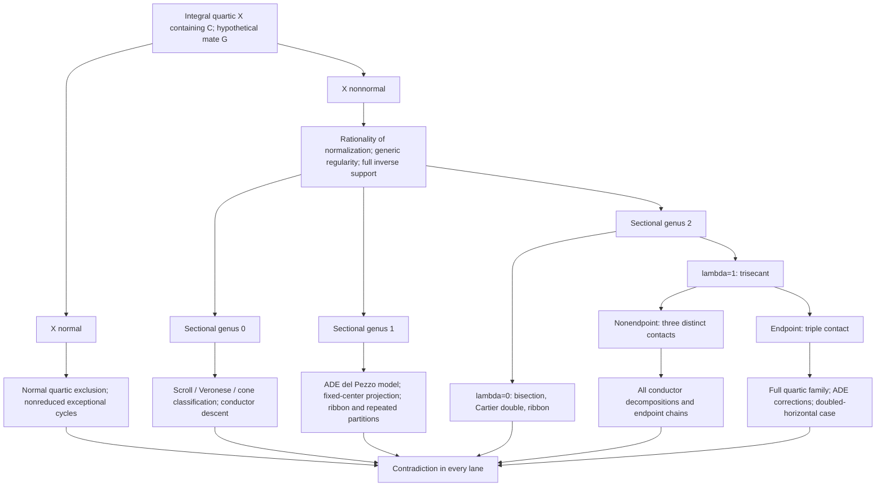

# Quartic-carrier exclusion: mathematical dependency graph

**Working consolidation document; no new theorem or proof verification.** Source authority: `research/results/quartic_carrier_exclusion.md` (R-0001), the October 11 acceptance, and its independent assembly audit. This is a **subject-organized proof map**, not a chronology or a replacement for the source arguments.

## The question

Let `C=[s^4:s^3t:st^3:t^4]` in projective three-space over an algebraically closed field of characteristic zero. Suppose an **integral quartic surface** `X` contains `C`. Can another surface `G`, of any positive degree, have set-theoretic intersection exactly `C`?

**Accepted answer (R-0001): no.** This excludes quartic carriers of arbitrary singularity and mates of arbitrary degree. It is **not** an exclusion of higher-degree carriers or a solution of the unrestricted STCI problem.

## Why normalization organizes the proof

For a nonnormal integral quartic `X`, normalize `nu:S->X`, and let `H=nu^*O_X(1)`. A general plane section of `X` has arithmetic genus 3; its normalized section has genus `pi` in `{0,1,2}`. A normal quartic is treated separately. The independent assembly audit establishes that nonnormal normalizations are rational and that generic smoothness along `C` is automatic, rather than assuming these facts.

If a mate `G` existed, the divisor of its pullback on the normalization would be supported on the single smooth lift `c` of `C` and would satisfy `div_S(nu^*G)=b c ~ bH` for `b=deg G`. **Full inverse support** is essential: isolated points above `C` cannot be discarded without the Cartier-divisor argument. The lift `c` need not be Cartier on a singular normalization.

## Proof dependency DAG

The DAG is logical, not a claim that each leaf has been independently rerun in this consolidation.

## Six lanes and indispensable proof mechanisms

| Lane | What actually excludes a mate | Source to preserve |
|---|---|---|
| Normal integral quartic | Global normal-carrier argument, including nonreduced exceptional cycles | `research/notes/2026-10-07-session-normal-global-adversarial.md`; `research/notes/2026-10-07-session-normal-nonreduced-independent-audit.md` |
| Nonnormal, `pi=0` | Classification of rational normalizations and conductor descent, including scrolls, Veronese, rational cone | `research/notes/2026-10-09-session-normalization-genus-zero-independent-audit.md` |
| Nonnormal, `pi=1` | Actual ADE del Pezzo model, fixed projection center, Cartier double/ribbon net and repeated contact partitions | `research/notes/2026-10-10-session-genus-one-interface-independent-audit.md`; `research/notes/2026-10-10-session-ribbon-repeated-partitions-independent-audit.md` |
| Nonnormal, `pi=2, lambda=0` | Second-pencil, Cartier-double and ribbon obstructions | `research/notes/2026-10-10-session-genus-two-bisection-full-independent-audit.md` |
| Nonnormal, `pi=2, lambda=1`, nonendpoint | Exhaustion of conductor decompositions and exceptional chains | `research/notes/2026-10-10-session-genus-two-nonendpoint-trisecant-continuation-independent-audit.md` |
| Nonnormal, `pi=2, lambda=1`, endpoint | Exhaustive quartic family, local ADE correction and doubled-horizontal cases | `research/notes/2026-10-10-session-genus-two-endpoint-full-quartic-reduction.md`; `research/notes/2026-10-10-session-genus-two-endpoint-full-independent-audit.md` |

**Shared inputs:** `research/notes/2026-10-09-session-nonrational-normalization-independent-audit.md` for rationality; `research/notes/2026-10-11-session-all-quartic-dependency-assembly-independent-audit.md` for full coverage, inverse support, and avoidance of circular small-degree inputs; `research/notes/2026-10-11-session-all-quartic-results-acceptance.md` for the accepted assembly.

## Distinctions that must survive rewriting

1. The sectional genus `pi` is the genus of a **normalized** general hyperplane section, not the arithmetic genus 3 of a plane quartic and not conductor degree.
2. The normalization may be singular; a proof treating only smooth scrolls does not cover the rational cone or the ADE models.
3. A curve on a singular normalization can be a smooth embedded lift without being Cartier. Local index/conductor data cannot be suppressed.
4. The genus-one projection-center condition is **deduced** from the complete anticanonical model and restriction to `c`, not assumed from a special displayed family.
5. The endpoint trisecant proof must use the **full quartic family**. The older irreducible-residual subcase is insufficient; the local ADE correction and doubled-horizontal strata are required.
6. Source-bound saved computational manifests and independent written audits are different kinds of evidence; neither should be relabeled as a fresh replay.

## What this document authorizes

It identifies the theorem's mathematical skeleton and exact supporting source families. It **does not** authorize deleting any listed source or replacing its full proof with this sketch. A permanent carrier chapter should develop the normalization, conductor and case mechanisms in coherent order, with one proof per logical claim and cross-references to the retained audits.

**Next task:** independently check the proof details and unique content of each lane, then integrate this dependency graph into the permanent carrier chapter. Other chapters may cite the theorem and explain its consequences without copying the full proof.
