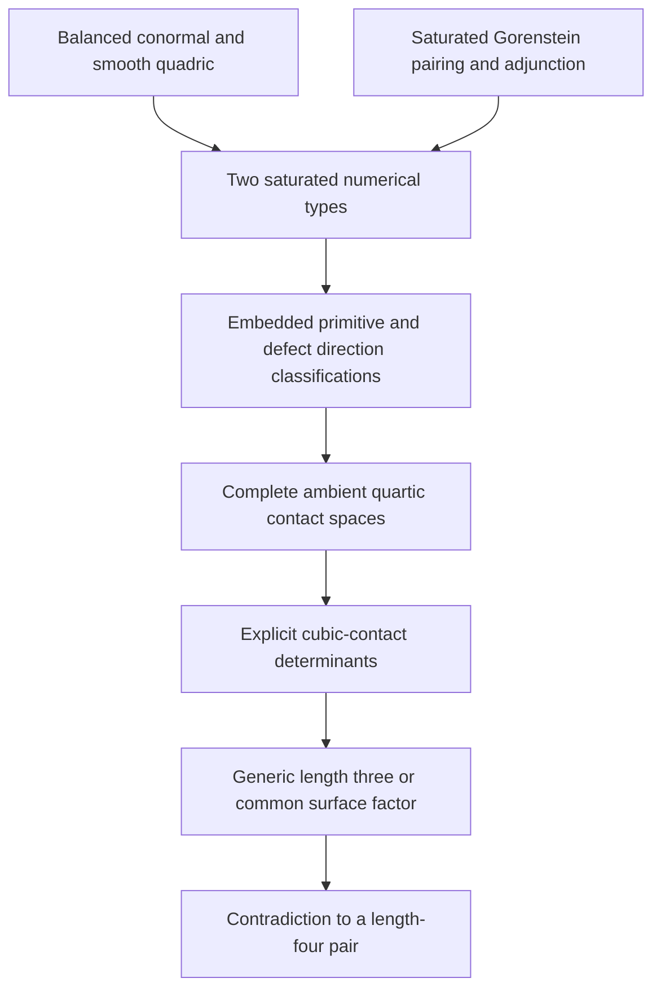
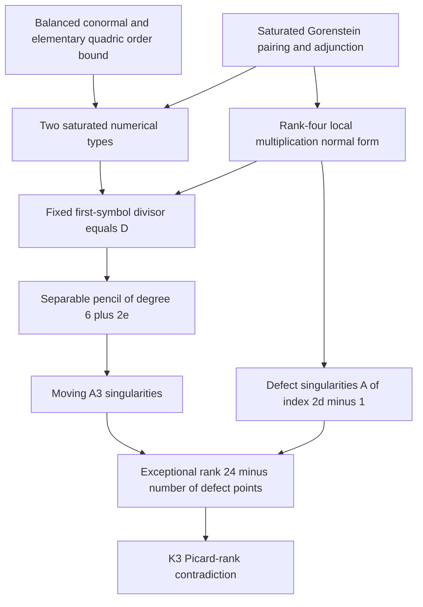

# Intrinsic (4,4) obstruction: research report and successor handoff

Date: 2026-10-23. **Independently reviewed new research evidence; no canonical theorem promotion.**

## Outcome and exact scope

The principal contribution is a new intrinsic proof that the fixed curve

\[
C=[s^4:s^3t:st^3:t^4]\subset\mathbf P^3_k
\]

cannot be the reduced support of a complete intersection of two quartics
over an algebraically closed field of characteristic zero. The proof is in
[the K3 obstruction note](2026-10-23-intrinsic-44-k3-proof-proposal.md).
It uses no classification of primitive triples, normal directions, quartic
carriers, or quartic contact pencils, and no cubic-contact nonvanishing
calculation. Its new obstruction is a surplus of exceptional curves on the
K3 resolution of a general member of the hypothetical pencil.

The proof retains the promoted balanced-conormal calculation
[STCI-R-0020](../results/quartic_conormal_characteristic_jump.md) and the
general accepted source-level
[saturated Gorenstein pairing theorem](2026-10-05-mf6-pairing-audit.md).
The latter is not a separately promoted result ID; the rank-four pairing
needed here is also reconstructed directly by its Frobenius determinant
in the new proof and audit. The unique smooth
quadric and its divisor classes give an elementary preliminary order
bound. The old exclusion [STCI-R-0001](../results/quartic_carrier_exclusion.md)
and the classified filtered proof
[STCI-R-0022](../results/quartic_44_filtered_exclusion.md) are comparison
records, not premises of the new proof. None of their status fields is
changed.

This is a proof for the degree pair (4,4). For a proper pair of quartics
containing C, it also implies that its generic multiplicity on C is at
most three: multiplicity four would exhaust the degree sixteen by
Bézout, forcing sole reduced support C. It does not exclude residual
components when the multiplicity is smaller, and it makes no claim
about arbitrary higher-degree mates or unrestricted STCI.

## The new geometric argument

Let Z be a hypothetical (4,4) complete intersection with sole support C.
Its generic transverse length is four and its dualizing sheaf is
\(\mathcal O_Z(4)\). A quartic with normal order at least two is a multiple
of \(q^2\), where \(q\) defines the unique smooth quadric. Restricting a
mate to that quadric rules out such an equation in the pair. The generic
transverse algebra is consequently curvilinear.

Let \(L=\mathcal O(e-7)\) be the first saturated layer. The conormal
quotient makes \(e\geq0\). Saturated duality gives

\[
E_2=L^2(D),\qquad E_3=L^3(D)=\mathcal O(-18),\qquad
\deg D=3-3e.
\]

Thus \(e=0\) with \(\deg D=3\), or \(e=1\) with \(D=0\). The new local
multiplication argument gives, at a defect of multiplicity d, the exact
embedded completed ideal

\[
(x^2,\ y^2-t^d x).
\]

This proves that D is exactly the fixed divisor of the first normal
symbols of the actual quartics. Removing D gives a basepoint-free pencil
of degree \(n=6+2e\) on C. Characteristic-zero separability makes a general
fiber consist of n distinct points outside D. Each gives an \(A_3\)
singularity on a general quartic member. At a defect of multiplicity d,
the general member has an \(A_{2d-1}\) singularity. The latter statement
allows arbitrary local coefficient functions in the two original
equations; it is not restricted to constant combinations of model
generators.

Writing \(r=\#\operatorname{Supp}D\), the resulting exceptional rank is

\[
3n+\sum_{p\in\operatorname{Supp}D}(2d_p-1)=24-r.
\]

It is 24 in the primitive case, and 21, 22, or 23 in the three defect
partitions. Bertini gives smoothness outside C, so the quartic has only
the isolated rational double points just described. Finite singular
locus also proves that it is integral and normal. Its minimal resolution
is a K3 surface. The independent exceptional classes contradict the
characteristic-zero bound \(\rho\leq20\); including the hyperplane class
gives the familiar stronger exceptional-rank bound of 19. The surface
facts are recorded in
[Morrison, pp. 5–6](https://web.math.ucsb.edu/~drm/conferences/ITP99/morrison/cortona.pdf)
and [Shimada, introduction](https://home.hiroshima-u.ac.jp/ichiro-shimada/preprints/RDPssK3/rdpssk3.pdf).

## Dependency diagrams and replacement audit

The old classified route, reconstructed from R0022 and its stated
evidence, is:

The new route is:

| Old ingredient | Nature and authority | Treatment in the new proof |
| --- | --- | --- |
| Conormal bundle and smooth quadric | Intrinsic embedded geometry; conormal promoted as R0020 | Retained explicitly |
| Saturated layers, Frobenius pairing, adjunction | Intrinsic local algebra and duality; accepted source-level theorem | Retained explicitly |
| Primitive e=1 direction classification | Classification-dependent accepted source evidence | Replaced by the separable first-symbol pencil and eight A3 points |
| Defect e=0 direction classification | Classification-dependent part of R0022 evidence | Replaced by the rank-four algebra normal form and defect singularities |
| Complete quartic contact matrices | Coordinate computations of actual global lifting spaces | Unneeded for the new contradiction |
| Explicit determinant nonvanishing | Exact computation plus classification exhaustion | Replaced by the K3 exceptional-rank obstruction |
| Associated graded and Rees objects | Intrinsic constructions, but not a universal length certificate by themselves | Explained in the companion contact and valuation notes |

The new proof is symmetric in the two equations: their two-dimensional
source is used as a pencil, with a general member and a complementary
generator. A local coordinate or generator is selected only to prove the
intrinsic local singularity type. No preferred global quartic is classified.

## Contact, coefficient valuations, and actual realizability

The [intrinsic cubic-contact note](2026-10-23-intrinsic-cubic-contact-construction.md)
constructs, for a pure quasiprimitive triple Y with ideal J,

\[
\mathcal M_Y=(J/I_CJ)/\mathrm{torsion},\qquad
0\longrightarrow L\otimes E_2\longrightarrow\mathcal M_Y
\longrightarrow \ker(E\to L)(-D)\longrightarrow0.
\]

The old \(h_0\tau_1-h_1\tau_0\) is the determinant of the actual ambient
source map into this rank-two bundle. Its global target is
\(\det(W)^*\otimes\det(E)\otimes L^2\otimes\mathcal O_C(8)\)
for quartics. This recovers a degree-four or degree-six determinant line,
the coordinate transformation laws, and its interpretation after two
normal-slice blowups. This construction alone does not force its
nonvanishing. The K3 proof bypasses that missing nonvanishing argument.

The [coefficient-valuation note](2026-10-23-intrinsic-coefficient-valuations.md)
distinguishes coefficient places, prolongations to an algebraic closure,
normal Gauss valuations, and ambient blowup-flag valuations. A real
weighted minimum is justified on polynomials or an explicitly restricted
series ring; it fails on arbitrary coefficient-pole series in
\(K[[u,v]]\). The intrinsic rank-two flag on
\(\operatorname{Bl}_C\mathbf P^3\supset E\supset E_p\)
retains normal order followed by coefficient order without a global
coefficient-field splitting. The mu4 calculation detects the order-three
collision of the residual branches and the characteristic-dependent
residue polynomial. Scalar ideal values alone, even over every centered
valuation, do not recover colength; a length-four versus length-three
counterexample is preserved in that note.

For completeness, the accepted quartic lifting constraints remain
available in [the characteristic/conormal source note, section 4](2026-10-23-quartic-characteristic-conormal.md).
They are not inputs to the K3 proof. In a balanced affine frame
\(U=x_3-z^4-\tfrac32z(x_2-z^3),\ V=x_2-z^3\), the actual first-symbol
image is the 17-dimensional subspace of \(H^0(E(4))\) consisting of
\(P(z)U+R(z)V\) with

\[
P_1=2R_2,\qquad P_4=2R_5,\qquad P_7=2R_8.
\]

In characteristic two the quotient coefficient has zero coefficients
of \(z^2,z^5,z^8\). In both characteristics
\(H^0(\mathcal I_C^2(4))=kq^2\). These are source-level audited explicit
global-image statements, not a claim that every abstract bundle section
lifts. The coordinate algebra is missing \(s^2t^2\) in degree one,
while it equals the full section space in degrees at least two. The new
proof avoids replacing the coordinate algebra by a full section ring:
it uses only the pencil supplied by the hypothetical equations.

## Evidence and successor handoff

The principal proof and supporting local-algebra proof are new,
unpromoted research contributions. Independent mathematical review is
recorded in
[the K3 audit](2026-10-23-intrinsic-44-k3-independent-audit.md).
The contact and valuation constructions have their own
[secondary audit](2026-10-23-intrinsic-contact-valuations-independent-audit.md).
Exact new calculation evidence and commands are collected in
[the validation record](../validation/intrinsic-44-2026-10-23/README.md).
These checks verify displayed identities and examples; the mathematical
proof supplies the universal local normal form, general-member argument,
and K3 contradiction. No inherited exclusion or classification was rerun.

The strongest new result is the complete intrinsic (4,4) proof, using
local multiplication and a global surface-rank bound. The main remaining
issue is broader scope: this argument uses the K3 nature of degree-four
surfaces, and provides no all-degree obstruction. A justified successor
task is to extract the analogous singularity budget for a higher-degree
pencil under explicitly stated curvilinear and duality hypotheses, then
compare it with the appropriate surface invariants. That is an experiment,
not a claim that the (4,4) proof already extends. Separately, the intrinsic
determinant target now makes a classification-free global-source
nonvanishing theorem a precise optional question rather than a dependency
of this exclusion.
