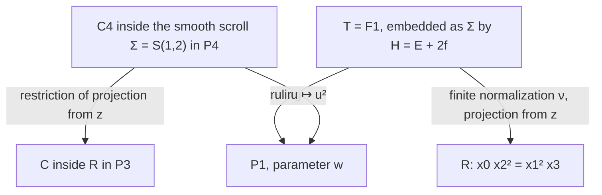

# The paired-secant cubic: smooth scroll upstairs, conductor downstairs

Date: 2026-10-24. Status: **independently reviewed provisional research with proofs; not canonical promotion**. See the [independent ruled-model audit](2026-10-24-p4-ruled-models-independent-audit.md).

Throughout Sections 1–8, \(k\) is algebraically closed of characteristic zero. We study
\[
 c([s:t])=[s^4:s^3t:st^3:t^4],\qquad
 R=V(x_0x_2^2-x_1^2x_3)\subset\mathbf P^3.
\]
This is intrinsic projective geometry, with no STCI inference. The [earlier special-lines note](2026-10-24-special-lines-planes-research-note.md), Section 5, and its [geometry audit](2026-10-24-special-lines-planes-geometry-audit.md), Section 4, give the motivating paired-secant formula. We reconstruct it and all normalization and divisor claims used here. No novelty claim is made. The general projection/cone constructions are treated in the companion notes on [resolved projection](2026-10-24-p4-resolved-projection.md) and the [cone](2026-10-24-projection-cone-ruled-model.md).

## 1. The quadric and its two rulings

Use Segre coordinates
\[
 (x_0,x_1,x_2,x_3)=(ac,ad,bc,bd)
\]
on \(Q=V(x_0x_3-x_1x_2)\cong\mathbf P^1_{[a:b]}\times\mathbf P^1_{[c:d]}\). Let \(A=(1,0)\) and \(B=(0,1)\) be the two divisor classes, with \(A^2=B^2=0\), \(A B=1\). Then
\[
 C=V(bc^3-ad^3),\quad [C]=A+3B,\quad H_Q=A+B,\quad C^2=6.
\]
The projection to \([c:d]=[s:t]\) is an isomorphism on \(C\); the projection to \([a:b]=[s^3:t^3]\) has degree three. Thus, for the ruling whose base is \(C\), \(f=B\), a chosen minimal section has class \(E=A\), and \(C=E+3f\). For the other ruling the curve is a three-section. The degree-three map has the two totally ramified fibers \(3p_0,3p_\infty\).

The unique quadric assertion follows directly from multiplication of actual sections: the ten monomials in \(\operatorname{Sym}^2\langle s^4,s^3t,st^3,t^4\rangle\) span all nine degree-eight monomials, with the sole relation \(x_0x_3=x_1x_2\). The displayed determinant is smooth. This proof does not rely on a carrier classification.

## 2. The actual ruling bundle of the cubic

At a finite nonzero parameter \(u=t/s\), the line joining \(c(u)\) and \(c(-u)\) consists of
\[
 [A:B:wB:w^2A],\qquad w=u^2.
\tag{2.1}
\]
The limiting lines at \(w=0,\infty\) are tangent trisecants. They are included using length-two subschemes, rather than by substituting coincident points in an ordinary secant formula.

Write the base as \(B_0=\mathbf P^1_{[v_0:v_1]}\), with \(w=v_1/v_0\). The two vector-valued sections spanning a ruling give the injection
\[
 \mathcal O_{B_0}(-2)\oplus\mathcal O_{B_0}(-1)
 \longrightarrow k^4\otimes\mathcal O_{B_0},
\]
whose summands map to \((v_0^2,0,0,v_1^2)\) and \((0,v_0,v_1,0)\). The vectors are everywhere independent. Consequently the line-point incidence variety is the smooth projective bundle
\[
 T=\mathbf P_{\mathrm{lines}}(\mathcal O(-2)\oplus\mathcal O(-1))
   =\mathbf P_{\mathrm{quot}}(\mathcal O(2)\oplus\mathcal O(1))
   \cong\mathbb F_1.
\tag{2.2}
\]
Here \(\mathbf P_{\mathrm{quot}}\) parametrizes one-dimensional quotients; \(\mathbf P_{\mathrm{lines}}\) parametrizes one-dimensional subspaces. The displayed equality uses duality, not an identification of the two conventions without dualizing.

Let \(E\) be the negative section, and \(f\) a ruling fiber. Then
\[
 E^2=-1,\quad E f=1,\quad f^2=0,\quad H=\mathcal O_T(1)=E+2f.
\tag{2.3}
\]
The morphism to \(\mathbf P^3\) is
\[
 \nu:T\longrightarrow R,\qquad
 [v_0:v_1;A:B]\longmapsto
 [A v_0^2:B v_0:B v_1:A v_1^2].
\tag{2.4}
\]
Fiber coordinates are interpreted in the corresponding locally trivialized summands. Equivalently use Cox degrees \(\deg A=E\), \(\deg B=E+f\), \(\deg v_i=f\); every displayed coordinate has class \(E+2f\).

Every point of the image satisfies the cubic equation. Away from \(x_1=x_2=0\), the base is recovered as \([v_0:v_1]=[x_1:x_2]\), giving birationality. The image is closed and has dimension two, hence is the irreducible cubic \(R\). No ruling is contracted, and the only non-singleton fibers are described in Section 4. In particular \(\nu\) is quasi-finite and proper, hence finite. Since \(T\) is smooth and the map is finite birational, it is the normalization. Thus the incidence is already smooth and normal; one does not need to resolve the incidence further.

## 3. The smooth cubic scroll in the same \(\mathbf P^4\)

The complete linear system \(|H|\), with \(h^0(H)=3+2=5\), embeds \(T\) as the smooth cubic rational normal scroll
\[
 \Sigma=S(1,2)\subset\mathbf P^4,
\]
with coordinates in the *same order as the rational normal quartic*
\[
 [X_0:X_1:X_2:X_3:X_4]
 =[A v_0^2:B v_0:A v_0v_1:B v_1:A v_1^2].
\tag{3.1}
\]
The standard degree-one and degree-two summands show that this morphism is an embedding; alternatively on the charts with a nonzero summand the ratios recover both the base and fiber coordinate, including their differentials. Its ideal is the three \(2\times2\) minors
\[
 X_0X_4-X_2^2,\quad X_0X_3-X_1X_2,\quad X_2X_3-X_1X_4.
\tag{3.2}
\]
The map (2.4) is projection deleting \(X_2\), from \(z=[0:0:1:0:0]\). Equation \(X_0X_4-X_2^2=0\) shows \(z\notin\Sigma\). The conic directrix \(D=V(B)\) lies in the plane \(X_1=X_3=0\), and \(z\) lies in that plane off the conic. Its secants through \(z\) explain the double line of the image.

The rational normal quartic \(C_4\) lies on this scroll. Explicitly,
\[
 [v_0:v_1]=[s^2:t^2],\qquad [A:B]=[1:st]
\]
in the corresponding homogeneous trivializations, or on \(s=1\), \(w=u^2, B/A=u\). Substitution in (3.1) gives exactly
\[
 [1:u:u^2:u^3:u^4].
\]
An invariant description is that \(\Sigma\) is swept out by the secant or limiting tangent lines of \(C_4\) associated with the involution \(u\mapsto-u\). Those lines have independent even and odd parts
\[
 (1,0,w,0,w^2),\qquad(0,1,0,w,0).
\]
Thus the two \(\mathbf P^4\) constructions coexist for an actual geometric reason: **the same embedded \(C_4\) and the same center \(z\) project simultaneously to \(C\) and \(R\)**. This is substantially stronger than an abstract dimension count for linear systems.

## 4. Singularities and the full conductor

The negative section \(E=V(A)\) maps isomorphically to the simple directrix \(V(x_0,x_3)\). The section
\[
 D=V(B),\qquad [D]=E+f,\qquad D^2=1
\]
maps to the double directrix \(L=V(x_1,x_2)\) by
\[
 [v_0:v_1]\longmapsto[v_0^2:v_1^2].
\tag{4.1}
\]
It is degree two, branched precisely at \(0,\infty\). These two branch images are \(p_0=[1:0:0:0]\) and \(p_\infty=[0:0:0:1]\).

Here is an exact local normalization and conductor calculation, including the branch points. On \(x_0=1\), put \(r=B/A, w=v_1/v_0\). Then
\[
 A_0=k[r,rw,w^2]\subset B_0=k[r,w],\qquad
 (x_1,x_2,x_3)=(r,rw,w^2).
\tag{4.2}
\]
The element \(w\) is integral, with \(w^2=x_3\), and is in the fraction field as \(x_2/x_1\). The polynomial ring \(B_0\) is normal and finite over \(A_0\), proving the normalization on the chart. The conductor is exactly
\[
 \mathfrak c_{B_0}=rB_0,\qquad
 \mathfrak c_{A_0}=(r,rw)=(x_1,x_2).
\tag{4.3}
\]
Indeed every monomial containing \(r\) belongs to \(A_0\). Modulo \(rB_0\), the extension is \(k[w^2]\subset k[w]\), and no nonzero element of the smaller ring multiplies all of the larger ring into the smaller ring: multiplication by \(w\) detects the odd part. The reverse chart \(x_3=1\) gives the same answer. Together the charts cover \(L\); away from \(L\), normalization is an isomorphism. Thus the full conductor ideal sheaf downstairs is the reduced ideal \(I_L=(x_1,x_2)\), with pullback \(\mathcal O_T(-D)\). The conductor cover is (4.1), not two globally disjoint sections.

The reduced singular locus is \(L\). The Jacobian singular subscheme in characteristic zero has homogeneous ideal, on \(R\),
\[
 (x_2^2,\ x_1x_3,\ x_0x_2,\ x_1^2).
\]
At a general point of \(L\), completion produces two smooth branches meeting transversely. At \(p_0\) the affine equation is the pinch-point equation \(x_2^2=x_1^2x_3\); the other endpoint is symmetric. The normalization is finite and contracts no curve. It should not be called a birational contraction of the conductor section.

## 5. The quartic on the normalization, and a scheme-image warning

Let \(\widehat C\subset T\) be the strict/reduced lift of \(C\). The ruling on it is the double map \(u\mapsto u^2\); hence \(\widehat C f=2\). Its hyperplane degree is four. Writing \(\widehat C=aE+bf\) gives
\[
 a=2,\quad (E+2f)(2E+bf)=2+b=4,
\]
so
\[
 [\widehat C]=2E+2f,\quad \widehat C^2=4,\quad
 \widehat C E=0,\quad \widehat C D=2.
\tag{5.1}
\]
Its homogeneous Cox equation is
\[
 B^2-A^2v_0v_1=0.
\tag{5.2}
\]
It is smooth and maps isomorphically to \(C\). Locally its equation is \(w=r^2\), which shows it meets \(D=(r=0)\) transversely at the two endpoints but is tangent to each endpoint ruling fiber. Its normal bundle in \(T\) is \(\mathcal O_{\mathbf P^1}(4)\), as a consequence of self-intersection four.

The **full scheme-theoretic inverse image** \(C\times_R T\) is larger than this Cartier curve at the endpoints. On \(x_0=1\), \(I_C\) is generated by \(x_2-x_1^3\) and \(x_3-x_1^4\), or by \(x_2-x_1^3\) and \(x_3-x_1x_2\). Pulling back using (4.2) gives
\[
 I_C\mathcal O_T=(w-r^2)(r,w)
\tag{5.3}
\]
near \(p_0\), and the analogous expression at infinity. Consequently its divisorial hull is \(\mathcal O_T(-\widehat C)\), but there is an embedded length-one defect at each endpoint:
\[
 \operatorname{length}\bigl(\mathcal O_T(-\widehat C)/(I_C\mathcal O_T)\bigr)_{p_i}=1.
\tag{5.4}
\]
The support is exactly \(\widehat C\); the finite normalization has no isolated additional inverse-image points. Statements about the “class of the inverse image” must specify the divisor/strict transform (5.1), rather than falsely asserting the full inverse ideal is invertible.

The same distinction describes the intersection of the projection cone \(S\subset\mathbf P^4\) with the smooth scroll \(\Sigma\). The cone is the inverse image of \(C\) under projection away from \(z\); since \(z\notin\Sigma\), (5.3) implies
\[
 (S\cap\Sigma)_{\mathrm{red}}=C_4,
\]
with the two embedded defects just computed in the full scheme intersection.

## 6. The restriction to the quadric

On the Segre quadric,
\[
 R|_Q=ab(bc^3-ad^3).
\]
This is an equality of Cartier divisors on the smooth quadric:
\[
 R|_Q=C+L_0+L_\infty,
\tag{6.1}
\]
where \(L_0,L_\infty\) are the two fibers of the degree-three ruling over \([a:b]=[1:0],[0:1]\). They are precisely the endpoint tangent trisecants. Each has class \(A\), so the right side has class \(3A+3B=3H_Q\), as required. Each intersects \(C\) in a length-three scheme concentrated at the corresponding endpoint. The interpretation is intrinsic: the paired-secant scroll contains the two limiting tangent trisecants, the quartic has the remaining divisor class, and degree exhausts the restriction. The factorization verifies both the multiplicities and that there is no residual curve omitted from this identity.

For comparison, pulling the quadric equation back to \(T\) gives
\[
 q|_T=v_0v_1(A^2v_0v_1-B^2),
\]
so
\[
 \nu^*Q=\widehat C+f_0+f_\infty.
\tag{6.2}
\]
Its class is \(2E+4f=2H\). Unlike the full inverse ideal of \(C\), this principal Cartier pullback has exactly the displayed divisor and no embedded zero-dimensional structure.

## 7. A natural base change, rather than an arbitrary birational comparison

The map \(C\to B_0\), \(u\mapsto u^2\), is intrinsic to the osculating involution. Pulling the ruling bundle back gives
\[
 T_C=T\times_{B_0}C
 =\mathbf P_{\mathrm{quot}}(\mathcal O_C(4)\oplus\mathcal O_C(2))
 \cong\mathbb F_2.
\]
The pullback of \(\widehat C\) factors as \((r-u)(r+u)=0\). Thus in characteristic zero it is the union of two sections, each of class \(E_2+2f\), with self-intersection two and mutual intersection two. They meet transversely once at each endpoint. This construction is natural, but the map \(T_C\to T\) has degree two; it is not an elementary transformation or a birational identification of their rulings. It explains why forcing the \(\mathbb F_1\) and projection-cone \(\mathbb F_4\) rulings to have the same base would discard meaningful data.

## 8. Characteristic-two boundary

The bundle and monomial formulas (2.2), (2.4), (3.1), and the conductor calculation (4.2)–(4.3) make sense over \(\mathbf Z_{(2)}\). Their fibers still give finite normalizations \(\mathbb F_1\to R_k\): the integral polynomial chart calculation proves this directly, without assuming that normalization commutes with base change. In characteristic two the conductor cover \(D\to L\) is purely inseparable, \(w\mapsto w^2\). The Jacobian singular scheme is then defined by \((x_1^2,x_2^2)\), rather than the characteristic-zero Jacobian ideal. The separable two-branch/pinch-point classification must not be transferred unchanged.

The smooth lifted quartic (5.2) still has local equation \(w=r^2\), but its map to the ruling base is inseparable. The base change of Section 7 gives a double section \((r-u)^2=0\), not two distinct sections. This is a concrete common construction witnessing degeneration of the paired-secant incidence: the involution \(u\mapsto-u\) specializes to the identity, while its length-two divisor \(p+(-p)\) specializes to \(2p\). Corresponding “secants” become tangent lines; their flat limiting incidence scroll remains the displayed \(\mathbb F_1\) bundle. It would be incorrect to use the set of distinct characteristic-two pairs to reconstruct this scheme family.

In fact, in characteristic two the same smooth scroll \(\Sigma\) is the tangent developable of \(C_4\): on the finite chart, \(c_4'(u)=(0,1,0,u^2,0)\), and subtracting \(u c_4'(u)\) from \(c_4(u)\) gives \((1,0,u^2,0,u^4)\). These are exactly the ruling vectors in Section 3, with \(w=u^2\). Similarly \(R\) is the tangent developable downstairs. The ruling map is inseparable, so this does not contradict the characteristic-zero nondevelopability of the paired-secant scroll.

## 9. Dependencies, review boundary, and open continuation

All normalization, conductor, divisor, and common-\(\mathbf P^4\) claims above are supplied with direct proofs. Dependencies are elementary projective-bundle intersection theory, finite birational normalization, the quadric multiplication calculation, and the length-two secant incidence; no canonical STCI theorem is invoked. The earlier provisional notes motivated the paired-secant family but did not establish the new normalization or schematic inverse-image assertions by authority.

The [independent ruled-model audit](2026-10-24-p4-ruled-models-independent-audit.md) reconstructed the conductor at the two ramification points, the embedded defects in (5.3), the same-center embedding (3.1), the double-cover base change, and the characteristic-two tangent-developable description; its substantive mathematical verdict is clean. The relation between this degree-two base change and elementary transformations of the other marked ruled surfaces is treated comparatively, rather than asserted here. A full arithmetic comparison with the \(\mu_4\) orbit family requires the separate arithmetic note; coincidence of characteristic two alone is insufficient. No new STCI result is proposed or promoted.
