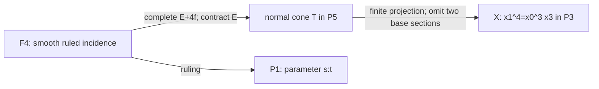
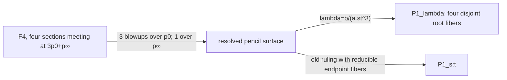

# The four-component quartic surface and its ruled model

Date: 2026-10-24. Author: independent research agent `four_sheet`.
Status: **provisional intrinsic geometry; independently reconstructed and
reviewed in the [arithmetic and normalization audit](2026-10-24-four-sheet-arithmetic-independent-audit.md)
and the [comparison audit](2026-10-24-ruled-comparison-independent-audit.md);
no canonical promotion**. Work over an algebraically closed field of
characteristic zero unless a base is specified. The arithmetic companion
[studies specialization separately](2026-10-24-ruled-surfaces-arithmetic.md).

The fixed objects are
\[
X=V(F)\subset\mathbf P^3,\quad F=x_1^4-x_0^3x_3,
\qquad C_\zeta=[s^4:s^3t:\zeta st^3:t^4],\quad\zeta^4=1.
\]
Write $p_0=[1:0]$, $p_\infty=[0:1]$ on every marked parameter line.
The purpose is the geometry of $X$, its finite normalization, and its
smooth ruled model. No carrier-exclusion theorem is used or reopened.

## 1. The ruling and the two different normalization maps

For fixed $[s:t]$, let
\[
\ell_{[s:t]}=\{[a s^4:a s^3t:b:a t^4]\mid[a:b]\text{ in the indicated fiber}\}.
\tag{1}
\]
All these lines contain $v=[0:0:1:0]$. They are the generators of the cone
over the plane quartic
\[
B=[s^4:s^3t:t^4]\subset\mathbf P^2_{x_0,x_1,x_3}.
\]
The map $\mathbf P^1\to B$ is its normalization: $u=t/s=x_1/x_0$
recovers the parameter on a dense chart, and the only singularity is
$s=0$, where $x_3=1$ gives $(x_0,x_1)=(v^4,v^3)$ with $v=s/t$.
This is the $(3,4)$ cusp. Its semigroup has gaps $1,2,5$, hence delta
invariant three, in agreement with the plane quartic arithmetic genus.

Every line (1) lies in $X$. The ruled image is an irreducible surface,
and $x_1^4-x_0^3x_3$ is irreducible; for instance it is primitive and
linear in $x_3$ over $k[x_0,x_1]$. Thus its image is exactly $X$.
The four points of the assignment are the four values $b/a=\zeta st^3$
on this generator, in compatible trivializations.

Use the **lines convention**
\[
Y=\mathbf P_{\mathbf P^1}(\mathcal O\oplus\mathcal O(-4)),
\qquad \mathcal O_Y(-1)\subset p^*(\mathcal O\oplus\mathcal O(-4)).
\]
It is also isomorphic to the quotient-convention surface
$\mathbf P(\mathcal O\oplus\mathcal O(4))$. The subbundle $\mathcal O$
defines the negative section $E$, with
\[
E^2=-4,\quad E\cdot f=1,\quad f^2=0,
\qquad H=c_1(\mathcal O_Y(1))=E+4f.
\tag{2}
\]
Indeed $N_{E/Y}=\operatorname{Hom}(\mathcal O,\mathcal O(-4))$
and $H|_E=\mathcal O$. Formula (1) defines a morphism
$\phi:Y=\mathbb F_4\to X$ by a four-dimensional subspace of $H^0(H)$.
Its negative section contracts to $v$. Therefore **this morphism is a
resolution through the normalization, and is not finite**.

The finite normalization is the normal cone over the complete rational
normal quartic:
\[
T=\operatorname{Proj} k[s^4,s^3t,s^2t^2,st^3,t^4,r]
\cong\mathbf P(1,1,4).
\tag{3}
\]
Here the six displayed generators have standard degree one; in the
weighted presentation $s,t,r$ have weights $1,1,4$. The map
$\rho:Y\to T$ is given by the complete system $|H|$ and contracts only
$E$. It is the minimal resolution of the vertex quotient singularity
$\frac14(1,1)$. In particular the Hirzebruch index is four, not three.
The complete system maps to $\mathbf P^5$, not $\mathbf P^4$.

For a direct proof of finite normalization, set
\[
A=k[s^4,s^3t,t^4,r],\qquad
\overline A=k[s^4,s^3t,s^2t^2,st^3,t^4,r].
\]
The omitted generators belong to $\operatorname{Frac}(A)$, because
$s^2t^2=(s^3t)^2/s^4$ and $st^3=(s^3t)^3/(s^4)^2$.
They are integral: $(s^2t^2)^2=s^4t^4$ and
$(st^3)^4=s^4(t^4)^3$. The fourth Veronese ring of $k[s,t]$ is normal,
and adjoining $r$ preserves normality. Thus $\overline A$ is exactly
the integral closure of $A$. This proves that $\nu:T\to X$ is finite
birational normalization, with
\[
\phi=\nu\circ\rho,\qquad \nu^*\mathcal O_X(1)=\mathcal O_T(1),
\quad\rho^*\mathcal O_T(1)=\mathcal O_Y(H).
\tag{4}
\]

## 2. Singular locus and full conductor

Differentiating $F$ in characteristic zero gives reduced singular locus
\[
\Sigma=V(x_0,x_1),
\tag{5}
\]
the generator above $p_\infty$. It includes the vertex. In the chart
$x_3=1$, away from the vertex, normalization is
\[
k[v^3,v^4,b]\subset k[v,b],\qquad
(x_0,x_1,x_2)=(v^4,v^3,b).
\tag{6}
\]
The map is one-to-one on geometric points along this line; its failure
is a transverse cusp, rather than the double-curve identification of
the cubic scroll. The normalized surface $T$ itself is smooth off its
vertex and singular at its vertex. The original $X$ is nonnormal along
all of $\Sigma$.

The **global conductor ideal** in $\mathcal O_X$ is
\[
\mathfrak c=(x_0,x_1)^2.
\tag{7}
\]
Here is a semigroup proof, which also checks the vertex. A monomial
$s^a t^b$ in the full fourth Veronese belongs to
$k[s^4,s^3t,t^4]$ exactly when, writing $j=b\bmod4$ with
$0\le j\le3$, one has $a\ge3j$. Every monomial with $a\ge6$
therefore belongs, and remains in the smaller semigroup after any
multiplication by a full-Veronese monomial. The only possible smaller
$s$-exponents in the smaller ring are $0,3,4$; each fails the conductor
condition after multiplication by a missing degree-one generator.
The conductor is monomial, since the inclusion is torus graded. Its
monomials are exactly those of $s$-exponent at least six, generated in
the smaller ring by
\[
s^6t^2=x_1^2,\quad s^7t=x_0x_1,\quad s^8=x_0^2.
\]
Polynomial extension by $r=x_2$ preserves this computation. It follows
that (7) gives the full homogeneous conductor, rather than only its
support. In (6) it becomes $v^6k[v,b]$.

On $Y$, its extended ideal is invertible and equals
\[
\mathfrak c\mathcal O_Y=\mathcal O_Y(-2E-6f_\infty).
\tag{8}
\]
Indeed its three generators are locally $a^2s^6$ times
$s^2,st,t^2$, which have no common zero on the base. The multiplicity
two on $E$ must be retained when the resolution and finite
normalization are compared.

## 3. The four sections and their exact intersections

More generally every $h\in H^0(\mathbf P^1,\mathcal O(4))$ gives a
section $D_h$ of $p$ defined by $b=a h$. It avoids $E$, and is the
image of the subbundle $\mathcal O(-4)\to\mathcal O\oplus\mathcal O(-4)$,
$w\mapsto(hw,w)$. Its class is
\[
D_h\sim H=E+4f,\qquad D_h^2=4,\qquad N_{D_h/Y}\cong\mathcal O_{\mathbf P^1}(4).
\tag{9}
\]
The $D_h$ form an affine five-space of sections; the normal-bundle
calculation gives the same unobstructed five-dimensional deformation
space. In particular the four strict transforms, or reduced inverse
images, are
\[
D_\zeta=D_{\zeta st^3}\sim E+4f.
\]
Their restrictions to $C_\zeta$ are isomorphisms, as is evident from
the parameterizations. They are disjoint from the contracted section.
For distinct fourth roots $\zeta,\eta$, their scheme intersection is
the zero divisor of $(\zeta-\eta)st^3$:
\[
(D_\zeta\cap D_\eta)|_{D_\zeta}=3p_0+p_\infty,
\qquad D_\zeta\cdot D_\eta=4.
\tag{10}
\]
This is linear equivalence, not merely numerical equivalence.

The **image curves have different intersection lengths**. On $x_0=1$,
with $u=x_1$, their ideals are
\[
I_{C_\zeta}=(x_3-u^4,\ x_2-\zeta u^3).
\]
Adding the ideals for two distinct roots gives $(x_3,u^3,x_2)$, of
length three at $p_0$. On $x_3=1$, put $b=x_2$. Their ideals are
\[
I_{C_\zeta}=(x_0-b^4,\ x_1-\zeta b^3),
\tag{11}
\]
since $\zeta^4=1$. The sum is $(x_0,x_1,b^3)$, of length three
at $p_\infty$. Hence
\[
(C_\zeta\cap C_\eta)|_{C_\zeta}=3p_0+3p_\infty,
\quad\operatorname{length}(C_\zeta\cap C_\eta)=6.
\tag{12}
\]
The two endpoints exhaust the intersection set. At infinity the
normalization separates distinct tangent directions $b=\zeta v$;
downstairs the cusp parameter $v^3$ makes the image curves tangent.
It is incorrect to transfer (10) unchanged to the images in $\mathbf P^3$.

There is one further scheme distinction. The **full scheme inverse
image** of $C_\zeta$ under normalization is not just $D_\zeta$.
In (6), the ideal pulled back from (11) is
\[
J=(v^4-b^4,\ v^3-\zeta b^3)
 =l\,(v^2+\zeta^{-1}vb+\zeta^{-2}b^2,\ b^3),
\quad l=v-\zeta^{-1}b.
\tag{13}
\]
For the equality, factor the cubics and quartics and reduce the cubic
cofactor modulo the quadratic; it becomes a unit times $b^3$.
The residual ideal in parentheses is a regular sequence of colength
six. The exact sequence
\[
0\longrightarrow (l)/J\longrightarrow k[v,b]/J
\longrightarrow k[v,b]/(l)\longrightarrow0
\]
has its left term of length six. Thus there is an embedded correction
at the cusp point, even though the reduced inverse image is the smooth
section. The same chart describes the full inverse image on $Y$,
since these points avoid $E$.

## 4. A natural pencil and the four separating blowups

Consider the whole pencil
\[
D_\lambda:\quad b=\lambda a st^3,\qquad\lambda\in\mathbf A^1.
\tag{14}
\]
It lies in $|H|$. Its member at infinity is
$E+3f_0+f_\infty$. The pencil has exactly the base scheme of length four
$3p_0+p_\infty$ on $D_0$. Resolve its rational function
\[
\lambda=\frac{b}{a st^3}
\tag{15}
\]
by three successive point blowups above $p_0$ and one blowup above
$p_\infty$. This is a natural resolution of the pencil, not four
arbitrarily chosen blowups.

Near $p_0$ the four sections have equations $b=\zeta u^3$. In the
successive charts they become
$b_1=\zeta u^2$, $b_2=\zeta u$, $b_3=\zeta$.
Thus the third blowup separates them. Near infinity they are
$b=\zeta v$, with distinct tangent directions, so one blowup separates
them. Every pair loses one unit of intersection at each of these four
common centers. The final strict transforms are disjoint curves of
self-intersection $4-4=0$, and are fibers of the resolved morphism
$\widehat Y\to\mathbf P^1_\lambda$. Their class, in the basis of total
exceptional transforms, is
\[
\widehat D=\pi^*H-e_1-e_2-e_3-e_\infty,
\qquad \widehat D^2=0.
\tag{16}
\]
The original ruling over $[s:t]$ now has reducible fibers above the
endpoints. The new map (15) supplies a different rational fibration.
The two rulings should not be conflated.

The action $b\mapsto\xi b$ fixes the base parameter and $E$, preserves
the conductor, and carries $D_\zeta$ to $D_{\xi\zeta}$.
For $\xi\in\mu_4$ it permutes the four curves. It extends through the
pencil resolution and acts on its base by $\lambda\mapsto\xi\lambda$.
Over characteristic zero, this is the usual action of four geometric
points. Over $\mathbf Z_{(2)}$ its group scheme meaning must be kept;
the [arithmetic note](2026-10-24-ruled-surfaces-arithmetic.md) treats it.

## 5. A genuine common cone with the projection construction

The common full cone $T$ from (3) has coordinates
\[
(s^4,s^3t,s^2t^2,st^3,t^4,r).
\]
The projection-cone surface of the assignment uses the subsystem
\[
(s^4,s^3t,r,st^3,t^4)
\]
and is denoted $S\subset\mathbf P^4$. The surface $X$ uses the further
subsystem $(s^4,s^3t,r,t^4)$. Thus there is an actual finite birational
projection $S\to X$, not just an abstract birational equivalence.
Its center, the omitted $st^3$ coordinate point, lies outside $S$:
the base curve $[s^4:s^3t:st^3:t^4]$ never equals that point.
A positive-dimensional projection fiber would be a line through that
center contained in $S$, which is impossible. Properness then makes
the projection finite. On $x_0=1$, its omitted coordinate is recovered as
$(t/s)^3=(x_1/x_0)^3$, so the projection is birational. Both surfaces have the same finite normalization
$T$ and the same minimal smooth ruled model $Y$.

On this common $Y$, the original rational normal quartic in the
projection construction is the graph $r=s^2t^2$; its projected copy
in the complementary hyperplane is $r=0$. The four curves in this
note are the different graphs $r=\zeta st^3$. The image of the first
of those original curves under $S\to X$ is
$[s^4:s^3t:s^2t^2:t^4]$, which is not one of the four $C_\zeta$.
The common surface and nested linear subsystems are canonical for the
fixed coordinates; identifying differently marked graph sections is an
additional operation.

The [projection-cone companion](2026-10-24-projection-cone-ruled-model.md)
explains the nonnormal vertex of $S$ and the exact distinction between
linear equivalence of graph sections on $Y,T$ and Cartier descent on $S$.

## 6. A marked elementary-transformation bridge from the quadric

This bridge requires the degree-one ruling of $Q$, an ordering of the
two endpoints, and its distinguished auxiliary section described below.
It is compatible with the marked curve; it is more specific than the
existence of a birational map between rational surfaces.

Use Segre coordinates
\[
(x_0,x_1,x_2,x_3)=(A_0B_0,A_0B_1,A_1B_0,A_1B_1)
\]
and let the ruling base be $u=B_1/B_0$. With $A=A_1/A_0$,
$Q$ is $\mathbb F_0$ over this base, its marked curve is $A=u^3$,
and its section $E_0=\{A=\infty\}$ has square zero. These are actual
ruling sections on $Q$, with
\[
H_Q=E_0+f,\qquad C=E_0+3f,\qquad C^2=6.
\]
The generic-fiber identity $b=A$ gives the rational map
\[
[1:u:A:Au]\dashrightarrow[1:u:A:u^4]\in X.
\tag{17}
\]
The transition to the finite fiber coordinate on $Y$ at infinity is
$b'=v^4A$, $v=1/u$. Four elementary transformations over that endpoint
implement it. Starting from $E_0$, blow up $E_0\cap f_\infty$ and
contract the strict transform of $f_\infty$; repeat on the new negative
section. After $j$ steps its self-intersection is $-j$ and the fiber
coordinate is $v^jA$.

For the first three steps the center also lies on the successive
transform of $C$, since $1/A=v^3$ initially. The fourth center lies on
the negative section and is disjoint from $C$. Consequently
\[
C^2:\quad6\longmapsto5\longmapsto4\longmapsto3\longmapsto4,
\]
and its classes are $E_j+3f$ for $j=0,1,2,3$, then $E_4+4f$.
The final image has local equation $b'=v$, exactly the section
$r=st^3$ of the four-component model. In the blowup/contraction formula,
a section through the center loses one in its square; a section avoiding
the center gains one when the fiber is contracted. This checks every
step of the intersection calculation.

This construction privileges one endpoint and one section $A=\infty$.
It is not invariant under the full endpoint-exchanging symmetry, and
it does not identify the original projective hyperplane classes.
The intermediate $\mathbb F_3$ is useful here, but is not the finite
normalization or minimal resolution of $X$.

## 7. Scope, evidence, and remaining questions

All bundle, normalization, conductor, intersection, and blowup statements
above are proved by the displayed constructions. The [independent comparison audit](2026-10-24-ruled-comparison-independent-audit.md)
reconstructs the pencil resolution and the marked elementary transformations.
The [central normalization audit](2026-10-24-four-sheet-arithmetic-independent-audit.md)
also checks the full inverse-image ideals as well as the reduced curve classes;
its final source comparison records no remaining discrepancy. No novelty is asserted: the normalization of cones and
Hirzebruch-surface calculations are standard mechanisms, and the package's
[literature note](2026-10-24-ruled-surfaces-literature.md) records checked references.

Characteristic-two statements do not follow by replacing the four roots
with one point. The full group scheme, orbit divisor, and the distinction
between normalization of a nonreduced fiber and normalization of its
reduction belong to the arithmetic companion. The curves $C_\zeta$ do
not lie on one common smooth quadric; each has its own $Q_\zeta$.
Their pairwise intersection in projective space was computed directly,
not by a nonexistent common-quadric intersection pairing.

No canonical STCI claim, accepted proof, excluded carrier case, or
frontier record is changed by this note.
