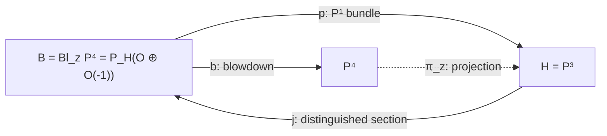
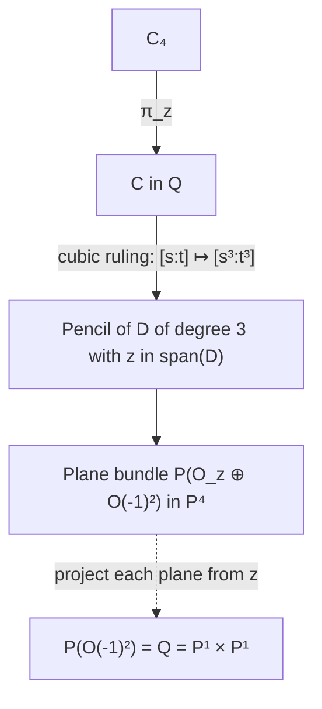

# The rational normal quartic in projective four-space and resolved projection

Date: 2026-10-24. Status: **provisional geometric research with proofs;
independent audit is recorded with the accompanying ruled-surface package;
no canonical promotion and no STCI conclusion**.

Work over an algebraically closed field of characteristic zero unless an
explicit qualification says otherwise. Put

\[
W=H^0(\mathbf P^1,\mathcal O(4)),\quad
V=\langle s^4,s^3t,st^3,t^4\rangle,\quad
m=s^2t^2,
\]
\[
C_4=[s^4:s^3t:s^2t^2:st^3:t^4]\subset\mathbf P(W^\vee),
\quad z=[0:0:1:0:0],\quad H=V(X_2).
\]

The curve in the chosen section is
\(C=[s^4:s^3t:0:st^3:t^4]\subset H\). Thus \(C_4\) and \(C\)
are different embedded curves in the same \(\mathbf P^4\).

The new constructions use only this linear system and elementary bundle
geometry. The sole retained project normal-bundle premise is
[STCI-R-0020](../results/quartic_conormal_characteristic_jump.md), in the
exact scope \(N_{C/H}=\mathcal O(7)^2\) in characteristic zero. Its
accepted proof is not rerun. The earlier
[projection note](2026-10-24-quartic-projection-automorphisms.md),
[symmetric-square note](2026-10-24-quartic-symmetric-square-bitangents.md),
and their independent audits
([projection](2026-10-24-quartic-projection-independent-audit.md),
[symmetric square](2026-10-24-quartic-symmetric-independent-audit.md))
are provisional background. Essential geometric statements needed here
are reconstructed below, rather than promoted by reference. No
normalization or STCI classification is a premise.

## 1. Conventions and the resolved projection

Throughout this note, \(\mathbf P_B(\mathcal E)\) parametrizes **lines** in
the fibers of \(\mathcal E\); its tautological subbundle is
\(\mathcal O_{\mathbf P(\mathcal E)}(-1)\subset p^*\mathcal E\).
Let \(L=k e_2\subset W^\vee\), and write \(U=V^\vee\). The chosen
hyperplane supplies \(W^\vee=L\oplus U\), with \(H=\mathbf P(U)\).
The incidence variety of a direction in \(H\) and a point on the
corresponding line through \(z\) is

\[
B=\mathbf P_H\big((L\otimes\mathcal O_H)\oplus
\mathcal O_H(-1)\big).
\tag{1.1}
\]

The bundle injection into \(W^\vee\otimes\mathcal O_H\) induces
\(b:B\to\mathbf P(W^\vee)\). On a direction \([v]\in H\), its fiber
is \(\mathbf P(L\oplus kv)\), mapped isomorphically to the joining line
\(\overline{z[v]}\). Away from \(z\), \(b\) has inverse given by the
direction of the line to \(z\). Over \(z\) it records all directions.
Equivalently, the equations of this incidence are the usual equations
\(X_i v_j=X_j v_i\) for indices \(i,j\ne2\), the graph closure of the
ideal \((X_0,X_1,X_3,X_4)\). Its affine charts are the blowup charts of
that ideal. Therefore \(b\) is exactly
\(\operatorname{Bl}_z\mathbf P^4\to\mathbf P^4\), not just a birational
map with a similar exceptional set.

The bundle projection \(p:B\to H\) resolves \(\pi_z\). Set

\[
\xi=c_1\mathcal O_B(1)=b^*c_1\mathcal O_{\mathbf P^4}(1),\qquad
h=p^*c_1\mathcal O_H(1).
\]

The exceptional section \(E_z=\mathbf P_H(L\otimes\mathcal O_H)\)
has divisor class \(\xi-h\): it is the zero divisor of the map from
the tautological line to \(p^*\mathcal O_H(-1)\). The strict transform
\(H_\infty=\mathbf P_H(\mathcal O_H(-1))\) has class \(\xi\): it is
the zero divisor of the projection of the tautological line to \(L\).
They are disjoint. Both map isomorphically to \(H\) under \(p\), while
\(b\) contracts \(E_z\) to \(z\) and maps \(H_\infty\)
isomorphically onto the original hyperplane.

Their normal bundles follow directly from the normal bundle of a line
subbundle section:

\[
N_{E_z/B}=\operatorname{Hom}(\mathcal O_H,\mathcal O_H(-1))
=\mathcal O_H(-1),
\]
\[
N_{H_\infty/B}=\operatorname{Hom}(\mathcal O_H(-1),\mathcal O_H)
=\mathcal O_H(1).
\tag{1.2}
\]

The class identities are
\(p^*\mathcal O_H(1)=b^*\mathcal O_{\mathbf P^4}(1)(-E_z)\) and
\(\xi(\xi-h)=0\). On a fiber \(\ell\cong\mathbf P^1\),
\(\mathcal O_B(1)|_\ell=\mathcal O_\ell(1)\) and
\(p^*\mathcal O_H(1)|_\ell=\mathcal O_\ell\). On \(E_z\),
\(\xi\) is trivial and \(h=\mathcal O_H(1)\); on \(H_\infty\),
both restrict to \(\mathcal O_H(1)\). These restrictions fix all signs.
For a further consistency check,
\(K_B=-2\xi-3h=-5\xi+3E_z\), as required for blowing up a point of
a fourfold.

If \(j:H\to B\) is the distinguished section, then \(p\circ j\)
is the identity. The morphism \(j\circ p:B\to H_\infty\subset B\)
is an idempotent retraction. The original rational projection is also
defined on \(\mathbf P^4\setminus\{z\}\), restricts to the identity on
\(H\), and becomes a morphism on all of \(B\). This is the precise
sense of “retraction”; it does not identify the blowdown \(b\) with the
bundle projection \(p\).

## 2. Why the projection embeds the curve and selects two points

For \(Z=[Z_0:\cdots:Z_4]\) form

\[
K(Z)=\begin{pmatrix}Z_0&Z_1&Z_2\\Z_1&Z_2&Z_3\\Z_2&Z_3&Z_4\end{pmatrix}.
\]

At a point of \(C_4\), this matrix has rank one. At every point of a
secant or limiting tangent line it has rank at most two. At \(z\) its
determinant is \(-1\). Consequently \(z\) is outside the closed secant
variety and no length-two divisor loses separation under projection.
The subsystem \(V\) is therefore basepoint free and separates every
length-two subscheme of \(\mathbf P^1\), proving that its map is a
closed immersion.

Write \(v(u)=(1,u,u^2,u^3,u^4)\), where \(u=t/s\). Solving membership
of \(e_2\) in \(\langle v,v',v''\rangle\) forces the coefficient of
\(v\) and \(v'\) to vanish, then forces \(u=0\). The reversed chart
gives the other solution \(u=\infty\). The same calculation with
\(v'''\) gives no new points. Thus the two exceptional points are
intrinsic to \((C_4,z)\):

\[
p_0=[1:0],\qquad p_\infty=[0:1],
\]
\[
z=\operatorname{Osc}^2_{p_0}(C_4)\cap
\operatorname{Osc}^2_{p_\infty}(C_4),
\]
\[
\operatorname{Osc}^2_{p_0}(C_4)=\mathbf P\langle e_0,e_1,e_2\rangle,
\quad
\operatorname{Osc}^2_{p_\infty}(C_4)=\mathbf P\langle e_2,e_3,e_4\rangle.
\tag{2.1}
\]

These second-osculating planes each project to a line. On \(C\), the
vanishing sequence at either endpoint is \((0,1,3,4)\), versus
\((0,1,2,3)\) elsewhere (the affine Wronskian is \(72u^2\)). Hence
the two points are precisely the hyperosculating points of the
projected curve. Their intrinsic characterization does not require a
complementary hyperplane.

One can alternatively use characteristic-zero apolar self-duality:
the functional \(e_2\) corresponds, up to nonzero scalar, to
\(s^2t^2\), and its root support is the endpoint pair. The factor
\(6\) in the usual binomial normalization matters in arithmetic;
neither this identification nor the derivative argument is asserted by
naive reduction in characteristic two.

## 3. The two quartics meet in a doubled endpoint divisor

The ideal of \(C\) restricts on \(C_4\) to the ideal generated by
\(X_2\). Indeed all equations in the remaining four coordinates
already vanish on their common parametrization. Hence, as a scheme,

\[
C_4\cap C=C_4\cap H=\operatorname{div}(s^2t^2)
=2p_0+2p_\infty.
\tag{3.1}
\]

This is length four, not two reduced intersection points. Near zero the
curves have parametrizations
\((u,u^2,u^3,u^4)\) and \((u,0,u^3,u^4)\) in the \(X_0=1\) chart.
Their difference first occurs at order two in the direction \(e_2\).
Their common tangent is \(\mathbf P\langle e_0,e_1\rangle\), and
their local intersection ideal on either curve is \((u^2)\).

The entire ordinary jet flags at zero are especially informative:

| Jet order | \(C_4\) in \(\mathbf P^4\) | \(C\) in \(H\subset\mathbf P^4\) |
|---|---|---|
| 0 | \(\mathbf P\langle e_0\rangle\) | \(\mathbf P\langle e_0\rangle\) |
| 1 | \(\mathbf P\langle e_0,e_1\rangle\) | \(\mathbf P\langle e_0,e_1\rangle\) |
| 2 | \(\mathbf P\langle e_0,e_1,e_2\rangle\) | \(\mathbf P\langle e_0,e_1\rangle\) |
| 3 | \(\mathbf P\langle e_0,e_1,e_2,e_3\rangle\) | \(\mathbf P\langle e_0,e_1,e_3\rangle\) |
| 4 | \(\mathbf P^4\) | \(H\) |

At infinity reverse the indices. The limiting second-osculating plane
of \(C\) at zero is its order-three jet plane
\(\mathbf P\langle e_0,e_1,e_3\rangle\), with contact four; it equals
\(H\cap\operatorname{Osc}^3_{p_0}(C_4)\). Its ordinary second jet is
only a line. This distinction prevents an incorrect assertion that the
two quartics have the same osculating plane at their tangency.

The order-two contact in (3.1) comes from the chosen section
\(m=s^2t^2\); its support happens to be the intrinsic exceptional pair
because this section is chosen in the weight-two complement. For an
arbitrary complementary hyperplane the intersection divisor changes,
as Section 6 makes explicit.

## 4. A common smooth surface and the full section family

Pull back the \(\mathbf P^1\)-bundle along \(C\hookrightarrow H\):

\[
T=p^{-1}(C)=\mathbf P_{\mathbf P^1}(\mathcal O\oplus\mathcal O(-4))
\cong\mathbb F_4.
\tag{4.1}
\]

Both strict transforms lie on this smooth surface. Its negative section
is \(E=E_z\cap T\), with \(E^2=-4\). For the fiber \(f\),
\(f^2=0\), \(E\cdot f=1\), and

\[
\tau=\xi|_T=E+4f,\qquad \tau^2=4,\qquad \tau\cdot E=0.
\]

A section disjoint from \(E\) is the graph of a bundle map
\(\mathcal O(-4)\to\mathcal O\), hence of a quartic
\(q\in H^0(\mathcal O(4))\). Its image is

\[
\Gamma_q:[s:t]\longmapsto[s^4:s^3t:q(s,t):st^3:t^4].
\tag{4.2}
\]

All these sections are linearly equivalent to \(\tau\), not just
numerically equivalent. They form the affine open \(\mathbf A^5\)
of \(|\tau|\cong\mathbf P^5\) consisting of members disjoint from
\(E\). The remaining members are \(E\) plus the four fibers cut out
by a quartic on the base, with the usual multiplicities.
The two distinguished members are \(C=\Gamma_0\) and
\(C_4=\Gamma_m\). For any distinct \(q,r\),

\[
\Gamma_q\cap\Gamma_r=\operatorname{div}(q-r),\qquad
\Gamma_q\cdot\Gamma_r=4.
\tag{4.3}
\]

This gives an intrinsic surface explanation of (3.1). Projection
\(C_4\to C\) is the restriction of \(p\), followed by the zero graph
section identifying the base with \(C\). The joining lines are exactly
the fibers of \(T\to\mathbf P^1\); their images are the lines through
\(z\), and at a zero of \(m\) the two section points coincide while
the joining fiber remains well defined. The double zero is tangency
of the two sections, not degeneration or duplication of that fiber.

The image \(S=b(T)\) is the projection cone. The map \(T\to S\)
contracts \(E\) and is an isomorphism away from \(E\). It is **not**
a finite normalization map. Moreover \(S\) is nonnormal at its vertex,
because the embedding of its base \(C\) is not projectively normal.
The precise factorization through the normal cone and the minimal
resolution is proved in the separate
[projection-cone note](2026-10-24-projection-cone-ruled-model.md).
The smooth common surface here is \(T\subset B\), not a fictitious
smooth normalization of the projective cone.

There is a further exact geometric distinction inside this section
family:

\[
q\in V \Longleftrightarrow \Gamma_q\text{ lies in a complementary
hyperplane of }\mathbf P^4,
\]
\[
q\notin V \Longleftrightarrow \Gamma_q\text{ is a rational normal
quartic spanning }\mathbf P^4.
\tag{4.4}
\]

If \(q=a m+\ell\), with \(\ell\in V\), then for \(a\ne0\) the
projectivity \((v,y)\mapsto(v,ay+\ell(v))\) fixes \(z\), induces the
identity on the quotient, and carries \(C_4\) to \(\Gamma_q\).
If \(a=0\), a shear carries \(C\) to \(\Gamma_q\). In particular
\(\Gamma_{\lambda m}\), \(\lambda\in\mathbf A^1\), is a flat
family of smooth embedded quartics on \(T\), specializing the rational
normal quartic to the quartic in \(H\). All have the same surface
normal bundle \(\mathcal O(4)\), while their ambient normal bundles
jump as follows.

## 5. Normal bundles and the normal jump

The blowdown is an isomorphism on a neighborhood of either curve,
since neither meets \(z\). Thus their normal bundles in \(B\) equal
those in \(\mathbf P^4\). With every \(\mathcal O(d)\) measured on
the parameter \(\mathbf P^1\), the data are

| Embedding | Normal bundle |
|---|---|
| \(C_4\subset\mathbf P^4\), or its strict transform in \(B\) | \(\mathcal O(6)^3\) |
| \(C\subset H\) | \(\mathcal O(7)^2\), retained promoted premise R0020 |
| \(C\subset\mathbf P^4\), or its strict transform in \(B\) | \(\mathcal O(7)^2\oplus\mathcal O(4)\) |
| Either curve in \(T\) | \(\mathcal O(4)\) |
| \(C\subset Q\) | \(\mathcal O(6)\) |

Here is a short independent proof of the first row. For
\(f_i=s^{4-i}t^i\), the restricted Euler sequence and the Euler
identity identify the conormal bundle with the kernel of

\[
\mathcal O(-4)^5\xrightarrow{(\partial_s f_i,\partial_t f_i)}
\mathcal O(-1)^2.
\]

Its three quadratic syzygies are

\[
(t^2,-2st,s^2,0,0),\quad(0,t^2,-2st,s^2,0),\quad
(0,0,t^2,-2st,s^2).
\]

Their band matrix has rank three at every point: its first three rows
are invertible when \(t\ne0\), and its last three when \(s\ne0\).
This proves \(N^*_{C_4/\mathbf P^4}=\mathcal O(-6)^3\).

The chosen splitting gives
\(T_{\mathbf P^4}|_H=T_H\oplus\mathcal O_H(1)\), proving the third
row from R0020. The fourth row follows from \(\tau^2=4\), and the
last from the graph class \((1,3)\) on \(Q\), whose square is six.

Because \(T=p^{-1}(C)\),
\(N_{T/B}=p_T^*N_{C/H}\). The section normal sequences are therefore

\[
0\to\mathcal O(4)\to N_{\Gamma_q/B}\to\mathcal O(7)^2\to0.
\tag{5.1}
\]

For \(C\), this sequence splits. For \(C_4\), its middle term is
\(\mathcal O(6)^3\), and it cannot split since
\(\operatorname{Hom}(\mathcal O(7),\mathcal O(6))=0\). The dual
surjection is, in the displayed syzygy basis,

\[
\mathcal O(-6)^3\xrightarrow{(s^2,-2st,t^2)}\mathcal O(-4),
\]

obtained by pairing with the vertical direction \(e_2\).
The shears in Section 4 consequently prove the entire family statement

\[
N_{\Gamma_q/B}=\begin{cases}
\mathcal O(7)^2\oplus\mathcal O(4),&q\in V,\\
\mathcal O(6)^3,&q\notin V.
\end{cases}
\tag{5.2}
\]

This is a concrete deformation phenomenon: the section class and
surface self-intersection stay fixed while linear normality and the
ambient normal splitting change. Infinitesimal deformations as a
section of the fixed ruled surface have tangent space
\(H^0(\mathcal O(4))\), of dimension five, and obstruction space
\(H^1(\mathcal O(4))=0\). Varying the complementary hyperplane moves
only in its four-dimensional subspace \(V\). Moving the projection
center instead has a four-dimensional ambient parameter space, and
changes the subsystem \(V\); it is a different deformation problem.
In particular these two dimension-four spaces must not be identified
because their dimensions happen to agree.

## 6. All complementary hyperplanes and their stabilizers

Every hyperplane avoiding \(z\) has a unique normalized equation

\[
H_{\ell}:X_2-\ell(X_0,X_1,X_3,X_4)=0,
\qquad\ell\in V.
\tag{6.1}
\]

Thus the set of splittings is an affine four-space, a torsor under
\(\operatorname{Hom}(U,L)\). Its strict transform is a section of
\(p\), and its restriction to \(T\) is \(\Gamma_\ell\). On \(C_4\),

\[
C_4\cap H_\ell=\operatorname{div}(m-\ell).
\tag{6.2}
\]

Equivalently these are precisely degree-four effective divisors cut
out by a quartic whose middle coefficient is nonzero, scaled to one.
A general choice has four distinct points. A nonendpoint divisor
\(4p\) also occurs, since the middle coefficient of
\((t-us)^4\) is \(6u^2\ne0\). The endpoint divisors \(4p_0\) and
\(4p_\infty\) do not occur in this affine chart. Therefore neither
the support nor the multiplicity pattern of the intersection divisor
is intrinsic to the center. The distinguished choice \(\ell=0\)
gives \(2p_0+2p_\infty\).

There are two different automorphism questions. All projectivities of
\(\mathbf P^4\) fixing \(z\) preserve the projection as a quotient
construction, while inducing arbitrary projectivities downstairs;
they form the appropriate parabolic group. If \(C_4\) is also required
to be preserved, restriction to \(C_4\cong\mathbf P^1\) identifies the
group with

\[
\operatorname{Aut}(\mathbf P^4,C_4,z)=
\{u\mapsto au,\ u\mapsto a/u\}
\cong\mathbf G_m\rtimes\mathbf Z/2.
\tag{6.3}
\]

Indeed any projectivity of the complete rational normal curve comes
from its parameter automorphism; preserving \(z\) is equivalent,
under apolarity or (2.1), to preserving the unordered endpoint pair.
Conversely such a parameter automorphism acts on the complete section
space and fixes \(z\). There is no restriction kernel, because a
projectivity fixing every point of a nondegenerate irreducible curve
must be scalar.

The chosen \(H=V(X_2)\) is preserved by all of this group: the lifts
are \(\operatorname{diag}(1,a,a^2,a^3,a^4)\) and reversal of the five
coordinates. Thus, **for this distinguished hyperplane**, the subgroup
preserving the hyperplane equals the entire group in (6.3).
For a general complement it is smaller. Writing
\(\ell=\sum_{i\in\{0,1,3,4\}}\ell_i s^{4-i}t^i\), the action on
coefficients is

\[
\ell_i\mapsto a^{2-i}\ell_i,\qquad
(\ell_0,\ell_1,\ell_3,\ell_4)\mapsto
(\ell_4,\ell_3,\ell_1,\ell_0).
\tag{6.4}
\]

These equations give the stabilizer of every choice. A nonzero
complement has torus stabilizer \(\mu_d\), where
\(d=\gcd\{|2-i|:\ell_i\ne0\}\), hence \(d=1\) or \(2\).
An endpoint-exchanging element occurs exactly when there is an
\(a\in k^*\) satisfying
\(\ell_i=a^{2-i}\ell_{4-i}\) for all four indices. A general
complement has trivial stabilizer. The equality of the two groups for
\(H\) should therefore not be generalized to all retraction sections.

## 7. The quadric as a quotient of a family of planes upstairs

The unique quadric is recovered without guessing its equation:
\(\operatorname{Sym}^2V\to H^0(\mathcal O(8))\) has monomial
weights \(0,1,2,3,4,4,5,6,7,8\). Its one-dimensional kernel is
\(x_0x_3-x_1x_2\). This gives the smooth quadric \(Q\subset H\).

A stronger incidence construction recovers its trisecant ruling.
For a degree-three divisor \(D\) cut out by

\[
g=a s^3+b s^2t+c st^2+d t^3,
\]

the plane \(\langle D\rangle\subset\mathbf P^4\) is annihilated
by \(gH^0(\mathcal O(1))\). The condition
\(z\in\langle D\rangle\) is exactly
\(z(sg)=z(tg)=0\), or \(b=c=0\). Thus all such divisors form the
cubic pencil \(\langle s^3,t^3\rangle\), not a chosen subfamily of a
larger unexamined incidence.

For \([A_0:A_1]\in\mathbf P^1\), its plane is

\[
\mathbf P\langle e_2, A_0e_0+A_1e_3, A_0e_1+A_1e_4\rangle.
\tag{7.1}
\]

The rank-three subbundle parametrizing these planes is
\(\mathcal O_z\oplus\mathcal O(-1)^2\). Quotienting the constant
center line gives \(\mathcal O(-1)^2\), whose projectivization is
\(\mathbf P^1\times\mathbf P^1\). Its map to \(H\) is

\[
([A_0:A_1],[B_0:B_1])\longmapsto
[A_0B_0:A_0B_1:A_1B_0:A_1B_1].
\tag{7.2}
\]

It is exactly the Segre embedding onto \(Q\). This constructs the
quadric as the projected incidence of all center-containing
three-point planes of \(C_4\). The curve is the graph
\([s:t]\mapsto([s^3:t^3],[s:t])\): its two ruling degrees are three
and one. Under the convention \(\mathcal O_Q(a,b)\) pulled back
from the \(A\)- and \(B\)-factors, its class is \((1,3)\), its
square is six, and its hyperplane class is \((1,1)\).
The two special fibers of the cubic map are \(3p_0\) and
\(3p_\infty\). They are another manifestation of the center-selected
pair; they do not depend on \(H\).

## 8. Secant, tangent, osculating, and bitangent incidences

There is one useful uniform construction for the line incidences.
Let \(B_2=\operatorname{Sym}^2\mathbf P^1\cong\mathbf P^2\), and
let \(\mathcal D_2\subset\mathbf P^1\times B_2\) be the universal
length-two divisor. Its tautological evaluation bundle

\[
\mathcal E_2=(\operatorname{pr}_2)_*
\big(\mathcal O_{\mathcal D_2}\otimes\operatorname{pr}_1^*\mathcal O(4)\big)
\]

has rank two and receives the surjection \(W\otimes\mathcal O\to
\mathcal E_2\). Its dual embeds in \(W^\vee\otimes\mathcal O\),
and \(\mathbf P_{B_2}(\mathcal E_2^\vee)\to\mathbf P^4\) is the
universal secant incidence, including tangent lines over the diagonal.
Since \(z\) lies on none of those lines, projection also gives an
everywhere-defined line bundle incidence and a Grassmannian morphism
\(B_2\to\operatorname{Gr}(2,V^\vee)\). Projection can identify
different lines or different parameter divisors downstairs: a
trisecant has three degree-two sub-divisors. Thus this Grassmannian
map is not an embedding. Restriction to the diagonal gives the
tangent incidence upstairs and downstairs.

For a quadratic \(h=\alpha s^2+\beta st+\gamma t^2\), the bitangent
condition is intrinsic upstairs:

\[
z\in\langle 2\operatorname{div}(h)\rangle
\Longleftrightarrow z(h^2)=0
\Longleftrightarrow\beta^2+2\alpha\gamma=0.
\tag{8.1}
\]

Here the span of the degree-four divisor is a hyperplane; this says
that it projects to a bitangent plane of \(C\). The diagonal conic
is \(\beta^2-4\alpha\gamma=0\); its intersection with (8.1) is
\((\alpha\gamma,\beta^2)\), length two at each endpoint divisor.
For finite roots \(u,v\), (8.1) is
\(u^2+4uv+v^2=0\). Hence the two partner ratios satisfy
\(\rho+\rho^{-1}=-4\), and are different from \(-1\).
The construction is a center-conditioned multiplication incidence on
the complete quartic system, rather than a new symmetry of order two.

The osculating residual relation similarly comes from
\(z\in\langle3p+q\rangle\). Away from the endpoints, the missing
coefficient of \((t-us)^3(t-vs)\) is \(3u(u+v)\), forcing
\(v=-u\). At an endpoint the same condition permits every residual
point. The **full incidence** consequently has endpoint vertical
components; the closure of its component dominating the parameter
curve is the graph of the involution \(\iota:u\mapsto-u\).
Its projected hyperplanes have sections \(3p+\iota(p)\), with
endpoint limits \(4p_0,4p_\infty\). Treating the total incidence as
only that graph would silently discard the endpoint pencils.

In \(B_2\), the unordered pairs \(p+\iota(p)\) form the line
\(\beta=0\). Restricting the universal secant incidence to this
line gives the ruled incidence whose image is the singular cubic
\(R\). Thus \(R\) is an actual image of a natural incidence
associated with \((C_4,z)\), and not merely a rational surface later
compared by a birational map. Its smooth model, conductor, and
projection from the cubic normal scroll are analyzed in the
[cubic-scroll note](2026-10-24-cubic-scroll-normalization.md).

For higher osculating incidences one uses the universal divisors
\((r+1)p\), their evaluation bundles of rank \(r+1\), and the
associated spans in \(\mathbf P^4\). Projection is regular on points
of these spans after the blowup, but its vector-space rank drops when
a span contains \(z\). The order-two drop occurs exactly at the
two points in (2.1). This explains why a uniform Grassmannian map of
projected ordinary osculating planes cannot be used at those points
without taking a flat limit or saturating the incidence.

## 9. What is intrinsic, what is chosen, and what remains open

The complete rational normal curve carries all divisor and secant
evaluation constructions. The center \(z\) selects the subsystem,
the exceptional pair, the quadric with its cubic ruling, the
osculating involution, and the bitangent conic. Choosing a
complementary hyperplane realizes the quotient target as an actual
linear subspace of \(\mathbf P^4\), and selects an intersection
divisor \(C_4\cap H'\). Its divisor \(2p_0+2p_\infty\) is special
to the distinguished splitting; the pair itself is intrinsic.

The same \(\mathbb F_4\) supports both quartics in a complete linear
system, and its section deformation exhibits the precise ambient
normal jump. The quadric arises instead by quotienting a family of
center-containing three-point planes. The cubic comes from restricting
the two-point incidence to the osculating-pair line. These are related
constructions from the same complete curve and center, with different
rank-two bundles and different parameter maps. No arbitrary birational
equivalence is needed to explain their appearance.

This note does not classify the full deformation of all these
incidences as \(z\) moves through the embedding locus, or compute a
versal deformation of their singular projective images. Those are
specific further questions. All statements here are geometric
arguments for the fixed characteristic-zero data, retained as
provisional research until the independent audit is recorded. No
novelty claim is made; the package's literature note supplies classical
context and source checks. No canonical STCI result or frontier is
modified.
