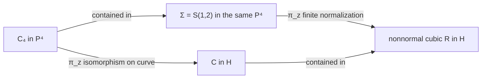

# One quartic in four-space, two projection bridges, and four ruled models

Date: 2026-10-24. Status: **provisional intrinsic geometry with proofs and
independent audits; no canonical promotion or STCI conclusion**.

The fixed characteristic-zero data are
\[
C_4=[s^4:s^3t:s^2t^2:st^3:t^4]\subset\mathbf P^4,\qquad
z=[0:0:1:0:0],\qquad H=V(X_2),
\]
and the projected curve
\[
C=[s^4:s^3t:st^3:t^4]\subset H\cong\mathbf P^3.
\]
Write \(p_0=[1:0]\), \(p_\infty=[0:1]\) on the parameter line.
Arithmetic statements below explicitly change the base to
\(A=\mathbf Z_{(2)}\). The investigation concerns these embeddings,
incidences, and surfaces for their own geometric content.

## 1. Reading route, dependencies, and review

The standalone reports provide the arguments; this synthesis compares
them and records the limits of the identifications.

| Assignment | Report and evidence |
| --- | --- |
| I: ambient blowup, the two quartics, hyperplane choices, upstairs incidences | [Resolved projection in four-space](2026-10-24-p4-resolved-projection.md) |
| II: cone, finite normalization, resolution, section family | [Projection cone](2026-10-24-projection-cone-ruled-model.md) |
| III: quadric, cubic incidence, conductor, same-center cubic scroll | [Cubic scroll](2026-10-24-cubic-scroll-normalization.md) |
| IV: common quartic cone, four sections, intersection schemes | [Four-section ruled surface](2026-10-24-four-sheet-ruled-surface.md) |
| IV: group schemes, orbit images, arithmetic normalization, contact comparison | [Arithmetic](2026-10-24-ruled-surfaces-arithmetic.md) |
| V: actual elementary transformations and the degree-two base change | [Independent comparison](2026-10-24-ruled-comparison-independent-audit.md) |
| Independent reconstruction of I–III | [Central-model audit](2026-10-24-p4-ruled-models-independent-audit.md) |
| Independent reconstruction of IV | [Four-section and arithmetic audit](2026-10-24-four-sheet-arithmetic-independent-audit.md) |
| Literature and priority limits | [Source check](2026-10-24-ruled-surfaces-literature.md) |

Retrieval followed [INDEX](../INDEX.md), the requested state/frontier
summaries, [authority rules](../AUTHORITY.md), and the
[intrinsic-geometry interlude](../INTRINSIC_GEOMETRY_INTERLUDE_2026-10-24.md).
The earlier October 24 projection, symmetric-square, and special-lines
notes and audits are provisional evidence. Essential formulas used here
are reconstructed in the new notes. Two promoted inputs are retained
only in their exact scopes: [R0020](../results/quartic_conormal_characteristic_jump.md)
for \(N_{C/\mathbf P^3}=\mathcal O(7)^2\) in characteristic zero,
and [R0021](../results/quartic_mu4_degeneration.md) for flatness and
geometric fibers of the prescribed pair \((F,G)\). No accepted carrier
classification, lifting obstruction, or STCI nonexistence result is
needed for the new constructions.

All new identifications remain research proposals even when independently
verified. The audits distinguish initial independent reconstruction from
comparison against the completed author texts. Symbolic checks support
the arguments; they do not supply the normalization, completeness, or
global incidence proofs by themselves.

## 2. The ambient construction is a resolved retraction

With projectivization parametrizing **lines**, one has
\[
B=\operatorname{Bl}_z\mathbf P^4
=\mathbf P_H(\mathcal O\oplus\mathcal O(-1)),
\qquad p:B\to H,\qquad b:B\to\mathbf P^4.
\]
Set \(\xi=b^*\mathcal O_{\mathbf P^4}(1)\) and
\(h=p^*\mathcal O_H(1)\). The exceptional divisor has class
\(\xi-h\) and normal bundle \(\mathcal O_H(-1)\); the strict transform
of the distinguished hyperplane has class \(\xi\) and normal bundle
\(\mathcal O_H(1)\). The projection \(p\) restricts to the identity
on that section, while \(b\) maps each bundle fiber to the corresponding
line through \(z\). These are different morphisms.

On the smooth surface \(p^{-1}(C)=\mathbb F_4\), the two curves are
graphs of \(0\) and \(m=s^2t^2\) in \(\operatorname{Tot}\mathcal O(4)\).
Both belong to \(|E+4f|\), have square four, and intersect in
\(2p_0+2p_\infty\). Their tangents agree at those two points;
their ordinary second jets differ. The complete curve retains a plane,
whereas the projected curve has a line as its second jet and a limiting
osculating plane with contact four. The normal bundles in \(\mathbf P^4\)
are respectively \(\mathcal O(6)^3\) and
\(\mathcal O(7)^2\oplus\mathcal O(4)\).

This is part of a full five-dimensional graph family
\(q\in W=H^0(\mathcal O(4))\). The complementary hyperplanes form only
the four-dimensional subfamily \(q\in V\). A graph with \(q\notin V\)
spans \(\mathbf P^4\); a graph with \(q\in V\) is a hyperplane-contained
copy of the projected quartic. Thus the common linear system also
exhibits an explicit jump of ambient normal bundles without changing
the smooth surface normal bundle \(\mathcal O(4)\).

Every complementary hyperplane has equation \(X_2-\ell=0\), \(\ell\in V\),
and cuts \(C_4\) in \(\operatorname{div}(m-\ell)\). This divisor is
usually four distinct points. The exceptional unordered pair itself is
intrinsic to \((C_4,z)\): its second-osculating planes are the only ones
containing \(z\). Their intersection is \(z\). The special double-double
hyperplane divisor uses the chosen splitting. The group preserving
\((C_4,z)\) is \(\mathbf G_m\rtimes\mathbf Z/2\); it also preserves
the distinguished \(H\). A general complementary hyperplane has trivial
stabilizer in that group.

## 3. A comparison table with the actual normalizations

For each smooth ruled surface below, \(E^2=-n\), \(E\cdot f=1\),
and \(f^2=0\). On \(\mathbb F_0\) a minimal section is chosen from
one ruling. The column labelled quartic gives the **strict or reduced
lift**, not an assertion that its full inverse-image ideal is invertible.

| Projective image | Base and smooth ruled model | Hyperplane pullback | Marked quartic class; square | Exceptional/conductor geometry |
| --- | --- | --- | --- | --- |
| \(Q\subset H\) | Degree-one ruling base \(C\); \(\mathbb F_0\), \(E^2=0\) | \(E+f\), square 2 | \(E+3f\); square 6; section | Smooth embedding; opposite ruling has degree 3 on \(C\) |
| Projection cone \(S\subset\mathbf P^4\) | Base \(C\); \(\mathbb F_4\), \(E^2=-4\) | \(E+4f\), square 4 | Both \(C\) and \(C_4\): \(E+4f\); square 4 | Contract \(E\) to normal cone \(T\), then finite \(T\to S\); conductor is reduced vertex downstairs, length 2 upstairs |
| Cubic \(R\subset H\) | Base \(C/\iota\), \(u\mapsto u^2\); \(\mathbb F_1\), \(E^2=-1\) | \(E+2f\), square 3 | \(2E+2f\); square 4; bisection | \(\mathbb F_1\to R\) itself is finite normalization; conductor \(D=E+f\) maps 2:1 to double line, branched at endpoints |
| Quartic \(X=V(F)\subset H\) | Base \(C\); \(\mathbb F_4\), \(E^2=-4\) | \(E+4f\), square 4 | Each \(C_\zeta\): \(E+4f\); square 4 | Contract \(E\) to \(T\), then finite \(T\to X\); full conductor \((x_0,x_1)^2\), extending to \(\mathcal O(-2E-6f_\infty)\) |

Here the common finite normalization of the two cones is
\[
T=\mathbf P(1,1,4)
=\operatorname{Proj}k[s^4,s^3t,s^2t^2,st^3,t^4,r].
\]
It is singular at its vertex. Neither cone has a smooth finite
normalization. For \(X\), the singular locus downstairs is the line
\(x_0=x_1=0\); its transverse local ring on \(x_3=1\) is
\(k[v^3,v^4,b]\subset k[v,b]\), with conductor \(v^6\).
For \(S\), the only singular point is its vertex.

The symmetric quartic \(V(G)\) is obtained by reversing the four
coordinates. It has the corresponding \(\mathbb F_4\) model with the
endpoints interchanged; the smooth-model section intersection becomes
\(p_0+3p_\infty\). The pair \((F,G)\) selects the two ordered variants.

## 4. Two genuine projection bridges

The first bridge consists of a contraction followed by finite birational
projections, all with one smooth ruled model:
\[
\mathbb F_4\longrightarrow T\longrightarrow S\longrightarrow X.
\]
The complete system has coordinates
\((s^4,s^3t,s^2t^2,st^3,t^4,r)\).
The map to \(S\) omits \(s^2t^2\); the further map to \(X\) omits
\(st^3\). The latter projection center is outside \(S\). The original
two graph sections are \(r=0,m\); the four-component configuration is
\(r=\zeta st^3\). The common surface does not identify these differently
marked curves.

The second bridge uses the **same** \(C_4\) and center \(z\) in the
original \(\mathbf P^4\). The lines joining \(C_4(u)\) and
\(C_4(-u)\), including their limiting tangents, sweep the smooth cubic
scroll
\[
\Sigma=S(1,2):\quad
X_0X_4-X_2^2=X_0X_3-X_1X_2=X_2X_3-X_1X_4=0.
\]
It contains \(C_4\), avoids \(z\), and projects finitely onto \(R\).
Restoring the missing coordinate in the normalization of \(R\) gives
exactly this scroll, rather than an unrelated copy of \(S(1,2)\).

The projection cone and the cubic scroll meet in reduced support
\(C_4\), but their full scheme intersection has an embedded correction
of length one at each endpoint. On a normalization chart of \(R\),
\[
(x_1,x_2,x_3)=(a,aw,w^2),\qquad
I_C\mathcal O_{\mathbb F_1}=(w-a^2)(a,w).
\]
This proves the correction and identifies the divisorial hull with
the strict quartic. On the quadric, by contrast, there is the exact
Cartier-divisor identity
\[
R|_Q=C+L_0+L_\infty.
\]
The residual lines are the two limiting tangent trisecants, each with
multiplicity one. These are actual curves downstairs; the embedded
endpoint corrections in the other intersection are zero-dimensional.

## 5. Natural elementary transformations, with their choices retained

There is a marked birational comparison from the actual quadric to the
four-section model. Use its degree-one ruling parameter \(u=t/s\),
fiber coordinate \(v=A_1/A_0\), and \(C:v=u^3\). The generic-fiber
map sends
\[
[1:u:v:uv]\dashrightarrow[1:u:v:u^4]\in X.
\]
At \(u=\infty\), four elementary transformations centered successively
on the chosen section \(v=\infty\) yield the \(\mathcal O(4)\)
transition \(q_\infty=u^{-4}v\). The first three centers are on
the marked curve, and the fourth is off it. Its squares are
\[
6\longrightarrow5\longrightarrow4\longrightarrow3\longrightarrow4,
\]
with classes \(E_j+3f\) for \(j\leq3\), then \(E_4+4f\).
For a curve of multiplicity \(m\) at a center on the negative section,
the full class rule is
\[
aE+bf\longmapsto aE'+(b+a-m)f,\qquad
(D')^2-D^2=a^2-2am.
\]
This chain respects the curve and base ruling, but uses an ordered
endpoint. The section \(v=\infty\) is its endpoint tangent trisecant
\(L_\infty\), so it is intrinsic once that endpoint is chosen.
The chain does not preserve the
two projective hyperplane systems.

There is a different useful comparison for the entire four-section
configuration. Resolve the graph pencil \(q=\lambda h\), \(h=st^3\),
by three blowups over \(p_0\) and one over \(p_\infty\).
The strict transforms of the four sections are disjoint, of square zero,
and become fibers of the pencil morphism to \(\mathbf P^1_\lambda\).
If one also contracts the successive old ruling fibers, one obtains
\(\mathbf P^1_u\times\mathbf P^1_\lambda\), with four constant sections
\(\lambda=\zeta\). This second \(\mathbb F_0\) is not the marked
pair \((Q,C)\): its marked sections have square zero, while \(C^2=6\)
on \(Q\).

The cubic ruling behaves differently: its quartic is a bisection. A
birational map over an isomorphism of bases cannot turn that degree two
into degree one. There is instead the natural degree-two base change
\[
\mathbb F_2=\mathbb F_1\times_{\mathbf P^1_{u^2}}\mathbf P^1_u.
\]
The cubic hyperplane pulls back to \(E_2+4f\), and the pullback of its
marked bisection splits into two sections of class \(E_2+2f\), meeting
in \(p_0+p_\infty\).
This proves a ruling-compatible incidence relationship without
asserting a birational identification of all marked models.

## 6. The four sections and their arithmetic degeneration

On the common \(\mathbb F_4\), the four sections have graph equations
\(q=\zeta h\), \(h=st^3\). Their pairwise intersection divisor is
\(3p_0+p_\infty\); their image curves in \(\mathbf P^3\) meet in
\(3p_0+3p_\infty\). At the cusp endpoint the full inverse ideal of
one curve also has an embedded correction: if \(b=x_2\), \(v=s/t\),
and \(l=v-\zeta^{-1}b\), then
\[
I_{C_\zeta}\mathcal O_{\mathbb F_4}
=l\,(v^2+\zeta^{-1}vb+\zeta^{-2}b^2,b^3).
\]
The residual ideal has colength six. Thus the strict divisor class
in the table cannot be substituted for its full scheme inverse image.

Over \(A\), the group scheme \(\mu_4\) acts by fiber scaling.
The flat divisor \(D_M:q^4-h^4=0\) is the scheme image of
\(\mathbf P^1_A\times\mu_4\to M\), \(q=\lambda h\).
At an endpoint the individual point orbit is a reduced point, although
the fiber of the flat divisor over that endpoint has length four.
In characteristic two the group scheme has length four and one
geometric point, and \(D_{M,k}=4C_1\).

After the explicitly stated splitting extension to \(A[i]\), pairwise
intersections of labelled sections acquire a vertical component as well.
With \(\pi=1-i\), their divisor on either arithmetic section is
\[
3[p_0]+[p_\infty]+v_\pi(\zeta-\eta)[\mathbf P^1_k].
\]
The vertical multiplicity is one for adjacent fourth roots and two for
opposite roots. Thus specializing only the generic horizontal divisor
would omit part of the incidence.

The surface family has finite normalization
\(T_A=\mathbf P_A(1,1,4)\); its explicit semigroup construction does
commute with the two arithmetic fibers. The reduced total curve family
has normalization
\[
\mathbf P^1_A\sqcup\mathbf P^1_A\sqcup\mathbf P^1_{A[i]}.
\]
Its special fiber is
\[
\mathbf P^1_k\sqcup\mathbf P^1_k\sqcup
\mathbf P^1_{k[\epsilon]/(\epsilon^2)}.
\]
Its reduction consists of three disjoint projective lines, while its
third connected component has a nilpotent thickening from ramification.
It is quite different from the single normal curve
\(D_k^{\mathrm{red}}\cong\mathbf P^1_k\).
Normalization therefore fails to commute with this curve specialization.

There is also a proved, choice-dependent common construction connecting
the contact correspondences to these sections. Write an ordered contact
pair as \(v=\lambda u\). Bitangency gives
\(T_B:\lambda^2+4\lambda+1=0\); the osculating residual multiplier
is \(-1\). Map these multiplier schemes into the same graph family by
\[
q=\lambda^3st^3.
\]
Cubing maps \(T_B\) isomorphically to
\(\eta^2+52\eta+1=0\), since \(\lambda^3=15\lambda+4\) and
15 is a unit in \(A\). On the special fiber it gives the actual
inclusion \(\mu_2\subset\mu_4\), hence \(2C_1\subset4C_1\).
There is no such inclusion generically; the bitangent multipliers have
infinite order there. The base torus defining contact graphs and the
fiber-scaling torus are different actions, compared by this explicit
weight-three map.

The cubic scroll has a separate compatible arithmetic construction:
its ruling cover becomes inseparable, the two sections of the
\(\mathbb F_2\) base change become a double section, and \(\Sigma\)
becomes the tangent developable of \(C_4\) in characteristic two.
These statements use the bundle and derivative equations, rather than
coincidence of characteristic or the counting of geometric points.

## 7. Why these indices and these occurrences of four appear

The uniform framework is a curve mapping to a Grassmannian and the
projectivization of its rank-two tautological subbundle. In each
construction here the normalized parameter curve is \(\mathbf P^1\),
so its rank-two bundle splits and its projectivization is a Hirzebruch
surface. For the degree-one quadric ruling it is
\(\mathcal O(-1)^2\); for the projection or quartic-cone ruling it is
\(\mathcal O\oplus\mathcal O(-4)\); for the paired-secant ruling it is
\(\mathcal O(-2)\oplus\mathcal O(-1)\). Their index differences are
respectively zero, four, and one. This gives more information than the
abstract classification of rational ruled surfaces: the summands record
the actual directing curves or fixed vertex.

The degree four of the embedded curve determines the \(-4\) section
of its cone resolution and the intersection degree of graph differences.
The four components come from the fourth-power equation and \(\mu_4\),
an additional feature of the prescribed \((F,G)\). The divisors \(2+2\)
and \(3+1\) encode the specific sections \(s^2t^2\) and \(st^3\).
Downstairs lengths \(3+3\) incorporate the cusp conductor. These
numbers have identifiable mechanisms, but are not all the same invariant.
For a cone over a smooth rational curve of degree \(d\), the same bundle
argument gives \(\mathbb F_d\); a root-of-unity configuration requires
a separately specified power equation.

The catalecticant cubic controls secant avoidance of the projection
center, the smooth cubic scroll controls the osculating-pair incidence,
and the projected cubic has a double directrix. These are distinct cubic
objects. The discriminant value \(I^3/J^2=27\) retains its previous
binary-quartic meaning; this work produces no relation to the twenty-seven
lines on a smooth cubic surface. The [literature check](2026-10-24-ruled-surfaces-literature.md)
places the constructions in their classical setting and makes no novelty
claim.

## 8. Evidence, settled questions within this package, and next work

The [exact Python verifier](../computations/verify_p4_ruled_surfaces_2026_10_24.py)
and its [JSON output](../computations/p4_ruled_surfaces_2026_10_24.json)
record nineteen finite checks. The
[independent Macaulay2 replay](../computations/verify_p4_ruled_surfaces_2026_10_24.m2)
and [output](../computations/p4_ruled_surfaces_2026_10_24_m2.txt)
check elimination and endpoint ideals. Reproduce with
`/tmp/stci-z4-env/bin/python research/computations/verify_p4_ruled_surfaces_2026_10_24.py`
and `M2 --script research/computations/verify_p4_ruled_surfaces_2026_10_24.m2`
from the repository root. The Python script also accepts a JSON destination;
its header documents the precise invocation. These scripts check the new
identities only; accepted STCI proofs are not rerun.

Within this fixed setup the projective-bundle identifications, finite
normalizations, divisor classes, conductors, intersection multiplicities,
projection bridges, elementary transformations, and stated arithmetic
models have explicit arguments and independent review. They are established
within a provisional research package, without canonical promotion.
No additional conjecture is needed for these calculations.

The most promising further questions are geometric extensions of the
verified constructions:

1. Vary the center through the embedding locus outside the catalecticant
   cubic. Determine which center-conditioned two- and three-point
   incidences remain rational, and how their rank-two bundle splittings
   and conductors change. The fixed-center results do not classify that
   family.
2. Formulate the weight-three arithmetic contact/section comparison
   without choosing an ordered endpoint or a choice between \(F\) and
   \(G\). The explicit chosen-coordinate comparison is proved; descent
   to an unordered construction is open here.
3. Study the local deformations of \(S\), \(X\), and \(R\) together
   with their conductor data, comparing the five section directions with
   moving the projection center. Equal dimensions of some parameter
   spaces do not identify their deformation functors.
4. Compare these exact marked equations with the classical directing-curve
   classifications in Edge and Semple–Roth. The source check records
   which texts were inspected and which full scans remained inaccessible.

The earlier unrestricted STCI question and accepted frontier retain their
recorded status. This package changes neither and opens no excluded
carrier case.
