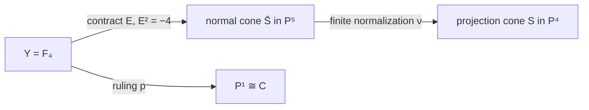

# The projection cone: normalization, the fourth Hirzebruch surface, and its sections

Date: 2026-10-24. Status: **provisional proved arguments, independently
reviewed as recorded in the package audit; no canonical promotion**.

Throughout, \(k\) is algebraically closed of characteristic zero. The
curve is the fixed

\[
C=[s^4:s^3t:st^3:t^4]\subset H=\{X_2=0\}\subset\mathbf P^4,
\]

the other curve is \(C_4=[s^4:s^3t:s^2t^2:st^3:t^4]\), and

\[
z=[0:0:1:0:0],\qquad S=\bigcup_{p\in\mathbf P^1}\overline{zC_4(p)}
 =\operatorname{Cone}_z(C).
\]

The source dependencies are the [research protocol](../INDEX.md), the
[contribution instructions](../CONTRIBUTING_AGENT.md), and the setup of the
[earlier projection note](2026-10-24-quartic-projection-automorphisms.md).
The bundle construction, normalization, conductor, and section claims
are reconstructed below. No STCI result or carrier exclusion is used.
The [resolved-projection report](2026-10-24-p4-resolved-projection.md)
places this surface inside the ambient blowup.

## 1. Projectivization and the morphism

Use the **lines** convention: \(\mathbf P_B(\mathcal E)\) parametrizes
one-dimensional subspaces of \(\mathcal E\); its tautological subbundle
is \(\mathcal O(-1)\). Put

\[
B=\mathbf P^1,\quad L=\mathcal O_B(-4),\quad
Y=\mathbf P_B(\mathcal O_B\oplus L),\quad p:Y\longrightarrow B.
\]

Evaluation embeds \(L\) in the constant four-dimensional vector space
whose projectivization is \(H\). Together with the constant line \(kz\),
this gives a fiberwise injective bundle map

\[
\mathcal O_B\oplus L\hookrightarrow k^5\otimes\mathcal O_B.
\]

Its projectivization is a morphism \(\rho:Y\to\mathbf P^4\), with
image \(S\). On \(s\ne0\), set \(u=t/s\), choose the evaluation frame
\(v_0=(1,u,u^3,u^4)\) for \(L\), and write a line in the bundle as
\([a:b]\), meaning the vector \(az+bv_0\). Then

\[
\rho(u,[a:b])=[b:bu:a:bu^3:bu^4]. \tag{1}
\]

The expression is a local formula; \(b\) transforms when the evaluation
frame changes. In particular it is not a formula on an untwisted
product \(B\times\mathbf P^1\).

Let

\[
E=\mathbf P_B(\mathcal O_B),\qquad f=\text{class of a fiber},\qquad
\xi=c_1(\mathcal O_Y(1)).
\]

The section \(E\) maps to \(z\), and

\[
N_{E/Y}=\mathcal H om(\mathcal O_B,L)=\mathcal O_B(-4).
\]

Consequently \(Y\cong\mathbb F_4\), with

\[
E^2=-4,\quad E\cdot f=1,\quad f^2=0,\qquad
\boxed{\xi=E+4f},\qquad \xi^2=4. \tag{2}
\]

Indeed \(\xi\cdot f=1\) and \(\xi|_E=\mathcal O_E\), which determine
the displayed class. The pullback of \(\mathcal O_{\mathbf P^4}(1)\)
is precisely \(\mathcal O_Y(1)\). Off \(E\), a point of \(S\setminus\{z\}\)
determines its ruling line, because its projection to \(H\) lies at a
unique point of the embedded smooth curve \(C\). Formula (1) then gives
an inverse. Thus \(Y\setminus E\cong S\setminus\{z\}\).

There is no additional singular locus away from \(z\). The distinction
between finite normalization and contraction at \(z\), however, is
essential.

## 2. The image cone is not normal

Write \(x_0,x_1,x_2,x_3\) for the four coordinates of \(C\subset H\),
and let \(r=X_2\) be the cone coordinate, all of degree one. The
homogeneous coordinate ring is

\[
A[r],\qquad
A=k[s^4,s^3t,st^3,t^4]\subset k[s,t]^{(4)}=:T,
\]

where a form of degree \(4n\) has degree \(n\). The omitted element
\(h=s^2t^2\) is integral over \(A\), since

\[
h^2=x_0x_3=x_1x_2.
\]

Furthermore

\[
hx_0=x_1^2,\quad hx_1=x_0x_2,\quad
hx_2=x_1x_3,\quad hx_3=x_2^2. \tag{3}
\]

All degree-two monomials in \(s,t\) of total degree eight occur in \(A\):
the sums of two exponents in \(\{0,1,3,4\}\) exhaust \(0,\ldots,8\).
Induction gives every degree \(4n\) monomial for \(n\ge2\). Hence

\[
T=A\oplus kh\quad\text{as graded vector spaces},\qquad
T/A\cong k(-1).
\]

The fourth Veronese ring \(T\) is normal: in characteristic zero it is
the invariant ring of the scalar \(\mu_4\)-action on \(k[s,t]\), or
equivalently its monomial semigroup is saturated in its own lattice.
It follows that \(T[r]\) is the integral closure of \(A[r]\).

The **finite normalization** is therefore

\[
\nu:\overline S=\operatorname{Proj}T[r]\longrightarrow S.
\tag{4}
\]

The normal surface \(\overline S\) is the complete projective cone
over the rational normal quartic, embedded in \(\mathbf P^5\) by the
six coordinates

\[
(s^4,s^3t,s^2t^2,st^3,t^4,r).
\]

Abstractly it is the weighted projective plane
\(\mathbf P(1,1,4)\): its fourth Veronese gives exactly this embedding.
It is singular at its vertex. On the chart \(r\ne0\), its local cone is
\(\operatorname{Spec}T\), the cyclic quotient of type \(\frac14(1,1)\).

The complete system \(|\xi|\), with

\[
h^0(Y,\mathcal O_Y(\xi))=1+h^0(B,\mathcal O_B(4))=6,
\]

contracts exactly \(E\) and maps \(Y\) to \(\overline S\). Thus the
factorization is

The map \(Y\to\overline S\) is the minimal resolution: its exceptional
locus consists of the single \((-4)\)-curve and has no exceptional
\((-1)\)-curve. The composite \(Y\to S\) is a resolution of the
nonnormal surface, **not its finite normalization**. The five-dimensional
subsystem \(kr\oplus V\subset kr\oplus W\), rather than the whole
complete system, is responsible for the nonnormal image.

## 3. Conductor and descent at the vertex

The conductor ideal in \(A\) is the positive-degree ideal
\(\mathfrak m=(x_0,x_1,x_2,x_3)\). A constant cannot be in the conductor,
because multiplying it by \(h\) leaves \(A\); every positive-degree
element is in it by (3) and the degree calculation. After adjoining \(r\),
the conductor is \(\mathfrak m[r]\). Downstairs its projective subscheme
is the **reduced vertex**. Upstairs,

\[
T[r]/\mathfrak mT[r]\cong k[r,h]/(h^2),
\]

so the conductor subscheme on \(\overline S\) has length two at the
vertex. It is not the reduced vertex. Its inverse-image ideal on \(Y\)
is \(\mathcal O_Y(-E)\): in (1) the four \(x_i\) have their common
factor \(b\), and the evaluation sections have no common zero.

These conductor schemes also explain a useful distinction between
linear equivalence upstairs and downstairs. The conductor square has
residue rings \(k\subset k[\epsilon]/(\epsilon^2)\). Its units give
the exact sequence

\[
0\longrightarrow\mathbf G_a(k)\longrightarrow
\operatorname{Pic}(S)\longrightarrow\operatorname{Pic}(\overline S)
\longrightarrow0. \tag{5}
\]

Here both projective integral surfaces have only constant global units,
and the conductor schemes have trivial Picard groups. This is a
statement about Picard groups of this fixed surface over \(k\); no
general representability assertion is needed. The group
\(\operatorname{Pic}(\overline S)\cong\mathbf Z\) is generated by its
hyperplane: on the resolution a descending line bundle has degree zero
on \(E\), hence has class \(a(E+4f)\), and this class does descend.

In particular two sections can be linearly equivalent on the smooth
model and on the normal cone while having distinct line bundles on
\(S\). The pair in the assignment is an explicit instance in Section 4.

## 4. Two quartics as sections of the same complete system

The projected curve \(C\) is the section
\(\mathbf P_B(L)\), namely \(a=0\). It has class
\(\xi=E+4f\). Every homomorphism

\[
q:L\longrightarrow\mathcal O_B,
\qquad q\in H^0(B,\mathcal O_B(4))=W,
\]

gives a graph line subbundle \(L\to\mathcal O_B\oplus L\), and hence
a section \(D_q\) disjoint from \(E\). Conversely every section disjoint
from \(E\) arises this way: its projection to \(L\) is an isomorphism
of line bundles. Thus these sections are the affine space \(W\cong
\mathbf A^5\), the open set of \(|\xi|\cong\mathbf P^5\) whose members
are disjoint from \(E\).

For \(q=s^2t^2\), formula (1) becomes the complete rational normal
quartic \(C_4\). Therefore

\[
\widetilde C=D_0,\qquad
\widetilde C_4=D_{s^2t^2},\qquad
[\widetilde C]=[\widetilde C_4]=E+4f,
\]

and

\[
\widetilde C^2=\widetilde C_4^2=
\widetilde C\cdot\widetilde C_4=4. \tag{6}
\]

These are linearly equivalent, not merely numerically equivalent,
on \(Y\). Their actual intersection subscheme projects isomorphically
onto the divisor

\[
\operatorname{div}(s^2t^2)=2p_0+2p_\infty. \tag{7}
\]

Indeed in a graph chart their equations are \(y=0\) and \(y=q\), so
their intersection is \((y,q)\). This proves (7) scheme-theoretically
and shows why the two sections are tangent at the two endpoints.
Their common normal bundle in \(Y\) is \(\mathcal O_B(4)\).

Since both curves avoid the exceptional section, their intersection
schemes on \(Y\), \(\overline S\), and \(S\) agree. Nevertheless their
linear equivalence does **not** descend from \(\overline S\) to \(S\).
Both image curves are Cartier on \(S\), since they avoid the vertex,
and \(C\) is a hyperplane section. If \(C_4\sim C\) on \(S\), then
\(C_4\) would be a hyperplane section as well. But

\[
H^0(S,\mathcal O_S(1))=kr\oplus V
\]

has dimension five, and no hyperplane in \(\mathbf P^4\) contains the
linearly nondegenerate \(C_4\). This is impossible. One way to justify
the displayed space of sections is that the ring \(A[r]\) has depth at
least two at its irrelevant ideal (the new variable is regular), so
its degree-one piece is already saturated. Equivalently the missing
section \(h\) fails to be regular at the vertex, exactly as (3) shows.
The difference lies in the additive kernel in (5).

The ruling \(p\) restricts to isomorphisms from both sections to \(B\).
After identifying \(B\) with \(C\), the resolved projection
\(\widetilde C_4\to C\) is exactly this restriction. More precisely
the ambient resolved projection on \(Y\) factors as

\[
Y\xrightarrow{p}B\xrightarrow{c}C\hookrightarrow H.
\]

It is not a contraction of the curve \(C_4\); it forgets its graph
coordinate along each joining line.

## 5. All complementary hyperplanes and all section intersections

A hyperplane of \(\mathbf P^4\) avoiding \(z\) has a unique equation

\[
r-\ell(x_0,x_1,x_2,x_3)=0,
\qquad \ell\in V.
\]

Its strict transform meets \(Y\) in the graph section \(D_\ell\).
Consequently the complementary-hyperplane family is the **affine
four-space \(V\)** inside the full affine five-space \(W\) of sections.
The rational normal curve \(C_4=D_{s^2t^2}\) lies outside that
four-space. It is a member of the complete system on the normal cone,
but not of the subsystem defining \(S\subset\mathbf P^4\).

For any \(q_1\ne q_2\in W\),

\[
D_{q_1}\cap D_{q_2}\cong
Z(q_1-q_2)\subset B. \tag{8}
\]

Every such pair has total intersection length four, with multiplicities
given by the zeros of the difference section. In particular

\[
C_4\cap H'\quad\leftrightarrow\quad
Z(s^2t^2-\ell).
\]

As \(H'\) varies, these are exactly the quartic divisors whose defining
section has nonzero middle coefficient, normalized to one. A general
one consists of four distinct points; special ones can have many other
multiplicity patterns. The divisor \(2p_0+2p_\infty\) belongs to the
chosen splitting \(r=0\). The unordered endpoint pair itself is
intrinsic to \(z\), recovered as the two points whose second-osculating
planes on \(C_4\) contain \(z\). Thus section intersections offer a
marked realization of the pair, not a characterization independent of
the hyperplane choice.

## 6. Deformations and the universal incidence

For each graph section,

\[
N_{D_q/Y}\cong\mathcal O_B(4),\quad h^0=5,\quad h^1=0.
\]

The embedded section deformations in the fixed smooth surface are
unobstructed, and the graph family \(W\) realizes all their local
parameters. Complementary ambient hyperplanes realize only four of
these five directions. This difference is visible globally through
the missing degree-one section and the conductor.

Moving the center is a different deformation problem. The admissible
centers outside \(\sigma_2(C_4)\) form an open set of dimension four in
\(\mathbf P^4\). Their ruled incidence surfaces still have abstract
type \(\mathbb F_4\), since the projected evaluation line has degree
\(-4\). The dimension of this center family differs from that of the
section family; there is no identification of the two tangent spaces.
The special center orbit preserving the binary-quartic root type
\((2,2)\) has dimension two, an additional restriction.

There is nevertheless a common universal construction. Over

\[
B\times U,\qquad U=\mathbf P^4\setminus\sigma_2(C_4),
\]

let \(\mathcal Z\) be the tautological center line pulled back from
\(U\), and let \(\mathcal L\) be the evaluation line
\(\mathcal O_B(-4)\) pulled back from \(B\). Since no center belongs
to \(C_4\), their sum injects into the constant ambient vector bundle.
The incidence variety

\[
\mathcal Y=\mathbf P_{B\times U}(\mathcal Z\oplus\mathcal L)
\]

parametrizes a parameter point, a center, and a point on their joining
line. It carries the center section and the \(C_4\) section. A
complementary hyperplane supplies a third section by intersecting each
joining line. Restricting to a fixed center and a fixed splitting gives
the graph construction above. Varying a section in a fixed ruled
surface and varying the incidence surface with its center are therefore
related through a universal incidence, without being the same problem.

## 7. A concrete bridge to the common quartic surface

The [four-section surface note](2026-10-24-four-sheet-ruled-surface.md)
studies \(F=x_1^4-x_0^3x_3\). The relation to this cone is an actual
linear projection, not just the rationality of the two surfaces. In
the complete normalized cone's coordinates

\[
(s^4,s^3t,s^2t^2,st^3,t^4,r),
\]

the surface \(S\) retains
\((s^4,s^3t,st^3,t^4,r)\), while \(V(F)\subset\mathbf P^3\) retains
\((s^4,s^3t,r,t^4)\). Dropping the \(st^3\) coordinate gives a
morphism \(S\to V(F)\): its projection center is outside \(S\).
It has no positive-dimensional fiber, since such a fiber would be a
line through that center contained in \(S\), forcing the center into
the closed surface. It is generically birational, because on
\(s\ne0\) the coordinate ratio \(s^3t/s^4\) recovers \(u\), and
the remaining fiber coordinate is \(r\). Hence it is finite birational.

Both images thus have the same finite normalization and the same
smooth ruled resolution:

\[
\mathbb F_4\longrightarrow\overline S
\longrightarrow S\longrightarrow V(F).
\]

The distinguished section configurations differ. The present pair has
graphs \(0,s^2t^2\) and divisor \(2p_0+2p_\infty\). The four curves
of the explicit quartic pair have graphs \(\zeta st^3\), with pairwise
intersection divisor \(3p_0+p_\infty\) on this common smooth model.
The further projection can enlarge intersection lengths in its image;
the four-section note distinguishes those image schemes from (8).

## 8. Scope, audit, and continuation

The central claims are explicit bundle, ring, and divisor computations
for this fixed projection. They establish the smooth ruled model,
finite normalization, conductor schemes, complete graph family, and
intersection divisors. They do not assert a normalization theorem for
arbitrary projections or a general elementary-transformation relation
among every ruled surface in the assignment. The shared complete cone
and the finite map to \(V(F)\) give a specific relationship compatible
with their rulings. The independent audit checks the normalization,
conductor, and divisor conventions; the package synthesis records its
exact scope and any remaining questions. No mathematical statement is
promoted to the canonical STCI record.
