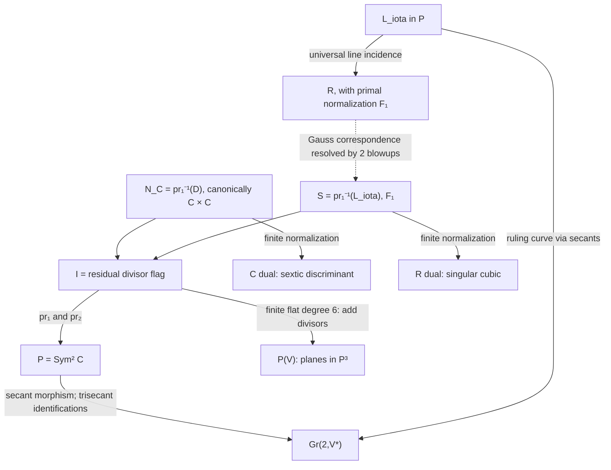

# One divisor flag, two ruled surfaces, and three duals

Date: 2026-10-24. **Status: new proved propositions and exact algebraic
certificates in an independently reviewed provisional geometry package;
no canonical promotion.** Throughout the main argument, the field is
algebraically closed of characteristic zero and
\[
C=[s^4:s^3t:st^3:t^4]\subset\mathbf P^3.
\]
This investigation studies its projective geometry for its own sake.

## 1. What unifies the constructions

The most economical common source is addition of degree-two divisors on
the parameter curve, restricted to its marked hyperplane system. It
produces a smooth flag threefold \(\mathcal I\), containing two naturally
marked ruled surfaces: the conormal normalization of \(C^\vee\), and
the normalization of the dual cubic \(R^\vee\). The same line in the
symmetric square that gives the second surface also parametrizes the
rulings of the primal cubic \(R\).

This supplies actual morphisms and controlled correspondences, rather
than a marked isomorphism between unrelated product surfaces. In
particular the conormal surface has a canonical product description
through residual intersection with a conic. Its two distinguished
sections are the diagonal and the graph of the osculating involution.
Residual swap on the threefold remains a different operation.

The second common source is the classical discriminant identity for the
marked binary-quartic system. It identifies the cubic dual with the
restricted invariant locus \(J=0\), and determines the full intersections
of the three dual surfaces, including their endpoint multiplicities.
These two constructions explain the geometry more effectively than
abstract ruled-surface classifications alone.

## 2. Dependencies, authority, and reading route

The checkout starts at current main \(320dbd8\), containing merged PRs
#71–#74. The [research index](../INDEX.md), [state](../STATE.md),
[frontier](../FRONTIER.md), [authority policy](../AUTHORITY.md),
[interlude](../INTRINSIC_GEOMETRY_INTERLUDE_2026-10-24.md), and
[discussion reconciliation](2026-10-24-discussion-reconciliation.md)
were consulted before the investigation. Navigation and discussion
records are not theorem authority.

The retained geometry is the exact fixed-embedding description in the
[special-lines note](2026-10-24-special-lines-planes-research-note.md)
and its [geometry audit](2026-10-24-special-lines-planes-geometry-audit.md),
the [automorphism/bitangent synthesis](2026-10-24-quartic-automorphisms-bitangents-synthesis.md),
and the [merged ruled-surface synthesis](2026-10-24-p4-ruled-surfaces-synthesis.md)
with its linked independent audits. These are previously reviewed
**provisional geometry**, not promoted result records. We retain their
unique quadric, group, secant fibers, projection center, and actual cubic
normalization. The only promoted bundle input used for comparison is
[R0020](../results/quartic_conormal_characteristic_jump.md), the stated
characteristic-dependent conormal splitting. Its proof is not rerun.

The supporting investigations are:

| Note | Main contribution and evidence type |
| --- | --- |
| [Flag incidence](2026-10-24-quartic-flag-incidence.md) | Global construction, finite fibers, swap, contact structure, automorphisms; proofs and exact checks |
| [Conormal and residual geometry](2026-10-24-quartic-conormal-residual-geometry.md) | Canonical product, distinguished sections, residual double cover and higher contact; proofs and exact checks |
| [Cubic scroll and Gauss duality](2026-10-24-cubic-scroll-gauss-dual.md) | Dual equation, normalization, Gauss resolution and elementary transformations; proofs and exact checks |
| [Dual intersections](2026-10-24-quartic-dual-intersections.md) | Global intersection ideals and endpoint inverse-ideal corrections; proofs and exact checks |
| [Dual singular scheme](2026-10-24-quartic-dual-singular-scheme.md) | Full Jacobian scheme, generic transverse structures and embedded endpoint points; local algebra and exact certificates |
| [Independent audit](2026-10-24-quartic-flag-duality-independent-audit.md) | Independent reconstruction, boundary checks, and separate algebra replay |
| [Literature context](2026-10-24-quartic-flag-duality-literature.md) | Primary-source comparison and explicit access limits; no novelty claim |

None of these new propositions has been promoted to a canonical result.
The proofs and review establish the scope of this package; passing scripts
are not substitutes for the global arguments.

## 3. The flag is global, with six-sheeted multiplication

Put \(U=H^0(\mathbf P^1,\mathcal O(2))\),
\(W=H^0(\mathbf P^1,\mathcal O(4))\), and
\(V=\langle s^4,s^3t,st^3,t^4\rangle\). The plane
\(P=\operatorname{Sym}^2C=\mathbf P(U)\) parametrizes effective
divisors, including doubled points. Write \(z:W\to W/V\) for the
quotient to the missing coefficient. Multiplication defines
\[
b_z(h,k)=z(hk),\qquad
\mathcal I=\{([h],[k]):b_z(h,k)=0\}.
\]

**Proposition.** This is the secant–plane flag incidence over arbitrary
base schemes. Both projections to \(P\) are projective-line bundles,
and \(\mathcal I\simeq F(1,2;3)\).

**Proof.** For a universal degree-two divisor \(D\), hyperplane
sections containing its secant or tangent are exactly sections vanishing
along \(D\). Dividing by its universal quadratic gives its residual
degree-two divisor. Thus the scheme is the fiber product of divisor
addition \(P\times P\to\operatorname{Sym}^4C\) with
\(\mathbf P(V)\). In coefficients \(h=\alpha s^2+\beta st+\gamma t^2\)
and \(k=A s^2+Bst+Ct^2\), its equation is
\(\alpha C+\beta B+\gamma A=0\). The pairing has determinant
\(-1\); it identifies the second plane with the dual of the first,
giving the ordinary point–line flag incidence. This proves globality
also on nonreduced boundary divisors. \(\square\)

For a varying codimension-one subsystem, the same conclusion holds
precisely when its multiplication pairing is nondegenerate. A radical
pair gives a singular point otherwise. The abstract flag forgets the
marked diagonal conic and hyperplane map; its much larger automorphism
group is not the embedded curve's automorphism group.

The morphism
\[
f:\mathcal I\longrightarrow\mathbf P(V),\qquad(D,E)\longmapsto D+E
\]
is finite flat of degree six: divisor addition is finite between smooth
fourfolds and has six choices of a two-point sub-divisor over four
distinct points, and \(f\) is its base change. Over a quadruple root its
fiber is a length-six scheme, rather than a single reduced point. Its
ramification divisor is the resultant \(\operatorname{Res}(h,k)=0\)
of class \((2,2)\), and its branch support is \(C^\vee\). A general
double-root section has two simple ramification points, so the pushed
ramification cycle is \(2[C^\vee]\).

The residual involution \(\tau(D,E)=(E,D)\) fixes the **scheme**
\[
\mathcal B=\{(D,D):z(h^2)=0\},\qquad
\beta^2+2\alpha\gamma=0.
\]
It is the smooth bitangent conic in characteristic zero; its hyperplane
image is the quartic of bitangent planes. The flag carries its usual
contact distribution, and \(\tau\) preserves it. The fixed conic is
Legendrian. The degree-three quotient by swap parametrizes unordered
partitions into two pairs, rather than a conormal surface.

The secant morphism \(\sigma:P\to\operatorname{Gr}(2,V^*)\) is
not injective. Retaining the audited secant fibers, a general trisecant
has three inverse pairs and an endpoint tangent trisecant has one inverse
point of scheme length three. The map
\((D,E)\mapsto(\sigma(D),f(D,E))\) normalizes the ordinary incidence
of secant lines and containing planes and retains exactly these fibers.
Forgetting \(D\) therefore loses geometric information even when the
plane is also remembered.

## 4. Conormal geometry from the polar geometry of one conic

Let \(\mathcal D\subset P\) be the conic of doubled points,
\(\beta^2-4\alpha\gamma=0\). There is a canonical identification
\[
N_C=\operatorname{pr}_1^{-1}(\mathcal D)\subset\mathcal I,
\quad(p,H)\longmapsto(2p,H|_C-2p).
\]
Its finite map to \(C^\vee\) is birational, since a general tangent
plane has one double contact, and its source is smooth. It is therefore
the normalization, in the stated characteristic-zero scope.

**Proposition.** The marked pairing and doubled-point conic give a
canonical product \(N_C\simeq C\times C\). The residual map
\(r:N_C\to P\) is a double cover whose deck transformation exchanges
the two factors. Its ramification section is \(p\mapsto T_pQ\).

**Proof.** For residual divisor \(E\), its \(b_z\)-polar line meets
\(\mathcal D\) in \(2p\) and one residual point \(2p'\). This
constructs the second factor, including the tangent case \(p=p'\),
by the universal degree-two divisor on the smooth conic. Conversely the
chord or tangent of \(\mathcal D\) through \(2p,2p'\), identified
with its polar point, recovers \(E\). In affine coordinates \(u,u'\)
the residual quadratic is
\[
k(v)=v^2+\frac{u+u'}2v+uu'.
\]
Thus factor exchange is the deck involution. Its diagonal has residual
\(v^2+uv+u^2\), and
\((v-u)^2(v^2+uv+u^2)=(v-u)(v^3-u^3)\), precisely the tangent
quadric section. \(\square\)

Let \(a,b\) be the two ruling classes, with \(a\) a fiber of the
contact-point projection. Then
\[
r^*\mathcal O_P(1)=\mathcal O(1,1),\qquad
\nu_C^*\mathcal O_{\mathbf P(V)}(1)=\mathcal O(3,1).
\]
Both distinguished sections have class \((1,1)\), square two, and
intersect simply at the two endpoints:
\[
\sigma_Q=\Delta_C,\qquad
\sigma_O=\Gamma_\iota,\qquad \iota(u)=-u.
\]
Their images are distinct quartics and meet to order three at each
endpoint in dual space. Images and normalization intersections therefore
have different scheme structures.

This also separates three operations. The osculating involution is an
automorphism of \(C\); the bitangent relation has two generic partners;
\(\tau\) exchanges two degree-two factors on a threefold. The conormal
deck involution exchanges \(p,p'\), and restricts on \(\Gamma_\iota\)
to \(\iota\), giving a genuine relation without identifying these maps.
The intersection \(N_C\cap\tau(N_C)\) records ordered bitangent
contacts \((2p,2q)\), not the swap-fixed factorization \((p+q,p+q)\).

There is no isomorphism over \(C\) carrying \(\sigma_Q\subset N_C\)
to \(C\subset Q\): their squares are two and six. Normal lines in
the blowup exceptional divisor and conormal covectors in this incidence
are different bundle data. Quadric polarity does not overcome this
marked intersection-theoretic obstruction.

## 5. The same flag also normalizes the cubic dual

Let \(L_\iota\subset P\) be the line of pairs \(p+\iota(p)\),
including the two endpoint double points. Its secants sweep the known
cubic \(R=V(x_0x_2^2-x_1^2x_3)\). The surface
\[
\mathscr S=\operatorname{pr}_1^{-1}(L_\iota)\subset\mathcal I
\]
is a projective-line bundle with splitting difference one, hence
\(\mathbb F_1\). It parametrizes all planes through these rulings.

**Proposition.** Restriction \(f|_{\mathscr S}\) is the finite
normalization of the dual cubic
\[
R^\vee=V(AC^2+B^2D)\subset\mathbf P(V).
\]

**Proof.** A factorization with one even quadratic can be written
\((1+zv^2)(A+Bv-Azv^2)\). Its coefficient vector is
\([A:B:Bz:-Az^2]\), on the displayed cubic. The image is a surface;
its hyperplane class on \(\mathbb F_1\) has square three, so the
finite map is birational onto the irreducible cubic. Independently, the
Gauss map of the primal ruling \([a:b:zb:z^2a]\) is
\([z^2b:-2z^2a:2za:-b]\), and fills its plane pencil for general
\(z\). Thus this image is the actual dual of the projected singular
cubic, rather than the dual of the embedded scroll in four-space.
\(\square\)

The dual cubic has a double line and two pinch points; its smooth finite
normalization is \(\mathbb F_1\). The Gauss map pulled back to the
**primal** normalization is rational, with two reduced basepoints at
the conductor endpoints. Blowing them up resolves it. Contracting the
strict endpoint ruling fibers gives \(\mathscr S\), the **dual**
normalization. These are two elementary transformations. The original
conductor becomes the target negative section, and the original negative
section becomes the target conductor. It is a birational correspondence
of marked ruled surfaces, not an everywhere defined isomorphism.

Off the endpoints, the Gauss trace along \(C\) is the osculating plane.
The whole dual cubic contains many other tangent planes. In the flag,
\(N_C\cap\mathscr S\) is precisely the two endpoint pencil fibers,
because \(\mathcal D\cap L_\iota\) consists of the endpoint double
points. The osculating quartic is a common **image** of the two surfaces;
its two flag markings differ away from the endpoints.

The last arrow denotes the Gauss construction through the primal
normalization and its resolution. It is not a morphism from the singular
cubic everywhere. \(Q^\vee\) embeds in the same plane parameter space
\(\mathbf P(V)\); its distinguished trace is the image of \(\sigma_Q\).
There is no map from all of \(N_C\) to \(Q^\vee\) asserted here.

## 6. Three duals through two invariant identities

Write a hyperplane section as \(A+Bu+Cu^3+Du^4\), and put
\[
M=AD-BC,\quad L=BC-4AD,\quad
K=AC^2+B^2D,\quad T=AC^2-B^2D.
\]
Then \(Q^\vee=V(M)\), \(R^\vee=V(K)\), and the dual sextic is
\[
\boxed{\Delta=-4L^3-27K^2
       =4M(8AD+BC)^2-27T^2.}
\]
Indeed the classical binary-quartic invariants restrict to
\(I=-3L\), \(J=-27K\), and
\(\Delta=(4I^3-J^2)/27\). Thus the dual cubic is the restricted
\(J=0\) locus. Direct expansion proves the second identity as well.

The identities give **equalities of scheme ideals**:

| Full intersection | Scheme and interpretation |
| --- | --- |
| \(C^\vee\cap R^\vee\) | \((K,L^3)\): triple Cartier divisor of osculating quartic plus \(\ell_0+\ell_\infty\) on \(R^\vee\) |
| \(C^\vee\cap Q^\vee\) | \((M,T^2)\): double Cartier divisor of quadric-tangent quartic plus \(\ell_0+\ell_\infty\) on \(Q^\vee\) |
| \(R^\vee\cap Q^\vee\) | \((M,K)\): reduced union of a third smooth quartic and \(\ell_0+\ell_\infty\) |

Here \(\ell_0=V(A,B)\) and \(\ell_\infty=V(C,D)\). Reducedness
of the underlying divisors and absence of extra embedded components in
these complete intersections are proved in the supporting notes.
The ideal notation retains their endpoint structure, beyond the cycle
multiplicities three, two, and one. For an individual distinguished
quartic the full inverse ideal on a scroll can still have an endpoint
correction; it must not be replaced by its Cartier hull.

A plane on a general endpoint pencil line is tangent to \(C\) and
\(Q\) at different points. On \(R\), that line records limiting
tangent planes at its singular pinch point; following smooth points of
\(C\) selects only the unique osculating limit. Thus full dual
intersections exceed common-point conormal traces. The reduced common
intersection of all three duals is the two pencil lines, not a common
distinguished quartic.

The reduced singular locus of \(C^\vee\) is the previously recorded
union of the osculating and bitangent quartics and the two pencil lines.
The new scheme calculation is stricter. The saturated gradient ideal
has Hilbert polynomial \(16n-43\); its unmixed curve has polynomial
\(16n-45\), with one embedded length-one point at each hyperosculating
plane. Generically the osculating curve and pencil lines carry the
length-two Jacobian structure of a transverse cusp, while the bitangent
curve has the reduced Jacobian structure of a transverse node. Explicit
local algebra, a Hilbert–Burch presentation, and an independent exact
replay establish the endpoint correction. The cuspidal expression for
\(\Delta\) alone does not make the entire surface a cusp product;
the critical behavior of the invariant map matters.

## 7. Symmetry, endpoints, and higher contact

The retained embedded automorphism group is
\(G=\mathbf G_m\rtimes\mathbf Z/2\), preserving the unordered
endpoint pair. Its simultaneous action on both divisor factors preserves
\(b_z\) up to scalar, hence the entire flag, its contact distribution,
the factorization map, both marked ruled surfaces, and all the displayed
correspondences. It commutes with residual swap. On the canonical
\(C\times C\) conormal model its action is diagonal. The focused flag
note gives the fixed schemes for every torus element, reflection,
residual swap, and their combinations; choosing one bitangent multiplier
breaks the endpoint-exchange symmetry.

The two endpoints recur for a single geometric reason: the marked center
selects this exceptional unordered pair, and the doubled-point conic is
tangent to the bitangent conic there. They are also the two fixed points
of \(\iota\) and the intersection of \(L_\iota\) with the doubled
conic. Accordingly they appear as degenerate secants, extra triple-contact
fibers, conductor pinch points, Gauss basepoints, and embedded points in
the dual singular scheme. These occurrences are compatible constructions;
their numerical lengths are not interchangeable.

There is a modest higher-contact extension already on \(N_C\). The
third-contact locus is the Cartier divisor
\[
T_{\geq3}=f_0+f_\infty+\sigma_O.
\]
The resultant ramification of \(f\), restricted to \(N_C\), is
\(2T_{\geq3}\): a doubled factor gives
\(\operatorname{Res}(\ell_p^2,k)=k(p)^2\). This relates the
factorization cover to osculation without identifying its ramification
surface with \(N_C\). The fourth-contact jet incidence has length two
at each hyperosculating point, although its support is two points. These
schemes come from principal-parts evaluation; ordinary derivative ranks
alone would miss the boundary structure. A full theory of nested divisor
flags is a next question, not an assertion of this package.

## 8. Characteristic boundary and a short roadmap

The flag pairing has determinant \(-1\), so the smooth flag and divisor
addition survive in characteristic two. Its swap-fixed scheme becomes
the double line \(\beta^2=0\). The doubled-point map from \(C\) is
then inseparable onto a line, so the conic-polar product construction
fails. The conormal surface is \(\mathbb F_2\), and its map to the
reduced cubic dual of \(C\) is purely inseparable of degree two; it is
not a normalization map. In coordinates \(\Delta\bmod2=K^2\).

There is a second distinction: the actual dual of the cubic \(R\) in
characteristic two is the line \(B=C=0\), since its gradient has only
first and last entries. The cubic special fiber of the characteristic-zero
equation for \(R^\vee\) is therefore not that actual dual. These exact
boundary identities do not extend the characteristic-zero assertions
about normalization, Gauss birationality, or intersection multiplicities.

The most promising continuations are small enough to be precise:

1. **Vary the projection center.** Nondegeneracy of the middle
   multiplication pairing preserves the abstract flag. Study how the
   doubled conic, swap-fixed conic, marked lines, and residual double
   cover vary together. The identification of a restricted invariant
   cubic with this scroll dual is special and requires a fresh argument
   for another center.
2. **Study the three-pair quotient.** Its degree-three map to hyperplane
   space is the natural resolvent construction. Relate its quotient
   singularities and discriminant to the two distinguished ruled
   surfaces, retaining the length-six fiber over a hyperosculating plane.
3. **Extend contact through divisor flags.** Use principal-parts or nested
   Hilbert schemes to organize orders two, three, and four, including the
   nonreduced fourth-contact endpoints. Compare that scheme with the
   embedded correction in the dual Jacobian, without assuming they are
   identical.
4. **Compare the classical sources more completely.** The inspected
   modern sources place the ingredients in standard theory; unavailable
   classical scans leave priority questions open. No novelty claim or
   general classification is made.

No conjecture is needed for the fixed characteristic-zero propositions
above. Variation of the center, quotient geometry beyond the stated local
model, and a systematic higher-contact theory remain research questions.
Canonical STCI records and their scopes are unchanged.
