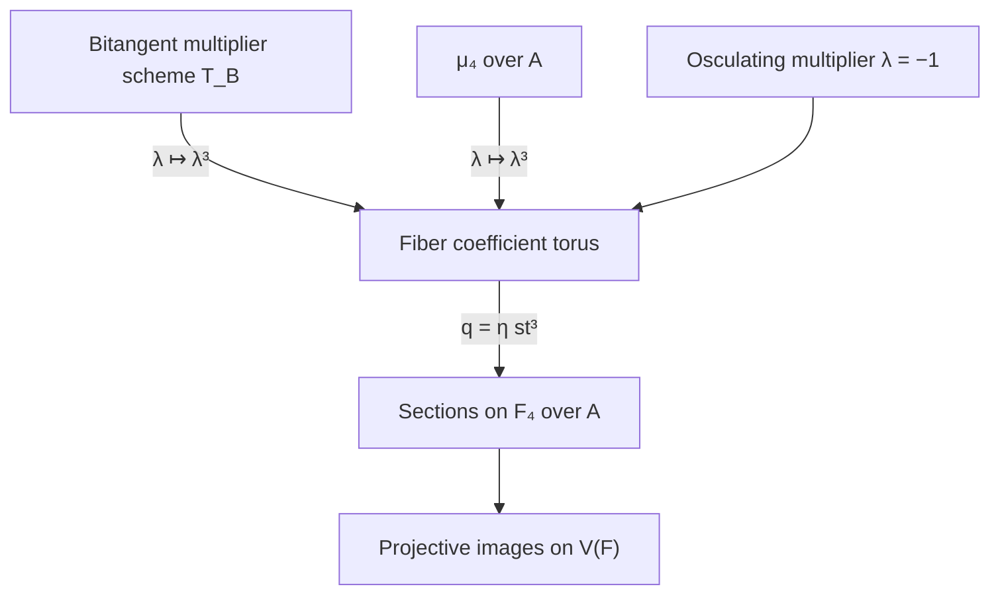

# Arithmetic of the four sections and the contact correspondences

Date: 2026-10-24. Status: **provisional research argument; independent
review is recorded in the [companion audit](2026-10-24-four-sheet-arithmetic-independent-audit.md); no canonical promotion**.

The base is $A=\mathbf Z_{(2)}$, with fraction field $K=\mathbf Q$
and residue field $k=\mathbf F_2$; geometric fibers can subsequently
be taken. All assertions below concern the specified equations

\[
 F=x_1^4-x_0^3x_3,\qquad G=x_2^4-x_0x_3^3.
\]

The accepted [STCI-R-0021](../results/quartic_mu4_degeneration.md)
supplies the already established flatness and fiber description of this
particular complete intersection. The present argument reconstructs the
additional ruled-model and normalization claims, rather than rerunning
that accepted calculation. The coordinate description of the ruled model
is proved in the [four-section note](2026-10-24-four-sheet-ruled-surface.md).
The prior [symmetric-square note](2026-10-24-quartic-symmetric-square-bitangents.md)
and [projection audit](2026-10-24-quartic-projection-independent-audit.md)
are provisional background; the contact formulas used here are derived
again in Section 7. No carrier-exclusion or arithmetic-nonlifting theorem
is used.

## 1. One ruled surface over the arithmetic base

Use the convention that $\mathbf P(E)$ parametrizes lines in a bundle
$E$. Let

\[
 M=\mathbf P_{\mathbf P^1_A}(\mathcal O\oplus\mathcal O(-4)),
 \qquad E^2=-4,\quad f^2=0,\quad E\cdot f=1.
\]

Here $E$ is the section defined by the line subbundle $\mathcal O$.
Its complement is the total space of $\mathcal O(4)$. Write a point
there as $([s:t],q)$, with $q$ a value of $\mathcal O(4)$.
The map to $X=V(F)\subset\mathbf P^3_A$ is

\[
 ([s:t],[a:b])\longmapsto
 [a s^4:a s^3t:b:a t^4],\qquad q=b/a.
 \tag{1}
\]

This notation means the evaluation of the four global sections of
$\mathcal O_M(E+4f)$; it is independent of changes of trivialization.
The section $E$ is contracted to $[0:0:1:0]$, and $X$ is a cone
over the plane rational quartic $[s^4:s^3t:t^4]$.

The finite normalization of $X$ is

\[
 N=\operatorname{Proj} A[s^4,s^3t,s^2t^2,st^3,t^4,b]
   =\mathbf P_A(1,1,4),
 \tag{2}
\]

where the displayed generators have degree one and the weighted
presentation gives $s,t$ weight one and $b$ weight four. Its map to
$X$ forgets $s^2t^2,st^3$. The missing generators are integral over
the retained ring: their powers are products of $s^4,t^4$, and the
function fields agree because $t/s=(s^3t)/(s^4)$. The full Veronese
ring is normal: it is the saturated semigroup ring on exponent pairs
whose total degree is a multiple of four, with the independent vertex
variable adjoined. This argument is valid over $A$ and over either
residue field. Thus $M\to N$ is a resolution contracting $E$, while
$N\to X$ is finite normalization. They are different morphisms.

In this particular surface family normalization **does** commute with
the two fiber changes: (2) remains normal after either change of base,
and the same finite birational argument applies. Section 5 shows why
the analogous assertion for the curve configuration is false.

## 2. The flat relative divisor of four moving sections

Put $h=st^3\in H^0(\mathbf P^1_A,\mathcal O(4))$, and define

\[
 D_M=V(q^4-h^4)\subset\operatorname{Tot}(\mathcal O(4))\subset M.
 \tag{3}
\]

The equation is globally a section of the fourth tensor power of the
fiber line bundle. In homogeneous fiber coordinates it is
$b^4-a^4s^4t^{12}=0$, so $D_M\cap E=\varnothing$. It is a Cartier
divisor of class $4E+16f$. Projection $D_M\to\mathbf P^1_A$ is
finite flat of degree four, with module

\[
 \mathcal O\oplus\mathcal O(-4)\oplus\mathcal O(-8)
             \oplus\mathcal O(-12).
 \tag{4}
\]

Indeed this is the basis $1,q,q^2,q^3$ in local trivializations of the
monic equation. It proves flatness over $A$ as well. Its total space
is reduced: it is $A$-torsion-free, and its generic fiber is reduced,
since $q^4-h^4$ is square-free in the generic function field in
characteristic zero. Any nilpotent would vanish after inverting two
and hence would be $A$-torsion.

After adjoining the fourth roots of unity in characteristic zero,

\[
 D_{M,\overline K}=\bigcup_{\zeta^4=1} C^M_\zeta,
       \qquad C^M_\zeta=V(q-\zeta h),\qquad
       C^M_\zeta\sim E+4f.
 \tag{5}
\]

These components are sections, each with self-intersection four. With
$p_0=[1:0]$, $p_\infty=[0:1]$, their pairwise scheme intersection is

\[
 (\zeta-\eta)h=0
     \quad\Longrightarrow\quad 3p_0+p_\infty\quad(\zeta\ne\eta).
 \tag{6}
\]

In characteristic two the *scheme fiber* is

\[
 D_{M,k}=V((q-h)^4)=4C^M_1,
 \tag{7}
\]

whereas its reduction is the single section $C^M_1\simeq\mathbf P^1_k$.
Thus it is a Cartier multiple on a smooth ruled surface. This does not
mean that its image in $\mathbf P^3$ has the same embedded local
algebra at the endpoints.

## 3. The group scheme, its orbit map, and endpoint base change

The group scheme

\[
 \mu_{4,A}=\operatorname{Spec}A[\lambda]/(\lambda^4-1)
\]

acts on $M$ by $q\mapsto\lambda q$, fixing the base. It comes from
the ambient projectivity
$[x_0:x_1:x_2:x_3]\mapsto[x_0:x_1:\lambda x_2:x_3]$.
The orbit map of the section $C^M_1$ is

\[
 o:\mathbf P^1_A\times\mu_{4,A}\longrightarrow D_M,
       \qquad(p,\lambda)\longmapsto(p,q=\lambda h(p)).
 \tag{8}
\]

It is finite. Locally $\lambda$ is integral with equation
$\lambda^4=1$, and $1,\lambda,\lambda^2,\lambda^3$ generate its
coordinate ring over the target ring. It is an isomorphism where
$h\ne0$, since $\lambda=q/h$. Its **scheme-theoretic image** on the
whole base is exactly $D_M$. To see the kernel assertion, reduce a
polynomial in $q$ modulo $q^4-h^4$. The image of the remainder is

\[
 a_0+a_1h\lambda+a_2h^2\lambda^2+a_3h^3\lambda^3.
\]

The basis $1,\lambda,\lambda^2,\lambda^3$ and the fact that $h$ is
a nonzerodivisor force every $a_j=0$. This proof also works after
reduction modulo two, so in this case the total scheme image commutes
with arithmetic specialization.

It does **not** commute with restricting to a zero of $h$. The actual
orbit of the endpoint point is one fixed reduced point: the orbit map
is $q=0$. In contrast, the fiber of the closure $D_M\to\mathbf P^1_A$
at that endpoint is $\operatorname{Spec}A[q]/(q^4)$. The distinction
is the failure of the nonzerodivisor step after setting $h=0$.
Consequently “the union of point orbits” needs its scheme meaning
specified; the flat divisor (3), the finite orbit parameter space, and
the individual endpoint orbits are three different objects.

The special group scheme has one geometric point and length four:

\[
 \mu_{4,k}=\operatorname{Spec}k[\epsilon]/(\epsilon^4),
       \qquad\lambda=1+\epsilon.
\]

There are no four distinct special-fiber sections. Their first, second,
and third infinitesimal separations are retained by this action.

For a precise comparison of the four labeled sections, pass explicitly
to the splitting DVR $B=A[i]$, with uniformizer $\pi=1-i$. On the
section $C^M_\zeta\simeq\mathbf P^1_B$, the intersection with
$C^M_\eta$ is the effective Cartier divisor

\[
 \operatorname{div}((\zeta-\eta)h)
 =3[p_0]+[p_\infty]
       +v_\pi(\zeta-\eta)[\mathbf P^1_k].
\]

Here the first two terms are horizontal divisors in the arithmetic
surface, and the final term is vertical. Adjacent fourth roots have
$v_\pi(\zeta-\eta)=1$; opposite roots have valuation two, since
$v_\pi(2)=2$. Thus the pairwise total intersection schemes acquire
the entire special section, with these vertical multiplicities. One
cannot specialize the generic intersection divisor (6) by retaining
only its four horizontal points with multiplicity. The definition
over the original base $A$ remains (3); the root labels used in this
paragraph belong to the stated ramified extension.

## 4. Comparing the ruled divisor with its projective image

Let $D=V(F,G)\subset\mathbf P^3_A$. The map (1) restricts to a finite
map $D_M\to D$: $D_M$ avoids the exceptional section, and the
remaining morphism factors through the finite normalization of the
surface. It is an isomorphism over $x_0\ne0$, where its local equation
is

\[
 A[u,q]/(q^4-u^{12}),\qquad u=t/s.
 \tag{9}
\]

At the other endpoint, on $x_3=1$, write $v=s/t$. The ruled model
and its image have rings

\[
 B=A[v,q]/(q^4-v^4),\qquad
 A_D=A[y,q]/(y^4-q^{12}),\qquad y\longmapsto v^3.
 \tag{10}
\]

Here $x_0=q^4=v^4$, $x_1=y=v^3$, $x_2=q$. The homomorphism is
injective: reduce by the monic equation in $y$, use the four-element
basis in powers of $v$, and note that the appearing powers of $q$
are nonzerodivisors in the resulting free $A[q]$-module. It is finite
because $v^4=q^4$, and is generically an isomorphism component by
component. These formulas identify the scheme image with the stated
complete intersection, not merely with its set of points.

In characteristic zero the four image curves meet with length three
at each endpoint. At infinity a component has equation
$y=\zeta q^3$, so subtracting the equations of two distinct components
gives $q^3=0$. Upstairs the same intersection has length one at
infinity by (6). At $p_0$, (9) gives length three both upstairs and
downstairs. The pairwise total lengths are therefore four on $M$
and six in $\mathbf P^3$.

In characteristic two, (10) becomes

\[
 B_k=k[v,q]/((q-v)^4),\qquad
 (A_D)_k=k[y,q]/((y-q^3)^4).
 \tag{11}
\]

Their reductions map isomorphically onto $C_0$, but their nilpotent
structures differ at this endpoint. This is an explicit reason to
distinguish the strict transform of the multiple curve from its image.

## 5. Normalization of total space versus normalization of fibers

Normalization here is taken of a reduced total space; the special
curve is nonreduced, so “normalization of the special fiber” means the
normalization of its reduction unless otherwise specified.

Over $A$, the polynomial factors as

\[
 q^4-h^4=(q-h)(q+h)(q^2+h^2).
\]

The total normalization of $D_M$, and also of $D$, is

\[
 \overline D=\mathbf P^1_A\ \sqcup\ \mathbf P^1_A\
                     \sqcup\ \mathbf P^1_{A[i]},\qquad i^2=-1.
 \tag{12}
\]

The three maps are the graphs $q=h,-h,ih$, followed when appropriate
by (1). They are finite and generically componentwise birational. The
sources are normal: $A[i]$ is the Gaussian DVR localized at its unique
prime over two, and each projective line over these DVRs is regular.
For the quadratic component, adjoining the integral element $i$ and
using $q=ih$ explicitly gives this integral closure; the same argument
applies in both base charts. This proves (12) rather than presuming
that a root-of-unity parameter space is normal.

The orbit parameter space in (8) is itself reduced over $A$, but it
is **not** normal. The ring $A[\lambda]/(\lambda^4-1)$ has the three
generic components above, meeting over two; its normalization is
$A\times A\times A[i]$. Thus (8) is a useful intermediate finite
map, not the total normalization.

The special fiber of (12) is

\[
 \mathbf P^1_k\ \sqcup\ \mathbf P^1_k\
             \sqcup\ \mathbf P^1_{k[\epsilon]/(\epsilon^2)},
 \tag{13}
\]

because $i^2+1=(i+1)^2$ modulo two. It even has a nonreduced
component. Its reduced support consists of three disjoint projective
lines, all mapping onto the one reduced curve $C_0$. In contrast,
the normalization of $D_k^{\mathrm{red}}=C_0$ is just $\mathbf P^1_k$.
These are explicit failures of commuting total normalization with
specialization for the curve configuration. After a ramified base
extension splitting all roots, the generic components become four;
the corresponding normalization statement must be made over that new
base, not substituted silently into (12).

## 6. Resolving the common pencil over the same base

The graph pencil $q=\eta h$, $\eta\in\mathbf P^1$, has base
divisor $3p_0+p_\infty$ on its finite graph sections. The
[four-section note](2026-10-24-four-sheet-ruled-surface.md) resolves it
by three successive point blowups over $p_0$ and one over
$p_\infty$. The base centers and their successive transforms are
defined over $A$, so the construction works arithmetically. The
resulting morphism to $\mathbf P^1_{A,\eta}$ makes the four generic
sections disjoint fibers over $\eta^4=1$. Its scheme inverse image of
$\mu_4\subset\mathbf G_m$ specializes to the quadruple fiber over
$\eta=1$, while the reduced fiber is one smooth rational curve.
Blowing up separates distinct geometric generic sections; it does not
turn the length-four special group scheme into four geometric points.

## 7. A common construction with the osculating and bitangent families

There is a concrete relationship, but it requires retaining which
torus acts on the base and which torus acts in the fibers. Fix the
ordered endpoints temporarily. On $C\setminus\{p_0,p_\infty\}$,
the endpoint torus acts by $u\mapsto\lambda u$. The ordered graph
correspondence is $v=\lambda u$.

For osculation, the middle coefficient of
$(t-us)^3(t-vs)$ is $3u(u+v)$. Since three is a unit in $A$, the
closure of the residual relation away from the endpoints is
$v=-u$, or $\lambda=-1$. For bitangency, the middle coefficient of
$((t-us)(t-vs))^2$ is

\[
 u^2+4uv+v^2.
\]

Thus its multiplier scheme on the torus is the finite flat degree-two
scheme

\[
 T_B=\operatorname{Spec}A[\lambda]/(\lambda^2+4\lambda+1)
                  \subset\mathbf G_{m,A}.
 \tag{14}
\]

It is **not a subgroup** over $A$; generically its two roots have
infinite multiplicative order. The expression also reconstructs the
ordered bitangent correspondence, including its nonreduced reduction,
without relying on an apolar identification that fails in characteristic
two.

The same endpoint torus has a weight-three representation on the
coefficient $h=st^3$. It gives an actual family of sections of $M$:

\[
 \Phi:\mathbf P^1_A\times\mathbf G_{m,A}\longrightarrow M,
       \qquad (p,\lambda)\longmapsto(p,q=\lambda^3 h(p)).
 \tag{15}
\]

On the finite torus chart this is the assignment
$(u,v=\lambda u)\mapsto(u,q=v^3)$. Equation (15), rather than
this rational-chart notation alone, proves that the construction
extends through both endpoints.

It has three immediate consequences.

1. The osculating multiplier $\lambda=-1$ gives the section
   $C^M_{-1}$, one of the four sections in (5).
2. Restricting $\Phi$ to $\mu_4$ gives exactly $D_M$ as its
   scheme image, since cubing is an automorphism of $\mu_4$.
3. Restricting $\Phi$ to $T_B$ gives a degree-two graph family.
   Put $\eta=\lambda^3$. The equation in (14) gives
   $\lambda^3=15\lambda+4$, so cubing identifies $T_B$ with
   $\eta^2+52\eta+1=0$; fifteen is a unit in $A$.

The bitangent-family image is therefore the relative divisor

\[
 D_B^M=V(q^2+52hq+h^2)\subset M\setminus E.
 \tag{16}
\]

To prove the scheme-image assertion at the endpoints as well, use
the basis $1,\eta$ and the same nonzerodivisor argument as in
Section 3. Its class is $2E+8f$. Generically its two sections are
$q=\rho^3h,q=\rho^{-3}h$, with
$\rho+\rho^{-1}=-4$; they are not among the four sections of (5).
For example, a generic root of (14) is not a root of unity: in a real
embedding one root has absolute value strictly between zero and one.

In characteristic two the same diagram specializes to

\[
 (T_B)_k=\mu_{2,k}\hookrightarrow\mu_{4,k},\qquad
 D^M_{B,k}=V((q-h)^2)=2C^M_1
                         \hookrightarrow 4C^M_1=D_{M,k}.
 \tag{17}
\]

This is a scheme-theoretic inclusion supplied by one family of maps
(15), not a comparison of supports alone. It explains a common piece
of the two characteristic-two degenerations. The bitangent
correspondence has retained a length-two infinitesimal multiplier;
the four-section orbit retains length four. The ordinary osculating
graph $\lambda=-1$ itself specializes only to the ordinary diagonal.
It must not be replaced by the full length-two group scheme. Moreover
the usual osculating plane section becomes
$(t-us)^3(t+us)=(t+us)^4$ in characteristic two, explaining why its
contact divisor can become quadruple even though the residual graph
specializes with multiplicity one.

The base torus action preserving $C^M_1$ is
$(u,q)\mapsto(\lambda u,\lambda^3q)$ in the finite chart. Its
central $\mu_2$ is not the fiber-scaling action (8), which fixes
the base. Formula (15) compares their representations and the graph
correspondences; it does **not** identify these two actions. The
construction depends on the chosen quartic $F$, the ordered
endpoint coordinates, and its weight-three section $h$. It does
not establish an intrinsic identification of all the contact and
orbit families without these choices.

The special-fiber diagram has the actual closed immersions
$\mu_2\subset\mu_4$ and $2C^M_1\subset4C^M_1$. There is no
corresponding inclusion $T_B\subset\mu_4$ on the generic fiber.

## 8. Review boundary and questions left open

The new assertions in this note are the finite orbit-image description,
the explicit total normalization and its failure to commute with curve
specialization, the endpoint algebra comparison, and the shared
weight-three section construction. They are proved above for these
equations and this base. Independent review must check the finite
normalization arguments, the endpoint kernels, and (14)–(17), not
infer their validity from accepted STCI-R-0021.

No universal statement about characteristic-two complete intersections,
arbitrary projection centers, or an intrinsic identification of two
different torus actions is asserted. A coordinate-free version of
(15) for an unordered endpoint pair, including a compatible treatment
of exchanging $F$ and $G$, is a further question. The stated
construction already proves the limited relationship requested here.
