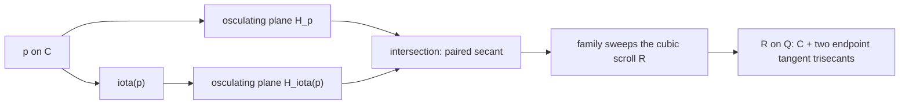

# Special lines, osculating planes, and intersection geometry of the rational quartic

Date: 2026-10-24. Status: **independently reviewed exploratory research
proposal; no canonical promotion and no new STCI exclusion claimed**.

Throughout, $k$ is algebraically closed of characteristic zero and

\[
\nu:\mathbf P^1\longrightarrow\mathbf P^3,
\qquad [s:t]\longmapsto[s^4:s^3t:st^3:t^4],\qquad C=\nu(\mathbf P^1).
\]

The geometry below is reconstructed from this embedding. The conclusion is
positive geometric structure, together with precise necessary conditions for
containing surfaces. We find no contradiction to a hypothetical STCI in the
remaining degrees. In particular, bitangent pairs are **different** from
osculating residual pairs, and there are trisecant lines but no length-four
line sections.

## 1. Authority, retained inputs, and evidence

The retrieval route was [INDEX](../INDEX.md), the relevant canonical records,
and their scope statements. The following accepted results are retained as
premises, without recomputation or reproof:

| Record | Exact input or boundary used here |
| --- | --- |
| [STCI-R-0020](../results/quartic_conormal_characteristic_jump.md) | For this embedding in characteristic zero, $E=N^*_{C/\mathbf P^3}=\mathcal O_{\mathbf P^1}(-7)^2$. |
| [STCI-R-0001](../results/quartic_carrier_exclusion.md) | An integral quartic carrier has no mate of any positive degree. Its recorded factor reduction and lower-degree exclusions imply $d,e\ge5$ for a hypothetical presentation. This is context, not a premise for the geometric arguments. |
| [STCI-R-0019](../results/quasiprimitive_residual_cycles.md) | Its stronger auxiliary-surface length-cycle/defect formulas require a finite-flat generically curvilinear algebra, a saturated invertible flag, a nonzero generic auxiliary first class, and proper residual intersection. Those additional hypotheses are not imposed below. |

The unrestricted characteristic-zero STCI problem remains open. The reviewed
but unpromoted intrinsic $(4,4)$ K3 proposal is not an input, nor are earlier
proposed bounds on common normal directions. No source branch or acceptance
note is treated as a substitute for a promoted record.

New evidence consists of the [geometry derivation](2026-10-24-special-lines-geometry-derivation.md),
[dual-incidence derivation](2026-10-24-special-dual-incidence-derivation.md),
[section derivation](2026-10-24-special-sections-stci-derivation.md),
and [independent normal-count review](2026-10-24-osculating-normal-count-review.md).
These are research evidence, not numbered canonical results. Proofs of the
new statements are given here. No literature-priority claim is intended.
The final [geometry audit](2026-10-24-special-lines-planes-geometry-audit.md)
and [STCI scope audit](2026-10-24-special-lines-planes-stci-audit.md)
independently reconstruct the corrected statements. The geometry audit
found an omitted pair of endpoint-pencil components in the initial dual
singular-locus description; Section 6 now includes them, and the rejected
two-component assertion is documented in the audit and derivation note.
The general local intersection-length formalism is supported by
[Stacks, Section 43.16](https://stacks.math.columbia.edu/tag/0B01) and the
[multiplicity associativity formula, Lemma 43.15.3](https://stacks.math.columbia.edu/tag/0AZU).

## 2. The quadric explains the special lines

The unique containing quadric is smooth:

\[
Q=V(q),\qquad q=x_0x_3-x_1x_2.
\]

Indeed, the ten quadratic coordinate monomials restrict to nine distinct
degree-eight binary monomials; the only repetition is $x_0x_3=x_1x_2$.
Use the Segre description

\[
(x_0,x_1,x_2,x_3)=(ac,ad,bc,bd),\qquad
Q=\mathbf P^1_A\times\mathbf P^1_B.
\]

Then $C$ is the graph of the cubic map

\[
[c:d]=[s:t]\longmapsto[a:b]=[s^3:t^3],
\qquad c_C=bc^3-ad^3=0.
\]

Thus $C\sim(1,3)$, while a hyperplane has class $(1,1)$. The first
projection has degree three on $C$, and the second is an isomorphism. This
intrinsically distinguishes the two ruling families and the two totally
ramified points $p_0=\nu(1,0)$, $p_\infty=\nu(0,1)$.

The ruling with $A$-coordinate $[1:\kappa]$ is

\[
L_\kappa=V(x_2-\kappa x_0,\ x_3-\kappa x_1),
\quad C\cap L_\kappa=\{t^3-\kappa s^3=0\}.
\]

Its intersection length is three. For $\kappa\ne0,\infty$ there are
three distinct points; the endpoint fibers are $3p_0,3p_\infty$.
The other ruling meets $C$ in length one.

**Proposition 2.1.** Every line with scheme intersection length greater than
two with $C$ is one of the $L_\kappa$. In particular no line has
intersection length four or more.

Proof: if a line is not contained in $Q$, the quadratic $q|_L\ne0$
has a degree-two zero divisor containing $C\cap L$. If it is contained
in $Q$, it belongs to one of its rulings, of intersection lengths three
and one. This also accounts for nonreduced line sections.

Write $c(u)=[1:u:u^3:u^4]$. The ordinary tangent

\[
T_u=\langle c(u),c'(u)\rangle
\]

has length two on $C$ for $u\ne0,\infty$; $T_0=L_0$ and
$T_\infty=L_\infty$ are tangent trisecants of length three.
For distinct finite $u,v$, their secant is a trisecant exactly when
$u^3=v^3$. One check is

\[
q(\lambda c(u)+\mu c(v))
=\lambda\mu(u-v)^2(u^2+uv+v^2).
\]

Otherwise it is an ordinary length-two secant. There are no $[2,1]$
trisecant sections: the cubic ruling map is either unramified in a fiber
or totally ramified at an endpoint.

## 3. Osculation and its residual involution

The embedding is the incomplete linear system

\[
W=\langle s^4,s^3t,st^3,t^4\rangle\subset H^0(\mathcal O_{\mathbf P^1}(4)).
\]

For finite $u\ne0$, a section with a triple zero at $u$ has the form
$(v-u)^3(v-r)$. The missing $v^2$ coefficient is $3u(u+r)$,
so $r=-u$. Therefore

\[
H_u=V(-u^4x_0+2u^3x_1-2ux_2+x_3),\qquad
H_u|_C=3c(u)+c(-u).
\tag{3.1}
\]

The residual map is the involution $\iota(u)=-u$. Intrinsically, it is
the unique nonidentity involution fixing individually the two ramification
points of the degree-three ruling map. Formula (3.1), rather than that
description alone, proves it is the residual map of osculation.

The homogeneous dual map is

\[
[s:t]\longmapsto[-t^4:2st^3:-2s^3t:s^4].
\tag{3.2}
\]

It extends to $H_0=V(x_3)$, $H_\infty=V(x_0)$, with sections
$4p_0,4p_\infty$. These are the only hyperosculating points.
At either endpoint the ordinary second jet spans just the tangent line:
every plane through that line has contact at least three. Here $H_p$
means the limiting osculating plane, equivalently the unique plane with
contact four. Defining it only as the span of the second jet would miss
this endpoint distinction.

More explicitly, the full pencil through $T_0$ has equations
$Cx_2+Dx_3=0$ and sections $3p_0+q$, with residual point $q$ varying
freely on $C$; the analogous pencil through $T_\infty$ has equations
$Ax_0+Bx_1=0$. Their special residual points $q=p_0,p_\infty$ give the
two limiting hyperosculating planes. These pencils will reappear as the
extra singular lines of the dual surface in Section 6.

The involution extends to

\[
\sigma[x_0:x_1:x_2:x_3]=[x_0:-x_1:-x_2:x_3].
\]

It preserves $Q$ and both rulings, acting as
$([a:b],[c:d])\mapsto([a:-b],[c:-d])$. Its fixed lines in projective
space are $E_+=V(x_1,x_2)$ and $E_-=V(x_0,x_3)$. Its four fixed
points on $Q$ are the four Segre coordinate points, of which exactly
$p_0,p_\infty$ belong to $C$.

## 4. Bitangent planes give a different correspondence

For a plane with two distinct double contacts $u,v$, its binary section
is proportional to $(z-u)^2(z-v)^2$. The missing middle coefficient gives

\[
u^2+4uv+v^2=0,\qquad v=\rho u\ \text{or}\ \rho^{-1}u,
\quad \rho=-2+\sqrt3.
\tag{4.1}
\]

Thus a generic point has two bitangent partners. The unordered ratio
satisfies $\rho+\rho^{-1}=-4$, which is invariant under changing the
coordinate preserving the two endpoints. **The contacts are not an
involution pair.** The involution takes $\{u,v\}$ to $\{-u,-v\}$.

For such $u,v$, the plane is

\[
B_{u,v}=V(u^2v^2x_0-2uv(u+v)x_1-2(u+v)x_2+x_3).
\]

An intrinsic compactification is especially simple. Identify
$\operatorname{Sym}^2 C\cong\mathbf P^2$, with a divisor represented by
the quadratic $h=\alpha s^2+\beta st+\gamma t^2$. The double divisor
is a plane section precisely when $h^2\in W$, or

\[
\beta^2+2\alpha\gamma=0.
\tag{4.2}
\]

This is a smooth conic. Squaring maps it to a rational quartic of
bitangent planes in the dual space. The diagonal of $\operatorname{Sym}^2 C$
has equation $\beta^2-4\alpha\gamma=0$; the conics are tangent at
the two endpoint divisors. The two contacts therefore coalesce precisely
at $p_0,p_\infty$, giving the same two hyperosculating planes. There is
no bitangent joining an endpoint to a distinct point.

For explicit calculations one can use their sum $w=u+v$:

\[
B_w=[w^4/4:w^3:-2w:1],\qquad
B_w|_C=(z^2-wz-w^2/2)^2.
\tag{4.3}
\]

Its contact parameters are $(1\pm\sqrt3)w/2$. Homogenization includes
the member at infinity.

## 5. The main incidence identities and the canonical cubic scroll

For $u\ne0,\infty$, the two paired osculating planes meet along the
paired secant itself:

\[
H_u\cap H_{-u}=\langle c(u),c(-u)\rangle=S_{u^2},\qquad
S_z=V(x_2-zx_1,\ x_3-z^2x_0).
\tag{5.1}
\]

Each plane contains both points, and they are distinct, which proves the
identity without a coordinate computation. Adding and subtracting their
equations verifies it. The family is parametrized by $C/\iota\cong\mathbf P^1$,
with $z=u^2$. Its endpoint limits are the tangent trisecants, even though
the scheme intersection of the two planes at the endpoint itself is the
whole plane: one must distinguish the limiting line from $H_0\cap H_0$.

The paired secants sweep the irreducible cubic ruled surface

\[
R=V(x_0x_2^2-x_1^2x_3).
\tag{5.2}
\]

The line $S_z$ joins $[1:0:0:z^2]\in E_+$ and
$[0:1:z:0]\in E_-$. Thus the double directrix $E_+$ reflects the
degree-two map $z\mapsto z^2$; $E_-$ is a simple directrix.
Its two branch values are exactly the pinch points $p_0,p_\infty$.
For example, the local equation at $p_0$ is $x_2^2=x_1^2x_3$.

Two identities connect this scroll to osculation and the quadric:

\[
T_{c(u)}R=H_u\quad(u\ne0,\infty),\qquad
R|_Q=C+L_0+L_\infty.
\tag{5.3}
\]

For the first, its gradient at $c(u)$ is
$-u^2[-u^4:2u^3:-2u:1]$. For the second, its Segre restriction is
$ab(bc^3-ad^3)$. These are actual residual lines downstairs.
The scroll is not developable: its tangent plane varies along a general
ruling. Its osculating tangent-plane property holds along the distinguished
curve $C$.

Further incidence is governed by common divisors: for distinct planes
$H,K$, the scheme $C\cap(H\cap K)$ is the divisor
$\min(H|_C,K|_C)$. This follows in a DVR from
$(t^h,t^k)=(t^{\min(h,k)})$. In particular:

- Two distinct osculating planes have intersection line disjoint from $C$
  unless they are involution-paired, when (5.1) applies.
- A bitangent plane and an osculating plane sharing their contact at a
  nonendpoint $p$ intersect in $T_pC$.
- Two distinct tangent lines meet exactly when their contact points form a
  bitangent pair. Hence $T_u,T_{-u}$ are skew for nonendpoint $u$.
- The tangent plane to $Q$ at $c(u)$ cuts $C$ in
  $2c(u)+c(\zeta u)+c(\zeta^2u)$, where $\zeta^3=1,\zeta\ne1$.
  It cuts $Q$ in its two rulings. In contrast a nonendpoint osculating
  or bitangent plane cuts $Q$ in a smooth conic. At the endpoints all
  three plane families have the same limiting hyperosculating plane,
  whose quadric conic splits into the rulings with contact lengths three
  and one.

The polarity of $Q$ is another symmetry, distinct from $\sigma$. The
pole of $H_u$ is $[1:2u:-2u^3:-u^4]$, and

\[
S_{u^2}^{\perp}
=T_{c(u)}Q\cap T_{c(-u)}Q
=V(x_3+u^4x_0,\ x_2+u^2x_1).
\]

This is generally a different line from $S_{u^2}$.



The diagram describes nonfixed $p$; at a fixed point use the limiting
line as explained above.

## 6. Dual geometry and the universal incidence divisor

The dual surface $C^\vee\subset\mathbf P(W)$ parametrizes tangent
planes: its equation is the binary-quartic discriminant restricted to $W$.
It is reduced irreducible of degree six. Its singular set has **four**
irreducible components: the osculating quartic, the bitangent quartic,
and the two endpoint pencils of triple-contact planes

\[
\ell_0=\{[0:0:C:D]\},\qquad
\ell_\infty=\{[A:B:0:0]\}.
\tag{6.0}
\]

For completeness, a nonendpoint triple root forces its residual point to
be its involution partner, giving the osculating quartic. At an endpoint,
however, a section $z^3(C+Dz)$ has a triple root for every $[C:D]$;
the reversed chart gives the second pencil. These entire pencils are
singular on the dual surface, not just their hyperosculating members.
Sections with two double roots give the bitangent quartic. No other
singular points occur: at a section with just one double root the full
discriminant is smooth, with differential a nonzero multiple of evaluation
at that root; this differential cannot vanish on the basepoint-free
system $W$. These assertions describe the reduced singular locus, without
identifying its possibly nonreduced singular scheme. The tangent-plane
incidence over $C$ is a projective-line bundle, proving irreducibility;
a general simple double root proves reducedness.

The osculating and bitangent quartics meet only at the hyperosculating planes. Their
local scheme intersection has length three at either endpoint: in the
last-coefficient-one chart, equating (3.1) and (4.3) gives $u=w$,
$u^3=0$, and the redundant order-four equation. They agree through
quadratic order and separate at cubic order.

On the product of the osculating parameter line and $C$, the universal
plane equation factors homogeneously as

\[
H_{[a:b]}(\nu(s,t))=(at-bs)^3(at+bs).
\]

It defines the exact Cartier divisor

\[
D_{\rm osc}=3\Delta+\Gamma_\iota\sim(4,4).
\tag{6.1}
\]

The bitangent family similarly gives
$D_{\rm bit}=2\Gamma_{c_+}+2\Gamma_{c_-}\sim(4,4)$, with
$c_\pm(w)=(1\pm\sqrt3)w/2$. The graphs meet at the two endpoints;
their mergers produce the hyperosculating sections. There are no additional
vertical components in either divisor.

## 7. Proper containing pairs first, then the STCI hypothesis

Let $F,G\in I_C$ be nonzero homogeneous forms of degrees $d,e>0$
with no common surface component, and $Z=V_+(F,G)$. Initially impose
only $C\subset Z_{\rm red}$. The complete intersection is a pure
Cohen--Macaulay curve, with

\[
[Z]=m[C]+\mathcal R,\qquad de=4m+\deg\mathcal R,
\tag{7.1}
\]

where $\mathcal R$ is an effective residual cycle. If a plane contains
no component of $Z$, then

\[
[Z\cap H]=m[H|_C]+\mathcal R\cdot H.
\tag{7.2}
\]

Residual terms can occur at points on $C$; if a plane contains a residual
curve, the finite-section formula does not apply. In particular, a local
excess or an exceptional vertical cycle does not itself establish an extra
curve downstairs.

Now assume the actual STCI condition $Z_{\rm red}=C$. Then
$\mathcal R=0$, $de=4m$, and every plane is a proper section. Neither
$F_H$ nor $G_H$ is identically zero, and they have no common plane
curve component: either failure would put a plane curve inside $Z$.
For every $p\in C\cap H$, one has the exact local length

\[
\boxed{\ i_p(F_H,G_H)
=\ell\bigl(\mathcal O_{\mathbf P^3,p}/(F,G,H)\bigr)
=m\,\operatorname{ord}_p(H|_C).\ }
\tag{7.3}
\]

Proof: the local ring $B=\mathcal O_{Z,p}$ is one-dimensional
Cohen--Macaulay and $h$ is a parameter/nonzerodivisor. The associativity
formula for multiplicity gives
$e_h(B)=m e_h(\mathcal O_{C,p})=m\operatorname{ord}_p(h|_C)$.
Cohen--Macaulayness gives $e_h(B)=\ell(B/hB)$. This proves the
length assertion, rather than merely an equality of total degrees.

| Plane | Its divisor on $C$ | Local intersection lengths of $F_H,G_H$ |
| --- | --- | --- |
| Ordinary osculating $H_p$ | $3p+\iota(p)$ | $3m$ and $m$ |
| Hyperosculating $H_0,H_\infty$ | $4p_0$ or $4p_\infty$ | One point of length $4m=de$ |
| Nondegenerate bitangent | $2p+2q$ | $2m$ at each point |
| Generic tangent plane to $Q$ at $p$ | $2p+q+r$ | $2m,m,m$ |
| General plane | Four distinct points | $m$ at each point |

These are identities of fundamental zero-cycles and local lengths. They
do not say that the plane CI is the $m$-th power of a plane-section
ideal, or determine its Hilbert function.

## 8. What the local lengths say about tangency

If the two plane germs at $p$ have multiplicities $a_p,b_p$, then

\[
a_pb_p\le m\operatorname{ord}_p(H|_C).
\]

Equality holds when their tangent cones have no common factor; strict
inequality means a common tangent direction. If both germs are smooth,
their contact order is exactly the length in (7.3). When the plane contains
$T_pC$ and differs from the tangent plane to a smooth containing surface,
that surface's section is smooth with tangent line $T_pC$. If the planes
coincide the section is singular, and the tangent cone needs higher terms.

Neither concentration at a hyperosculating point nor a large value of $m$
forces an ambient singularity at that point of concentration. In formal
coordinates with $C=V(x,y)$,

\[
F=x,\quad G=x+y^m,\quad H_r=V(y+t^r)
\tag{8.1}
\]

give two smooth ambient surfaces and two smooth plane germs with exact
intersection length $rm$. The case $r=4$ realizes the hyperosculating
local length. This is a local model, not a projective STCI construction for
$C$.

Nor does the length determine the scheme: $(x,y^4)$ and $(x^2,y^2)$
have the same generic thickness four, but their sections by $H_r$ have
algebras $k[[t]]/(t^{4r})$ and $k[[t,x]]/(x^2,t^{2r})$, of different
embedding dimensions for $r\ge2$.

For $m>1$, the first conormal symbols of $F,G$ satisfy
$\sigma_F\wedge\sigma_G=0$ along all of $C$: independent generic
linear terms would give transverse colength one. Thus their tangent planes
agree wherever both surfaces are smooth on $C$. A zero symbol instead
means the surface is singular there; if both symbols vanish identically,
this first-order viewpoint supplies no common tangent-plane field.

There is nevertheless a standard **global** singularity constraint: each
defining surface of a hypothetical sole-support pair must be singular at
some point of $C$. If $X=V(F)$ were smooth along all of $C$, then $C$ would
be Cartier on a smooth neighborhood in $X$, and $G|_X$ would have divisor
$mC$ there. Restricting the associated line bundles to $C$ gives

\[
4e=m\deg N_{C/X}=m(14-4d).
\]

Here the normal sequence uses the accepted degree $\deg N_{C/\mathbf P^3}=14$
and $N_{X/\mathbf P^3}|_C=\mathcal O_C(d)$. With $de=4m$, it would imply
$16=d(14-4d)$, whereas that integer expression is at most twelve for positive
integers $d$. This is impossible. The argument is ordinary adjunction on the
smooth carrier neighborhood; it does not identify the singular points,
place them at the hyperosculating points, or force the two surfaces to
share a singular point. The local models above remain compatible with it,
since they do not give a globally smooth carrier for this projective curve.

## 9. Restrictions to lines and to the quadric

For a line $L$, at least one of $F_L,G_L$ is nonzero under sole support.
If both are nonzero, their common-zero divisor on $L\cong\mathbf P^1$
is the divisor of their gcd, supported exactly on $C\cap L$, containing
that intersection scheme, and of degree at most $\min(d,e)$. Individual
forms may have other zeros; only common zeros are constrained. If
$L\subset V(F)$, the entire degree-$e$ divisor of $G_L$ is supported
on $C\cap L$. On an endpoint tangent trisecant that is contained in
$V(F)$, it is $ep_0$ or $ep_\infty$.

There is no formula $\ell(Z\cap L)=m\ell(C\cap L)$ in general.
For example the actual transverse line $t=y=0$ in (8.1) gives length
one for every $m$. The special paired secants have length two on $C$,
the generic tangents length two, and the ruling trisecants length three;
none inherits a plane's $3m+m$ or $4m$ formula.

On $Q$, neither restricted equation vanishes identically under sole
support. If $q\mid F$, a nonzero $G_Q$ would have a divisor supported
only on $C$, forcing $(e,e)=b(1,3)$, impossible for $e>0$.
The case $G_Q=0$ would put $Q$ inside $Z$. Write the genuine divisors

\[
\operatorname{div}(F_Q)=aC+R_F,\quad
R_F\sim(d-a,d-3a),\quad 1\le a\le\lfloor d/3\rfloor,
\tag{9.1}
\]

and similarly with $e,b,R_G$. These are orders **on $Q$**, not
automatically ambient normal orders. The residual divisors have no common
component and their proper intersection is supported on $C$. Hence

\[
\boxed{R_F\cdot R_G=2de-4(db+ea)+6ab\ge0,\qquad
R_F\cdot C=4d-6a.}
\tag{9.2}
\]

Here the first displayed intersection denotes its degree. If $d=3a$,
$R_F\sim(2a,0)$ is a sum of trisecant ruling fibers. On each component
the mate has all its roots at the fiber's three points of $C$; at the
ramified fibers they concentrate at one point. These give actual global
interpolation conditions but no general emptiness conclusion. Identifying
the residual intersection cycle with a normal defect divisor requires the
extra R0019 hypotheses listed in Section 1.

## 10. A global normal-direction count, and a counterexample test

This is a new geometric interpretation of first-normal data, not a new
STCI obstruction. The osculating field defines a saturated line

\[
L_{\rm osc}\cong\mathcal O(-8)\subset E.
\tag{10.1}
\]

Indeed, the degree-four, nowhere zero plane vector (3.2) defines a line
$\mathcal O(-4)\subset E\otimes\mathcal O_C(1)=E(4)$: Euler's
relation makes it a cotangent vector and tangency to $C$ makes it
conormal. Untwisting gives (10.1). Alternatively, the scroll's first
normal symbol has precisely the divisor $2p_0+2p_\infty$; saturating
$\mathcal O(-12)\to E$ again gives $\mathcal O(-8)$.

Let $F\in I_C(d)$ have nonzero first normal symbol and zero divisor
$A_F$, of degree $a_F$. Its saturated direction is
$L_F\cong\mathcal O(a_F-4d)\subset E$. If it does not coincide
identically with $L_{\rm osc}$, their wedge has a coincidence divisor

\[
\boxed{\deg D_F^{\rm osc}=4d-6-a_F.}
\tag{10.2}
\]

This is the degree of $\operatorname{Hom}(L_F\otimes L_{\rm osc},\det E)$,
using $\deg E=-14$. At smooth points its zeros mean $T_pV(F)=H_p$.
At points of $A_F$, it compares saturated limiting directions rather
than assigning a tangent plane to a singular surface. If the first symbol
is identically zero the construction is unavailable; if the directions
are identical the wedge is zero and there is no finite coincidence divisor.

There is a reproducible coordinate check valid for every $F\in I_C(d)$:

\[
P_F(s,t)=\sum_i F_{x_i}(\nu(s,t))\nu_i(s,-t),\qquad
\frac{P_F}{4s^3t^3}\in H^0(\mathcal O(4d-6)).
\tag{10.3}
\]

Euler and the derivative of $F(\nu(1,u))=0$ give
$P_F(1,u)=4u^3(F_{x_2}(c(u))+2uF_{x_3}(c(u)))$; the reversed chart
gives the factor $s^3$. The remaining factor records
$A_F+D_F^{\rm osc}$, when nonzero. For $Q$ it is $st$, giving
the two simple endpoint coincidences; for the scroll it is identically zero.

For two proportional, nonzero generic first symbols one obtains the
compatibility identity

\[
4d-a_F=4e-a_G,
\tag{10.4}
\]

and the same saturated coincidence divisor. In a balanced trivialization
$E(7)\cong\mathcal O^2$, the common normal direction is a map of
degree $\mu=4d-7-a_F$, and (10.2) says $\deg D^{\rm osc}=\mu+1$.
This is not a bound $\mu\le2$; entirely thick equations are outside
this first-symbol case.

Geometrically, the balanced projective conormal bundle is a product of
two projective lines. The osculating section has degree one in the
direction factor, so it can serve as the diagonal after an identification
of that factor with $C$. A saturated normal field of degree $\mu$ meets
this diagonal in $\mu+1$ points counted with multiplicity. This ruled
surface picture explains the count and why it supplies an exact
compatibility divisor rather than a small upper bound.

An explicit test prevents an unjustified small bound. Set

\[
F=x_0^2x_2-x_1^3+x_1x_3^2-x_2^3,\qquad G=x_0F+q^2.
\tag{10.5}
\]

The cubic $F$ is smooth everywhere on $C$: at finite $u$ its gradient is
$(2u^3,-3u^2+u^8,1-3u^6,2u^5)$, and at infinity it is $dx_1$.
It has six distinct osculating coincidences, since

\[
P_F=4s^3t^3(s^6+t^6).
\]

The proper pair has $(F,G)=(F,q^2)$ and common saturated direction
of degree five. Its residual support is fully visible:

\[
F_Q=(a^2-b^2)(bc^3-ad^3),\qquad
[V(F,G)]=2[C]+2[L_{a=b}]+2[L_{a=-b}].
\tag{10.6}
\]

Consequently $de=12=8+4$, with $m=2$. It refutes a bound of two
based on proper containment and common first-normal direction alone. It
does **not** refute any bound retaining additional actual-STCI hypotheses:
this pair has two residual trisecants. It is a diagnostic example, not a
proposed STCI witness.

## 11. Compatibility as the planes vary

For an actual sole-support CI $Z$, either degree-four plane family defines

\[
W_Z=(Z\times\mathbf P^1)\cap\mathcal H
\longrightarrow\mathbf P^1.
\]

It is finite flat of degree $de$. Every fiber is a proper section of the
Cohen--Macaulay curve $Z$, of length $de$; equivalently the universal
plane is fiberwise regular and defines a flat relative effective Cartier
divisor with finite fibers. Its fundamental cycles are

\[
[W_Z^{\rm osc}]=m(3\Delta+\Gamma_\iota),\qquad
[W_Z^{\rm bit}]=2m(\Gamma_{c_+}+\Gamma_{c_-}).
\tag{11.1}
\]

These cycles live on the reduced incidence support in the ambient product.
The thickened incidence scheme is not thereby a divisor on the reduced
surface $C\times\mathbf P^1$. The endpoint mergers, including the full
$4m$ fiber, are already compatible with flatness.

There is also a numerical condition on the algebra bundle
$\mathcal B=f_*\mathcal O_{W_Z}$:

\[
\operatorname{rk}\mathcal B=de,\qquad
\deg\mathcal B=-2de(d+e-2).
\tag{11.2}
\]

For a degree-$k$ plane family the second number is
$-kde(d+e-2)/2$. To prove it, use the exact sequence

\[
0\to\mathcal O_Z(-1)\boxtimes\mathcal O(-k)
\to\mathcal O_{Z\times\mathbf P^1}\to\mathcal O_{W_Z}\to0
\]

and the CI Hilbert polynomial
$\chi(\mathcal O_Z(n))=de\,n+de(4-d-e)/2$. Taking Euler
characteristics and subtracting the rank gives the stated degree. This
holds for every such CI section family; it supplies no inconsistency with
(11.1). Both (11.1) and (11.2) are formal compatibility conditions once the
actual pair exists.

## 12. Assessment and focused questions

The new geometric contributions in this package are the unified incidence
description, the osculating conormal reference line and exact coincidence
count, and explicit residual tests that prevent overinterpreting these
configurations. The line geometry also recovers the earlier recorded
trisecant classification; it is not being claimed as new to the repository.

The plane section identities are the ordinary CI cycle identity applied
locally, with Cohen--Macaulayness supplying exact lengths. The quadric
residual support, actual first-normal divisors, and incidence algebra bundle
carry information beyond a bare total-degree equality, but no new
incompatibility has been proved. The decisive missing input is control of
the actual global homogeneous equations and higher normal/gluing data.

The following questions are useful continuation targets, not conjectured
theorems:

1. Does the **algebra structure and embedded extension data** of the finite
   flat incidence family impose conditions stronger than its rank, degree,
   and fundamental cycle? The local models (8.1) rule out a contradiction
   from endpoint concentration alone.
2. Can one combine the osculating-reference coincidence divisor with the
   genuine residual schemes on $Q$, under fully stated saturation and
   first-symbol hypotheses? Example (10.5) shows that proper containment
   and proportional symbols are insufficient; R0019 supplies only its
   conditional length-cycle bridge.
3. Can the two cubic ruling branch points force a global relation between
   higher normal data at $p$ and $\iota(p)$? Neither the cycle
   $3\Delta+\Gamma_\iota$ nor the bitangent correspondence gives such
   a relation on its own. Any assertion must survive both the local smooth
   models and the explicit residual pair.

There is currently no supported conjectural inequality with enough evidence
to state as a proposed obstruction. The unrestricted STCI frontier and the
accepted degree-four exclusion are unchanged.

## 13. Reproduction and review record

Run the new exact identity check (SymPy required):

```sh
/tmp/stci-z4-env/bin/python research/computations/verify_special_lines_planes_2026_10_24.py
python3 research/computations/validate_records.py
git diff --check
```

The first script checks only the displayed new polynomial identities and
local example lengths. It does not rerun the accepted normal splitting or
quartic exclusion, prove a global nonvanishing statement, or search for an
STCI pair. The mathematical proofs are the arguments above. See the
[validation record](../validation/2026-10-24-special-lines-planes/README.md)
for exact output and the final independent scope review.

The work is on `codex/special-lines-planes-2026-10-24`, based on local commit
`d024e2b3eeaae4e439e622baf8259a10b83a5279` of the pre-existing
`codex/delta-embedding-geometry-2026-10-24` branch. The base selection
preserves the current checkout's research context; it is not an assertion
that every inherited proposal is promoted or that this branch starts at
`main`. No remote publication is part of this investigation.
