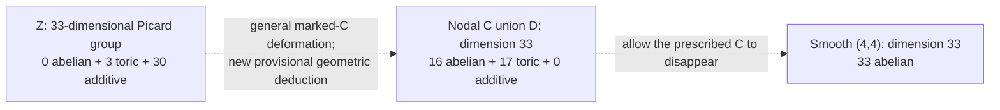

# Complete-intersection cycles containing the rational quartic: a geometric notebook

Date: 2026-10-25. **Status: exploratory research, with selective exact calculations and an independent audit; no canonical promotion.**

The question is how to see the distinguished four-quartic intersection as a special configuration among complete intersections containing a marked curve. The most productive picture emerging here is that it **concentrates a fixed attachment boundary and a large amount of genus into two symmetric places**. That picture has several mathematical realizations, but each forgets something. We keep the competing viewpoints alive rather than choosing a universal order prematurely.

**Clarified direction.** The broader aim is to show that every proper characteristic-zero hypersurface pair containing this fixed \(C\) has a nonzero residual cycle away from \(C\). Proximity to a multiple of \(C\) is the research tool, and its measure may depend on the pair being studied. The [adaptive valuative continuation](2026-10-25-ci-cycle-adaptive-valuative-notebook.md) develops this interpretation: generic transverse valuations, point valuations on \(C\), infinitely near points, and a valuative contact divisor provide complementary certificate types. It distinguishes the proposed universal goal from the local identities and examples currently established.

Throughout the characteristic-zero discussion, the field is algebraically closed. Statements about ordinary topology mean the complex fiber. Write
\[
C=[s^4:s^3t:st^3:t^4],\quad
p=[1:0:0:0],\quad q=[0:0:0:1],
\]
\[
F=x_1^4-x_0^3x_3,\qquad G=x_2^4-x_0x_3^3,
\qquad Z=V(F,G),\qquad Q=x_0x_3-x_1x_2.
\]
The parameter \(a\) below is unrelated to a hypersurface degree. An ambient twist by \(d\) has degree \(4d\) on the normalization \(C\cong\mathbf P^1\).

## 1. Starting with motion

A small perturbation of two quartic equations usually loses the prescribed curve. To retain it, move the equations in
\[
V=H^0(\mathbf P^3,I_C(4)),\qquad \dim V=18.
\]
The dimension follows from the actual restriction of the 35 quartic monomials to all 17 degree-16 binary monomials. Ordered independent pairs form an open subset of \(V^2\); changing the basis of their pencil does not change the intersection. Thus the natural parameter space is the open locus
\[
U\subset\operatorname{Gr}(2,V),\qquad \dim U=32,
\]
where the two generators have no common surface component. Its universal curve is a flat family of complete intersections with Hilbert polynomial \(16n-32\). The proper-intersection condition matters: a limit in the full Grassmannian can acquire a common surface and leave this family of curves.

For a reduced member generically simple along \(C\), imagine separating off a residual curve \(D\). For a general point of \(U\), the residual curve is smooth and irreducible and the attachment points are transverse. The resulting picture is
\[
W=C\cup D,\qquad \deg D=12,\quad p_a(D)=16,
\quad \operatorname{length}(C\cap D)=18.
\]
If \(D\) is smooth and the attachments are transverse, these are eighteen ordinary nodes. The genus calculation is especially transparent:
\[
33=0+16+18-1.
\]
This is the basic picture against which to compare \(Z\): a high-genus residual curve joined to \(C\) at eighteen separate places, versus three rational residual quartics whose attachments to \(C\) are concentrated at two places. The generic smoothness assertion is a new provisional geometric deduction, independently reviewed in this package. The ideal of \(C\) is generated in degrees at most three, so its blowup embeds as a graph in \(\mathbf P^3\times\mathbf P^6\). The Segre polarization restricts to \(4H-E\), which is very ample. Two general members give a smooth irreducible residual curve upstairs by Bertini. Simple boundary zeros, available by section 5, give transverse crossings of the exceptional divisor; blowdown preserves smoothness there and yields transverse attachments to \(C\). The [deformation laboratory](2026-10-25-ci-cycle-deformation-laboratory.md) and [independent audit](2026-10-25-ci-cycle-exploration-audit.md) record the details. The subsequent [exact rational benchmark](2026-10-25-ci-cycle-smooth-residual-example.md), with its [independent audit](2026-10-25-ci-cycle-smooth-residual-audit.md), now supplies a computed pair with all eighteen attachments away from \(p,q\).

The [deformation laboratory](2026-10-25-ci-cycle-deformation-laboratory.md) gives the actual section basis, a pencil that moves attachment points, and a calculation of the boundary map. The [Stacks Project Euler-characteristic lemma](https://stacks.math.columbia.edu/tag/0B9T) explains the general flat-family constancy behind this use of Hilbert polynomials; here the complete-intersection resolution gives the polynomial directly.

## 2. A visible dissolution of an endpoint

Keep \(F\) fixed and put
\[
G_\lambda=G+\lambda x_0^2Q.
\]
On \(x_0=1\), use \(u=x_1\), \(X=x_3-u^4\), \(Y=x_2-u^3\). Eliminating \(X\) gives
\[
G_\lambda|_{F=0}
=Y\bigl(Y^3+4u^3Y^2+6u^6Y+4u^9-\lambda u\bigr).
\]
The first factor is \(C\); the second is the residual equation on this chart. Its intersection with \(C\) has equation
\[
u(4u^8-\lambda)=0.
\]
Globally the attachment divisor is
\[
B_\lambda=\operatorname{div}\bigl(s^9t(4t^8-\lambda s^8)\bigr).
\]
At \(\lambda=0\) this is \(9p+9q\). For nonzero \(\lambda\), it consists of \(p+9q\) and eight distinct moving points. Those eight attachments are locally ordinary transverse crossings: near a nonzero root, the residual equation has a nonzero \(u\)-derivative along \(Y=0\).

This gives a concrete meaning to “concentration”: eight simple attachments collide with one retained attachment at \(p\). Their degree is conserved. It does **not** say that the residual curve is smooth globally or that every singularity in the family is accounted for by these eight nodes. Keeping one singular quartic carrier fixed is deliberately restrictive.

An immediate second experiment is to perturb both generators so that the divisor near \(q\) also splits. The boundary-map calculation in section 5 says there is no first-order obstruction to moving any of its eighteen zeros.

## 3. A different motion: preserve the whole two-point arrangement

There is a second pencil with almost opposite behavior:
\[
G_a=G+a x_3^2Q
=x_2^4-a x_1x_2x_3^2+(a-1)x_0x_3^3.
\]
On \(F=0\), setting \(x_2=\ell u^3\) yields
\[
f_a(\ell)=\ell^4-a\ell+a-1
=(\ell-1)(\ell^3+\ell^2+\ell+1-a).
\]
The fixed root \(1\) retains \(C\). When the four roots are distinct and nonzero, the components are
\[
C_\ell=[s^4:s^3t:\ell st^3:t^4].
\]
Every component is projectively equivalent to \(C\), every pair meets only at \(p,q\), and every pair has contact order three at both endpoints. Thus the normalization, all pairwise contact lengths, and every component's conductor boundary remain the same while the root arrangement moves.

The family is flat for finite \(a\): the equations are monic with relatively prime leading monomials \(x_1^4,x_2^4\), giving a free rank-16 module over \(k[a,x_0,x_3]\). Its discriminant is
\[
\operatorname{disc}(f_a)
=256(a-1)^3-27a^4
=(a-4)^2(-27a^2+40a-16).
\]

| Parameter | Geometric event |
|---|---|
| \(a=0\) | The distinguished roots-of-unity configuration \(Z\). |
| General \(a\) | Four smooth quartics, the same two contact points and the same \(9p+9q\) boundary. |
| \(a=4\), characteristic zero | \(C\) becomes double; the other two roots are \(-1\pm i\sqrt2\). The cycle is \(2[C]+[C_{-1+i\sqrt2}]+[C_{-1-i\sqrt2}]\). |
| The other discriminant zeros | Two residual roots collide; their quartic becomes a double component. |
| \(a=1\) | A root is zero; its plane quartic is singular, so the “four smooth copies” description stops applying. |
| \(a=\infty\), in the projective pencil | The second equation is \(x_3^2Q\); the cycle is \(C+3L_a+9L_d\), where \(L_a=V(x_0,x_1)\), \(L_d=V(x_1,x_3)\). |

The endpoint at infinity is still a proper complete intersection with \(F\). Indeed, on the Segre quadric \(F=a_0^3d(a_0d^3-bc^3)\), while \(F\cap V(x_3)=4L_d\). Here \(a_0\) denotes the Segre coordinate, to distinguish it from the pencil parameter. This explains the multiplicities \(3\) and \(9\).

The first-normal determinant for finite parameter is proportional to
\[
(4-a)s^9t^9.
\]
For \(a\ne4\), its divisor is exactly \(9p+9q\). At \(a=4\) it becomes identically zero: an attachment divisor for a generically simple marked component has ceased to be the right object. At infinity the divisor is again \(9p+9q\), despite the radically different residual cycle.

This family is a useful warning and an invitation. Boundary concentration does not characterize the four-quartic arrangement. Conversely, equal boundary leaves room for interesting moduli and changes of multiplicity. The [root-pencil notebook](2026-10-25-ci-cycle-root-pencil.md) records the exact equations, exceptional parameters, and a reproducible verifier.

## 4. A hidden elliptic curve in the four branches

At \(p\), a weighted separation of the common tangent uses \(x_2/u^3=\ell\). The four branches become four points on the exceptional parameter line. Their cross-ratio gives a moduli parameter invisible to the contact orders. Equivalently, attach the auxiliary double cover
\[
E_a:\quad w^2=\ell^4-a\ell+a-1.
\]
For distinct roots its smooth projective completion has genus one; the root \(\ell=1\) gives a marked ramification point. Direct conversion to a cubic gives
\[
j(E_a)=1728\,
\frac{256(a-1)^3}{256(a-1)^3-27a^4}.
\]
At \(a=0\), \(j=1728\): the four roots form a harmonic quadruple. At \(a=1\), \(j=0\), even though one of the corresponding quartics downstairs has become singular. This already shows that the auxiliary elliptic modulus measures the resolved branch arrangement, rather than every feature of the embedded curve.

**Interpretation to explore.** \(Z\) may be a symmetry-enhanced point in a moduli space of equicontact arrangements. Its extra symmetry is partly detected by a familiar elliptic modulus. This would be a different extremality principle from minimizing residual mass or maximizing a conductor length. The elliptic curve is an auxiliary construction from four separated branches; no elliptic component of \(Z\) is being asserted.

The same four points can be read after three successive separations of the common tangent in a smooth endpoint surface chart. At \(q\), coefficients are reciprocally cubed. Remarkably, the root equation gives
\[
\ell^{-3}=\frac{\ell}{a\ell+1-a}.
\]
For \(a\ne1\), this is one common Möbius transformation for all four roots. The two endpoint configurations therefore have the same cross-ratio and auxiliary elliptic modulus throughout this pencil. This ties the two local pictures together through the actual global equations. A classification of all endpoint analytic equivalences, or a comparable relation for moving carriers, is not attempted here.

## 5. The attachment boundary as a map of parameter spaces

Let \(E=I_C/I_C^2\). In characteristic zero the promoted conormal result is \(E\cong\mathcal O_{\mathbf P^1}(-7)^2\). Two quartics have first-normal sections in \(E(4)\), and their wedge is a section of
\[
\det(E(4))=\mathcal O_{\mathbf P^1}(18).
\]
When this section is nonzero, define
\[
B(W)=\operatorname{div}(\sigma_f\wedge\sigma_g).
\]
Changing the basis of the pencil scales the wedge, so this gives a well-defined rational map
\[
\beta:U\dashrightarrow\mathbf P H^0(\mathcal O_{\mathbf P^1}(18))
\cong\mathbf P^{18}.
\]
In the reduced residual setting, this is \(C\cap D\) as a divisor on \(C\). It also records failures of first-normal independence when a simple residual interpretation is unavailable. It is undefined where the wedge is identically zero, including a generically multiple \(C\).

**New finite calculation.** The differential of \(\beta\) is surjective at \(\langle F,G\rangle\). The calculation uses actual global quartics, not arbitrary sections over \(k(C)\). In the chart above, write a first symbol as \(A_hX+B_hY\). Then
\[
\sigma_F=-X,\quad \sigma_G=-3u^8X+4u^9Y,
\]
and the variation of the determinant is
\[
4u^9A_h+3u^8B_h-B_k.
\]
For the actual restriction-kernel basis these variations span all nineteen coefficients of a degree-at-most-18 polynomial. Quotienting by the line of the original determinant gives projective differential rank eighteen. The [stdlib Python experiment](../computations/explore_ci_contact_deformations_2026_10_25.py) preserves the basis and rational rank calculation.

Thus near \(Z\) the boundary is locally a freely moving degree-18 divisor, and the fiber over \(9p+9q\) has dimension fourteen. In characteristic zero this is the smooth-fiber conclusion from a surjective differential between the smooth Grassmannian open and projective space. This is a local statement at \(Z\), not a classification of the entire fiber.

**Why this is promising.** It gives a manageable first layer of a deformation atlas. First prescribe where residual curves attach to \(C\); then study the fourteen-dimensional local fiber carrying the missing embedded information. The root pencil lies inside that fiber but cannot exhaust it.

**What might fail.** The boundary does not specify the number, genera, multiplicities, or higher contact data of residual components. Surjectivity does not assert that every arbitrarily chosen global boundary has a prescribed smooth residual realization, and it gives no multiplicity-four model on \(C\). Understanding topology inside a boundary fiber is a separate experiment.

**Completed continuation, October 26.** At the [line-plus-degree-eleven residual member](2026-10-25-ci-cycle-line-degeneration.md), the boundary map is again smooth of rank eighteen. The [fixed-boundary smoothing experiment](2026-10-25-ci-cycle-fixed-boundary-node-smoothing.md) shows that its fourteen-dimensional local fiber controls all five residual node-smoothing parameters independently, with nine further tangent parameters. The exact ranks and formal/étale interpretation have [independent review](2026-10-26-ci-cycle-fixed-boundary-node-smoothing-audit.md). Thus even the exact divisor, rather than only its degree, can be fixed while genus moves from residual gluing into residual normalization. An explicit polynomial coefficient arc is not part of that calculation.

## 6. What exactly is compressed at the endpoints?

The established local equation at either endpoint of \(Z\), in a smooth surface chart, is analytically equivalent to
\[
y^4-u^{12}=0.
\]
Its four smooth branches meet pairwise with multiplicity three. Therefore
\[
\delta_p=\delta_q=\binom42\cdot3=18,
\qquad \delta(Z)=36.
\]
The normalization sequence gives
\[
p_a(Z)=\sum g(C_i)+\delta(Z)-4+1=33.
\]
Each component meets the other three in \(9p+9q\). Because \(Z\) is a reduced Gorenstein curve,
\[
\nu^*\omega_Z|_{C_i}
=\omega_{\mathbf P^1}(9p+9q)
=\mathcal O_{\mathbf P^1}(16).
\]
This agrees with complete-intersection adjunction \(\omega_Z=\mathcal O_Z(4)\). The sum of conductor degrees upstairs is \(4\cdot18=72=2\delta(Z)\).

The boundary on one component has a useful dual interpretation. \(9p+9q\) is the full pole allowance for a dualizing differential; its reduced support \(p+q\) makes \(\mathbf P^1\setminus\{p,q\}\cong\mathbf G_m\). The reduced log pair has \(K_{\mathbf P^1}+p+q\sim0\), while retaining coefficient nine gives canonical degree sixteen. These are two different structures, both naturally present. The coefficient nine cannot be discarded when studying duality or conductor descent.

There is also an inverse-problem lesson: the divisor on the normalization gives a pole budget, but descending differentials must satisfy gluing conditions between branches. Likewise, a conductor divisor alone does not reconstruct a singular curve. A promising finer object is the conductor quotient algebra together with its four labelled normalization maps.

## 7. Three topologies and a moving genus budget

For the complex fiber, the normalization of \(Z\) is four spheres. Identifying their four \(p\)-points to one point and their four \(q\)-points to another gives the topology of the reduced curve. The incidence graph has four component vertices, two singular-point vertices, and eight branch edges, hence first Betti number three.

| Curve or model | Normalization genera | \(b_1\) of the curve | \(b_2\) | Topological Euler characteristic | Arithmetic genus |
|---|---:|---:|---:|---:|---:|
| \(C\) | \(0\) | \(0\) | \(1\) | \(2\) | \(0\) |
| \(Z\) | \(0,0,0,0\) | \(3\) | \(4\) | \(2\) | \(33\) |
| \(C\cup D\), \(D\) smooth genus 16, 18 transverse nodes | \(0,16\) | \(49\) | \(2\) | \(-46\) | \(33\) |
| Smooth complete intersection \((4,4)\), allowing \(C\) to be lost | \(33\) | \(66\) | \(1\) | \(-64\) | \(33\) |

The equality \(\chi_{\mathrm{top}}(Z)=\chi_{\mathrm{top}}(C)=2\) is a striking accident, not a reason to identify their topology. The last row is a comparison outside the marked-\(C\) deformation problem: a smooth irreducible curve cannot contain \(C\) as a proper curve component.

The generalized Jacobian reveals data that ordinary topology misses. Over characteristic zero,
\[
\operatorname{Pic}^0(Z)\cong\mathbf G_m^3\times\mathbf G_a^{30}
\]
noncanonically. There is no abelian part, since all normalized components are rational. The torus records the three graph loops; thirty additive directions record higher-order gluing beyond the seminormal curve. For the nodal comparison \(C\cup D\), its Picard group is an extension of \(\operatorname{Jac}(D)\), dimension sixteen, by a torus of rank seventeen, with no unipotent part.



**Geometric intuition.** Genus is being stored in different places: on normalization components, in graph loops, and in infinitesimal gluing. \(Z\) stores almost all of it in infinitesimal gluing. This seems closer to the user's intuition than total degree alone. The unit-quotient description and the characteristic-zero restriction are explained in the [conductor and topology notebook](2026-10-25-ci-cycle-conductor-topology.md), with [Bosch–Lütkebohmert–Raynaud, Jacobians of relative curves](https://math.arizona.edu/~cais/scans/BLR-Neron_Models/neron4.pdf) as a primary reference.

## 8. Is this an extremal amount of singularity?

Inside a class of four reduced rational components, genus thirty-three forces total \(\delta=36\). In that class the interesting quantity is where singularity is placed and what kind it is, rather than its total. The root pencil keeps even that placement constant while changing an elliptic modulus.

Across all reduced \((4,4)\) intersections, total delta need not be at most thirty-six. An explicit competing arrangement is
\[
V(Q L_1L_2, R L_3),\qquad R=x_0x_2^2-x_1^2x_3,
\]
with the three planes chosen as in the [exact eight-component experiment](../computations/verify_ci_cycle_eight_component_competitor_2026_10_25.m2). It is a reduced proper complete intersection with eight rational components of degrees
\[
4,1,1,2,3,3,1,1.
\]
The two irreducible plane cubics are nodal. Hence its total delta is
\[
33+8-1=40.
\]
This example allows reducible hypersurfaces, exactly as the broad parameter space does. It does not decide an extremality question after imposing integral carriers, four smooth quartic components, fixed endpoint support, or a symmetry condition. It helps identify which additional hypotheses would make such a question interesting.

A simpler comparison across degrees is already available on the smooth quadric. The provisional, independently audited cubic-scroll calculation gives
\[
V(Q,R)=C+L_0+L_\infty,
\]
where the two ruling lines attach at \(3p\) and \(3q\). This \((2,3)\) curve has degree six, arithmetic genus four, and boundary \(3p+3q\) on \(C\). The same two-point pattern occurs with a smaller genus budget. It suggests an arithmetic progression of contact budgets, but there is no asserted family or classification interpolating these configurations.

## 9. Several candidate meanings of proximity

The notation \(W\succeq Z\succeq C\) can encode genuinely different questions. The following candidates are intentionally kept separate.

| Candidate | What it detects | Why \(Z\) is interesting | What it forgets or can fail to order |
|---|---|---|---|
| Effective cycle inclusion | Actual multiplicities of irreducible curves | \([Z]\ge[C]\) | Distinct same-degree cycles containing \(C\) are generally incomparable; numerical equivalence in \(\mathbf P^3\) sees only degree. |
| Degree-normalized mass on \(C\) | \(4m_C(W)/\deg W\) | Characteristic-two \(Z\) has mass one | All generically simple \((4,4)\) members have mass \(1/4\); \(V(Q,R)\) has larger mass \(2/3\). |
| Boundary concentration | Multiplicities in \(B(W)\) | \(9p+9q\) concentrates eighteen units at two points | Not defined on the identically-zero determinant locus; same boundary has a fourteen-dimensional local fiber. |
| Additive genus storage | Unipotent dimension in the reduced curve's Picard group | Thirty additive directions | Depends on reduction and characteristic; no universal monotonicity asserted here. |
| Resolved branch moduli | Cross-ratios or auxiliary elliptic \(j\) | Harmonic quadruple, \(j=1728\) | Applies to an equicontact branch class, not arbitrary intersections. |
| Specialization of marked schemes | Actual flat families retaining \(C\) | Explicit pencils specialize to \(Z\) | A relation on specified families or strata; it is not automatically a numerical order. |
| Valuations of branch separations | Contact order and arithmetic collision depth | Endpoint order three plus 2-adic root collision | Requires a carrier/model and labelled branches; exceptional geometry must be pushed downstairs correctly. |

For example, for a nonzero degree-18 boundary \(B=\sum m_i r_i\), a crude concentration score is
\[
\mathcal K(B)=\frac{\sum m_i^2}{18^2}.
\]
It is \(1/18\) for eighteen distinct points and \(1/2\) for \(9p+9q\). Colliding points raises it. An arbitrary divisor \(18p\) would have score one; we have not determined which extreme global divisors are realized in a desired residual smoothness class. Thus this score quantifies a direction of degeneration without declaring \(Z\) a global maximum. A distance between distinct points would require extra metric data; no projectively canonical metric has been chosen.

For a proper \((d,e)\) complete intersection containing \(C\) generically simply, the analogous determinant degree is
\[
\deg B=4(d+e)-14,
\]
whenever the determinant is nonzero. Normalizing the boundary by this degree allows a comparison across bidegrees. Such a comparison remembers attachment distribution while losing the total canonical budget. Keeping both quantities seems preferable.

## 10. A precise balanced-boundary interpretation from GIT

Regard \(B(Z)\) as the degree-18 binary form \(s^9t^9\). In the usual \(\operatorname{PGL}_2\) invariant theory of divisors on \(\mathbf P^1\), semistability permits multiplicity at most nine. The equal two-point divisor is strictly polystable: it represents the unique closed orbit in the strictly semistable locus. Thus there is a precise sense in which \(9p+9q\) is an exceptionally balanced **boundary configuration**.

This is a compelling version of the guiding intuition. It is balanced between two equal concentrations, not spread uniformly over eighteen points. The root pencil shows why a boundary quotient should be only the first stage of a richer moduli problem.

Two qualifications preserve the geometry. First, full \(\operatorname{PGL}_2\) forgets the specified four-dimensional hyperplane linear system defining the embedding \(C\subset\mathbf P^3\). The actual embedded automorphism group is smaller. Second, stable binary forms do not all have \(s^9t^9\) in their semistable orbit closure. This GIT observation does not order every complete intersection above \(Z\). See [Alper–Isaev, §5.2](https://sites.math.washington.edu/~jarod/papers/binary.pdf) and the [specialization notebook](2026-10-25-ci-cycle-specialization-proximity.md).

Under the actual torus fixing \(p,q\), plus endpoint exchange, \(9p+9q\) is the unique invariant effective divisor of degree eighteen. But it is not the unique torus-fixed complete-intersection pencil: the whole root pencil is torus invariant. This is a symmetry principle for a quotient of the geometry, with a substantial fiber still to understand.

## 11. Hilbert, Chow, and the choice of a specialization relation

On the Hilbert scheme the degree and arithmetic genus of a proper \((4,4)\) family stay fixed. On the Chow space one remembers component cycles and their multiplicities but loses the conductor algebra and much embedded structure. In the numerical curve group of \(\mathbf P^3\), even the position of a quartic has disappeared: every \(Z\) has class \(16[\text{line}]\).

The reduced curve \(C\) has Hilbert polynomial \(4n+1\), so it cannot be the special fiber of a flat projective family with Hilbert polynomial \(16n-32\). A multiple structure with support \(C\) can be such a fiber. This is precisely why the characteristic-two example matters.

A usable exploratory relation could be: a **stratum** of marked intersections lies above another if its closure contains the latter, with a specified flat family as evidence. The generic point of a chosen family then lies above its special point. Over an algebraically closed field, two distinct closed Hilbert-scheme points do not specialize directly to one another in the literal topological sense; one needs a family, a generic point, or orbit closures.

The finite root pencil gives \(Z_a\rightsquigarrow Z_0=Z\) along its parameter curve, but other special members occur on that same curve. This puts \(Z\) into a web of degenerations rather than making it a unique terminal object. An orbit-closure relation under automorphisms preserving \(C\) would be more restrictive. Neither relation is asserted to compare all of \(U\).

Another useful invariance check is \(V(F^r,G^s)\): its fundamental cycle is \(rs[Z]\). Any degree-normalized cycle score is unchanged by this presentation thickening, even though the Hilbert polynomial and local algebras change. This is a reason to carry a scheme invariant alongside a normalized cycle invariant.

## 12. Characteristic two: residual mass becomes transverse thickness

The promoted result [STCI-R-0021](../results/quartic_mu4_degeneration.md) gives a flat integral model of \(Z\). Away from the endpoints it is
\[
\mathbf G_m\times\mu_4.
\]
In characteristic zero there are four geometric sheets. In characteristic two,
\[
z^4-1=(z-1)^4,
\]
and the generic transverse algebra is \(k(C)[Y]/(Y^4)\). The cycle is \(4[C]\), while the reduced support and its normalization are just \(C\cong\mathbf P^1\). A normalization of the nonreduced special fiber cannot retain its transverse thickness: normalization is taken through the reduction.

After normalizing all cycles to degree four,
\[
\tfrac14[Z_{\overline{\mathbf Q}}]
=\tfrac14\sum_{\zeta^4=1}[C_\zeta],
\qquad
\tfrac14[Z_{\overline{\mathbf F}_2}]=[C].
\]
Here the phrase “closer to \(C\)” has a precise cycle interpretation. The scheme still carries arithmetic genus thirty-three, whereas its reduction has genus zero. Genus has moved from reduced branch gluing into nilpotent structure.

The first-normal determinant explains a second transition. Its coefficient is \(4s^9t^9\); the horizontal contact information lies in \(s^9t^9\), while \(4\) carries arithmetic collision. Modulo two the determinant is identically zero, so the degree-18 divisor does not specialize as an ordinary effective Cartier divisor. The missing information reappears at higher normal order. The full normal filtration, rather than only its first determinant, is the natural continuation of the boundary map across this locus.

There are therefore two axes worth studying together: collision along the curve, measured by endpoint orders, and collision across characteristics, measured by valuations of root differences. The derivative \(4u^9\) and discriminant \(-256\) are small expressions coupling those axes. The arithmetic ruled-model notes warn that normalization and branch intersections need not commute with specialization; vertical exceptional components upstairs must not be mistaken for additional curve components downstairs.

## 13. A possible organizing object

The experiments suggest keeping a package rather than seeking one scalar immediately:
\[
\left(
\begin{gathered}
\text{normalized cycle};\\
\text{marked boundary};\\
\text{conductor quotient and branch maps};\\
\text{higher normal algebra}
\end{gathered}
\right).
\]
The first entry sees residual mass; the second sees concentration; the third sees genus and gluing; the fourth survives when residual sheets become transverse thickness. On an equicontact four-branch stratum, add the resolved branch cross-ratios.

This is a proposed research viewpoint, not a constructed moduli functor. A useful ordering may be multistage: compare mass on \(C\), then a boundary degeneration within a fixed mass stratum, then refinement of gluing. Characteristic two suggests that a compactification should allow one kind of information to change into another. A scalar that insists these features are interchangeable may obscure the most interesting geometry.

Three tentative extremality principles remain attractive:

1. **Balanced concentration:** \(Z\) is distinguished by its symmetric, polystable two-point boundary. This already has a precise quotient-level meaning, with a large fiber.
2. **Equicontact symmetry:** among four smooth quartics with this contact pattern, the roots-of-unity arrangement is a symmetry-enhanced moduli point. The auxiliary elliptic \(j=1728\) makes this testable.
3. **Arithmetic compressibility:** the four conjugate sheets form a finite-flat group-scheme pattern that can collapse entirely into thickness on the marked curve. This is a property of the integral model and its action, rather than an inequality among all characteristic-zero cycles.

Each can motivate a geometric classification on its own and may contribute to the broader residual-cycle goal. The adaptive valuative continuation asks how different comparisons could cover different classes of pairs, without requiring one fixed scalar measure.

## 14. Next experiments, in a useful order

1. **Explore the fourteen-dimensional boundary fiber.** Compute first deformations with \(\beta=9p+9q\) beyond the root pencil. Determine which retain four components, which change residual genus, and which change endpoint analytic types. Record the full residual schemes, not only the determinant. This tests what the boundary is concealing.
2. **Compare explicit global deformation mechanisms.** The [exact rational benchmark](2026-10-25-ci-cycle-smooth-residual-example.md) completes the requested smooth degree-12 genus-16 example, with eighteen simple attachments away from both endpoints. Its intermediate failed candidate forces an additional residual line. Study how the line appears and how its attachments redistribute genus, rather than rerunning the completed smoothness check.
3. **Resolve the endpoint arrangement with its marking.** Track the four points exposed by successive blowups and compare the configurations at \(p\) and \(q\). Determine the automorphism group of the generic root-pencil member and its enhancement at \(a=0\). Check which elliptic symmetries lift to the embedded curve configuration.
4. **Separate boundary GIT from embedded GIT.** Study the image of \(\beta\) and the action of the actual stabilizer of \(C\). Determine whether the balanced boundary fiber has distinguished closed orbits after retaining higher symbols. Do not substitute the full \(\operatorname{PGL}_2\) action for the embedded one.
5. **Compute the conductor algebra along a selected pencil.** Follow the thirty additive Picard directions and identify which become toric or abelian in a reduced deformation. This turns “genus compression” into a more concrete deformation question.
6. **Build a two-axis arithmetic experiment.** Work over a DVR above two with an additional deformation parameter. Track root differences, discriminant, determinant content, and the full normal filtration together. Ask whether a valuative/tropical diagram captures both endpoint contact and arithmetic coalescence.
7. **Compare simple low-degree arrangements.** Begin with \(V(Q,R)=C+L_0+L_\infty\), with boundary \(3p+3q\), before enlarging bidegrees. Test which normalized contact statistics are meaningful under changes of degree and under presentation thickening.

These are proposed experiments, not computations claimed complete. The first four are especially likely to distinguish a useful moduli principle from a numerical coincidence.

## 15. Evidence, status, and reproducibility

**Promoted premises used:** [STCI-R-0020](../results/quartic_conormal_characteristic_jump.md), the characteristic-dependent conormal splitting for this marked embedding; [STCI-R-0021](../results/quartic_mu4_degeneration.md), the prescribed flat roots-of-unity family and its geometric fibers. Their source notes and independent audits are linked in those records. No quartic-carrier exclusion or unrestricted STCI assertion is used.

**Additional inherited geometry:** the [cubic-scroll note, §6](2026-10-24-cubic-scroll-normalization.md) and [ruled-surface synthesis](2026-10-24-p4-ruled-surfaces-synthesis.md), independently audited provisional geometry, supply the explicit quadric/cubic arrangement and arithmetic-model cautions. These remain evidence notes, not promoted result records. The endpoint delta calculation and branch equations are already in the evidence for R0021; they were used as premises.

**New exploratory contributions:** the deformation parameter and boundary calculations; explicit partial dissolution; root pencil and auxiliary elliptic modulus; genus-storage comparison; selected competing arrangements; proposed orders and next experiments. These have the scope and uncertainty stated in their sections. The companion notebooks preserve derivations and primary literature links:

- [Deformation laboratory](2026-10-25-ci-cycle-deformation-laboratory.md).
- [Conductor and topology](2026-10-25-ci-cycle-conductor-topology.md).
- [Specialization and proximity](2026-10-25-ci-cycle-specialization-proximity.md).
- [Root pencil and elliptic modulus](2026-10-25-ci-cycle-root-pencil.md).
- [Independent audit](2026-10-25-ci-cycle-exploration-audit.md).
- [Adaptive valuative continuation](2026-10-25-ci-cycle-adaptive-valuative-notebook.md), incorporating the clarified broader goal and cycle-dependent measures.
- [Explicit smooth residual benchmark](2026-10-25-ci-cycle-smooth-residual-example.md) and [independent audit](2026-10-25-ci-cycle-smooth-residual-audit.md).
- [Line degeneration](2026-10-25-ci-cycle-line-degeneration.md) and [independent audit](2026-10-25-ci-cycle-line-degeneration-audit.md).
- [Independent node smoothing at fixed boundary](2026-10-25-ci-cycle-fixed-boundary-node-smoothing.md) and [October 26 audit](2026-10-26-ci-cycle-fixed-boundary-node-smoothing-audit.md).

Run the new selective experiments from the repository root:

```sh
python3 research/computations/explore_ci_contact_deformations_2026_10_25.py
python3 research/computations/verify_ci_cycle_root_pencil_2026_10_25.py
/opt/homebrew/bin/M2 --script research/computations/explore_ci_residual_pencil_2026_10_25.m2
/opt/homebrew/bin/M2 --script research/computations/verify_ci_cycle_eight_component_competitor_2026_10_25.m2
```

The original scripts check explicit coefficient maps, identities, and finite projective ideals. The subsequent smooth-residual benchmark adds direct rational Jacobian, cohomology, and reduced-attachment checks for one explicit pair. None classifies the boundary fiber or proves an all-pairs claim. The general-pair smoothness argument uses the separately reviewed blowup and Bertini geometry. No canonical mathematics has been edited or promoted, and no STCI frontier is closed by this exploration.
