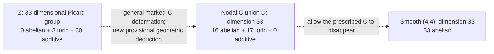

# Complete-intersection cycles: permanent mathematical source consolidation

## Mathematical dependency guide: residual examples versus smoothing claims

The [explicit smooth residual example](#2026-10-25-ci-cycle-smooth-residual-examplemd) supplies an actual equation pair and attachment calculation; the [deformation laboratory](#2026-10-25-ci-cycle-deformation-laboratorymd) explores how such intersections move. The [geometry notebook](#2026-10-25-ci-cycle-geometry-notebookmd) and [line degeneration](#2026-10-25-ci-cycle-line-degenerationmd) add geometric models with different boundary behavior.

The corresponding [smooth residual audit](CI_CYCLE_AUDITS_AND_BOUNDARY_SMOOTHING.md#2026-10-25-ci-cycle-smooth-residual-auditmd) and [line-degeneration audit](CI_CYCLE_AUDITS_AND_BOUNDARY_SMOOTHING.md#2026-10-25-ci-cycle-line-degeneration-auditmd) are the status checks. [Specialization proximity](CI_CYCLE_PENCILS_AND_SPECIALIZATION.md#2026-10-25-ci-cycle-specialization-proximitymd) gives a directed degeneration relation, not a total measure of closeness to STCI. [Valuative contact](CI_CYCLE_VALUATIONS_AND_CONTACT.md#2026-10-25-ci-cycle-valuative-contact-cyclemd) can record higher tangency without collapsing the residual cycle to zero.

The distinction between an actual residual component, its contact with the marked quartic, and the existence of a global deformation eliminating residual support is essential.

---


This subject supplement preserves the full mathematical content of the source investigations below, including hypotheses, computations, counterexamples, and limitations. Historical headings identify internal sections, not separate retained source files. No new theorem promotion is implied.


---

## 2026-10-25-ci-cycle-smooth-residual-example.md

# An actual smooth genus-sixteen residual with moving contact points

Date: 2026-10-25. Status: exact coordinate benchmark, independently audited and unpromoted. This supplies the explicit general-type example proposed in the [deformation laboratory](#2026-10-25-ci-cycle-deformation-laboratorymd), and a concrete test for the [adaptive valuative notebook](CI_CYCLE_ADAPTIVE_FRONTIER.md#2026-10-25-ci-cycle-adaptive-valuative-notebookmd). The underlying complete-intersection geometry is discussed in the [main notebook](#2026-10-25-ci-cycle-geometry-notebookmd). No canonical result changes.

The example is over \(\mathbf Q\), with geometric conclusions after passing to an algebraic closure. It is a single actual pair of homogeneous quartics. The exact computation does not classify all quartic pencils or assert anything about arbitrary equation degrees.

## 1. The pair

Retain the fixed curve

\[
C=[s^4:s^3t:st^3:t^4],
\qquad Q=x_0x_3-x_1x_2,
\]

and write

\[
F=x_1^4-x_0^3x_3,\qquad
G=x_2^4-x_0x_3^3,
\]

\[
A=x_1^3-x_0^2x_2,\qquad
D_3=x_2^3-x_1x_3^2.
\]

Choose the small integral quadratics

\[
H_0=x_0^2+x_1^2+x_2^2+x_3^2+x_0x_2+2x_1x_3,
\]

\[
H_1=2x_0^2+3x_1^2+5x_2^2+7x_3^2
+x_0x_1+x_0x_3+x_1x_2+3x_2x_3.
\]

The benchmark is

\[
\boxed{f=F+QH_0+2x_0A,\qquad
       g=G+QH_1+3x_3D_3.}                     \tag{1}
\]

All four summands used as perturbations vanish on the actual embedded \(C\). Thus the inclusion is built into the equations; no arbitrary generic-point coefficients are introduced.

Let \(J=(f,g)\) and let

\[
I_C=(Q,A,x_0x_2^2-x_1^2x_3,D_3),\qquad
K=\operatorname{saturate}(J:I_C).
\]

The exact rational calculation gives

\[
\boxed{J=I_C\cap K.}                          \tag{2}
\]

Consequently the total curve is exactly \(C\cup D\), where \(D=\operatorname{Proj}(\mathbf Q[x_0,x_1,x_2,x_3]/K)\). The residual curve is smooth and geometrically integral, has degree 12 and genus 16, and meets \(C\) at 18 distinct geometric points with distinct tangent directions. Neither distinguished endpoint is an attachment point.

This gives a particularly useful comparison with the four-quartic reference: the twelve residual units of degree form one smooth positive-genus component, and all residual contact has moved away from both special endpoints.

## 2. What was checked over the rationals

The [Macaulay2 verifier](../computations/verify_ci_smooth_residual_example_2026_10_25.m2) makes the following exact checks.

1. Both equations lie in \(I_C\), and \(J\) has codimension 2, so it is a proper \((4,4)\) complete intersection.
2. The saturated residual ideal \(K\) defines a projective curve of dimension 1, degree 12, and Hilbert polynomial \(12n-15\). Its minimal generators have degrees \(4,4,5,5,5\).
3. The intersection identity (2) holds as an equality of homogeneous ideals.
4. The saturated ideal generated by \(K\) and the two-by-two minors of its Jacobian is the unit ideal. Thus its projective singular scheme is empty.
5. The attachment ideal \(T=\operatorname{saturate}(K+I_C)\) defines a zero-dimensional projective scheme of degree 18. Adding the three-by-three Jacobian minors and saturating gives the unit ideal, so the attachment is geometrically reduced.
6. Adding either endpoint ideal to \(T\) and saturating gives the unit ideal.
7. \(H^0(D,\mathcal O_D)\) is exactly a rank-one vector space over \(\mathbf Q\).

The Jacobian calculations are over \(\mathbf Q\), not inferred from a finite-field trial. Over the perfect field \(\mathbf Q\), the empty projective singular scheme gives geometric smoothness. The unit-ideal certificates remain unit-ideal certificates after any field extension.

The last check upgrades irreducibility to **geometric** irreducibility. Flat base change for a field extension gives

\[
H^0(D_{\overline{\mathbf Q}},\mathcal O)
=H^0(D,\mathcal O_D)\otimes_{\mathbf Q}\overline{\mathbf Q}
=\overline{\mathbf Q}.
\]

Hence the smooth geometric curve is connected; the irreducible components of a smooth curve are disjoint, so it has one irreducible component. The exact equivalence for smooth proper curves is stated in [Stacks, Lemma 109.16.3](https://stacks.math.columbia.edu/tag/0E81), and the cohomology base-change input is [Stacks, Lemma 30.5.2](https://stacks.math.columbia.edu/tag/02KH).

One computational detail matters: Macaulay2's `dim` of this cohomology module returns its Krull dimension 0. Its vector-space dimension is obtained from `rank` after checking that its coefficient ring is `QQ`. The script checks both the coefficient ring and rank 1.

Since both curves are smooth, a reduced scheme-theoretic intersection point means that their tangent lines are distinct. Thus all 18 attachments are ordinary nodes of the total curve. There is no unexamined assertion of transversality hidden behind the degree count alone.

## 3. The attachment divisor is explicit and avoids both endpoints

On \(x_0=1\), set \(u=x_1\), \(X=x_3-u^4\), \(Y=x_2-u^3\). Restrict the quadratic perturbations to \(C\):

\[
h_0(u)=1+u^2+u^3+2u^5+u^6+u^8,
\]

\[
h_1(u)=2+u+3u^2+2u^4+5u^6+3u^7+7u^8.
\]

For the two-parameter template

\[
f_a=F+QH_0+ax_0A,\qquad
g_b=G+QH_1+bx_3D_3,
\]

the first-normal rows are

\[
f_a:\quad(h_0-1)X+(-uh_0-a)Y,
\]

\[
g_b:\quad(h_1-3u^8-2bu^9)X
+(4u^9-uh_1+3bu^{10})Y.
\]

Their determinant is

\[
d_{a,b}(u)
=(u+a)h_1+u^9(1+bu)h_0
-3au^8-(4+2ab)u^9-3bu^{10}.                   \tag{3}
\]

The benchmark uses \(a=2,b=3\). Its determinant has degree 18, constant coefficient 4, and leading coefficient 3. Its derivative is relatively prime to it over \(\mathbf Q\), so its 18 geometric zeros are distinct. The nonzero constant excludes \(p=[1:0:0:0]\); the degree 18 with nonzero leading coefficient excludes \(q=[0:0:0:1]\).

The [independent standard-library verifier](../computations/verify_ci_smooth_residual_boundary_2026_10_25.py) constructs the actual homogeneous equations, differentiates them in the normal coordinates, and independently checks (3), degree 18, endpoint absence, and the exact Euclidean gcd. Its [JSON output](../computations/ci_smooth_residual_boundary_2026_10_25.json) records the result. That script checks the boundary; the Macaulay2 calculation separately checks the entire residual curve.

In the terminology of the [valuative contact-cycle note](CI_CYCLE_VALUATIONS_AND_CONTACT.md#2026-10-25-ci-cycle-valuative-contact-cyclemd), if \(R=[D]\), then

\[
M_C(W)=B_C^{\mathrm{val}}(R)
=\sum_{d_{2,3}(u)=0}[u],
\]

with 18 distinct terms. Both cycles have degree 18, just as the distinguished \(Z\) has valuative contact degree 18. Their support and coefficients differ: for \(Z\), multiplicity excess is \(3p+3q\) and valuative contact is \(9p+9q\). A total contact degree cannot distinguish these configurations.

At both distinguished endpoints this example has \(e_p(W)=e_q(W)=m_C=1\), while residual components are present elsewhere. This is a concrete benchmark against any strategy that fixes those two points in advance. An adaptive witness must be allowed to move.

## 4. Where the genus goes

For the new example,

\[
p_a(C\cup D)=0+16+18-1=33.
\]

Its normalization is \(C\amalg D\), with total normalization genus 16, and its total delta invariant is 18. For the distinguished characteristic-zero \(Z\), the normalization is four rational curves and the total delta invariant is 36. Both total curves have the same Hilbert polynomial \(16n-32\).

Over \(\mathbf C\), the new curve has first Betti number \(32+17=49\): the smooth residual contributes 32, and the two-vertex graph with 18 edges contributes 17. The reference configuration has first Betti number 3. These differences are consistent with flat deformation; arithmetic genus, reduced-support topology, and normalization topology retain different information.

The geometry is therefore more than a numerical test of Bertini. It exhibits a redistribution from concentrated singular gluing to intrinsic genus and many simple attachment points.

## 5. A nearby failed choice is geometrically informative

The coefficients 1,1 in place of 2,3 initially looked equally plausible. Its residual has the same Hilbert polynomial and a reduced degree 18 attachment, but fails smoothness. The failure is structural: it contains the line

\[
L=V(x_0+x_1,x_2+x_3)\subset Q.
\]

Along \(L\), the identities \(x_0A=-F\) and \(x_3D_3=-G\) make both equations vanish when \(a=b=1\). The saturated residual Jacobian ideal is supported on that line and has degree 5. No classification of the complementary degree 11 cycle is asserted here.

This is a useful caution for reproducible examples: a squarefree attachment divisor does not certify smoothness away from \(C\). The final coefficients 2,3 remove that line and pass the global residual Jacobian test. The first simpler pair with no cubic perturbations was also smooth, but retained both distinguished endpoints as simple attachments; the final benchmark was chosen to demonstrate that residual contact can avoid both endpoints entirely.

## Evidence and continuation

Run from the repository root:

```sh
/opt/homebrew/bin/M2 --script research/computations/verify_ci_smooth_residual_example_2026_10_25.m2
python3 research/computations/verify_ci_smooth_residual_boundary_2026_10_25.py
```

The rational Macaulay2 suite took about 1.1 seconds in the recorded environment. Its largest individual test was the residual Jacobian saturation, about 0.4 CPU seconds. The initial smaller smooth pair received a separate independent rational computation; the final endpoint-free pair and its geometric interpretation are covered by the [independent audit](CI_CYCLE_AUDITS_AND_BOUNDARY_SMOOTHING.md#2026-10-25-ci-cycle-smooth-residual-auditmd).

The present benchmark completes the proposed explicit smooth-residual experiment. It leaves open the topology of fixed-boundary fibers and any universal positive-residual assertion. The failed line-containing pair suggests a next experiment in which the genus 16 residual breaks into a line and a degree 11 curve, with possible genus carried by their gluing; that interpretation should be checked before use.


---

## 2026-10-25-ci-cycle-deformation-laboratory.md

# Deformation laboratory for complete intersections through the fixed quartic

Date: 2026-10-25. Status: exploratory contribution to the [main notebook](#2026-10-25-ci-cycle-geometry-notebookmd). New calculations below are provisional research evidence; no canonical theorem or frontier record changes. The elementary calculations have reproducible scripts; the [independent audit](CI_CYCLE_AUDITS_AND_BOUNDARY_SMOOTHING.md#2026-10-25-ci-cycle-exploration-auditmd) separately reconstructs the deformation argument and exact global-source differential rank.

Throughout the main discussion, \(k\) is algebraically closed of characteristic zero,

\[
C=[s^4:s^3t:st^3:t^4],\quad
F=x_1^4-x_0^3x_3,\quad G=x_2^4-x_0x_3^3,
\quad Z=V(F,G).
\]

Write \(p=[1:0:0:0]\) and \(q=[0:0:0:1]\).

The question is how complete intersections containing the *fixed embedded curve* \(C\) can move, and how much of their geometry is recorded by their attachment to \(C\). It is not an STCI question.

The accepted premise [STCI-R-0021](../results/quartic_mu4_degeneration.md) identifies the four components of this prescribed \(Z\), its two endpoints, its flat integral model, and its characteristic-two collapse. Its linked source note supplies the local endpoint equation and boundary \(9p+9q\). [STCI-R-0020](../results/quartic_conormal_characteristic_jump.md) supplies the characteristic-zero splitting \(N^*_{C/\mathbf P^3}=\mathcal O_{\mathbf P^1}(-7)^2\). These records have their stated fixed-curve scopes. The argument here uses no carrier exclusion.

## 1. A simple parameter space with room to move

Put

\[
V=H^0(\mathbf P^3,I_C(4)).
\]

A quartic vanishing on the reduced curve vanishes scheme-theoretically on \(C\); thus this space parametrizes all quartic equations relevant to the fixed-\(C\) question. Restricting degree-four monomials to \(C\) gives all binary monomials of degree 16, so

\[
\dim V=35-17=18.
\]

This is also visible in the accepted quartic-symbol computation. Ordered independent equations form an open set in \(V^2\); after removing their choice of basis, the natural parameter space is

\[
\operatorname{Gr}(2,V)=\operatorname{Gr}(2,18),\qquad\dim=32.
\]

Remove the closed locus of pencils with a common surface component. On the resulting open set \(U\), every pair is a regular sequence and has the Koszul resolution of a \((4,4)\) complete intersection. The universal family is flat, with

\[
P_Z(n)=16n-32,\qquad p_a(Z)=33,\qquad\omega_Z\simeq\mathcal O_Z(4).
\]

Thus there is one irreducible local laboratory containing the distinguished configuration and many other configurations, even before allowing different equation degrees. The flat-family/Hilbert-scheme interpretation is standard; compare [Stacks, fixed Hilbert polynomial](https://stacks.math.columbia.edu/tag/0DNF). None of this means reduced support or normalization is constant.

A basis-free pencil parametrization matters: a path of ordered pairs obtained by an invertible linear recombination can look like a deformation while defining the identical curve. Passing to the Grassmannian removes that redundancy.

## 2. The generic picture: the four quartics can become \(C\) plus one genus 16 curve

A useful comparison configuration is

\[
Z_{\mathrm{gen}}=C\cup D,\qquad
\deg D=12,\quad g(D)=16,
\]

with \(D\) smooth and connected, meeting \(C\) transversely at 18 distinct points. This is the general picture in \(U\), rather than an assertion about every pair or every subfamily with fixed boundary.

Here is a compact geometric justification, also explaining why the general residual curve can be smooth. The ideal sheaf is generated in degrees at most 3, with equations

\[
Q=x_0x_3-x_1x_2,\quad
A=x_1^3-x_0^2x_2,\quad
B=x_0x_2^2-x_1^2x_3,\quad
D_3=x_2^3-x_1x_3^2.
\]

The accompanying Macaulay2 experiment checks that these generate the actual ideal. Hence \(I_C(3)\) is globally generated and \(h^0(I_C(3))=20-13=7\). On the smooth blowup \(B_C=\operatorname{Bl}_C\mathbf P^3\), write \(H\) for the pulled back hyperplane and \(E\) for the exceptional divisor. The graph construction embeds \(B_C\) into \(\mathbf P^3\times\mathbf P^6\) using \(H\) and \(3H-E\); the Segre polarization is \(4H-E\). In particular \(4H-E\) is very ample. Two general members therefore intersect in a smooth irreducible curve upstairs. Standard ingredients are the [Rees-algebra construction of the blowup](https://stacks.math.columbia.edu/tag/01OF), [Bertini smoothness](https://stacks.math.columbia.edu/tag/0FD4), and [Bertini irreducibility](https://stacks.math.columbia.edu/tag/0G4C).

The determinant calculation in the next section shows that a general pair has 18 simple attachment points on \(C\). Upstairs the residual curve crosses \(E\) at one point above each. Blowing down preserves smoothness at such a transverse crossing, and produces a transverse node with \(C\). This gives the claimed generic picture. This explanation is a new unpromoted geometric deduction, not a claim copied from a canonical record.

For the numerical values, work on a smooth quartic surface \(S\) containing \(C\). Adjunction gives \(K_S=0\) and \(C^2=-2\). The residual divisor class is

\[
D\sim4H-C,\qquad H^2=4,\quad H\cdot C=4.
\]

Consequently

\[
H\cdot D=12,\qquad D^2=30,\qquad p_a(D)=16,
\qquad C\cdot D=18.
\]

The genus bookkeeping is transparent:

\[
p_a(C\cup D)=0+16+18-1=33.
\]

At the distinguished point, \(D=C_{-1}\cup C_i\cup C_{-i}\) is three rational quartics. Its two endpoint singularities each have delta invariant 9, giving

\[
p_a(D)=18-3+1=16.
\]

So the residual genus 16 can migrate from singular gluing into the genus of one smooth component. The total arithmetic genus does not choose between these pictures. A normalization-based measure would see a dramatic change.

Over \(\mathbf C\), the generic nodal union has first Betti number \(2\cdot16+17=49\): the dual graph has two vertices and 18 edges. The distinguished reduced union has four spheres joined at two points, with incidence graph of first Betti number 3. These are different underlying topological curves in one flat family. The apparent loss of topology at the special fiber is carried by its more severe singularities, not a failure of flatness.

## 3. The attachment-divisor map is locally flexible even at \(Z\)

The first-normal parts of a pencil give a determinant section

\[
\det\bigl(N^*_{C/\mathbf P^3}(4)\bigr)
=\mathcal O_{\mathbf P^1}(18).
\]

When that section is nonzero, its zero divisor is an attachment diagnostic. On the reduced residual-component locus it is the intersection divisor \(C\cap D\), including intersection multiplicities. This defines a rational map, regular near the distinguished characteristic-zero point,

\[
\beta:U\dashrightarrow
\mathbf P H^0(\mathbf P^1,\mathcal O(18))
\simeq\operatorname{Sym}^{18}\mathbf P^1.
\]

The point \(Z\) maps to \(9p+9q\). The target has dimension 18.

**New calculation.** The differential of \(\beta\) at \(\langle F,G\rangle\) is surjective. Its tangent kernel therefore has dimension 14. This is stronger than the observation that some perturbations split endpoint contact: every infinitesimal degree 18 divisor direction is available through actual global quartics at this very pencil.

Use \(x_0=1\), \(u=x_1\), \(X=x_3-u^4\), \(Y=x_2-u^3\). Write a first-normal section as \(A(u)X+B(u)Y\). The two fixed equations have symbols

\[
f=(-1,0),\qquad g=(-3u^8,4u^9).
\]

For actual quartic perturbations \(h,k\in V\), the affine determinant derivative is

\[
\delta\det=4u^9A_h+3u^8B_h-B_k.
\]

The \(k\)-terms span \(1,u,\ldots,u^{10}\); the \(h\)-terms span \(u^8,\ldots,u^{18}\). Together they span all 19 coefficients. The reproducible Python script constructs an integral basis of \(V\) from differences of homogeneous monomials of equal parameter weight and verifies these ranks over \(\mathbf Q\). In particular it respects global \(k\)-coefficient constraints. It does not replace \(V\) by arbitrary \(k(C)\)-valued sections.

After quotienting the scalar determinant direction and the changes of basis of the pencil, the projective differential has rank 18. In characteristic zero this also gives the usual local smoothness interpretation: arbitrary sufficiently small formal/analytic movements of the boundary lift locally to movements of the pair. This is not a statement that every global degree 18 divisor has already been realized, nor a classification of the 14-dimensional fibers.

The striking research implication is that the endpoint concentration is not infinitesimally locked into the complete-intersection equations. It is a highly special divisor configuration inside a locally full-dimensional boundary space.

## 4. One visible perturbation: dissolve one endpoint bouquet

Keep \(F\) fixed and move only the other equation:

\[
G_\lambda=G+\lambda Qx_0^2.
\]

This is a global homogeneous quartic family containing \(C\). Since \(F\) is irreducible and the equations have equal degree without being proportional, it is a proper complete intersection for every \(\lambda\), and the constant Koszul resolution gives a flat family.

On the preceding affine chart \(F=0\) sets \(X=0\), and the actual second equation factors as

\[
G_\lambda|_{F=0}
=Y\left(Y^3+4u^3Y^2+6u^6Y+4u^9-\lambda u\right).
\]

For \(\lambda\ne0\), its residual curve is smooth at \(p\): its local equation has nonzero \(u\)-derivative \(-\lambda\). It meets \(C=(Y=0)\) transversely there. The attachment divisor becomes

\[
\operatorname{div}(s^9t(4t^8-\lambda s^8))
=9q+p+\sum_{u^8=\lambda/4}[u].
\]

The eight displayed finite points are distinct in characteristic zero. Thus nine units of endpoint contact unfold into one retained simple intersection plus eight mobile simple intersections. The opposite endpoint retains multiplicity 9 because \(F\) remains fixed. This asymmetric family is useful precisely because every feature is visible in one polynomial. It is not claimed to have globally smooth residual curve: the other endpoint is deliberately constrained.

At \(\lambda=1\), a finite Macaulay2 check computes the saturated residual by the actual colon ideal, finds degree 12 and Hilbert polynomial \(12n-15\), and checks length 18 of its attachment scheme to \(C\). These are finite coordinate checks, not a smoothness or irreducibility certification.

## 5. What the 14-dimensional boundary fiber hides

Surjective boundary differential leaves considerable room for equations to change while the attachment divisor stays \(9p+9q\). This is promising for comparing different sorts of proximity, but dangerous if one treats the divisor as a complete invariant.

For example, adding a multiple of \(Q^2\) to \(G\) changes no first-normal section at all. With \(F\) fixed, the residual local equation becomes

\[
Y^3+4u^3Y^2+(6u^6+\lambda u^2)Y+4u^9=0.
\]

It is still singular at \(p\). Thus a deformation invisible to the attachment divisor can change higher contact, yet need not release the endpoint singularity. One must calculate those higher terms rather than assuming that a generic member of a fixed-boundary fiber has a smooth residual branch with order 9 tangency. That is an experiment still to do.

The complementary root-pencil experiment in the main notebook keeps a four-quartic arrangement while varying its residual cross-ratio and occasionally its component multiplicities. Together these suggest that \(\beta^{-1}(9p+9q)\) has interesting internal strata: symmetry, branch count, normalization genus, tangency trees, and nonreduced components can vary even when the boundary divisor does not.

A useful next computation would choose a local 14-parameter slice to this fiber at \(Z\), compute jets of the two endpoint residual equations, and determine which branch-splitting and smoothing directions actually occur. This is a finite geometry experiment before any global extremality claim.

## 6. Experiments worth doing next

1. **Boundary lifting beyond first order.** Pick a one-parameter binary form splitting all 18 zeros, lift its first jet using the rank calculation, and solve successively for actual global quartics. The local smoothness calculation predicts no formal obstruction at \(Z\); an explicit low-degree lift would make the geometry visible.
2. **One verified generic residual.** Choose a reproducible rational pair near \(F,G\), compute its residual ideal, and check smoothness and irreducibility globally. The Bertini argument predicts the outcome; an example would provide a useful picture and numerical companion.
3. **Topology inside a boundary fiber.** Follow a family with fixed \(9p+9q\), compute endpoint Puiseux data, and compare residual normalization genus. The determinant alone cannot answer this.
4. **Blowup intersection picture.** Draw the moving 18 points on the exceptional ruled surface, including their positions within its fibers. Their projection to \(C\) is \(\beta\); their fiber coordinates and higher neighborhoods retain information lost by the divisor.
5. **Characteristic-two comparison.** Repeat the differential calculation after reduction, remembering that the determinant of the prescribed pair is then identically zero. The characteristic-zero boundary map does not extend to a degree 18 effective divisor at that point by merely substituting \(2=0\). One should retain the two-row normal map or its Fitting ideal before taking determinants.

## Reproducible evidence and review scope

**Continuation checkpoint.** The pending explicit-example experiment has now been completed in the [smooth residual benchmark](#2026-10-25-ci-cycle-smooth-residual-examplemd), with a [separate independent audit](CI_CYCLE_AUDITS_AND_BOUNDARY_SMOOTHING.md#2026-10-25-ci-cycle-smooth-residual-auditmd). The actual rational pair has a smooth geometrically integral degree-12 genus-16 residual and eighteen simple attachments, none at the distinguished endpoints. The original scripts below retain their narrower scopes; the new benchmark has its own certificates.

Run from the repository root:

```sh
python3 research/computations/explore_ci_contact_deformations_2026_10_25.py
/opt/homebrew/bin/M2 --script research/computations/explore_ci_residual_pencil_2026_10_25.m2
```

The Python script checks the exact rational differential ranks, its support decomposition, and the displayed boundary of the asymmetric pencil. The Macaulay2 script checks the actual ideal generators, residual Hilbert polynomials, and one attachment length. Both passed on 2026-10-25. They do not classify all pencils, analyze every fixed-boundary fiber, or promote these observations.

The [independent audit](CI_CYCLE_AUDITS_AND_BOUNDARY_SMOOTHING.md#2026-10-25-ci-cycle-exploration-auditmd) reconstructs the generic-smooth-residual explanation, determinant-map interpretation, and local-smoothness inference. They remain exploratory and unpromoted. There is no canonical authority gap for the prescribed four-component family itself: it is covered by STCI-R-0021. There is an authority distinction for the present deductions: these are exploratory unpromoted notes. No accepted mathematics is edited and no unrestricted frontier question changes.


---

## 2026-10-25-ci-cycle-geometry-notebook.md

# Complete-intersection cycles containing the rational quartic: a geometric notebook

Date: 2026-10-25. **Status: exploratory research, with selective exact calculations and an independent audit; no canonical promotion.**

The question is how to see the distinguished four-quartic intersection as a special configuration among complete intersections containing a marked curve. The most productive picture emerging here is that it **concentrates a fixed attachment boundary and a large amount of genus into two symmetric places**. That picture has several mathematical realizations, but each forgets something. We keep the competing viewpoints alive rather than choosing a universal order prematurely.

**Clarified direction.** The broader aim is to show that every proper characteristic-zero hypersurface pair containing this fixed \(C\) has a nonzero residual cycle away from \(C\). Proximity to a multiple of \(C\) is the research tool, and its measure may depend on the pair being studied. The [adaptive valuative continuation](CI_CYCLE_ADAPTIVE_FRONTIER.md#2026-10-25-ci-cycle-adaptive-valuative-notebookmd) develops this interpretation: generic transverse valuations, point valuations on \(C\), infinitely near points, and a valuative contact divisor provide complementary certificate types. It distinguishes the proposed universal goal from the local identities and examples currently established.

Throughout the characteristic-zero discussion, the field is algebraically closed. Statements about ordinary topology mean the complex fiber. Write
\[
C=[s^4:s^3t:st^3:t^4],\quad
p=[1:0:0:0],\quad q=[0:0:0:1],
\]
\[
F=x_1^4-x_0^3x_3,\qquad G=x_2^4-x_0x_3^3,
\qquad Z=V(F,G),\qquad Q=x_0x_3-x_1x_2.
\]
The parameter \(a\) below is unrelated to a hypersurface degree. An ambient twist by \(d\) has degree \(4d\) on the normalization \(C\cong\mathbf P^1\).

## 1. Starting with motion

A small perturbation of two quartic equations usually loses the prescribed curve. To retain it, move the equations in
\[
V=H^0(\mathbf P^3,I_C(4)),\qquad \dim V=18.
\]
The dimension follows from the actual restriction of the 35 quartic monomials to all 17 degree-16 binary monomials. Ordered independent pairs form an open subset of \(V^2\); changing the basis of their pencil does not change the intersection. Thus the natural parameter space is the open locus
\[
U\subset\operatorname{Gr}(2,V),\qquad \dim U=32,
\]
where the two generators have no common surface component. Its universal curve is a flat family of complete intersections with Hilbert polynomial \(16n-32\). The proper-intersection condition matters: a limit in the full Grassmannian can acquire a common surface and leave this family of curves.

For a reduced member generically simple along \(C\), imagine separating off a residual curve \(D\). For a general point of \(U\), the residual curve is smooth and irreducible and the attachment points are transverse. The resulting picture is
\[
W=C\cup D,\qquad \deg D=12,\quad p_a(D)=16,
\quad \operatorname{length}(C\cap D)=18.
\]
If \(D\) is smooth and the attachments are transverse, these are eighteen ordinary nodes. The genus calculation is especially transparent:
\[
33=0+16+18-1.
\]
This is the basic picture against which to compare \(Z\): a high-genus residual curve joined to \(C\) at eighteen separate places, versus three rational residual quartics whose attachments to \(C\) are concentrated at two places. The generic smoothness assertion is a new provisional geometric deduction, independently reviewed in this package. The ideal of \(C\) is generated in degrees at most three, so its blowup embeds as a graph in \(\mathbf P^3\times\mathbf P^6\). The Segre polarization restricts to \(4H-E\), which is very ample. Two general members give a smooth irreducible residual curve upstairs by Bertini. Simple boundary zeros, available by section 5, give transverse crossings of the exceptional divisor; blowdown preserves smoothness there and yields transverse attachments to \(C\). The [deformation laboratory](#2026-10-25-ci-cycle-deformation-laboratorymd) and [independent audit](CI_CYCLE_AUDITS_AND_BOUNDARY_SMOOTHING.md#2026-10-25-ci-cycle-exploration-auditmd) record the details. The subsequent [exact rational benchmark](#2026-10-25-ci-cycle-smooth-residual-examplemd), with its [independent audit](CI_CYCLE_AUDITS_AND_BOUNDARY_SMOOTHING.md#2026-10-25-ci-cycle-smooth-residual-auditmd), now supplies a computed pair with all eighteen attachments away from \(p,q\).

The [deformation laboratory](#2026-10-25-ci-cycle-deformation-laboratorymd) gives the actual section basis, a pencil that moves attachment points, and a calculation of the boundary map. The [Stacks Project Euler-characteristic lemma](https://stacks.math.columbia.edu/tag/0B9T) explains the general flat-family constancy behind this use of Hilbert polynomials; here the complete-intersection resolution gives the polynomial directly.

## 2. A visible dissolution of an endpoint

Keep \(F\) fixed and put
\[
G_\lambda=G+\lambda x_0^2Q.
\]
On \(x_0=1\), use \(u=x_1\), \(X=x_3-u^4\), \(Y=x_2-u^3\). Eliminating \(X\) gives
\[
G_\lambda|_{F=0}
=Y\bigl(Y^3+4u^3Y^2+6u^6Y+4u^9-\lambda u\bigr).
\]
The first factor is \(C\); the second is the residual equation on this chart. Its intersection with \(C\) has equation
\[
u(4u^8-\lambda)=0.
\]
Globally the attachment divisor is
\[
B_\lambda=\operatorname{div}\bigl(s^9t(4t^8-\lambda s^8)\bigr).
\]
At \(\lambda=0\) this is \(9p+9q\). For nonzero \(\lambda\), it consists of \(p+9q\) and eight distinct moving points. Those eight attachments are locally ordinary transverse crossings: near a nonzero root, the residual equation has a nonzero \(u\)-derivative along \(Y=0\).

This gives a concrete meaning to “concentration”: eight simple attachments collide with one retained attachment at \(p\). Their degree is conserved. It does **not** say that the residual curve is smooth globally or that every singularity in the family is accounted for by these eight nodes. Keeping one singular quartic carrier fixed is deliberately restrictive.

An immediate second experiment is to perturb both generators so that the divisor near \(q\) also splits. The boundary-map calculation in section 5 says there is no first-order obstruction to moving any of its eighteen zeros.

## 3. A different motion: preserve the whole two-point arrangement

There is a second pencil with almost opposite behavior:
\[
G_a=G+a x_3^2Q
=x_2^4-a x_1x_2x_3^2+(a-1)x_0x_3^3.
\]
On \(F=0\), setting \(x_2=\ell u^3\) yields
\[
f_a(\ell)=\ell^4-a\ell+a-1
=(\ell-1)(\ell^3+\ell^2+\ell+1-a).
\]
The fixed root \(1\) retains \(C\). When the four roots are distinct and nonzero, the components are
\[
C_\ell=[s^4:s^3t:\ell st^3:t^4].
\]
Every component is projectively equivalent to \(C\), every pair meets only at \(p,q\), and every pair has contact order three at both endpoints. Thus the normalization, all pairwise contact lengths, and every component's conductor boundary remain the same while the root arrangement moves.

The family is flat for finite \(a\): the equations are monic with relatively prime leading monomials \(x_1^4,x_2^4\), giving a free rank-16 module over \(k[a,x_0,x_3]\). Its discriminant is
\[
\operatorname{disc}(f_a)
=256(a-1)^3-27a^4
=(a-4)^2(-27a^2+40a-16).
\]

| Parameter | Geometric event |
|---|---|
| \(a=0\) | The distinguished roots-of-unity configuration \(Z\). |
| General \(a\) | Four smooth quartics, the same two contact points and the same \(9p+9q\) boundary. |
| \(a=4\), characteristic zero | \(C\) becomes double; the other two roots are \(-1\pm i\sqrt2\). The cycle is \(2[C]+[C_{-1+i\sqrt2}]+[C_{-1-i\sqrt2}]\). |
| The other discriminant zeros | Two residual roots collide; their quartic becomes a double component. |
| \(a=1\) | A root is zero; its plane quartic is singular, so the “four smooth copies” description stops applying. |
| \(a=\infty\), in the projective pencil | The second equation is \(x_3^2Q\); the cycle is \(C+3L_a+9L_d\), where \(L_a=V(x_0,x_1)\), \(L_d=V(x_1,x_3)\). |

The endpoint at infinity is still a proper complete intersection with \(F\). Indeed, on the Segre quadric \(F=a_0^3d(a_0d^3-bc^3)\), while \(F\cap V(x_3)=4L_d\). Here \(a_0\) denotes the Segre coordinate, to distinguish it from the pencil parameter. This explains the multiplicities \(3\) and \(9\).

The first-normal determinant for finite parameter is proportional to
\[
(4-a)s^9t^9.
\]
For \(a\ne4\), its divisor is exactly \(9p+9q\). At \(a=4\) it becomes identically zero: an attachment divisor for a generically simple marked component has ceased to be the right object. At infinity the divisor is again \(9p+9q\), despite the radically different residual cycle.

This family is a useful warning and an invitation. Boundary concentration does not characterize the four-quartic arrangement. Conversely, equal boundary leaves room for interesting moduli and changes of multiplicity. The [root-pencil notebook](CI_CYCLE_PENCILS_AND_SPECIALIZATION.md#2026-10-25-ci-cycle-root-pencilmd) records the exact equations, exceptional parameters, and a reproducible verifier.

## 4. A hidden elliptic curve in the four branches

At \(p\), a weighted separation of the common tangent uses \(x_2/u^3=\ell\). The four branches become four points on the exceptional parameter line. Their cross-ratio gives a moduli parameter invisible to the contact orders. Equivalently, attach the auxiliary double cover
\[
E_a:\quad w^2=\ell^4-a\ell+a-1.
\]
For distinct roots its smooth projective completion has genus one; the root \(\ell=1\) gives a marked ramification point. Direct conversion to a cubic gives
\[
j(E_a)=1728\,
\frac{256(a-1)^3}{256(a-1)^3-27a^4}.
\]
At \(a=0\), \(j=1728\): the four roots form a harmonic quadruple. At \(a=1\), \(j=0\), even though one of the corresponding quartics downstairs has become singular. This already shows that the auxiliary elliptic modulus measures the resolved branch arrangement, rather than every feature of the embedded curve.

**Interpretation to explore.** \(Z\) may be a symmetry-enhanced point in a moduli space of equicontact arrangements. Its extra symmetry is partly detected by a familiar elliptic modulus. This would be a different extremality principle from minimizing residual mass or maximizing a conductor length. The elliptic curve is an auxiliary construction from four separated branches; no elliptic component of \(Z\) is being asserted.

The same four points can be read after three successive separations of the common tangent in a smooth endpoint surface chart. At \(q\), coefficients are reciprocally cubed. Remarkably, the root equation gives
\[
\ell^{-3}=\frac{\ell}{a\ell+1-a}.
\]
For \(a\ne1\), this is one common Möbius transformation for all four roots. The two endpoint configurations therefore have the same cross-ratio and auxiliary elliptic modulus throughout this pencil. This ties the two local pictures together through the actual global equations. A classification of all endpoint analytic equivalences, or a comparable relation for moving carriers, is not attempted here.

## 5. The attachment boundary as a map of parameter spaces

Let \(E=I_C/I_C^2\). In characteristic zero the promoted conormal result is \(E\cong\mathcal O_{\mathbf P^1}(-7)^2\). Two quartics have first-normal sections in \(E(4)\), and their wedge is a section of
\[
\det(E(4))=\mathcal O_{\mathbf P^1}(18).
\]
When this section is nonzero, define
\[
B(W)=\operatorname{div}(\sigma_f\wedge\sigma_g).
\]
Changing the basis of the pencil scales the wedge, so this gives a well-defined rational map
\[
\beta:U\dashrightarrow\mathbf P H^0(\mathcal O_{\mathbf P^1}(18))
\cong\mathbf P^{18}.
\]
In the reduced residual setting, this is \(C\cap D\) as a divisor on \(C\). It also records failures of first-normal independence when a simple residual interpretation is unavailable. It is undefined where the wedge is identically zero, including a generically multiple \(C\).

**New finite calculation.** The differential of \(\beta\) is surjective at \(\langle F,G\rangle\). The calculation uses actual global quartics, not arbitrary sections over \(k(C)\). In the chart above, write a first symbol as \(A_hX+B_hY\). Then
\[
\sigma_F=-X,\quad \sigma_G=-3u^8X+4u^9Y,
\]
and the variation of the determinant is
\[
4u^9A_h+3u^8B_h-B_k.
\]
For the actual restriction-kernel basis these variations span all nineteen coefficients of a degree-at-most-18 polynomial. Quotienting by the line of the original determinant gives projective differential rank eighteen. The [stdlib Python experiment](../computations/explore_ci_contact_deformations_2026_10_25.py) preserves the basis and rational rank calculation.

Thus near \(Z\) the boundary is locally a freely moving degree-18 divisor, and the fiber over \(9p+9q\) has dimension fourteen. In characteristic zero this is the smooth-fiber conclusion from a surjective differential between the smooth Grassmannian open and projective space. This is a local statement at \(Z\), not a classification of the entire fiber.

**Why this is promising.** It gives a manageable first layer of a deformation atlas. First prescribe where residual curves attach to \(C\); then study the fourteen-dimensional local fiber carrying the missing embedded information. The root pencil lies inside that fiber but cannot exhaust it.

**What might fail.** The boundary does not specify the number, genera, multiplicities, or higher contact data of residual components. Surjectivity does not assert that every arbitrarily chosen global boundary has a prescribed smooth residual realization, and it gives no multiplicity-four model on \(C\). Understanding topology inside a boundary fiber is a separate experiment.

**Completed continuation, October 26.** At the [line-plus-degree-eleven residual member](#2026-10-25-ci-cycle-line-degenerationmd), the boundary map is again smooth of rank eighteen. The [fixed-boundary smoothing experiment](CI_CYCLE_AUDITS_AND_BOUNDARY_SMOOTHING.md#2026-10-25-ci-cycle-fixed-boundary-node-smoothingmd) shows that its fourteen-dimensional local fiber controls all five residual node-smoothing parameters independently, with nine further tangent parameters. The exact ranks and formal/étale interpretation have [independent review](CI_CYCLE_AUDITS_AND_BOUNDARY_SMOOTHING.md#2026-10-25-ci-cycle-fixed-boundary-node-smoothing-auditmd). Thus even the exact divisor, rather than only its degree, can be fixed while genus moves from residual gluing into residual normalization. An explicit polynomial coefficient arc is not part of that calculation.

## 6. What exactly is compressed at the endpoints?

The established local equation at either endpoint of \(Z\), in a smooth surface chart, is analytically equivalent to
\[
y^4-u^{12}=0.
\]
Its four smooth branches meet pairwise with multiplicity three. Therefore
\[
\delta_p=\delta_q=\binom42\cdot3=18,
\qquad \delta(Z)=36.
\]
The normalization sequence gives
\[
p_a(Z)=\sum g(C_i)+\delta(Z)-4+1=33.
\]
Each component meets the other three in \(9p+9q\). Because \(Z\) is a reduced Gorenstein curve,
\[
\nu^*\omega_Z|_{C_i}
=\omega_{\mathbf P^1}(9p+9q)
=\mathcal O_{\mathbf P^1}(16).
\]
This agrees with complete-intersection adjunction \(\omega_Z=\mathcal O_Z(4)\). The sum of conductor degrees upstairs is \(4\cdot18=72=2\delta(Z)\).

The boundary on one component has a useful dual interpretation. \(9p+9q\) is the full pole allowance for a dualizing differential; its reduced support \(p+q\) makes \(\mathbf P^1\setminus\{p,q\}\cong\mathbf G_m\). The reduced log pair has \(K_{\mathbf P^1}+p+q\sim0\), while retaining coefficient nine gives canonical degree sixteen. These are two different structures, both naturally present. The coefficient nine cannot be discarded when studying duality or conductor descent.

There is also an inverse-problem lesson: the divisor on the normalization gives a pole budget, but descending differentials must satisfy gluing conditions between branches. Likewise, a conductor divisor alone does not reconstruct a singular curve. A promising finer object is the conductor quotient algebra together with its four labelled normalization maps.

## 7. Three topologies and a moving genus budget

For the complex fiber, the normalization of \(Z\) is four spheres. Identifying their four \(p\)-points to one point and their four \(q\)-points to another gives the topology of the reduced curve. The incidence graph has four component vertices, two singular-point vertices, and eight branch edges, hence first Betti number three.

| Curve or model | Normalization genera | \(b_1\) of the curve | \(b_2\) | Topological Euler characteristic | Arithmetic genus |
|---|---:|---:|---:|---:|---:|
| \(C\) | \(0\) | \(0\) | \(1\) | \(2\) | \(0\) |
| \(Z\) | \(0,0,0,0\) | \(3\) | \(4\) | \(2\) | \(33\) |
| \(C\cup D\), \(D\) smooth genus 16, 18 transverse nodes | \(0,16\) | \(49\) | \(2\) | \(-46\) | \(33\) |
| Smooth complete intersection \((4,4)\), allowing \(C\) to be lost | \(33\) | \(66\) | \(1\) | \(-64\) | \(33\) |

The equality \(\chi_{\mathrm{top}}(Z)=\chi_{\mathrm{top}}(C)=2\) is a striking accident, not a reason to identify their topology. The last row is a comparison outside the marked-\(C\) deformation problem: a smooth irreducible curve cannot contain \(C\) as a proper curve component.

The generalized Jacobian reveals data that ordinary topology misses. Over characteristic zero,
\[
\operatorname{Pic}^0(Z)\cong\mathbf G_m^3\times\mathbf G_a^{30}
\]
noncanonically. There is no abelian part, since all normalized components are rational. The torus records the three graph loops; thirty additive directions record higher-order gluing beyond the seminormal curve. For the nodal comparison \(C\cup D\), its Picard group is an extension of \(\operatorname{Jac}(D)\), dimension sixteen, by a torus of rank seventeen, with no unipotent part.



**Geometric intuition.** Genus is being stored in different places: on normalization components, in graph loops, and in infinitesimal gluing. \(Z\) stores almost all of it in infinitesimal gluing. This seems closer to the user's intuition than total degree alone. The unit-quotient description and the characteristic-zero restriction are explained in the [conductor and topology notebook](CI_CYCLE_PENCILS_AND_SPECIALIZATION.md#2026-10-25-ci-cycle-conductor-topologymd), with [Bosch–Lütkebohmert–Raynaud, Jacobians of relative curves](https://math.arizona.edu/~cais/scans/BLR-Neron_Models/neron4.pdf) as a primary reference.

## 8. Is this an extremal amount of singularity?

Inside a class of four reduced rational components, genus thirty-three forces total \(\delta=36\). In that class the interesting quantity is where singularity is placed and what kind it is, rather than its total. The root pencil keeps even that placement constant while changing an elliptic modulus.

Across all reduced \((4,4)\) intersections, total delta need not be at most thirty-six. An explicit competing arrangement is
\[
V(Q L_1L_2, R L_3),\qquad R=x_0x_2^2-x_1^2x_3,
\]
with the three planes chosen as in the [exact eight-component experiment](../computations/verify_ci_cycle_eight_component_competitor_2026_10_25.m2). It is a reduced proper complete intersection with eight rational components of degrees
\[
4,1,1,2,3,3,1,1.
\]
The two irreducible plane cubics are nodal. Hence its total delta is
\[
33+8-1=40.
\]
This example allows reducible hypersurfaces, exactly as the broad parameter space does. It does not decide an extremality question after imposing integral carriers, four smooth quartic components, fixed endpoint support, or a symmetry condition. It helps identify which additional hypotheses would make such a question interesting.

A simpler comparison across degrees is already available on the smooth quadric. The provisional, independently audited cubic-scroll calculation gives
\[
V(Q,R)=C+L_0+L_\infty,
\]
where the two ruling lines attach at \(3p\) and \(3q\). This \((2,3)\) curve has degree six, arithmetic genus four, and boundary \(3p+3q\) on \(C\). The same two-point pattern occurs with a smaller genus budget. It suggests an arithmetic progression of contact budgets, but there is no asserted family or classification interpolating these configurations.

## 9. Several candidate meanings of proximity

The notation \(W\succeq Z\succeq C\) can encode genuinely different questions. The following candidates are intentionally kept separate.

| Candidate | What it detects | Why \(Z\) is interesting | What it forgets or can fail to order |
|---|---|---|---|
| Effective cycle inclusion | Actual multiplicities of irreducible curves | \([Z]\ge[C]\) | Distinct same-degree cycles containing \(C\) are generally incomparable; numerical equivalence in \(\mathbf P^3\) sees only degree. |
| Degree-normalized mass on \(C\) | \(4m_C(W)/\deg W\) | Characteristic-two \(Z\) has mass one | All generically simple \((4,4)\) members have mass \(1/4\); \(V(Q,R)\) has larger mass \(2/3\). |
| Boundary concentration | Multiplicities in \(B(W)\) | \(9p+9q\) concentrates eighteen units at two points | Not defined on the identically-zero determinant locus; same boundary has a fourteen-dimensional local fiber. |
| Additive genus storage | Unipotent dimension in the reduced curve's Picard group | Thirty additive directions | Depends on reduction and characteristic; no universal monotonicity asserted here. |
| Resolved branch moduli | Cross-ratios or auxiliary elliptic \(j\) | Harmonic quadruple, \(j=1728\) | Applies to an equicontact branch class, not arbitrary intersections. |
| Specialization of marked schemes | Actual flat families retaining \(C\) | Explicit pencils specialize to \(Z\) | A relation on specified families or strata; it is not automatically a numerical order. |
| Valuations of branch separations | Contact order and arithmetic collision depth | Endpoint order three plus 2-adic root collision | Requires a carrier/model and labelled branches; exceptional geometry must be pushed downstairs correctly. |

For example, for a nonzero degree-18 boundary \(B=\sum m_i r_i\), a crude concentration score is
\[
\mathcal K(B)=\frac{\sum m_i^2}{18^2}.
\]
It is \(1/18\) for eighteen distinct points and \(1/2\) for \(9p+9q\). Colliding points raises it. An arbitrary divisor \(18p\) would have score one; we have not determined which extreme global divisors are realized in a desired residual smoothness class. Thus this score quantifies a direction of degeneration without declaring \(Z\) a global maximum. A distance between distinct points would require extra metric data; no projectively canonical metric has been chosen.

For a proper \((d,e)\) complete intersection containing \(C\) generically simply, the analogous determinant degree is
\[
\deg B=4(d+e)-14,
\]
whenever the determinant is nonzero. Normalizing the boundary by this degree allows a comparison across bidegrees. Such a comparison remembers attachment distribution while losing the total canonical budget. Keeping both quantities seems preferable.

## 10. A precise balanced-boundary interpretation from GIT

Regard \(B(Z)\) as the degree-18 binary form \(s^9t^9\). In the usual \(\operatorname{PGL}_2\) invariant theory of divisors on \(\mathbf P^1\), semistability permits multiplicity at most nine. The equal two-point divisor is strictly polystable: it represents the unique closed orbit in the strictly semistable locus. Thus there is a precise sense in which \(9p+9q\) is an exceptionally balanced **boundary configuration**.

This is a compelling version of the guiding intuition. It is balanced between two equal concentrations, not spread uniformly over eighteen points. The root pencil shows why a boundary quotient should be only the first stage of a richer moduli problem.

Two qualifications preserve the geometry. First, full \(\operatorname{PGL}_2\) forgets the specified four-dimensional hyperplane linear system defining the embedding \(C\subset\mathbf P^3\). The actual embedded automorphism group is smaller. Second, stable binary forms do not all have \(s^9t^9\) in their semistable orbit closure. This GIT observation does not order every complete intersection above \(Z\). See [Alper–Isaev, §5.2](https://sites.math.washington.edu/~jarod/papers/binary.pdf) and the [specialization notebook](CI_CYCLE_PENCILS_AND_SPECIALIZATION.md#2026-10-25-ci-cycle-specialization-proximitymd).

Under the actual torus fixing \(p,q\), plus endpoint exchange, \(9p+9q\) is the unique invariant effective divisor of degree eighteen. But it is not the unique torus-fixed complete-intersection pencil: the whole root pencil is torus invariant. This is a symmetry principle for a quotient of the geometry, with a substantial fiber still to understand.

## 11. Hilbert, Chow, and the choice of a specialization relation

On the Hilbert scheme the degree and arithmetic genus of a proper \((4,4)\) family stay fixed. On the Chow space one remembers component cycles and their multiplicities but loses the conductor algebra and much embedded structure. In the numerical curve group of \(\mathbf P^3\), even the position of a quartic has disappeared: every \(Z\) has class \(16[\text{line}]\).

The reduced curve \(C\) has Hilbert polynomial \(4n+1\), so it cannot be the special fiber of a flat projective family with Hilbert polynomial \(16n-32\). A multiple structure with support \(C\) can be such a fiber. This is precisely why the characteristic-two example matters.

A usable exploratory relation could be: a **stratum** of marked intersections lies above another if its closure contains the latter, with a specified flat family as evidence. The generic point of a chosen family then lies above its special point. Over an algebraically closed field, two distinct closed Hilbert-scheme points do not specialize directly to one another in the literal topological sense; one needs a family, a generic point, or orbit closures.

The finite root pencil gives \(Z_a\rightsquigarrow Z_0=Z\) along its parameter curve, but other special members occur on that same curve. This puts \(Z\) into a web of degenerations rather than making it a unique terminal object. An orbit-closure relation under automorphisms preserving \(C\) would be more restrictive. Neither relation is asserted to compare all of \(U\).

Another useful invariance check is \(V(F^r,G^s)\): its fundamental cycle is \(rs[Z]\). Any degree-normalized cycle score is unchanged by this presentation thickening, even though the Hilbert polynomial and local algebras change. This is a reason to carry a scheme invariant alongside a normalized cycle invariant.

## 12. Characteristic two: residual mass becomes transverse thickness

The promoted result [STCI-R-0021](../results/quartic_mu4_degeneration.md) gives a flat integral model of \(Z\). Away from the endpoints it is
\[
\mathbf G_m\times\mu_4.
\]
In characteristic zero there are four geometric sheets. In characteristic two,
\[
z^4-1=(z-1)^4,
\]
and the generic transverse algebra is \(k(C)[Y]/(Y^4)\). The cycle is \(4[C]\), while the reduced support and its normalization are just \(C\cong\mathbf P^1\). A normalization of the nonreduced special fiber cannot retain its transverse thickness: normalization is taken through the reduction.

After normalizing all cycles to degree four,
\[
\tfrac14[Z_{\overline{\mathbf Q}}]
=\tfrac14\sum_{\zeta^4=1}[C_\zeta],
\qquad
\tfrac14[Z_{\overline{\mathbf F}_2}]=[C].
\]
Here the phrase “closer to \(C\)” has a precise cycle interpretation. The scheme still carries arithmetic genus thirty-three, whereas its reduction has genus zero. Genus has moved from reduced branch gluing into nilpotent structure.

The first-normal determinant explains a second transition. Its coefficient is \(4s^9t^9\); the horizontal contact information lies in \(s^9t^9\), while \(4\) carries arithmetic collision. Modulo two the determinant is identically zero, so the degree-18 divisor does not specialize as an ordinary effective Cartier divisor. The missing information reappears at higher normal order. The full normal filtration, rather than only its first determinant, is the natural continuation of the boundary map across this locus.

There are therefore two axes worth studying together: collision along the curve, measured by endpoint orders, and collision across characteristics, measured by valuations of root differences. The derivative \(4u^9\) and discriminant \(-256\) are small expressions coupling those axes. The arithmetic ruled-model notes warn that normalization and branch intersections need not commute with specialization; vertical exceptional components upstairs must not be mistaken for additional curve components downstairs.

## 13. A possible organizing object

The experiments suggest keeping a package rather than seeking one scalar immediately:
\[
\left(
\begin{gathered}
\text{normalized cycle};\\
\text{marked boundary};\\
\text{conductor quotient and branch maps};\\
\text{higher normal algebra}
\end{gathered}
\right).
\]
The first entry sees residual mass; the second sees concentration; the third sees genus and gluing; the fourth survives when residual sheets become transverse thickness. On an equicontact four-branch stratum, add the resolved branch cross-ratios.

This is a proposed research viewpoint, not a constructed moduli functor. A useful ordering may be multistage: compare mass on \(C\), then a boundary degeneration within a fixed mass stratum, then refinement of gluing. Characteristic two suggests that a compactification should allow one kind of information to change into another. A scalar that insists these features are interchangeable may obscure the most interesting geometry.

Three tentative extremality principles remain attractive:

1. **Balanced concentration:** \(Z\) is distinguished by its symmetric, polystable two-point boundary. This already has a precise quotient-level meaning, with a large fiber.
2. **Equicontact symmetry:** among four smooth quartics with this contact pattern, the roots-of-unity arrangement is a symmetry-enhanced moduli point. The auxiliary elliptic \(j=1728\) makes this testable.
3. **Arithmetic compressibility:** the four conjugate sheets form a finite-flat group-scheme pattern that can collapse entirely into thickness on the marked curve. This is a property of the integral model and its action, rather than an inequality among all characteristic-zero cycles.

Each can motivate a geometric classification on its own and may contribute to the broader residual-cycle goal. The adaptive valuative continuation asks how different comparisons could cover different classes of pairs, without requiring one fixed scalar measure.

## 14. Next experiments, in a useful order

1. **Explore the fourteen-dimensional boundary fiber.** Compute first deformations with \(\beta=9p+9q\) beyond the root pencil. Determine which retain four components, which change residual genus, and which change endpoint analytic types. Record the full residual schemes, not only the determinant. This tests what the boundary is concealing.
2. **Compare explicit global deformation mechanisms.** The [exact rational benchmark](#2026-10-25-ci-cycle-smooth-residual-examplemd) completes the requested smooth degree-12 genus-16 example, with eighteen simple attachments away from both endpoints. Its intermediate failed candidate forces an additional residual line. Study how the line appears and how its attachments redistribute genus, rather than rerunning the completed smoothness check.
3. **Resolve the endpoint arrangement with its marking.** Track the four points exposed by successive blowups and compare the configurations at \(p\) and \(q\). Determine the automorphism group of the generic root-pencil member and its enhancement at \(a=0\). Check which elliptic symmetries lift to the embedded curve configuration.
4. **Separate boundary GIT from embedded GIT.** Study the image of \(\beta\) and the action of the actual stabilizer of \(C\). Determine whether the balanced boundary fiber has distinguished closed orbits after retaining higher symbols. Do not substitute the full \(\operatorname{PGL}_2\) action for the embedded one.
5. **Compute the conductor algebra along a selected pencil.** Follow the thirty additive Picard directions and identify which become toric or abelian in a reduced deformation. This turns “genus compression” into a more concrete deformation question.
6. **Build a two-axis arithmetic experiment.** Work over a DVR above two with an additional deformation parameter. Track root differences, discriminant, determinant content, and the full normal filtration together. Ask whether a valuative/tropical diagram captures both endpoint contact and arithmetic coalescence.
7. **Compare simple low-degree arrangements.** Begin with \(V(Q,R)=C+L_0+L_\infty\), with boundary \(3p+3q\), before enlarging bidegrees. Test which normalized contact statistics are meaningful under changes of degree and under presentation thickening.

These are proposed experiments, not computations claimed complete. The first four are especially likely to distinguish a useful moduli principle from a numerical coincidence.

## 15. Evidence, status, and reproducibility

**Promoted premises used:** [STCI-R-0020](../results/quartic_conormal_characteristic_jump.md), the characteristic-dependent conormal splitting for this marked embedding; [STCI-R-0021](../results/quartic_mu4_degeneration.md), the prescribed flat roots-of-unity family and its geometric fibers. Their source notes and independent audits are linked in those records. No quartic-carrier exclusion or unrestricted STCI assertion is used.

**Additional inherited geometry:** the [cubic-scroll note, §6](CUBIC_SCROLL_AND_RULED_SURFACES.md#cubic-scroll-normalization) and [ruled-surface synthesis](CUBIC_SCROLL_AND_RULED_SURFACES.md#p4-ruled-surfaces-synthesis), independently audited provisional geometry, supply the explicit quadric/cubic arrangement and arithmetic-model cautions. These remain evidence notes, not promoted result records. The endpoint delta calculation and branch equations are already in the evidence for R0021; they were used as premises.

**New exploratory contributions:** the deformation parameter and boundary calculations; explicit partial dissolution; root pencil and auxiliary elliptic modulus; genus-storage comparison; selected competing arrangements; proposed orders and next experiments. These have the scope and uncertainty stated in their sections. The companion notebooks preserve derivations and primary literature links:

- [Deformation laboratory](#2026-10-25-ci-cycle-deformation-laboratorymd).
- [Conductor and topology](CI_CYCLE_PENCILS_AND_SPECIALIZATION.md#2026-10-25-ci-cycle-conductor-topologymd).
- [Specialization and proximity](CI_CYCLE_PENCILS_AND_SPECIALIZATION.md#2026-10-25-ci-cycle-specialization-proximitymd).
- [Root pencil and elliptic modulus](CI_CYCLE_PENCILS_AND_SPECIALIZATION.md#2026-10-25-ci-cycle-root-pencilmd).
- [Independent audit](CI_CYCLE_AUDITS_AND_BOUNDARY_SMOOTHING.md#2026-10-25-ci-cycle-exploration-auditmd).
- [Adaptive valuative continuation](CI_CYCLE_ADAPTIVE_FRONTIER.md#2026-10-25-ci-cycle-adaptive-valuative-notebookmd), incorporating the clarified broader goal and cycle-dependent measures.
- [Explicit smooth residual benchmark](#2026-10-25-ci-cycle-smooth-residual-examplemd) and [independent audit](CI_CYCLE_AUDITS_AND_BOUNDARY_SMOOTHING.md#2026-10-25-ci-cycle-smooth-residual-auditmd).
- [Line degeneration](#2026-10-25-ci-cycle-line-degenerationmd) and [independent audit](CI_CYCLE_AUDITS_AND_BOUNDARY_SMOOTHING.md#2026-10-25-ci-cycle-line-degeneration-auditmd).
- [Independent node smoothing at fixed boundary](CI_CYCLE_AUDITS_AND_BOUNDARY_SMOOTHING.md#2026-10-25-ci-cycle-fixed-boundary-node-smoothingmd) and [October 26 audit](CI_CYCLE_AUDITS_AND_BOUNDARY_SMOOTHING.md#2026-10-25-ci-cycle-fixed-boundary-node-smoothing-auditmd).
- [Completed endpoint-four sextic followup](ENDPOINT_FOUR_ACTUAL_SEXTICS.md#actual-sextics-on-the-retained-endpoint-four-chart), including one explicit fixed-carrier residual bound, and [scope audit](2026-10-26-endpoint4-nonsplit-node-scope-audit.md).

Run the new selective experiments from the repository root:

```sh
python3 research/computations/explore_ci_contact_deformations_2026_10_25.py
python3 research/computations/verify_ci_cycle_root_pencil_2026_10_25.py
/opt/homebrew/bin/M2 --script research/computations/explore_ci_residual_pencil_2026_10_25.m2
/opt/homebrew/bin/M2 --script research/computations/verify_ci_cycle_eight_component_competitor_2026_10_25.m2
```

The original scripts check explicit coefficient maps, identities, and finite projective ideals. The subsequent smooth-residual benchmark adds direct rational Jacobian, cohomology, and reduced-attachment checks for one explicit pair. None classifies the boundary fiber or proves an all-pairs claim. The general-pair smoothness argument uses the separately reviewed blowup and Bertini geometry. No canonical mathematics has been edited or promoted, and no STCI frontier is closed by this exploration.


---

## 2026-10-25-ci-cycle-line-degeneration.md

# A line is absorbed into the residual curve: five nodes and four units of genus

Date: 2026-10-25. **Exploratory coordinate experiment; not canonically
promoted.** This note continues the deformation laboratory for actual
complete intersections containing the fixed rational quartic. It turns a
failed smooth-residual candidate into a particularly transparent genus
redistribution. No STCI claim is made.

## 1. The actual two-parameter family

Work over \(\mathbf Q\), taking geometric fibers or embedding into
\(\mathbf C\) when discussing irreducibility and topology. Retain
\[
C=[s^4:s^3t:st^3:t^4],\quad Q=x_0x_3-x_1x_2,
\]
\[
F=x_1^4-x_0^3x_3,\quad G=x_2^4-x_0x_3^3,\quad
A=x_1^3-x_0^2x_2,\quad D_3=x_2^3-x_1x_3^2.
\]
Set
\[
H_0=x_0^2+x_1^2+x_2^2+x_3^2+x_0x_2+2x_1x_3,
\]
\[
H_1=2x_0^2+3x_1^2+5x_2^2+7x_3^2+x_0x_1+x_0x_3+x_1x_2+3x_2x_3,
\]
and consider the actual homogeneous quartics
\[
f_a=F+QH_0+a x_0A,\qquad
 g_b=G+QH_1+b x_3D_3.
\tag{1}
\]
Every pair vanishes on the same embedded \(C\). The separately checked
\((a,b)=(2,3)\) member has a smooth geometrically integral residual curve
of degree twelve and genus sixteen, with eighteen simple attachments to
\(C\); its evidence is the
[exact benchmark script](../computations/verify_ci_smooth_residual_example_2026_10_25.m2).
This note investigates the initially unsuccessful choice \((1,1)\).
The general deformation framework and its review are in
[the laboratory](#2026-10-25-ci-cycle-deformation-laboratorymd) and
[the exploration audit](CI_CYCLE_AUDITS_AND_BOUNDARY_SMOOTHING.md#2026-10-25-ci-cycle-exploration-auditmd).

The canonical input [R0021](../results/quartic_mu4_degeneration.md)
concerns the original prescribed \((F,G)\) family, not (1). All new finite
scheme computations here remain provisional research evidence.

## 2. Exact residual decomposition at (1,1)

Let \(I_C\) be the actual four-generator quartic-curve ideal. The
[QQ Macaulay2 experiment](../computations/ci_cycle_line_degeneration_2026_10_25.m2)
computes saturated colons
\[
I_D=((f_1,g_1):I_C)^{\mathrm{sat}},\qquad
I_E=(I_D:I_L)^{\mathrm{sat}},\qquad
I_L=(x_0+x_1,x_2+x_3).
\]
It establishes the following exact coordinate example:

* \(V(f_1,g_1)=C\cup L\cup E\) scheme-theoretically, with
  \(I_D=I_L\cap I_E\) and \((f_1,g_1)=I_C\cap I_D\).
* \(E\) has degree eleven and Hilbert polynomial \(11n-11\), hence
  arithmetic genus twelve.
* The projective Jacobian singular scheme of \(E\) is empty over
  \(\mathbf Q\), and \(H^0(E,\mathcal O_E)=\mathbf Q\). Smoothness and
  proper field-extension base change imply geometric connectedness, hence
  geometric integrality.
* \(L\cap E\) consists of five geometrically reduced points,
  \(C\cap E\) of seventeen, and \(C\cap L\) of one. There is no triple
  intersection.

Consequently all these intersections are ordinary transverse nodes in
the corresponding scheme unions. The residual curve \(D=L\cup E\) has
exactly five nodes, and the total curve has twenty-three nodes.

Parameterize the line by
\[
L=[-r:r:-s:s].
\]
Its five attachments to \(E\) are cut out by the squarefree binary quintic
\[
P_5(r,s)=4r^5-2r^4s+9r^3s^2+2r^2s^3+3rs^4+2s^5.
\tag{2}
\]
The unique point of \(C\cap L\) is the curve parameter \(u=t/s=-1\), or
\([1:-1:-1:1]\). It has \(r/s=-1\), and
\(P_5(-1,1)=-14\ne0\), so it is not one of the five residual nodes.
Neither distinguished endpoint of \(C\) occurs in this configuration's
attachment divisor.

## 3. Why the line occurs: a ruling stratum, not an accidental factor

The fixed line \(L\) is contained in (1) exactly at \(a=b=1\), because
\[
f_a|_L=(1-a)r^3(r+s),\qquad
 g_b|_L=(1-b)s^3(r+s).
\]
But a line in the same ruling moves with the parameters. On the smooth
quadric write
\[
x_0=\rho c,\quad x_1=\rho d,\quad
x_2=\sigma c,\quad x_3=\sigma d,
\]
and put \(K_C=\rho d^3-\sigma c^3\), which cuts out \(C\) on \(Q\).
Restriction of the actual equations gives
\[
f_a|_Q=\rho^3(d+a c)K_C,\qquad
 g_b|_Q=-\sigma^3(c+b d)K_C.
\tag{3}
\]
Thus the two ruling factors coincide precisely on the parameter hyperbola
\[
ab=1.
\tag{4}
\]
For \(a\ne0\), the residual then contains the moving ruling line
\[
L_a=V(x_1+a x_0,\ x_3+a x_2).
\]
This line meets \(C\) at the parameter \(u=-a\). The decomposition at
\((1,1)\) therefore belongs to a natural stratum inherited from the
unique containing quadric. It is not five unrelated node conditions
that happen to vanish simultaneously.

Near \((1,1)\), after restricting to the open set where the remaining
curve and the displayed intersections stay smooth and transverse, this
stratum retains a degree-eleven genus-twelve component and a line joined
to it at five points. This is an openness statement local to the checked
member, not a claim about every point of the whole hyperbola.

## 4. All five nodes smooth in the same parameter direction

For an explicit infinitesimal check, use normal coordinates to \(L\),
\(n_0=x_0+x_1\) and \(n_1=x_2+x_3\). The first-normal matrix of
\((f_1,g_1)\) is
\[
M_L=
\begin{pmatrix}
r^3+2r^2s+3rs^2+2s^3&-r^3-3r^2s-2rs^2\\
4r^2s-2rs^2+8s^3&-4r^3+2r^2s-9rs^2-s^3
\end{pmatrix}.
\]
Its determinant is
\[
\det M_L=-(r+s)P_5(r,s).
\tag{5}
\]
The six zeros are exactly the one attachment to \(C\) and the five to
\(E\). Denote the right-hand entries of its rows by
\(F_1=-r(r+s)(r+2s)\) and
\(G_1=-4r^3+2r^2s-9rs^2-s^3\). The entry \(F_1\) is nonzero at all five
roots of \(P_5\).

At such a residual node, a first-order parameter change gives values
\(\delta f=-r^3(r+s)\delta a\) and
\(\delta g=-s^3(r+s)\delta b\). A relation between the two gradient rows
identifies its one-dimensional smoothing class with
\[
(r+s)(-G_1r^3\delta a+F_1s^3\delta b).
\]
The exact polynomial identity
\[
-G_1r^3=rP_5+F_1s^3
\]
therefore makes this a nonzero scalar multiple of
\[
\delta a+\delta b
\tag{6}
\]
at each of the five nodes. The tangent line is exactly the tangent to
\(ab=1\), as predicted by the moving ruling.

The standard local model for a nodal family is \(xy=\tau\); see
[Stacks, étale local structure of nodal families](https://stacks.math.columbia.edu/tag/0H8M).
In a formal or étale neighborhood of this checked member, after labelling
the five nodes, each residual smoothing parameter is a unit times
\(ab-1\): it vanishes along the moving-line stratum and has nonzero
normal derivative by (6). Their product is a unit times \((ab-1)^5\).
This product records five node-smoothing contributions; it is not a
claim that the scheme-theoretic image of the critical locus has ideal
\((ab-1)^5\). That image can have reduced ideal \((ab-1)\).
This is a **local residual discriminant statement**. The total curve
retains nodes where it meets the fixed \(C\), so its entire singular-fiber
locus would not be the discriminant intended here.

To control the whole residual family locally, use the smooth blowup
\(\operatorname{Bl}_C\mathbf P^3\) from the deformation laboratory.
The two strict transforms have class \(4H-E_C\); their proper
intersection is flat near the checked base point. At its eighteen simple
attachments the blowdown is an isomorphism on the residual curve, because
the ideal of \(C\) restricts there to a Cartier point. Reducedness of
these attachments is open. Properness and openness of smoothness then
allow a neighborhood where the only residual singularities arise from
the five nodes just analyzed.

A transverse path such as \(a=1+t,b=1+2t\) smooths all five residual nodes
near \(t=0\), since \(ab-1=3t+2t^2\). Its member at \(t=1\) is also the
separately checked smooth benchmark. No assertion is made that every
intermediate parameter on the full affine path avoids all other bad
strata.

## 5. Four units of genus come from five gluing points

The residual genus is constant:
\[
p_a(L\cup E)=0+12+5-1=16.
\]
Smoothing the five nodes joins the two components and converts the
four independent cycles of their dual graph into genus on one smooth
component. This operation absorbs the line through deformation; it is
not a contraction or a blowdown of \(L\).

For the full curve the two configurations have the following budgets:

| Geometric quantity | At the line member | Nearby smooth residual |
| --- | --- | --- |
| Components | \(C,L,E\) | \(C,D\) |
| Degrees | \(4,1,11\) | \(4,12\) |
| Normalization genus sum | \(12\) | \(16\) |
| Total nodes / total delta | \(23\) | \(18\) |
| Dual-graph first Betti number | \(21\) | \(17\) |
| Arithmetic genus | \(12+23-3+1=33\) | \(16+18-2+1=33\) |
| Topological \(b_1\) over \(\mathbf C\) | \(45\) | \(49\) |
| Topological \(b_2\) over \(\mathbf C\) | \(3\) | \(2\) |

The topological Euler characteristic drops by five when the five nodes
smooth, even though the arithmetic genus stays fixed. The genus sixteen
of the residual can therefore be realized partly as genus twelve and
partly as graph gluing, without involving the severe endpoint bouquets
of the original \(\mu_4\) arrangement.

The canonical sheaf gives a particularly tidy componentwise check.
A \((4,4)\) complete intersection has \(\omega_Z=\mathcal O_Z(4)\).
For this nodal reduced fiber, normalization restricts it as the canonical
bundle plus the reduced attachment boundary. Consequently
\(2g_i-2+n_i=4d_i\):

| Component | \(d_i\) | \(g_i\) | Attachments \(n_i\) | \(2g_i-2+n_i\) |
| --- | --- | --- | --- | --- |
| \(C\) | 4 | 0 | 18 | 16 |
| \(L\) | 1 | 0 | 6 | 4 |
| \(E\) | 11 | 12 | 22 | 44 |
| Smoothed \(D\) | 12 | 16 | 18 | 48 |

This also explains the quintic before computing it. In a reduced nodal
complete intersection of degrees \(d,e\), a line component must have
\(d+e-2\) attachments, because \(\omega_Z|_L=\mathcal O_L(d+e-4)\)
and \(\deg\omega_L=-2\). Here there are six attachments in total,
and the one intersection with \(C\) leaves five for the other residual
component. Absorbing a line joined at five points then raises
normalization genus by four.

The six marked points on the line are geometrically meaningful. In
particular, it is a stable rational component of the total nodal curve,
not an unstable component discarded by forgetting the embedding.

## 6. The boundary on C stays ordinary throughout this change

Let \(u=t/s\) be the affine parameter on \(C\), and set
\[
h_0=1+u^2+u^3+2u^5+u^6+u^8,
\]
\[
h_1=2+u+3u^2+2u^4+5u^6+3u^7+7u^8.
\]
Independently differentiating the actual global sources in (1) gives the
first-normal determinant on \(C\):
\[
\beta_{a,b}(u)=(u+a)h_1+u^9(1+bu)h_0
-3au^8-(4+2ab)u^9-3bu^{10}.
\tag{7}
\]
At \((1,1)\),
\[
\beta_{1,1}(u)=(u+1)B_{17}(u),\qquad
B_{17}=h_1+u^9h_0-3u^8(u+1).
\tag{8}
\]
The factor \(u+1\) is the attachment to \(L\); \(B_{17}\) supplies the
seventeen attachments to \(E\). It is squarefree, has nonzero constant
and leading coefficients, and \(B_{17}(-1)=14\). Thus all eighteen
attachments are simple and avoid the distinguished endpoints. This
remains true on an open neighborhood in the parameter plane, including
points on both sides of the residual node-smoothing stratum.

The contact pattern along \(C\) is therefore already ordinary while
five additional nodes off \(C\) redistribute residual genus. Local
invariants sampled only at the attachments to \(C\) will miss that part
of the topology. The boundary divisor remains useful, but the residual
curve's own incidence graph supplies independent data.

## 7. Evidence limits and next experiments

The [Macaulay2 script](../computations/ci_cycle_line_degeneration_2026_10_25.m2)
and its [output](../computations/ci_cycle_line_degeneration_2026_10_25_m2.txt)
check the actual saturated residual ideals, geometric smoothness and
connectedness criterion, lengths and geometric reducedness of all three
attachment schemes, absence of triples, and the first-normal matrix.
The [stdlib companion](../computations/ci_cycle_line_degeneration_2026_10_25.py)
and [JSON output](../computations/ci_cycle_line_degeneration_2026_10_25.json)
check fourteen global-source, ruling, boundary, and genus identities.
These are exact checks over \(\mathbf Q\), with no finite-field lifting
step. The local smoothing and topology interpretations are stated
separately from the finite ideal computations.

The two-parameter family constrains all five smoothing parameters to
move together. A next experiment in the full eighteen-dimensional
quartic source should ask whether these five node smoothings can be
controlled independently while retaining a chosen first-order boundary
on \(C\). If so, partial smoothings would give a ladder of residual
normalization genera and graph contributions. If not, the dependence
could reveal a global linkage constraint worth understanding.

Another direction is to follow the degree-eleven component along
\(ab=1\), including limits of the six-pointed ruling line. Its stable
point configuration might organize boundary strata that the divisor on
\(C\) cannot see. No classification, global discriminant formula, or
canonical promotion is claimed here.

