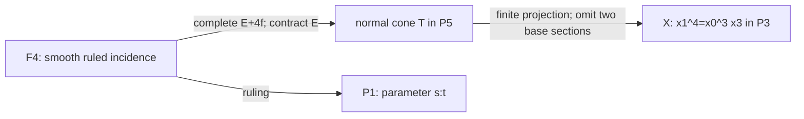
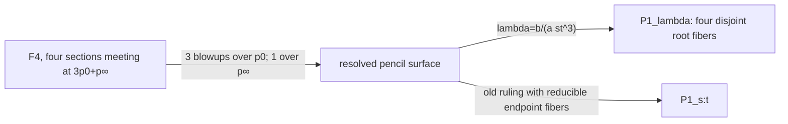
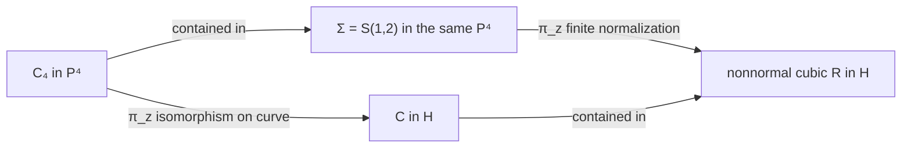
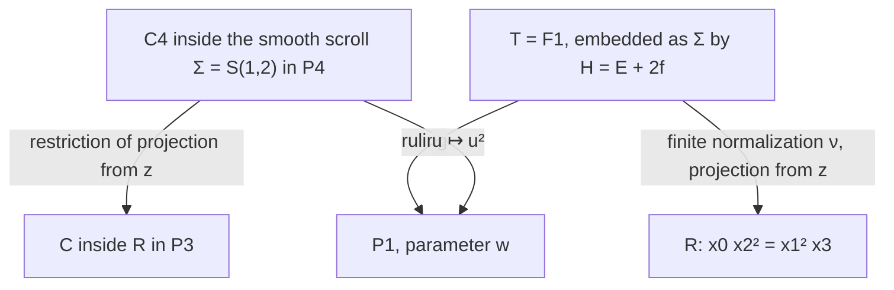
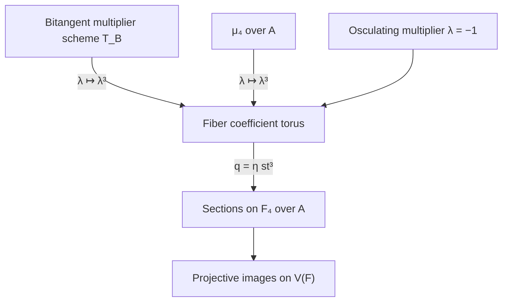
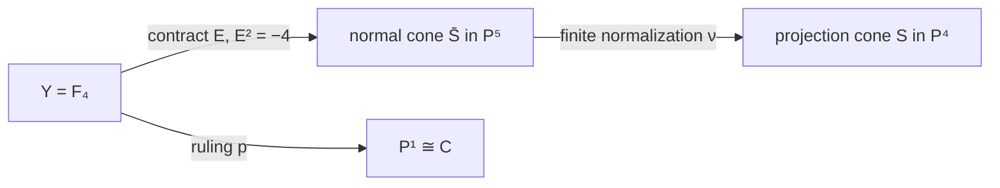

# Cubic scrolls and ruled-surface geometry

Full historical mathematical content retained by topic, including computational details, substantive failures and independently reviewed limitations. No theorem promotion.


---

## four-sheet-ruled-surface

# The four-component quartic surface and its ruled model

Date: 2026-10-24. Author: independent research agent `four_sheet`.
Status: **provisional intrinsic geometry; independently reconstructed and
reviewed in the [arithmetic and normalization audit](2026-10-24-four-sheet-arithmetic-independent-audit.md)
and the [comparison audit](2026-10-24-ruled-comparison-independent-audit.md);
no canonical promotion**. Work over an algebraically closed field of
characteristic zero unless a base is specified. The arithmetic companion
[studies specialization separately](2026-10-24-ruled-surfaces-arithmetic.md).

The fixed objects are
\[
X=V(F)\subset\mathbf P^3,\quad F=x_1^4-x_0^3x_3,
\qquad C_\zeta=[s^4:s^3t:\zeta st^3:t^4],\quad\zeta^4=1.
\]
Write $p_0=[1:0]$, $p_\infty=[0:1]$ on every marked parameter line.
The purpose is the geometry of $X$, its finite normalization, and its
smooth ruled model. No carrier-exclusion theorem is used or reopened.

## 1. The ruling and the two different normalization maps

For fixed $[s:t]$, let
\[
\ell_{[s:t]}=\{[a s^4:a s^3t:b:a t^4]\mid[a:b]\text{ in the indicated fiber}\}.
\tag{1}
\]
All these lines contain $v=[0:0:1:0]$. They are the generators of the cone
over the plane quartic
\[
B=[s^4:s^3t:t^4]\subset\mathbf P^2_{x_0,x_1,x_3}.
\]
The map $\mathbf P^1\to B$ is its normalization: $u=t/s=x_1/x_0$
recovers the parameter on a dense chart, and the only singularity is
$s=0$, where $x_3=1$ gives $(x_0,x_1)=(v^4,v^3)$ with $v=s/t$.
This is the $(3,4)$ cusp. Its semigroup has gaps $1,2,5$, hence delta
invariant three, in agreement with the plane quartic arithmetic genus.

Every line (1) lies in $X$. The ruled image is an irreducible surface,
and $x_1^4-x_0^3x_3$ is irreducible; for instance it is primitive and
linear in $x_3$ over $k[x_0,x_1]$. Thus its image is exactly $X$.
The four points of the assignment are the four values $b/a=\zeta st^3$
on this generator, in compatible trivializations.

Use the **lines convention**
\[
Y=\mathbf P_{\mathbf P^1}(\mathcal O\oplus\mathcal O(-4)),
\qquad \mathcal O_Y(-1)\subset p^*(\mathcal O\oplus\mathcal O(-4)).
\]
It is also isomorphic to the quotient-convention surface
$\mathbf P(\mathcal O\oplus\mathcal O(4))$. The subbundle $\mathcal O$
defines the negative section $E$, with
\[
E^2=-4,\quad E\cdot f=1,\quad f^2=0,
\qquad H=c_1(\mathcal O_Y(1))=E+4f.
\tag{2}
\]
Indeed $N_{E/Y}=\operatorname{Hom}(\mathcal O,\mathcal O(-4))$
and $H|_E=\mathcal O$. Formula (1) defines a morphism
$\phi:Y=\mathbb F_4\to X$ by a four-dimensional subspace of $H^0(H)$.
Its negative section contracts to $v$. Therefore **this morphism is a
resolution through the normalization, and is not finite**.

The finite normalization is the normal cone over the complete rational
normal quartic:
\[
T=\operatorname{Proj} k[s^4,s^3t,s^2t^2,st^3,t^4,r]
\cong\mathbf P(1,1,4).
\tag{3}
\]
Here the six displayed generators have standard degree one; in the
weighted presentation $s,t,r$ have weights $1,1,4$. The map
$\rho:Y\to T$ is given by the complete system $|H|$ and contracts only
$E$. It is the minimal resolution of the vertex quotient singularity
$\frac14(1,1)$. In particular the Hirzebruch index is four, not three.
The complete system maps to $\mathbf P^5$, not $\mathbf P^4$.

For a direct proof of finite normalization, set
\[
A=k[s^4,s^3t,t^4,r],\qquad
\overline A=k[s^4,s^3t,s^2t^2,st^3,t^4,r].
\]
The omitted generators belong to $\operatorname{Frac}(A)$, because
$s^2t^2=(s^3t)^2/s^4$ and $st^3=(s^3t)^3/(s^4)^2$.
They are integral: $(s^2t^2)^2=s^4t^4$ and
$(st^3)^4=s^4(t^4)^3$. The fourth Veronese ring of $k[s,t]$ is normal,
and adjoining $r$ preserves normality. Thus $\overline A$ is exactly
the integral closure of $A$. This proves that $\nu:T\to X$ is finite
birational normalization, with
\[
\phi=\nu\circ\rho,\qquad \nu^*\mathcal O_X(1)=\mathcal O_T(1),
\quad\rho^*\mathcal O_T(1)=\mathcal O_Y(H).
\tag{4}
\]



## 2. Singular locus and full conductor

Differentiating $F$ in characteristic zero gives reduced singular locus
\[
\Sigma=V(x_0,x_1),
\tag{5}
\]
the generator above $p_\infty$. It includes the vertex. In the chart
$x_3=1$, away from the vertex, normalization is
\[
k[v^3,v^4,b]\subset k[v,b],\qquad
(x_0,x_1,x_2)=(v^4,v^3,b).
\tag{6}
\]
The map is one-to-one on geometric points along this line; its failure
is a transverse cusp, rather than the double-curve identification of
the cubic scroll. The normalized surface $T$ itself is smooth off its
vertex and singular at its vertex. The original $X$ is nonnormal along
all of $\Sigma$.

The **global conductor ideal** in $\mathcal O_X$ is
\[
\mathfrak c=(x_0,x_1)^2.
\tag{7}
\]
Here is a semigroup proof, which also checks the vertex. A monomial
$s^a t^b$ in the full fourth Veronese belongs to
$k[s^4,s^3t,t^4]$ exactly when, writing $j=b\bmod4$ with
$0\le j\le3$, one has $a\ge3j$. Every monomial with $a\ge6$
therefore belongs, and remains in the smaller semigroup after any
multiplication by a full-Veronese monomial. The only possible smaller
$s$-exponents in the smaller ring are $0,3,4$; each fails the conductor
condition after multiplication by a missing degree-one generator.
The conductor is monomial, since the inclusion is torus graded. Its
monomials are exactly those of $s$-exponent at least six, generated in
the smaller ring by
\[
s^6t^2=x_1^2,\quad s^7t=x_0x_1,\quad s^8=x_0^2.
\]
Polynomial extension by $r=x_2$ preserves this computation. It follows
that (7) gives the full homogeneous conductor, rather than only its
support. In (6) it becomes $v^6k[v,b]$.

On $Y$, its extended ideal is invertible and equals
\[
\mathfrak c\mathcal O_Y=\mathcal O_Y(-2E-6f_\infty).
\tag{8}
\]
Indeed its three generators are locally $a^2s^6$ times
$s^2,st,t^2$, which have no common zero on the base. The multiplicity
two on $E$ must be retained when the resolution and finite
normalization are compared.

## 3. The four sections and their exact intersections

More generally every $h\in H^0(\mathbf P^1,\mathcal O(4))$ gives a
section $D_h$ of $p$ defined by $b=a h$. It avoids $E$, and is the
image of the subbundle $\mathcal O(-4)\to\mathcal O\oplus\mathcal O(-4)$,
$w\mapsto(hw,w)$. Its class is
\[
D_h\sim H=E+4f,\qquad D_h^2=4,\qquad N_{D_h/Y}\cong\mathcal O_{\mathbf P^1}(4).
\tag{9}
\]
The $D_h$ form an affine five-space of sections; the normal-bundle
calculation gives the same unobstructed five-dimensional deformation
space. In particular the four strict transforms, or reduced inverse
images, are
\[
D_\zeta=D_{\zeta st^3}\sim E+4f.
\]
Their restrictions to $C_\zeta$ are isomorphisms, as is evident from
the parameterizations. They are disjoint from the contracted section.
For distinct fourth roots $\zeta,\eta$, their scheme intersection is
the zero divisor of $(\zeta-\eta)st^3$:
\[
(D_\zeta\cap D_\eta)|_{D_\zeta}=3p_0+p_\infty,
\qquad D_\zeta\cdot D_\eta=4.
\tag{10}
\]
This is linear equivalence, not merely numerical equivalence.

The **image curves have different intersection lengths**. On $x_0=1$,
with $u=x_1$, their ideals are
\[
I_{C_\zeta}=(x_3-u^4,\ x_2-\zeta u^3).
\]
Adding the ideals for two distinct roots gives $(x_3,u^3,x_2)$, of
length three at $p_0$. On $x_3=1$, put $b=x_2$. Their ideals are
\[
I_{C_\zeta}=(x_0-b^4,\ x_1-\zeta b^3),
\tag{11}
\]
since $\zeta^4=1$. The sum is $(x_0,x_1,b^3)$, of length three
at $p_\infty$. Hence
\[
(C_\zeta\cap C_\eta)|_{C_\zeta}=3p_0+3p_\infty,
\quad\operatorname{length}(C_\zeta\cap C_\eta)=6.
\tag{12}
\]
The two endpoints exhaust the intersection set. At infinity the
normalization separates distinct tangent directions $b=\zeta v$;
downstairs the cusp parameter $v^3$ makes the image curves tangent.
It is incorrect to transfer (10) unchanged to the images in $\mathbf P^3$.

There is one further scheme distinction. The **full scheme inverse
image** of $C_\zeta$ under normalization is not just $D_\zeta$.
In (6), the ideal pulled back from (11) is
\[
J=(v^4-b^4,\ v^3-\zeta b^3)
 =l\,(v^2+\zeta^{-1}vb+\zeta^{-2}b^2,\ b^3),
\quad l=v-\zeta^{-1}b.
\tag{13}
\]
For the equality, factor the cubics and quartics and reduce the cubic
cofactor modulo the quadratic; it becomes a unit times $b^3$.
The residual ideal in parentheses is a regular sequence of colength
six. The exact sequence
\[
0\longrightarrow (l)/J\longrightarrow k[v,b]/J
\longrightarrow k[v,b]/(l)\longrightarrow0
\]
has its left term of length six. Thus there is an embedded correction
at the cusp point, even though the reduced inverse image is the smooth
section. The same chart describes the full inverse image on $Y$,
since these points avoid $E$.

## 4. A natural pencil and the four separating blowups

Consider the whole pencil
\[
D_\lambda:\quad b=\lambda a st^3,\qquad\lambda\in\mathbf A^1.
\tag{14}
\]
It lies in $|H|$. Its member at infinity is
$E+3f_0+f_\infty$. The pencil has exactly the base scheme of length four
$3p_0+p_\infty$ on $D_0$. Resolve its rational function
\[
\lambda=\frac{b}{a st^3}
\tag{15}
\]
by three successive point blowups above $p_0$ and one blowup above
$p_\infty$. This is a natural resolution of the pencil, not four
arbitrarily chosen blowups.

Near $p_0$ the four sections have equations $b=\zeta u^3$. In the
successive charts they become
$b_1=\zeta u^2$, $b_2=\zeta u$, $b_3=\zeta$.
Thus the third blowup separates them. Near infinity they are
$b=\zeta v$, with distinct tangent directions, so one blowup separates
them. Every pair loses one unit of intersection at each of these four
common centers. The final strict transforms are disjoint curves of
self-intersection $4-4=0$, and are fibers of the resolved morphism
$\widehat Y\to\mathbf P^1_\lambda$. Their class, in the basis of total
exceptional transforms, is
\[
\widehat D=\pi^*H-e_1-e_2-e_3-e_\infty,
\qquad \widehat D^2=0.
\tag{16}
\]
The original ruling over $[s:t]$ now has reducible fibers above the
endpoints. The new map (15) supplies a different rational fibration.
The two rulings should not be conflated.

The action $b\mapsto\xi b$ fixes the base parameter and $E$, preserves
the conductor, and carries $D_\zeta$ to $D_{\xi\zeta}$.
For $\xi\in\mu_4$ it permutes the four curves. It extends through the
pencil resolution and acts on its base by $\lambda\mapsto\xi\lambda$.
Over characteristic zero, this is the usual action of four geometric
points. Over $\mathbf Z_{(2)}$ its group scheme meaning must be kept;
the [arithmetic note](2026-10-24-ruled-surfaces-arithmetic.md) treats it.



## 5. A genuine common cone with the projection construction

The common full cone $T$ from (3) has coordinates
\[
(s^4,s^3t,s^2t^2,st^3,t^4,r).
\]
The projection-cone surface of the assignment uses the subsystem
\[
(s^4,s^3t,r,st^3,t^4)
\]
and is denoted $S\subset\mathbf P^4$. The surface $X$ uses the further
subsystem $(s^4,s^3t,r,t^4)$. Thus there is an actual finite birational
projection $S\to X$, not just an abstract birational equivalence.
Its center, the omitted $st^3$ coordinate point, lies outside $S$:
the base curve $[s^4:s^3t:st^3:t^4]$ never equals that point.
A positive-dimensional projection fiber would be a line through that
center contained in $S$, which is impossible. Properness then makes
the projection finite. On $x_0=1$, its omitted coordinate is recovered as
$(t/s)^3=(x_1/x_0)^3$, so the projection is birational. Both surfaces have the same finite normalization
$T$ and the same minimal smooth ruled model $Y$.

On this common $Y$, the original rational normal quartic in the
projection construction is the graph $r=s^2t^2$; its projected copy
in the complementary hyperplane is $r=0$. The four curves in this
note are the different graphs $r=\zeta st^3$. The image of the first
of those original curves under $S\to X$ is
$[s^4:s^3t:s^2t^2:t^4]$, which is not one of the four $C_\zeta$.
The common surface and nested linear subsystems are canonical for the
fixed coordinates; identifying differently marked graph sections is an
additional operation.


The [projection-cone companion](2026-10-24-projection-cone-ruled-model.md)
explains the nonnormal vertex of $S$ and the exact distinction between
linear equivalence of graph sections on $Y,T$ and Cartier descent on $S$.

## 6. A marked elementary-transformation bridge from the quadric

This bridge requires the degree-one ruling of $Q$, an ordering of the
two endpoints, and its distinguished auxiliary section described below.
It is compatible with the marked curve; it is more specific than the
existence of a birational map between rational surfaces.

Use Segre coordinates
\[
(x_0,x_1,x_2,x_3)=(A_0B_0,A_0B_1,A_1B_0,A_1B_1)
\]
and let the ruling base be $u=B_1/B_0$. With $A=A_1/A_0$,
$Q$ is $\mathbb F_0$ over this base, its marked curve is $A=u^3$,
and its section $E_0=\{A=\infty\}$ has square zero. These are actual
ruling sections on $Q$, with
\[
H_Q=E_0+f,\qquad C=E_0+3f,\qquad C^2=6.
\]
The generic-fiber identity $b=A$ gives the rational map
\[
[1:u:A:Au]\dashrightarrow[1:u:A:u^4]\in X.
\tag{17}
\]
The transition to the finite fiber coordinate on $Y$ at infinity is
$b'=v^4A$, $v=1/u$. Four elementary transformations over that endpoint
implement it. Starting from $E_0$, blow up $E_0\cap f_\infty$ and
contract the strict transform of $f_\infty$; repeat on the new negative
section. After $j$ steps its self-intersection is $-j$ and the fiber
coordinate is $v^jA$.

For the first three steps the center also lies on the successive
transform of $C$, since $1/A=v^3$ initially. The fourth center lies on
the negative section and is disjoint from $C$. Consequently
\[
C^2:\quad6\longmapsto5\longmapsto4\longmapsto3\longmapsto4,
\]
and its classes are $E_j+3f$ for $j=0,1,2,3$, then $E_4+4f$.
The final image has local equation $b'=v$, exactly the section
$r=st^3$ of the four-component model. In the blowup/contraction formula,
a section through the center loses one in its square; a section avoiding
the center gains one when the fiber is contracted. This checks every
step of the intersection calculation.

This construction privileges one endpoint and one section $A=\infty$.
It is not invariant under the full endpoint-exchanging symmetry, and
it does not identify the original projective hyperplane classes.
The intermediate $\mathbb F_3$ is useful here, but is not the finite
normalization or minimal resolution of $X$.

## 7. Scope, evidence, and remaining questions

All bundle, normalization, conductor, intersection, and blowup statements
above are proved by the displayed constructions. The [independent comparison audit](2026-10-24-ruled-comparison-independent-audit.md)
reconstructs the pencil resolution and the marked elementary transformations.
The [central normalization audit](2026-10-24-four-sheet-arithmetic-independent-audit.md)
also checks the full inverse-image ideals as well as the reduced curve classes;
its final source comparison records no remaining discrepancy. No novelty is asserted: the normalization of cones and
Hirzebruch-surface calculations are standard mechanisms, and the package's
[literature note](#2026-10-24-ruled-surfaces-literature) records checked references.

Characteristic-two statements do not follow by replacing the four roots
with one point. The full group scheme, orbit divisor, and the distinction
between normalization of a nonreduced fiber and normalization of its
reduction belong to the arithmetic companion. The curves $C_\zeta$ do
not lie on one common smooth quadric; each has its own $Q_\zeta$.
Their pairwise intersection in projective space was computed directly,
not by a nonexistent common-quadric intersection pairing.

No canonical STCI claim, accepted proof, excluded carrier case, or
frontier record is changed by this note.


---

## p4-ruled-surfaces-synthesis

# One quartic in four-space, two projection bridges, and four ruled models

Date: 2026-10-24. Status: **provisional intrinsic geometry with proofs and
independent audits; no canonical promotion or STCI conclusion**.

The fixed characteristic-zero data are
\[
C_4=[s^4:s^3t:s^2t^2:st^3:t^4]\subset\mathbf P^4,\qquad
z=[0:0:1:0:0],\qquad H=V(X_2),
\]
and the projected curve
\[
C=[s^4:s^3t:st^3:t^4]\subset H\cong\mathbf P^3.
\]
Write \(p_0=[1:0]\), \(p_\infty=[0:1]\) on the parameter line.
Arithmetic statements below explicitly change the base to
\(A=\mathbf Z_{(2)}\). The investigation concerns these embeddings,
incidences, and surfaces for their own geometric content.

## 1. Reading route, dependencies, and review

The standalone reports provide the arguments; this synthesis compares
them and records the limits of the identifications.

| Assignment | Report and evidence |
| --- | --- |
| I: ambient blowup, the two quartics, hyperplane choices, upstairs incidences | [Resolved projection in four-space](2026-10-24-p4-resolved-projection.md) |
| II: cone, finite normalization, resolution, section family | [Projection cone](2026-10-24-projection-cone-ruled-model.md) |
| III: quadric, cubic incidence, conductor, same-center cubic scroll | [Cubic scroll](2026-10-24-cubic-scroll-normalization.md) |
| IV: common quartic cone, four sections, intersection schemes | [Four-section ruled surface](2026-10-24-four-sheet-ruled-surface.md) |
| IV: group schemes, orbit images, arithmetic normalization, contact comparison | [Arithmetic](2026-10-24-ruled-surfaces-arithmetic.md) |
| V: actual elementary transformations and the degree-two base change | [Independent comparison](2026-10-24-ruled-comparison-independent-audit.md) |
| Independent reconstruction of I–III | [Central-model audit](2026-10-24-p4-ruled-models-independent-audit.md) |
| Independent reconstruction of IV | [Four-section and arithmetic audit](2026-10-24-four-sheet-arithmetic-independent-audit.md) |
| Literature and priority limits | [Source check](#2026-10-24-ruled-surfaces-literature) |

Retrieval followed [INDEX](../INDEX.md), the requested state/frontier
summaries, [authority rules](../AUTHORITY.md), and the
[intrinsic-geometry interlude](../INTRINSIC_GEOMETRY_INTERLUDE_2026-10-24.md).
The earlier October 24 projection, symmetric-square, and special-lines
notes and audits are provisional evidence. Essential formulas used here
are reconstructed in the new notes. Two promoted inputs are retained
only in their exact scopes: [R0020](../results/quartic_conormal_characteristic_jump.md)
for \(N_{C/\mathbf P^3}=\mathcal O(7)^2\) in characteristic zero,
and [R0021](../results/quartic_mu4_degeneration.md) for flatness and
geometric fibers of the prescribed pair \((F,G)\). No accepted carrier
classification, lifting obstruction, or STCI nonexistence result is
needed for the new constructions.

All new identifications remain research proposals even when independently
verified. The audits distinguish initial independent reconstruction from
comparison against the completed author texts. Symbolic checks support
the arguments; they do not supply the normalization, completeness, or
global incidence proofs by themselves.

## 2. The ambient construction is a resolved retraction

With projectivization parametrizing **lines**, one has
\[
B=\operatorname{Bl}_z\mathbf P^4
=\mathbf P_H(\mathcal O\oplus\mathcal O(-1)),
\qquad p:B\to H,\qquad b:B\to\mathbf P^4.
\]
Set \(\xi=b^*\mathcal O_{\mathbf P^4}(1)\) and
\(h=p^*\mathcal O_H(1)\). The exceptional divisor has class
\(\xi-h\) and normal bundle \(\mathcal O_H(-1)\); the strict transform
of the distinguished hyperplane has class \(\xi\) and normal bundle
\(\mathcal O_H(1)\). The projection \(p\) restricts to the identity
on that section, while \(b\) maps each bundle fiber to the corresponding
line through \(z\). These are different morphisms.

On the smooth surface \(p^{-1}(C)=\mathbb F_4\), the two curves are
graphs of \(0\) and \(m=s^2t^2\) in \(\operatorname{Tot}\mathcal O(4)\).
Both belong to \(|E+4f|\), have square four, and intersect in
\(2p_0+2p_\infty\). Their tangents agree at those two points;
their ordinary second jets differ. The complete curve retains a plane,
whereas the projected curve has a line as its second jet and a limiting
osculating plane with contact four. The normal bundles in \(\mathbf P^4\)
are respectively \(\mathcal O(6)^3\) and
\(\mathcal O(7)^2\oplus\mathcal O(4)\).

This is part of a full five-dimensional graph family
\(q\in W=H^0(\mathcal O(4))\). The complementary hyperplanes form only
the four-dimensional subfamily \(q\in V\). A graph with \(q\notin V\)
spans \(\mathbf P^4\); a graph with \(q\in V\) is a hyperplane-contained
copy of the projected quartic. Thus the common linear system also
exhibits an explicit jump of ambient normal bundles without changing
the smooth surface normal bundle \(\mathcal O(4)\).

Every complementary hyperplane has equation \(X_2-\ell=0\), \(\ell\in V\),
and cuts \(C_4\) in \(\operatorname{div}(m-\ell)\). This divisor is
usually four distinct points. The exceptional unordered pair itself is
intrinsic to \((C_4,z)\): its second-osculating planes are the only ones
containing \(z\). Their intersection is \(z\). The special double-double
hyperplane divisor uses the chosen splitting. The group preserving
\((C_4,z)\) is \(\mathbf G_m\rtimes\mathbf Z/2\); it also preserves
the distinguished \(H\). A general complementary hyperplane has trivial
stabilizer in that group.

## 3. A comparison table with the actual normalizations

For each smooth ruled surface below, \(E^2=-n\), \(E\cdot f=1\),
and \(f^2=0\). On \(\mathbb F_0\) a minimal section is chosen from
one ruling. The column labelled quartic gives the **strict or reduced
lift**, not an assertion that its full inverse-image ideal is invertible.

| Projective image | Base and smooth ruled model | Hyperplane pullback | Marked quartic class; square | Exceptional/conductor geometry |
| --- | --- | --- | --- | --- |
| \(Q\subset H\) | Degree-one ruling base \(C\); \(\mathbb F_0\), \(E^2=0\) | \(E+f\), square 2 | \(E+3f\); square 6; section | Smooth embedding; opposite ruling has degree 3 on \(C\) |
| Projection cone \(S\subset\mathbf P^4\) | Base \(C\); \(\mathbb F_4\), \(E^2=-4\) | \(E+4f\), square 4 | Both \(C\) and \(C_4\): \(E+4f\); square 4 | Contract \(E\) to normal cone \(T\), then finite \(T\to S\); conductor is reduced vertex downstairs, length 2 upstairs |
| Cubic \(R\subset H\) | Base \(C/\iota\), \(u\mapsto u^2\); \(\mathbb F_1\), \(E^2=-1\) | \(E+2f\), square 3 | \(2E+2f\); square 4; bisection | \(\mathbb F_1\to R\) itself is finite normalization; conductor \(D=E+f\) maps 2:1 to double line, branched at endpoints |
| Quartic \(X=V(F)\subset H\) | Base \(C\); \(\mathbb F_4\), \(E^2=-4\) | \(E+4f\), square 4 | Each \(C_\zeta\): \(E+4f\); square 4 | Contract \(E\) to \(T\), then finite \(T\to X\); full conductor \((x_0,x_1)^2\), extending to \(\mathcal O(-2E-6f_\infty)\) |

Here the common finite normalization of the two cones is
\[
T=\mathbf P(1,1,4)
=\operatorname{Proj}k[s^4,s^3t,s^2t^2,st^3,t^4,r].
\]
It is singular at its vertex. Neither cone has a smooth finite
normalization. For \(X\), the singular locus downstairs is the line
\(x_0=x_1=0\); its transverse local ring on \(x_3=1\) is
\(k[v^3,v^4,b]\subset k[v,b]\), with conductor \(v^6\).
For \(S\), the only singular point is its vertex.

The symmetric quartic \(V(G)\) is obtained by reversing the four
coordinates. It has the corresponding \(\mathbb F_4\) model with the
endpoints interchanged; the smooth-model section intersection becomes
\(p_0+3p_\infty\). The pair \((F,G)\) selects the two ordered variants.

## 4. Two genuine projection bridges

The first bridge consists of a contraction followed by finite birational
projections, all with one smooth ruled model:
\[
\mathbb F_4\longrightarrow T\longrightarrow S\longrightarrow X.
\]
The complete system has coordinates
\((s^4,s^3t,s^2t^2,st^3,t^4,r)\).
The map to \(S\) omits \(s^2t^2\); the further map to \(X\) omits
\(st^3\). The latter projection center is outside \(S\). The original
two graph sections are \(r=0,m\); the four-component configuration is
\(r=\zeta st^3\). The common surface does not identify these differently
marked curves.

The second bridge uses the **same** \(C_4\) and center \(z\) in the
original \(\mathbf P^4\). The lines joining \(C_4(u)\) and
\(C_4(-u)\), including their limiting tangents, sweep the smooth cubic
scroll
\[
\Sigma=S(1,2):\quad
X_0X_4-X_2^2=X_0X_3-X_1X_2=X_2X_3-X_1X_4=0.
\]
It contains \(C_4\), avoids \(z\), and projects finitely onto \(R\).
Restoring the missing coordinate in the normalization of \(R\) gives
exactly this scroll, rather than an unrelated copy of \(S(1,2)\).



The projection cone and the cubic scroll meet in reduced support
\(C_4\), but their full scheme intersection has an embedded correction
of length one at each endpoint. On a normalization chart of \(R\),
\[
(x_1,x_2,x_3)=(a,aw,w^2),\qquad
I_C\mathcal O_{\mathbb F_1}=(w-a^2)(a,w).
\]
This proves the correction and identifies the divisorial hull with
the strict quartic. On the quadric, by contrast, there is the exact
Cartier-divisor identity
\[
R|_Q=C+L_0+L_\infty.
\]
The residual lines are the two limiting tangent trisecants, each with
multiplicity one. These are actual curves downstairs; the embedded
endpoint corrections in the other intersection are zero-dimensional.

## 5. Natural elementary transformations, with their choices retained

There is a marked birational comparison from the actual quadric to the
four-section model. Use its degree-one ruling parameter \(u=t/s\),
fiber coordinate \(v=A_1/A_0\), and \(C:v=u^3\). The generic-fiber
map sends
\[
[1:u:v:uv]\dashrightarrow[1:u:v:u^4]\in X.
\]
At \(u=\infty\), four elementary transformations centered successively
on the chosen section \(v=\infty\) yield the \(\mathcal O(4)\)
transition \(q_\infty=u^{-4}v\). The first three centers are on
the marked curve, and the fourth is off it. Its squares are
\[
6\longrightarrow5\longrightarrow4\longrightarrow3\longrightarrow4,
\]
with classes \(E_j+3f\) for \(j\leq3\), then \(E_4+4f\).
For a curve of multiplicity \(m\) at a center on the negative section,
the full class rule is
\[
aE+bf\longmapsto aE'+(b+a-m)f,\qquad
(D')^2-D^2=a^2-2am.
\]
This chain respects the curve and base ruling, but uses an ordered
endpoint. The section \(v=\infty\) is its endpoint tangent trisecant
\(L_\infty\), so it is intrinsic once that endpoint is chosen.
The chain does not preserve the
two projective hyperplane systems.

There is a different useful comparison for the entire four-section
configuration. Resolve the graph pencil \(q=\lambda h\), \(h=st^3\),
by three blowups over \(p_0\) and one over \(p_\infty\).
The strict transforms of the four sections are disjoint, of square zero,
and become fibers of the pencil morphism to \(\mathbf P^1_\lambda\).
If one also contracts the successive old ruling fibers, one obtains
\(\mathbf P^1_u\times\mathbf P^1_\lambda\), with four constant sections
\(\lambda=\zeta\). This second \(\mathbb F_0\) is not the marked
pair \((Q,C)\): its marked sections have square zero, while \(C^2=6\)
on \(Q\).

The cubic ruling behaves differently: its quartic is a bisection. A
birational map over an isomorphism of bases cannot turn that degree two
into degree one. There is instead the natural degree-two base change
\[
\mathbb F_2=\mathbb F_1\times_{\mathbf P^1_{u^2}}\mathbf P^1_u.
\]
The cubic hyperplane pulls back to \(E_2+4f\), and the pullback of its
marked bisection splits into two sections of class \(E_2+2f\), meeting
in \(p_0+p_\infty\).
This proves a ruling-compatible incidence relationship without
asserting a birational identification of all marked models.

## 6. The four sections and their arithmetic degeneration

On the common \(\mathbb F_4\), the four sections have graph equations
\(q=\zeta h\), \(h=st^3\). Their pairwise intersection divisor is
\(3p_0+p_\infty\); their image curves in \(\mathbf P^3\) meet in
\(3p_0+3p_\infty\). At the cusp endpoint the full inverse ideal of
one curve also has an embedded correction: if \(b=x_2\), \(v=s/t\),
and \(l=v-\zeta^{-1}b\), then
\[
I_{C_\zeta}\mathcal O_{\mathbb F_4}
=l\,(v^2+\zeta^{-1}vb+\zeta^{-2}b^2,b^3).
\]
The residual ideal has colength six. Thus the strict divisor class
in the table cannot be substituted for its full scheme inverse image.

Over \(A\), the group scheme \(\mu_4\) acts by fiber scaling.
The flat divisor \(D_M:q^4-h^4=0\) is the scheme image of
\(\mathbf P^1_A\times\mu_4\to M\), \(q=\lambda h\).
At an endpoint the individual point orbit is a reduced point, although
the fiber of the flat divisor over that endpoint has length four.
In characteristic two the group scheme has length four and one
geometric point, and \(D_{M,k}=4C_1\).

After the explicitly stated splitting extension to \(A[i]\), pairwise
intersections of labelled sections acquire a vertical component as well.
With \(\pi=1-i\), their divisor on either arithmetic section is
\[
3[p_0]+[p_\infty]+v_\pi(\zeta-\eta)[\mathbf P^1_k].
\]
The vertical multiplicity is one for adjacent fourth roots and two for
opposite roots. Thus specializing only the generic horizontal divisor
would omit part of the incidence.

The surface family has finite normalization
\(T_A=\mathbf P_A(1,1,4)\); its explicit semigroup construction does
commute with the two arithmetic fibers. The reduced total curve family
has normalization
\[
\mathbf P^1_A\sqcup\mathbf P^1_A\sqcup\mathbf P^1_{A[i]}.
\]
Its special fiber is
\[
\mathbf P^1_k\sqcup\mathbf P^1_k\sqcup
\mathbf P^1_{k[\epsilon]/(\epsilon^2)}.
\]
Its reduction consists of three disjoint projective lines, while its
third connected component has a nilpotent thickening from ramification.
It is quite different from the single normal curve
\(D_k^{\mathrm{red}}\cong\mathbf P^1_k\).
Normalization therefore fails to commute with this curve specialization.

There is also a proved, choice-dependent common construction connecting
the contact correspondences to these sections. Write an ordered contact
pair as \(v=\lambda u\). Bitangency gives
\(T_B:\lambda^2+4\lambda+1=0\); the osculating residual multiplier
is \(-1\). Map these multiplier schemes into the same graph family by
\[
q=\lambda^3st^3.
\]
Cubing maps \(T_B\) isomorphically to
\(\eta^2+52\eta+1=0\), since \(\lambda^3=15\lambda+4\) and
15 is a unit in \(A\). On the special fiber it gives the actual
inclusion \(\mu_2\subset\mu_4\), hence \(2C_1\subset4C_1\).
There is no such inclusion generically; the bitangent multipliers have
infinite order there. The base torus defining contact graphs and the
fiber-scaling torus are different actions, compared by this explicit
weight-three map.

The cubic scroll has a separate compatible arithmetic construction:
its ruling cover becomes inseparable, the two sections of the
\(\mathbb F_2\) base change become a double section, and \(\Sigma\)
becomes the tangent developable of \(C_4\) in characteristic two.
These statements use the bundle and derivative equations, rather than
coincidence of characteristic or the counting of geometric points.

## 7. Why these indices and these occurrences of four appear

The uniform framework is a curve mapping to a Grassmannian and the
projectivization of its rank-two tautological subbundle. In each
construction here the normalized parameter curve is \(\mathbf P^1\),
so its rank-two bundle splits and its projectivization is a Hirzebruch
surface. For the degree-one quadric ruling it is
\(\mathcal O(-1)^2\); for the projection or quartic-cone ruling it is
\(\mathcal O\oplus\mathcal O(-4)\); for the paired-secant ruling it is
\(\mathcal O(-2)\oplus\mathcal O(-1)\). Their index differences are
respectively zero, four, and one. This gives more information than the
abstract classification of rational ruled surfaces: the summands record
the actual directing curves or fixed vertex.

The degree four of the embedded curve determines the \(-4\) section
of its cone resolution and the intersection degree of graph differences.
The four components come from the fourth-power equation and \(\mu_4\),
an additional feature of the prescribed \((F,G)\). The divisors \(2+2\)
and \(3+1\) encode the specific sections \(s^2t^2\) and \(st^3\).
Downstairs lengths \(3+3\) incorporate the cusp conductor. These
numbers have identifiable mechanisms, but are not all the same invariant.
For a cone over a smooth rational curve of degree \(d\), the same bundle
argument gives \(\mathbb F_d\); a root-of-unity configuration requires
a separately specified power equation.

The catalecticant cubic controls secant avoidance of the projection
center, the smooth cubic scroll controls the osculating-pair incidence,
and the projected cubic has a double directrix. These are distinct cubic
objects. The discriminant value \(I^3/J^2=27\) retains its previous
binary-quartic meaning; this work produces no relation to the twenty-seven
lines on a smooth cubic surface. The [literature check](#2026-10-24-ruled-surfaces-literature)
places the constructions in their classical setting and makes no novelty
claim.

## 8. Evidence, settled questions within this package, and next work

The [exact Python verifier](../computations/verify_p4_ruled_surfaces_2026_10_24.py)
and its [JSON output](../computations/p4_ruled_surfaces_2026_10_24.json)
record nineteen finite checks. The
[independent Macaulay2 replay](../computations/verify_p4_ruled_surfaces_2026_10_24.m2)
and [output](../computations/p4_ruled_surfaces_2026_10_24_m2.txt)
check elimination and endpoint ideals. Reproduce with
`/tmp/stci-z4-env/bin/python research/computations/verify_p4_ruled_surfaces_2026_10_24.py`
and `M2 --script research/computations/verify_p4_ruled_surfaces_2026_10_24.m2`
from the repository root. The Python script also accepts a JSON destination;
its header documents the precise invocation. These scripts check the new
identities only; accepted STCI proofs are not rerun.

Within this fixed setup the projective-bundle identifications, finite
normalizations, divisor classes, conductors, intersection multiplicities,
projection bridges, elementary transformations, and stated arithmetic
models have explicit arguments and independent review. They are established
within a provisional research package, without canonical promotion.
No additional conjecture is needed for these calculations.

The most promising further questions are geometric extensions of the
verified constructions:

1. Vary the center through the embedding locus outside the catalecticant
   cubic. Determine which center-conditioned two- and three-point
   incidences remain rational, and how their rank-two bundle splittings
   and conductors change. The fixed-center results do not classify that
   family.
2. Formulate the weight-three arithmetic contact/section comparison
   without choosing an ordered endpoint or a choice between \(F\) and
   \(G\). The explicit chosen-coordinate comparison is proved; descent
   to an unordered construction is open here.
3. Study the local deformations of \(S\), \(X\), and \(R\) together
   with their conductor data, comparing the five section directions with
   moving the projection center. Equal dimensions of some parameter
   spaces do not identify their deformation functors.
4. Compare these exact marked equations with the classical directing-curve
   classifications in Edge and Semple–Roth. The source check records
   which texts were inspected and which full scans remained inaccessible.

The earlier unrestricted STCI question and accepted frontier retain their
recorded status. This package changes neither and opens no excluded
carrier case.


---

## cubic-scroll-normalization

# The paired-secant cubic: smooth scroll upstairs, conductor downstairs

Date: 2026-10-24. Status: **independently reviewed provisional research with proofs; not canonical promotion**. See the [independent ruled-model audit](2026-10-24-p4-ruled-models-independent-audit.md).

Throughout Sections 1–8, \(k\) is algebraically closed of characteristic zero. We study
\[
 c([s:t])=[s^4:s^3t:st^3:t^4],\qquad
 R=V(x_0x_2^2-x_1^2x_3)\subset\mathbf P^3.
\]
This is intrinsic projective geometry, with no STCI inference. The [earlier special-lines note](QUARTIC_PROJECTION_AND_SPECIAL_GEOMETRY.md), Section 5, and its [geometry audit](2026-10-24-special-lines-planes-geometry-audit.md), Section 4, give the motivating paired-secant formula. We reconstruct it and all normalization and divisor claims used here. No novelty claim is made. The general projection/cone constructions are treated in the companion notes on [resolved projection](2026-10-24-p4-resolved-projection.md) and the [cone](2026-10-24-projection-cone-ruled-model.md).

## 1. The quadric and its two rulings

Use Segre coordinates
\[
 (x_0,x_1,x_2,x_3)=(ac,ad,bc,bd)
\]
on \(Q=V(x_0x_3-x_1x_2)\cong\mathbf P^1_{[a:b]}\times\mathbf P^1_{[c:d]}\). Let \(A=(1,0)\) and \(B=(0,1)\) be the two divisor classes, with \(A^2=B^2=0\), \(A B=1\). Then
\[
 C=V(bc^3-ad^3),\quad [C]=A+3B,\quad H_Q=A+B,\quad C^2=6.
\]
The projection to \([c:d]=[s:t]\) is an isomorphism on \(C\); the projection to \([a:b]=[s^3:t^3]\) has degree three. Thus, for the ruling whose base is \(C\), \(f=B\), a chosen minimal section has class \(E=A\), and \(C=E+3f\). For the other ruling the curve is a three-section. The degree-three map has the two totally ramified fibers \(3p_0,3p_\infty\).

The unique quadric assertion follows directly from multiplication of actual sections: the ten monomials in \(\operatorname{Sym}^2\langle s^4,s^3t,st^3,t^4\rangle\) span all nine degree-eight monomials, with the sole relation \(x_0x_3=x_1x_2\). The displayed determinant is smooth. This proof does not rely on a carrier classification.

## 2. The actual ruling bundle of the cubic

At a finite nonzero parameter \(u=t/s\), the line joining \(c(u)\) and \(c(-u)\) consists of
\[
 [A:B:wB:w^2A],\qquad w=u^2.
\tag{2.1}
\]
The limiting lines at \(w=0,\infty\) are tangent trisecants. They are included using length-two subschemes, rather than by substituting coincident points in an ordinary secant formula.

Write the base as \(B_0=\mathbf P^1_{[v_0:v_1]}\), with \(w=v_1/v_0\). The two vector-valued sections spanning a ruling give the injection
\[
 \mathcal O_{B_0}(-2)\oplus\mathcal O_{B_0}(-1)
 \longrightarrow k^4\otimes\mathcal O_{B_0},
\]
whose summands map to \((v_0^2,0,0,v_1^2)\) and \((0,v_0,v_1,0)\). The vectors are everywhere independent. Consequently the line-point incidence variety is the smooth projective bundle
\[
 T=\mathbf P_{\mathrm{lines}}(\mathcal O(-2)\oplus\mathcal O(-1))
   =\mathbf P_{\mathrm{quot}}(\mathcal O(2)\oplus\mathcal O(1))
   \cong\mathbb F_1.
\tag{2.2}
\]
Here \(\mathbf P_{\mathrm{quot}}\) parametrizes one-dimensional quotients; \(\mathbf P_{\mathrm{lines}}\) parametrizes one-dimensional subspaces. The displayed equality uses duality, not an identification of the two conventions without dualizing.

Let \(E\) be the negative section, and \(f\) a ruling fiber. Then
\[
 E^2=-1,\quad E f=1,\quad f^2=0,\quad H=\mathcal O_T(1)=E+2f.
\tag{2.3}
\]
The morphism to \(\mathbf P^3\) is
\[
 \nu:T\longrightarrow R,\qquad
 [v_0:v_1;A:B]\longmapsto
 [A v_0^2:B v_0:B v_1:A v_1^2].
\tag{2.4}
\]
Fiber coordinates are interpreted in the corresponding locally trivialized summands. Equivalently use Cox degrees \(\deg A=E\), \(\deg B=E+f\), \(\deg v_i=f\); every displayed coordinate has class \(E+2f\).

Every point of the image satisfies the cubic equation. Away from \(x_1=x_2=0\), the base is recovered as \([v_0:v_1]=[x_1:x_2]\), giving birationality. The image is closed and has dimension two, hence is the irreducible cubic \(R\). No ruling is contracted, and the only non-singleton fibers are described in Section 4. In particular \(\nu\) is quasi-finite and proper, hence finite. Since \(T\) is smooth and the map is finite birational, it is the normalization. Thus the incidence is already smooth and normal; one does not need to resolve the incidence further.

## 3. The smooth cubic scroll in the same \(\mathbf P^4\)

The complete linear system \(|H|\), with \(h^0(H)=3+2=5\), embeds \(T\) as the smooth cubic rational normal scroll
\[
 \Sigma=S(1,2)\subset\mathbf P^4,
\]
with coordinates in the *same order as the rational normal quartic*
\[
 [X_0:X_1:X_2:X_3:X_4]
 =[A v_0^2:B v_0:A v_0v_1:B v_1:A v_1^2].
\tag{3.1}
\]
The standard degree-one and degree-two summands show that this morphism is an embedding; alternatively on the charts with a nonzero summand the ratios recover both the base and fiber coordinate, including their differentials. Its ideal is the three \(2\times2\) minors
\[
 X_0X_4-X_2^2,\quad X_0X_3-X_1X_2,\quad X_2X_3-X_1X_4.
\tag{3.2}
\]
The map (2.4) is projection deleting \(X_2\), from \(z=[0:0:1:0:0]\). Equation \(X_0X_4-X_2^2=0\) shows \(z\notin\Sigma\). The conic directrix \(D=V(B)\) lies in the plane \(X_1=X_3=0\), and \(z\) lies in that plane off the conic. Its secants through \(z\) explain the double line of the image.

The rational normal quartic \(C_4\) lies on this scroll. Explicitly,
\[
 [v_0:v_1]=[s^2:t^2],\qquad [A:B]=[1:st]
\]
in the corresponding homogeneous trivializations, or on \(s=1\), \(w=u^2, B/A=u\). Substitution in (3.1) gives exactly
\[
 [1:u:u^2:u^3:u^4].
\]
An invariant description is that \(\Sigma\) is swept out by the secant or limiting tangent lines of \(C_4\) associated with the involution \(u\mapsto-u\). Those lines have independent even and odd parts
\[
 (1,0,w,0,w^2),\qquad(0,1,0,w,0).
\]
Thus the two \(\mathbf P^4\) constructions coexist for an actual geometric reason: **the same embedded \(C_4\) and the same center \(z\) project simultaneously to \(C\) and \(R\)**. This is substantially stronger than an abstract dimension count for linear systems.



## 4. Singularities and the full conductor

The negative section \(E=V(A)\) maps isomorphically to the simple directrix \(V(x_0,x_3)\). The section
\[
 D=V(B),\qquad [D]=E+f,\qquad D^2=1
\]
maps to the double directrix \(L=V(x_1,x_2)\) by
\[
 [v_0:v_1]\longmapsto[v_0^2:v_1^2].
\tag{4.1}
\]
It is degree two, branched precisely at \(0,\infty\). These two branch images are \(p_0=[1:0:0:0]\) and \(p_\infty=[0:0:0:1]\).

Here is an exact local normalization and conductor calculation, including the branch points. On \(x_0=1\), put \(r=B/A, w=v_1/v_0\). Then
\[
 A_0=k[r,rw,w^2]\subset B_0=k[r,w],\qquad
 (x_1,x_2,x_3)=(r,rw,w^2).
\tag{4.2}
\]
The element \(w\) is integral, with \(w^2=x_3\), and is in the fraction field as \(x_2/x_1\). The polynomial ring \(B_0\) is normal and finite over \(A_0\), proving the normalization on the chart. The conductor is exactly
\[
 \mathfrak c_{B_0}=rB_0,\qquad
 \mathfrak c_{A_0}=(r,rw)=(x_1,x_2).
\tag{4.3}
\]
Indeed every monomial containing \(r\) belongs to \(A_0\). Modulo \(rB_0\), the extension is \(k[w^2]\subset k[w]\), and no nonzero element of the smaller ring multiplies all of the larger ring into the smaller ring: multiplication by \(w\) detects the odd part. The reverse chart \(x_3=1\) gives the same answer. Together the charts cover \(L\); away from \(L\), normalization is an isomorphism. Thus the full conductor ideal sheaf downstairs is the reduced ideal \(I_L=(x_1,x_2)\), with pullback \(\mathcal O_T(-D)\). The conductor cover is (4.1), not two globally disjoint sections.

The reduced singular locus is \(L\). The Jacobian singular subscheme in characteristic zero has homogeneous ideal, on \(R\),
\[
 (x_2^2,\ x_1x_3,\ x_0x_2,\ x_1^2).
\]
At a general point of \(L\), completion produces two smooth branches meeting transversely. At \(p_0\) the affine equation is the pinch-point equation \(x_2^2=x_1^2x_3\); the other endpoint is symmetric. The normalization is finite and contracts no curve. It should not be called a birational contraction of the conductor section.

## 5. The quartic on the normalization, and a scheme-image warning

Let \(\widehat C\subset T\) be the strict/reduced lift of \(C\). The ruling on it is the double map \(u\mapsto u^2\); hence \(\widehat C f=2\). Its hyperplane degree is four. Writing \(\widehat C=aE+bf\) gives
\[
 a=2,\quad (E+2f)(2E+bf)=2+b=4,
\]
so
\[
 [\widehat C]=2E+2f,\quad \widehat C^2=4,\quad
 \widehat C E=0,\quad \widehat C D=2.
\tag{5.1}
\]
Its homogeneous Cox equation is
\[
 B^2-A^2v_0v_1=0.
\tag{5.2}
\]
It is smooth and maps isomorphically to \(C\). Locally its equation is \(w=r^2\), which shows it meets \(D=(r=0)\) transversely at the two endpoints but is tangent to each endpoint ruling fiber. Its normal bundle in \(T\) is \(\mathcal O_{\mathbf P^1}(4)\), as a consequence of self-intersection four.

The **full scheme-theoretic inverse image** \(C\times_R T\) is larger than this Cartier curve at the endpoints. On \(x_0=1\), \(I_C\) is generated by \(x_2-x_1^3\) and \(x_3-x_1^4\), or by \(x_2-x_1^3\) and \(x_3-x_1x_2\). Pulling back using (4.2) gives
\[
 I_C\mathcal O_T=(w-r^2)(r,w)
\tag{5.3}
\]
near \(p_0\), and the analogous expression at infinity. Consequently its divisorial hull is \(\mathcal O_T(-\widehat C)\), but there is an embedded length-one defect at each endpoint:
\[
 \operatorname{length}\bigl(\mathcal O_T(-\widehat C)/(I_C\mathcal O_T)\bigr)_{p_i}=1.
\tag{5.4}
\]
The support is exactly \(\widehat C\); the finite normalization has no isolated additional inverse-image points. Statements about the “class of the inverse image” must specify the divisor/strict transform (5.1), rather than falsely asserting the full inverse ideal is invertible.

The same distinction describes the intersection of the projection cone \(S\subset\mathbf P^4\) with the smooth scroll \(\Sigma\). The cone is the inverse image of \(C\) under projection away from \(z\); since \(z\notin\Sigma\), (5.3) implies
\[
 (S\cap\Sigma)_{\mathrm{red}}=C_4,
\]
with the two embedded defects just computed in the full scheme intersection.

## 6. The restriction to the quadric

On the Segre quadric,
\[
 R|_Q=ab(bc^3-ad^3).
\]
This is an equality of Cartier divisors on the smooth quadric:
\[
 R|_Q=C+L_0+L_\infty,
\tag{6.1}
\]
where \(L_0,L_\infty\) are the two fibers of the degree-three ruling over \([a:b]=[1:0],[0:1]\). They are precisely the endpoint tangent trisecants. Each has class \(A\), so the right side has class \(3A+3B=3H_Q\), as required. Each intersects \(C\) in a length-three scheme concentrated at the corresponding endpoint. The interpretation is intrinsic: the paired-secant scroll contains the two limiting tangent trisecants, the quartic has the remaining divisor class, and degree exhausts the restriction. The factorization verifies both the multiplicities and that there is no residual curve omitted from this identity.

For comparison, pulling the quadric equation back to \(T\) gives
\[
 q|_T=v_0v_1(A^2v_0v_1-B^2),
\]
so
\[
 \nu^*Q=\widehat C+f_0+f_\infty.
\tag{6.2}
\]
Its class is \(2E+4f=2H\). Unlike the full inverse ideal of \(C\), this principal Cartier pullback has exactly the displayed divisor and no embedded zero-dimensional structure.

## 7. A natural base change, rather than an arbitrary birational comparison

The map \(C\to B_0\), \(u\mapsto u^2\), is intrinsic to the osculating involution. Pulling the ruling bundle back gives
\[
 T_C=T\times_{B_0}C
 =\mathbf P_{\mathrm{quot}}(\mathcal O_C(4)\oplus\mathcal O_C(2))
 \cong\mathbb F_2.
\]
The pullback of \(\widehat C\) factors as \((r-u)(r+u)=0\). Thus in characteristic zero it is the union of two sections, each of class \(E_2+2f\), with self-intersection two and mutual intersection two. They meet transversely once at each endpoint. This construction is natural, but the map \(T_C\to T\) has degree two; it is not an elementary transformation or a birational identification of their rulings. It explains why forcing the \(\mathbb F_1\) and projection-cone \(\mathbb F_4\) rulings to have the same base would discard meaningful data.

## 8. Characteristic-two boundary

The bundle and monomial formulas (2.2), (2.4), (3.1), and the conductor calculation (4.2)–(4.3) make sense over \(\mathbf Z_{(2)}\). Their fibers still give finite normalizations \(\mathbb F_1\to R_k\): the integral polynomial chart calculation proves this directly, without assuming that normalization commutes with base change. In characteristic two the conductor cover \(D\to L\) is purely inseparable, \(w\mapsto w^2\). The Jacobian singular scheme is then defined by \((x_1^2,x_2^2)\), rather than the characteristic-zero Jacobian ideal. The separable two-branch/pinch-point classification must not be transferred unchanged.

The smooth lifted quartic (5.2) still has local equation \(w=r^2\), but its map to the ruling base is inseparable. The base change of Section 7 gives a double section \((r-u)^2=0\), not two distinct sections. This is a concrete common construction witnessing degeneration of the paired-secant incidence: the involution \(u\mapsto-u\) specializes to the identity, while its length-two divisor \(p+(-p)\) specializes to \(2p\). Corresponding “secants” become tangent lines; their flat limiting incidence scroll remains the displayed \(\mathbb F_1\) bundle. It would be incorrect to use the set of distinct characteristic-two pairs to reconstruct this scheme family.

In fact, in characteristic two the same smooth scroll \(\Sigma\) is the tangent developable of \(C_4\): on the finite chart, \(c_4'(u)=(0,1,0,u^2,0)\), and subtracting \(u c_4'(u)\) from \(c_4(u)\) gives \((1,0,u^2,0,u^4)\). These are exactly the ruling vectors in Section 3, with \(w=u^2\). Similarly \(R\) is the tangent developable downstairs. The ruling map is inseparable, so this does not contradict the characteristic-zero nondevelopability of the paired-secant scroll.

## 9. Dependencies, review boundary, and open continuation

All normalization, conductor, divisor, and common-\(\mathbf P^4\) claims above are supplied with direct proofs. Dependencies are elementary projective-bundle intersection theory, finite birational normalization, the quadric multiplication calculation, and the length-two secant incidence; no canonical STCI theorem is invoked. The earlier provisional notes motivated the paired-secant family but did not establish the new normalization or schematic inverse-image assertions by authority.

The [independent ruled-model audit](2026-10-24-p4-ruled-models-independent-audit.md) reconstructed the conductor at the two ramification points, the embedded defects in (5.3), the same-center embedding (3.1), the double-cover base change, and the characteristic-two tangent-developable description; its substantive mathematical verdict is clean. The relation between this degree-two base change and elementary transformations of the other marked ruled surfaces is treated comparatively, rather than asserted here. A full arithmetic comparison with the \(\mu_4\) orbit family requires the separate arithmetic note; coincidence of characteristic two alone is insufficient. No new STCI result is proposed or promoted.


---

## ruled-surfaces-literature

# Literature check: rational quartics, scrolls, and projection

Date: 2026-10-24. Status: **source comparison for provisional intrinsic
geometry research; no priority or novelty claim**.

This note records what was actually inspected for the
[ruled-surface investigation](#2026-10-24-p4-ruled-surfaces-synthesis).
The new specialized statements are proved in the companion notes, rather
than inferred from general scroll theory. No STCI exclusion is an input.

## 1. Primary sources inspected

1. Alessandro Bernardi, *Normal bundle of rational curves and Waring
   decomposition*, Journal of Algebra 400 (2014), 123–141,
   [author preprint](https://arxiv.org/pdf/1203.4955), Section 2 and
   Proposition 2.8, PDF page 5. The checked proposition characterizes
   isomorphic point projections of a smooth nondegenerate curve by
   avoidance of its secant variety. Its apolarity and catalecticant
   discussion supplies the classical setting for our center. We do not
   import the paper's normal-bundle classifications.

2. Izzet Coskun, *Degenerations of surface scrolls and the Gromov–Witten
   invariants of Grassmannians*,
   [author manuscript](https://homepages.math.uic.edu/~coskun/revpub.pdf),
   Section 2, especially Lemmas 2.2 and 2.4, printed pages 3–4.
   The checked construction realizes the scroll of type \((k,l)\) on
   \(\mathbb F_{l-k}\) with hyperplane class \(E+lf\), and interprets
   rulings as curves in a Grassmannian. This is the standard framework
   behind our explicit rank-two subbundles. It does not determine which
   subsystem, conductor, or marked quartic occurs in our examples.

3. Matteo Gallet, Niels Lubbes, Josef Schicho, and Jan Vršek,
   *Reconstruction of rational ruled surfaces from their silhouettes*,
   Journal of Symbolic Computation 104 (2021), 366–380,
   [author manuscript](https://arxiv.org/pdf/1905.11853), Section 3,
   printed pages 7–14. The inspected discussion treats projected scrolls,
   their double curves, pinch points, and recovery of a projection by
   identifying pairs on the scroll. It provides a useful modern
   comparison for the double directrix of our cubic. Its assumptions on
   good projections are not asserted for our cone or cuspidal quartic.

4. W. G. Welchman, *Incidence scrolls*, Mathematical Proceedings of the
   Cambridge Philosophical Society 29 (1933), 235–244,
   [publisher's primary-source extract](https://doi.org/10.1017/S0305004100011038).
   The accessible introduction distinguishes scrolls generated by linear
   incidence conditions and warns that naive incidence constructions can
   acquire a residual surface. Only this extract was inspected, not the
   full article. Our universal line-incidence construction is broader
   than the special meaning of “incidence scroll” in that article.

These checks establish the classical context, not the novelty of the
specialized package. In particular we make no priority claim for the
same-center realization of the cubic scroll or the elementary
transformations displayed in the new notes.

## 2. Classical treatments located; access limits

W. L. Edge, *The Theory of Ruled Surfaces*, Cambridge University Press
(1931), is available as a
[primary book scan hosted at Edinburgh](https://webhomes.maths.ed.ac.uk/~icheltso/edge2016/pdf/ruled.pdf).
The scan was located but exceeded the browsing tool's document-size limit;
its internal arguments were not checked in this run. It is a useful next
source for a historical comparison of cubic and quartic ruled surfaces,
directrices, and correspondence constructions.

J. G. Semple and L. Roth, *Introduction to Algebraic Geometry*, Clarendon
Press (1949), was located as a
[primary book scan](https://www.dbraulibrary.org.in/RareBooks/Introduction%20to%20algebraic%20geometry1949.pdf).
The search extract includes the classical exercise treatment of rational
normal scrolls and projections, but the full scan also exceeded the
document-size limit. No particular theorem from it is retained as a
verified dependency. The precise historical treatment of this rational
quartic's marked double-directrix cubic remains a bibliographic question.

Igor Dolgachev's *Classical Algebraic Geometry: a Modern View* was located
through the author's book page, including an indexed discussion of the
catalecticant cubic of binary quartics. The book URL redirected to an
unavailable address during retrieval. The new work therefore does not
claim to have checked its internal discussion; the catalecticant
identities used here are reconstructed directly and compared with
Bernardi's accessible text.

## 3. What the literature check does and does not establish

The general ingredients are classical: incomplete linear systems on a
rational normal curve, projectivized rank-two bundles, scroll embeddings,
and nonnormal projections. The contribution of this package is an
explicit, independently reviewed account for the fixed marked curve and
center, including scheme-theoretic endpoint corrections and arithmetic
models. “Contribution” describes the repository record, not an assertion
of new mathematics in the literature.

The value \(I^3/J^2=27\) is the discriminant value in the chosen
binary-quartic invariant normalization. The previous
[invariant-theory source check](2026-10-24-quartic-invariant-literature-outlook.md)
records the exact convention. Our scroll construction introduces no
configuration of twenty-seven lines, and no implication from this value
to the line geometry of a smooth cubic surface has been proved. The
smooth cubic scroll in \(\mathbf P^4\), the nonnormal cubic surface in
\(\mathbf P^3\), and the catalecticant cubic hypersurface in
\(\mathbf P^4\) are three different varieties.

An appropriate next historical check is to compare the explicit equations
of our projected cubic and quartic cones with Edge's directing-curve
classification, while retaining the modern distinctions between finite
normalization, resolution, and full inverse-image schemes. The source
access limitations above leave that comparison open; they do not leave a
gap in the elementary proofs supplied in the new notes.


---

## ruled-surfaces-arithmetic

# Arithmetic of the four sections and the contact correspondences

Date: 2026-10-24. Status: **provisional research argument; independent
review is recorded in the [companion audit](2026-10-24-four-sheet-arithmetic-independent-audit.md); no canonical promotion**.

The base is $A=\mathbf Z_{(2)}$, with fraction field $K=\mathbf Q$
and residue field $k=\mathbf F_2$; geometric fibers can subsequently
be taken. All assertions below concern the specified equations

\[
 F=x_1^4-x_0^3x_3,\qquad G=x_2^4-x_0x_3^3.
\]

The accepted [STCI-R-0021](../results/quartic_mu4_degeneration.md)
supplies the already established flatness and fiber description of this
particular complete intersection. The present argument reconstructs the
additional ruled-model and normalization claims, rather than rerunning
that accepted calculation. The coordinate description of the ruled model
is proved in the [four-section note](2026-10-24-four-sheet-ruled-surface.md).
The prior [symmetric-square note](2026-10-24-quartic-symmetric-square-bitangents.md)
and [projection audit](2026-10-24-quartic-projection-independent-audit.md)
are provisional background; the contact formulas used here are derived
again in Section 7. No carrier-exclusion or arithmetic-nonlifting theorem
is used.

## 1. One ruled surface over the arithmetic base

Use the convention that $\mathbf P(E)$ parametrizes lines in a bundle
$E$. Let

\[
 M=\mathbf P_{\mathbf P^1_A}(\mathcal O\oplus\mathcal O(-4)),
 \qquad E^2=-4,\quad f^2=0,\quad E\cdot f=1.
\]

Here $E$ is the section defined by the line subbundle $\mathcal O$.
Its complement is the total space of $\mathcal O(4)$. Write a point
there as $([s:t],q)$, with $q$ a value of $\mathcal O(4)$.
The map to $X=V(F)\subset\mathbf P^3_A$ is

\[
 ([s:t],[a:b])\longmapsto
 [a s^4:a s^3t:b:a t^4],\qquad q=b/a.
 \tag{1}
\]

This notation means the evaluation of the four global sections of
$\mathcal O_M(E+4f)$; it is independent of changes of trivialization.
The section $E$ is contracted to $[0:0:1:0]$, and $X$ is a cone
over the plane rational quartic $[s^4:s^3t:t^4]$.

The finite normalization of $X$ is

\[
 N=\operatorname{Proj} A[s^4,s^3t,s^2t^2,st^3,t^4,b]
   =\mathbf P_A(1,1,4),
 \tag{2}
\]

where the displayed generators have degree one and the weighted
presentation gives $s,t$ weight one and $b$ weight four. Its map to
$X$ forgets $s^2t^2,st^3$. The missing generators are integral over
the retained ring: their powers are products of $s^4,t^4$, and the
function fields agree because $t/s=(s^3t)/(s^4)$. The full Veronese
ring is normal: it is the saturated semigroup ring on exponent pairs
whose total degree is a multiple of four, with the independent vertex
variable adjoined. This argument is valid over $A$ and over either
residue field. Thus $M\to N$ is a resolution contracting $E$, while
$N\to X$ is finite normalization. They are different morphisms.

In this particular surface family normalization **does** commute with
the two fiber changes: (2) remains normal after either change of base,
and the same finite birational argument applies. Section 5 shows why
the analogous assertion for the curve configuration is false.

## 2. The flat relative divisor of four moving sections

Put $h=st^3\in H^0(\mathbf P^1_A,\mathcal O(4))$, and define

\[
 D_M=V(q^4-h^4)\subset\operatorname{Tot}(\mathcal O(4))\subset M.
 \tag{3}
\]

The equation is globally a section of the fourth tensor power of the
fiber line bundle. In homogeneous fiber coordinates it is
$b^4-a^4s^4t^{12}=0$, so $D_M\cap E=\varnothing$. It is a Cartier
divisor of class $4E+16f$. Projection $D_M\to\mathbf P^1_A$ is
finite flat of degree four, with module

\[
 \mathcal O\oplus\mathcal O(-4)\oplus\mathcal O(-8)
             \oplus\mathcal O(-12).
 \tag{4}
\]

Indeed this is the basis $1,q,q^2,q^3$ in local trivializations of the
monic equation. It proves flatness over $A$ as well. Its total space
is reduced: it is $A$-torsion-free, and its generic fiber is reduced,
since $q^4-h^4$ is square-free in the generic function field in
characteristic zero. Any nilpotent would vanish after inverting two
and hence would be $A$-torsion.

After adjoining the fourth roots of unity in characteristic zero,

\[
 D_{M,\overline K}=\bigcup_{\zeta^4=1} C^M_\zeta,
       \qquad C^M_\zeta=V(q-\zeta h),\qquad
       C^M_\zeta\sim E+4f.
 \tag{5}
\]

These components are sections, each with self-intersection four. With
$p_0=[1:0]$, $p_\infty=[0:1]$, their pairwise scheme intersection is

\[
 (\zeta-\eta)h=0
     \quad\Longrightarrow\quad 3p_0+p_\infty\quad(\zeta\ne\eta).
 \tag{6}
\]

In characteristic two the *scheme fiber* is

\[
 D_{M,k}=V((q-h)^4)=4C^M_1,
 \tag{7}
\]

whereas its reduction is the single section $C^M_1\simeq\mathbf P^1_k$.
Thus it is a Cartier multiple on a smooth ruled surface. This does not
mean that its image in $\mathbf P^3$ has the same embedded local
algebra at the endpoints.

## 3. The group scheme, its orbit map, and endpoint base change

The group scheme

\[
 \mu_{4,A}=\operatorname{Spec}A[\lambda]/(\lambda^4-1)
\]

acts on $M$ by $q\mapsto\lambda q$, fixing the base. It comes from
the ambient projectivity
$[x_0:x_1:x_2:x_3]\mapsto[x_0:x_1:\lambda x_2:x_3]$.
The orbit map of the section $C^M_1$ is

\[
 o:\mathbf P^1_A\times\mu_{4,A}\longrightarrow D_M,
       \qquad(p,\lambda)\longmapsto(p,q=\lambda h(p)).
 \tag{8}
\]

It is finite. Locally $\lambda$ is integral with equation
$\lambda^4=1$, and $1,\lambda,\lambda^2,\lambda^3$ generate its
coordinate ring over the target ring. It is an isomorphism where
$h\ne0$, since $\lambda=q/h$. Its **scheme-theoretic image** on the
whole base is exactly $D_M$. To see the kernel assertion, reduce a
polynomial in $q$ modulo $q^4-h^4$. The image of the remainder is

\[
 a_0+a_1h\lambda+a_2h^2\lambda^2+a_3h^3\lambda^3.
\]

The basis $1,\lambda,\lambda^2,\lambda^3$ and the fact that $h$ is
a nonzerodivisor force every $a_j=0$. This proof also works after
reduction modulo two, so in this case the total scheme image commutes
with arithmetic specialization.

It does **not** commute with restricting to a zero of $h$. The actual
orbit of the endpoint point is one fixed reduced point: the orbit map
is $q=0$. In contrast, the fiber of the closure $D_M\to\mathbf P^1_A$
at that endpoint is $\operatorname{Spec}A[q]/(q^4)$. The distinction
is the failure of the nonzerodivisor step after setting $h=0$.
Consequently “the union of point orbits” needs its scheme meaning
specified; the flat divisor (3), the finite orbit parameter space, and
the individual endpoint orbits are three different objects.

The special group scheme has one geometric point and length four:

\[
 \mu_{4,k}=\operatorname{Spec}k[\epsilon]/(\epsilon^4),
       \qquad\lambda=1+\epsilon.
\]

There are no four distinct special-fiber sections. Their first, second,
and third infinitesimal separations are retained by this action.

For a precise comparison of the four labeled sections, pass explicitly
to the splitting DVR $B=A[i]$, with uniformizer $\pi=1-i$. On the
section $C^M_\zeta\simeq\mathbf P^1_B$, the intersection with
$C^M_\eta$ is the effective Cartier divisor

\[
 \operatorname{div}((\zeta-\eta)h)
 =3[p_0]+[p_\infty]
       +v_\pi(\zeta-\eta)[\mathbf P^1_k].
\]

Here the first two terms are horizontal divisors in the arithmetic
surface, and the final term is vertical. Adjacent fourth roots have
$v_\pi(\zeta-\eta)=1$; opposite roots have valuation two, since
$v_\pi(2)=2$. Thus the pairwise total intersection schemes acquire
the entire special section, with these vertical multiplicities. One
cannot specialize the generic intersection divisor (6) by retaining
only its four horizontal points with multiplicity. The definition
over the original base $A$ remains (3); the root labels used in this
paragraph belong to the stated ramified extension.

## 4. Comparing the ruled divisor with its projective image

Let $D=V(F,G)\subset\mathbf P^3_A$. The map (1) restricts to a finite
map $D_M\to D$: $D_M$ avoids the exceptional section, and the
remaining morphism factors through the finite normalization of the
surface. It is an isomorphism over $x_0\ne0$, where its local equation
is

\[
 A[u,q]/(q^4-u^{12}),\qquad u=t/s.
 \tag{9}
\]

At the other endpoint, on $x_3=1$, write $v=s/t$. The ruled model
and its image have rings

\[
 B=A[v,q]/(q^4-v^4),\qquad
 A_D=A[y,q]/(y^4-q^{12}),\qquad y\longmapsto v^3.
 \tag{10}
\]

Here $x_0=q^4=v^4$, $x_1=y=v^3$, $x_2=q$. The homomorphism is
injective: reduce by the monic equation in $y$, use the four-element
basis in powers of $v$, and note that the appearing powers of $q$
are nonzerodivisors in the resulting free $A[q]$-module. It is finite
because $v^4=q^4$, and is generically an isomorphism component by
component. These formulas identify the scheme image with the stated
complete intersection, not merely with its set of points.

In characteristic zero the four image curves meet with length three
at each endpoint. At infinity a component has equation
$y=\zeta q^3$, so subtracting the equations of two distinct components
gives $q^3=0$. Upstairs the same intersection has length one at
infinity by (6). At $p_0$, (9) gives length three both upstairs and
downstairs. The pairwise total lengths are therefore four on $M$
and six in $\mathbf P^3$.

In characteristic two, (10) becomes

\[
 B_k=k[v,q]/((q-v)^4),\qquad
 (A_D)_k=k[y,q]/((y-q^3)^4).
 \tag{11}
\]

Their reductions map isomorphically onto $C_0$, but their nilpotent
structures differ at this endpoint. This is an explicit reason to
distinguish the strict transform of the multiple curve from its image.

## 5. Normalization of total space versus normalization of fibers

Normalization here is taken of a reduced total space; the special
curve is nonreduced, so “normalization of the special fiber” means the
normalization of its reduction unless otherwise specified.

Over $A$, the polynomial factors as

\[
 q^4-h^4=(q-h)(q+h)(q^2+h^2).
\]

The total normalization of $D_M$, and also of $D$, is

\[
 \overline D=\mathbf P^1_A\ \sqcup\ \mathbf P^1_A\
                     \sqcup\ \mathbf P^1_{A[i]},\qquad i^2=-1.
 \tag{12}
\]

The three maps are the graphs $q=h,-h,ih$, followed when appropriate
by (1). They are finite and generically componentwise birational. The
sources are normal: $A[i]$ is the Gaussian DVR localized at its unique
prime over two, and each projective line over these DVRs is regular.
For the quadratic component, adjoining the integral element $i$ and
using $q=ih$ explicitly gives this integral closure; the same argument
applies in both base charts. This proves (12) rather than presuming
that a root-of-unity parameter space is normal.

The orbit parameter space in (8) is itself reduced over $A$, but it
is **not** normal. The ring $A[\lambda]/(\lambda^4-1)$ has the three
generic components above, meeting over two; its normalization is
$A\times A\times A[i]$. Thus (8) is a useful intermediate finite
map, not the total normalization.

The special fiber of (12) is

\[
 \mathbf P^1_k\ \sqcup\ \mathbf P^1_k\
             \sqcup\ \mathbf P^1_{k[\epsilon]/(\epsilon^2)},
 \tag{13}
\]

because $i^2+1=(i+1)^2$ modulo two. It even has a nonreduced
component. Its reduced support consists of three disjoint projective
lines, all mapping onto the one reduced curve $C_0$. In contrast,
the normalization of $D_k^{\mathrm{red}}=C_0$ is just $\mathbf P^1_k$.
These are explicit failures of commuting total normalization with
specialization for the curve configuration. After a ramified base
extension splitting all roots, the generic components become four;
the corresponding normalization statement must be made over that new
base, not substituted silently into (12).

## 6. Resolving the common pencil over the same base

The graph pencil $q=\eta h$, $\eta\in\mathbf P^1$, has base
divisor $3p_0+p_\infty$ on its finite graph sections. The
[four-section note](2026-10-24-four-sheet-ruled-surface.md) resolves it
by three successive point blowups over $p_0$ and one over
$p_\infty$. The base centers and their successive transforms are
defined over $A$, so the construction works arithmetically. The
resulting morphism to $\mathbf P^1_{A,\eta}$ makes the four generic
sections disjoint fibers over $\eta^4=1$. Its scheme inverse image of
$\mu_4\subset\mathbf G_m$ specializes to the quadruple fiber over
$\eta=1$, while the reduced fiber is one smooth rational curve.
Blowing up separates distinct geometric generic sections; it does not
turn the length-four special group scheme into four geometric points.

## 7. A common construction with the osculating and bitangent families

There is a concrete relationship, but it requires retaining which
torus acts on the base and which torus acts in the fibers. Fix the
ordered endpoints temporarily. On $C\setminus\{p_0,p_\infty\}$,
the endpoint torus acts by $u\mapsto\lambda u$. The ordered graph
correspondence is $v=\lambda u$.

For osculation, the middle coefficient of
$(t-us)^3(t-vs)$ is $3u(u+v)$. Since three is a unit in $A$, the
closure of the residual relation away from the endpoints is
$v=-u$, or $\lambda=-1$. For bitangency, the middle coefficient of
$((t-us)(t-vs))^2$ is

\[
 u^2+4uv+v^2.
\]

Thus its multiplier scheme on the torus is the finite flat degree-two
scheme

\[
 T_B=\operatorname{Spec}A[\lambda]/(\lambda^2+4\lambda+1)
                  \subset\mathbf G_{m,A}.
 \tag{14}
\]

It is **not a subgroup** over $A$; generically its two roots have
infinite multiplicative order. The expression also reconstructs the
ordered bitangent correspondence, including its nonreduced reduction,
without relying on an apolar identification that fails in characteristic
two.

The same endpoint torus has a weight-three representation on the
coefficient $h=st^3$. It gives an actual family of sections of $M$:

\[
 \Phi:\mathbf P^1_A\times\mathbf G_{m,A}\longrightarrow M,
       \qquad (p,\lambda)\longmapsto(p,q=\lambda^3 h(p)).
 \tag{15}
\]

On the finite torus chart this is the assignment
$(u,v=\lambda u)\mapsto(u,q=v^3)$. Equation (15), rather than
this rational-chart notation alone, proves that the construction
extends through both endpoints.

It has three immediate consequences.

1. The osculating multiplier $\lambda=-1$ gives the section
   $C^M_{-1}$, one of the four sections in (5).
2. Restricting $\Phi$ to $\mu_4$ gives exactly $D_M$ as its
   scheme image, since cubing is an automorphism of $\mu_4$.
3. Restricting $\Phi$ to $T_B$ gives a degree-two graph family.
   Put $\eta=\lambda^3$. The equation in (14) gives
   $\lambda^3=15\lambda+4$, so cubing identifies $T_B$ with
   $\eta^2+52\eta+1=0$; fifteen is a unit in $A$.

The bitangent-family image is therefore the relative divisor

\[
 D_B^M=V(q^2+52hq+h^2)\subset M\setminus E.
 \tag{16}
\]

To prove the scheme-image assertion at the endpoints as well, use
the basis $1,\eta$ and the same nonzerodivisor argument as in
Section 3. Its class is $2E+8f$. Generically its two sections are
$q=\rho^3h,q=\rho^{-3}h$, with
$\rho+\rho^{-1}=-4$; they are not among the four sections of (5).
For example, a generic root of (14) is not a root of unity: in a real
embedding one root has absolute value strictly between zero and one.

In characteristic two the same diagram specializes to

\[
 (T_B)_k=\mu_{2,k}\hookrightarrow\mu_{4,k},\qquad
 D^M_{B,k}=V((q-h)^2)=2C^M_1
                         \hookrightarrow 4C^M_1=D_{M,k}.
 \tag{17}
\]

This is a scheme-theoretic inclusion supplied by one family of maps
(15), not a comparison of supports alone. It explains a common piece
of the two characteristic-two degenerations. The bitangent
correspondence has retained a length-two infinitesimal multiplier;
the four-section orbit retains length four. The ordinary osculating
graph $\lambda=-1$ itself specializes only to the ordinary diagonal.
It must not be replaced by the full length-two group scheme. Moreover
the usual osculating plane section becomes
$(t-us)^3(t+us)=(t+us)^4$ in characteristic two, explaining why its
contact divisor can become quadruple even though the residual graph
specializes with multiplicity one.

The base torus action preserving $C^M_1$ is
$(u,q)\mapsto(\lambda u,\lambda^3q)$ in the finite chart. Its
central $\mu_2$ is not the fiber-scaling action (8), which fixes
the base. Formula (15) compares their representations and the graph
correspondences; it does **not** identify these two actions. The
construction depends on the chosen quartic $F$, the ordered
endpoint coordinates, and its weight-three section $h$. It does
not establish an intrinsic identification of all the contact and
orbit families without these choices.



The special-fiber diagram has the actual closed immersions
$\mu_2\subset\mu_4$ and $2C^M_1\subset4C^M_1$. There is no
corresponding inclusion $T_B\subset\mu_4$ on the generic fiber.

## 8. Review boundary and questions left open

The new assertions in this note are the finite orbit-image description,
the explicit total normalization and its failure to commute with curve
specialization, the endpoint algebra comparison, and the shared
weight-three section construction. They are proved above for these
equations and this base. Independent review must check the finite
normalization arguments, the endpoint kernels, and (14)–(17), not
infer their validity from accepted STCI-R-0021.

No universal statement about characteristic-two complete intersections,
arbitrary projection centers, or an intrinsic identification of two
different torus actions is asserted. A coordinate-free version of
(15) for an unordered endpoint pair, including a compatible treatment
of exchanging $F$ and $G$, is a further question. The stated
construction already proves the limited relationship requested here.


---

## ruled-comparison-independent-audit

# Independent audit: natural ruled comparisons and their limits

Date: 2026-10-24. Reviewer: independent agent `comparison_audit`.
Status: **independently reconstructed provisional geometry; no canonical promotion**.
The field is algebraically closed of characteristic zero except where a change is explicitly stated. The fixed curve is
\[
C=[s^4:s^3t:st^3:t^4].
\]
The reviewer read [INDEX](../INDEX.md) and the [contribution instructions](../CONTRIBUTING_AGENT.md), then reconstructed the comparisons below from local bundle coordinates and intersection theory before consulting author drafts. No STCI result is a premise. This audit verifies specific maps; it does not identify arbitrary birational equivalences as geometric explanations.

## 1. A four-step elementary transformation from the quadric to the four-sheet model

Use the Segre parametrization
\[
Q=\mathbf P^1_{[a:b]}\times\mathbf P^1_{[s:t]},\qquad
[x_0:x_1:x_2:x_3]=[as:at:bs:bt].
\]
The ruling base is the parameter line of the degree-one projection of C. On s≠0 write u=t/s and v=b/a. Then C is v=u³. Write E₀={a=0}, the section v=∞, and f for a ruling fiber. Thus
\[
Q=\mathbb F_0,\qquad C=E_0+3f,\qquad C^2=6.
\]
Here E₀ is intrinsically the endpoint tangent trisecant L∞: its intersection with C is 3p∞. Thus the endpoint determines the square-zero section used in the construction, although F₀ as an abstract ruled surface has no unique minimal section.

Put w=1/u near p∞=[0:1], and r=1/v near E₀. The curve is r=w³. Blow up (w,r)=(0,0) and contract the strict transform of the fiber w=0. This is the elementary transformation with center on E₀. Its new local fiber coordinate near the strict transform E₁ is
\[
r_1=r/w.
\]
Repeating with rᵢ=r/wⁱ and center (w,rᵢ)=(0,0), for i=0,1,2,3, gives
\[
\mathbb F_0\dashrightarrow\mathbb F_1\dashrightarrow
\mathbb F_2\dashrightarrow\mathbb F_3\dashrightarrow\mathbb F_4.
\tag{1}
\]
Each Eᵢ becomes the negative section Eᵢ₊₁: blowing up its point decreases its square by one; its strict transform is disjoint from the contracted fiber. In the last surface the affine coordinate complementary to E₄ near infinity is
\[
q_\infty=1/r_4=w^4v,
\]
while over the finite u chart q₀=v. These are precisely the transition functions of the total space O(4), compactified by its infinity section E₄. This identifies the target with F₄ by its bundle transitions, not only by its intersection matrix.

The first three centers lie on the strict transform of C: rᵢ=w³⁻ⁱ for i=0,1,2. On F₃ the curve has r₃=1 at w=0, so the fourth center r₃=0 is off the curve. The resulting classes and squares are

| Surface | Strict transform of C | Square | Intersection with minimal section |
| --- | --- | --- | --- |
| F₀ | E₀+3f | 6 | 3 |
| F₁ | E₁+3f | 5 | 2 |
| F₂ | E₂+3f | 4 | 1 |
| F₃ | E₃+3f | 3 | 0 |
| F₄ | E₄+4f | 4 | 0 |

Here the final graph is q₀=u³ and q∞=w. It is the strict transform of C₁ on the common ruling model of F=x₁⁴−x₀³x₃, with q=x₂/x₀ on the finite chart. The map is explicitly compatible with the distinguished curve and degree-one ruling.

For completeness the class transformation can be checked for any curve D∼aEᵢ+bf having multiplicity m at the chosen center. Its strict transform meets the contracted fiber in a−m. Consequently
\[
(D')^2=D^2-m^2+(a-m)^2=D^2+a^2-2am,
\]
\[
D'\sim aE_{i+1}+(b+a-m)f.
\tag{2}
\]
The table follows by taking a=1 and m=1,1,1,0. This also checks that the fourth step cannot be omitted or incorrectly placed on C: either would produce the wrong square and bundle.

The comparison does not preserve the projective hyperplane linear systems. A general Q-hyperplane has class E₀+f and misses all four centers, hence its final strict transform is E₄+5f. Conversely a general F-hyperplane pulls back birationally to a section of class E₀+4f, whose first four centers lie on it; its transform is E₄+4f. Thus preserving the curve and ruling does not make the two projective embeddings equivalent.

## 2. What makes the chain natural, and which choices remain

The construction uses the intrinsic degree-one ruling of (Q,C), a choice of endpoint p∞, and its tangent trisecant E₀=L∞={a=0}. After choosing the endpoint, this auxiliary section is intrinsically determined by (Q,C). The fixed coordinate presentation supplies the matching fiber coordinates for the displayed projective model. It is equivariant for the torus
\[
u\mapsto\alpha u,\qquad v\mapsto\alpha^3v,
\]
which preserves C and the four successive centers. It is therefore substantially more constrained than an arbitrary birational map between rational surfaces.

Endpoint interchange exchanges F=x₁⁴−x₀³x₃ with the analogous surface G=x₂⁴−x₀x₃³. It exchanges the above chain with its counterpart based at p₀. The unordered endpoint pair alone does not choose a unique chain to a chosen one of F and G. No assertion of a canonical map invariant under the full torus normalizer follows.

To identify the image of C with the zero-graph section C in the projection-cone model rather than the section C₁ in the F model, compose the last map with the bundle translation q↦q−st³, interpreted as a global section of O(4). This is an automorphism of the ruled model. It does not identify all its chosen projective image maps or conductor structures.

## 3. A second product model: separating the four graph sections

On the F₄ model for the four-sheet surface let h=st³∈H⁰(O(4)), and let q be the affine O(4) coordinate complementary to E. The four sections are q=ζh. The rational function
\[
\lambda=q/h
\]
defines a fiberwise projective change of coordinates, giving a rational map to P¹_{[s:t]}×P¹_λ. Its base scheme is supported on the zero section above div(h)=3p₀+p∞. This follows equally from the pencil in |E+4f| whose zero member is {q=0} and whose infinity member is
\[
E+3f_0+f_\infty.
\]

Near p₀ put u=t/s. The graphs are q=ζu³. The elementary transformation at (u,q)=(0,0) replaces the local affine coordinate by q₁=q/u; its center is off E. Repeating three times gives q₃=ζ, separating all four graph values over p₀. Near p∞ the original chart is q∞=ζw, so one corresponding step replaces q∞ by q∞/w and separates the graph values there as well. These four steps realize
\[
\mathbb F_4\dashrightarrow\mathbb F_3\dashrightarrow
\mathbb F_2\dashrightarrow\mathbb F_1\dashrightarrow\mathbb F_0.
\tag{3}
\]
At a center off the negative section, its strict transform meets the contracted fiber once, so its square increases by one. Each marked graph passes through every center, hence its square decreases by one at each step. The marked-curve squares are therefore 4,3,2,1,0; the negative-section squares are −4,−3,−2,−1,0. The resulting product has E={λ=∞} and the four disjoint constant sections λ=ζ. The torus action q↦ξq becomes λ↦ξλ, including its μ₄ subgroup.

This procedure resolves all pairwise intersections simultaneously, and its centers are dictated by the common graph pencil rather than an arbitrary selection of points. On the intermediate blowup before the fiber contractions, the four strict transforms are also already disjoint. In characteristic zero the three successive points above p₀ account exactly for the order-three contact of the graphs, while the one point above p∞ accounts for their transverse intersection there.

The final F₀ is a useful incidence product; it is not the embedded quadric Q with its original marked curve. The marked curves on this product have square zero, whereas C⊂Q has square six. Thus (1) and (3) are two different constructions with different marked data, despite both involving a product Hirzebruch surface. In characteristic two the flat μ₄ configuration on the product is λ⁴=1=(λ−1)⁴. It has one reduced section with scheme multiplicity four, rather than four distinct constant sections; the coordinate construction establishes precisely that statement.

## 4. The cubic scroll has a different ruling on the marked curve

For the cubic-scroll normalization use
\[
\mathbb F_1=\mathbf P_{\rm quot}(\mathcal O(1)\oplus\mathcal O(2)),
\quad H_1=E_1+2f_1,
\quad \widetilde C=2E_1+2f_1.
\]
An independent affine reconstruction takes the ruling coordinate y and point coordinate λ:
\[
(y,\lambda)\longmapsto[1:\lambda:\lambda y:y^2]\in R.
\]
The lift of C is y=λ². Hence its ruling map is the quotient u↦u²; it is a bisection, while C is a section for the rulings used in Sections 1–2. A birational map of ruled surfaces over an isomorphism of bases preserves the degree of the marked curve over that base. It therefore cannot carry these marked curves to one another while identifying these two specified rulings. This is a concrete obstruction to the overly broad claim that all models are related by ruling-compatible elementary transformations.

There is instead a natural degree-two incidence base change:
\[
\begin{array}{ccc}
\mathbb F_2 &\longrightarrow& \mathbb F_1\\
\downarrow &&\downarrow\\
\mathbf P^1_u&\xrightarrow{u\mapsto u^2}&\mathbf P^1_y.
\end{array}
\tag{4}
\]
Indeed pulling back O(1)⊕O(2) gives O(2)⊕O(4), whose projective bundle after twisting is F₂. Its negative section has square −2. Pullback of the cubic-scroll hyperplane is
\[
H_2=E_2+4f_2,\qquad H_2^2=6=2H_1^2.
\]
Pullback of the marked bisection is
\[
2E_2+4f_2=\Gamma_++\Gamma_-,\qquad
\Gamma_\pm\sim E_2+2f_2,
\]
where on the finite chart Γ± is λ=±u. The complement of E₂ is O(2), so λ∞=u⁻²λ; the graphs are the sections ±st. Each has square two. Their difference 2st vanishes to order one at each endpoint. Thus Γ₊·Γ₋=2 with the exact intersection divisor p₀+p∞ on either graph. Each maps isomorphically to the original marked curve; their bases map with degree two.

In characteristic two the same base-change equation is λ²−u²=(λ−u)². The scheme inverse of the bisection is a double section, while its reduced support is one graph. This statement uses the actual base-change construction and does not claim that normalization commutes with a change of characteristic.

This F₂ and the F₂ in the elementary chain (1) are abstractly the same Hirzebruch type, but their marked curves have different classes and squares: E₂+2f₂ (square two) in the base-change construction, versus E₂+3f₂ (square four) in (1). Their equality as abstract surfaces supplies no identification of the marked configurations.

## 5. Audit outcome and scope

Both explicit elementary-transform chains are verified. The graph-pencil chain separates the four marked sections onto a product with square-zero constant sections; this product is distinguished explicitly from Q. The Q-to-F₄ chain is also verified. It proves a relationship compatible with the marked curve and the degree-one ruling, with the ordered endpoint and explicit embedding data stated. Its divisor transform formula, intermediate classes, and final bundle transitions agree independently.

The cubic-scroll model is linked naturally by a degree-two base change and splitting of the marked bisection, rather than by a birational identification of the specified rulings. Its hyperplane pullback and graph intersection divisor are verified. The characteristic-two assertion here is restricted to this exact base-change equation.

The author notes retain the proofs and full normalization/conductor information for the [projection cone](2026-10-24-projection-cone-ruled-model.md), [cubic scroll](2026-10-24-cubic-scroll-normalization.md), and [four-sheet surface](2026-10-24-four-sheet-ruled-surface.md). Their independent central-model and arithmetic audits are separate from this comparison audit. These are new provisional research contributions, with no change to canonical results, no STCI implication, and no novelty claim.

## 6. Final source comparison

After the reconstruction, the reviewer compared Sections 4 and 6 of the four-sheet note and Section 7 of the cubic-scroll note with these calculations. Their graph-pencil blowups, marked Q-to-F₄ chain, and F₂ base change agree with the independent local coordinate constructions and intersection numbers above. No discrepancy was found in those final comparison claims. The separate projective hyperplane classes and the differing marked F₀ and F₂ models have been retained explicitly in this audit to prevent an abstract-surface identification from being mistaken for an identification of the geometric constructions.

## 7. Synthesis review

The reviewer also checked Sections 3–5 and 7 of the [synthesis](#2026-10-24-p4-ruled-surfaces-synthesis), including the table's marked bisection and hyperplane classes, both elementary-transform bridges, and the rank-two subbundle splittings. The displayed divisor, intersection, and bundle calculations agree with the independent reconstruction. The reviewer requested four presentation precisions: distinguish the contraction F₄→T from the subsequent finite projections; identify the auxiliary section of the quadric chain intrinsically as the chosen endpoint tangent trisecant; specify that the parameter normalizations in this package are P¹ when invoking bundle splitting; and refer to the pulled-back marked bisection rather than an unspecified full inverse-image quartic. These requests do not alter any calculated class or map. The completed synthesis was reread after all four precisions were incorporated. Its revised wording correctly distinguishes these objects and hypotheses. No remaining discrepancy is identified in the reviewed synthesis claims.


---

## cubic-scroll-gauss-dual

# The cubic scroll: Gauss resolution, dual normalization, and common planes

Date: 2026-10-24. Author role: `scroll_duality`.

**Status: proposed intrinsic geometry with proofs, independently reviewed in the
[companion audit](2026-10-24-cubic-scroll-dual-independent-audit.md); not a canonical
result record.** Throughout, \(k\) is algebraically closed of characteristic zero,

\[
C=[s^4:s^3t:st^3:t^4],\qquad
R=V(x_0x_2^2-x_1^2x_3),\qquad Q=V(x_0x_3-x_1x_2).
\]

The claim concerns this fixed marked embedding. It is not a statement about all
rational quartics or all cubic scroll projections. It has no STCI conclusion.

## 1. Retained input and conventions

We retain the independently reviewed construction of the smooth finite
normalization from the [merged cubic-scroll note](2026-10-24-cubic-scroll-normalization.md),
Sections 2–5, and its
[independent audit](2026-10-24-p4-ruled-models-independent-audit.md), Section 3.
We do not rerun that normalization proof. In its notation,

\[
T=\mathbb F_1=\mathbf P_{\mathrm{lines}}(\mathcal O(-2)\oplus\mathcal O(-1)),
\quad H=E+2f,
\]

\[
\nu([v_0:v_1;A:B])=[A v_0^2:Bv_0:Bv_1:A v_1^2].
\tag{1}
\]

Here \(E^2=-1, Ef=1, f^2=0\), and Cox degrees are

\[
\deg A=E,\qquad \deg B=E+f,\qquad \deg v_i=f.
\]

The conductor section is \(D=V(B)\), class \(E+f\), square (1), and

\[
\widehat C=V(B^2-A^2v_0v_1),\qquad [\widehat C]=2E+2f.
\]

The negative section \(E=V(A)\) maps to the simple directrix

\[
M=V(x_0,x_3),
\]

whereas \(D\) maps two to one to the double directrix \(V(x_1,x_2)\).
The two conductor branch points are

\[
q_0=(B=v_1=0),\qquad q_\infty=(B=v_0=0).
\]

Use dual coordinates \([a:b:c:d]\), so that the covector represents the plane

\[
a x_0+b x_1+c x_2+d x_3=0.
\]

The letters \(c\) in a dual coordinate and \(C\) for the curve have different
roles. A Gauss value below is a conormal covector, not an ambient normal vector.

## 2. The Gauss map on the actual normalization

The hypersurface Gauss system consists of the four first partial derivatives of

\[
F=x_0x_2^2-x_1^2x_3.
\]

Pulling that system to \(T\) gives

\[
[B^2v_1^2:-2ABv_0v_1^2:2ABv_0^2v_1:-B^2v_0^2].
\]

Its common divisorial factor is precisely the conductor equation \(B\).
Consequently the rational map extending the Gauss map from \(R_{\rm sm}\) is

\[
\gamma_T:T\dashrightarrow(\mathbf P^3)^\vee,\qquad
[Bv_1^2:-2Av_0v_1^2:2Av_0^2v_1:-Bv_0^2].
\tag{2}
\]

Every entry is a section of

\[
L=2H-D=E+3f.
\tag{3}
\]

This line-bundle description explains the conductor correction to the usual
gradient system; it is more informative than merely cancelling a factor on the
smooth locus.

The base scheme of (2) is exactly the reduced pair \(q_0\sqcup q_\infty\).
For example on \(A=v_0=1\), with \(r=B/A, w=v_1/v_0\),

\[
\nu=[1:r:rw:w^2],\qquad
\gamma_T=[rw^2:-2w^2:2w:-r],
\tag{4}
\]

whose base ideal at \(q_0\) is \((r,w)\). The reversed chart gives the other
reduced base point. Everywhere else either \(B\ne0\), or \(A v_0v_1\ne0\)
on \(D\setminus\{q_0,q_\infty\}\), so there are no further base points or
base divisors.

Let

\[
\pi:S=\operatorname{Bl}_{q_0,q_\infty}T\longrightarrow T
\]

have exceptional curves \(e_0,e_\infty\). The resolved Gauss map is the morphism
given by

\[
\mathcal M=\pi^*(E+3f)-e_0-e_\infty,\qquad \mathcal M^2=3.
\tag{5}
\]

One ordinary blowup at each point suffices: the local generators \((r,w)\)
become invertible, so no infinitely near base point remains.

## 3. The cubic dual and its normalization

The complete dual surface is

\[
\boxed{R^\vee=V(a c^2+b^2d)\subset(\mathbf P^3)^\vee.}
\tag{6}
\]

Indeed (2) satisfies this equation. The equation is irreducible: regarded as a
polynomial in \(a\), it is primitive over \(k[b,c,d]\), and \(c^2\) and \(b^2d\)
have no common factor. On the dense open \(w\ne0,\infty\), the ratio

\[
w=-b/c
\]

recovers the ruling, and (4) then recovers \(r\). Thus the Gauss image has
dimension two and is dense in (6); its closure is that cubic surface. The
surface is not developable in characteristic zero. Its Gauss map is birational
but is neither finite nor everywhere defined on its normalization before the
two blowups.

There is a projective linear isomorphism \(R^\vee\simeq R\), for example

\[
[a:b:c:d]\longmapsto[a:b:c:-d].
\]

This is a statement about these two projective cubic surfaces. It is not a
polarity construction identifying the conormal normalization of the quartic
with its quadric.

For clarity the finite normalization of \(R^\vee\) can be written in the
same ruling convention:

\[
\nu^\vee:T^\vee=\mathbb F_1\longrightarrow R^\vee,
\quad
[v_0:v_1;A':B']\longmapsto
[A'v_1^2:-B'v_1:B'v_0:-A'v_0^2].
\tag{7}
\]

It is obtained from (1) by projective coordinate changes in the source base
and target, so the retained finite-normalization result applies. Its negative
section is \(E^\vee=V(A')\); its conductor is \(D^\vee=V(B')\).

The Gauss map lifts birationally to \(T^\vee\), over the *same* base

\[
[v_0:v_1;A:B]\dashrightarrow
[v_0:v_1;A':B']=[v_0:v_1;B:2A v_0v_1].
\tag{8}
\]

This formula is interpreted in local trivializations; it is not a claim that
the two displayed fiber coordinates have the same Cox degree on \(T\).
The corresponding intrinsic factorization is

\[
T\ \xleftarrow{\ \pi\ }\ S\ \xrightarrow{\ \rho\ }\ T^\vee
\ \xrightarrow{\ \nu^\vee\ }\ R^\vee.
\tag{9}
\]

Here \(\rho\) contracts exactly the strict transforms of the two endpoint
fibers \(f_0,f_\infty\). This follows locally from (8): near \(q_0\) the
fiber transformation is \([A':B']=[r:2w]\), resolved by the blowup of

\[
(r,w),
\]

and the strict transform of \(w=0\) is contracted to \([A':B']=[1:0]\).
The exceptional curve maps isomorphically to the new ruling fiber.
The reversed chart is identical. Away from those two fibers (8) is an
isomorphism. Thus these are precisely two elementary transformations.

Their effect on the marked sections is especially simple:

\[
D\longmapsto E^\vee,\qquad E\longmapsto D^\vee.
\tag{10}
\]

The first section has square \(1-2=-1\) after the blowups; it does not meet
the strict fibers being contracted. The second has square \(-1+2=1\)
after contracting those two fibers. These intersection computations also
identify the resulting ruled surface as \(\mathbb F_1\). The Gauss comparison
therefore exchanges the two directing sections with their marked roles
retained; it is not an isomorphism of the original marked ruled surfaces.

The singular support and Jacobian singular scheme of the dual are

\[
\operatorname{Sing}(R^\vee)_{\rm red}=V(b,c),
\]

\[
I_{\operatorname{Sing}(R^\vee)}=(c^2,bd,ac,b^2).
\tag{11}
\]

In (11) we give generators of the Jacobian ideal **sheaf**. The saturated
homogeneous ideal defining that sheaf is

\[
(b^2,bc,c^2,ac,bd)
=(b,c)\cap(c,d,b^2)\cap(a,b,c^2).
\tag{11a}
\]

Indeed the product of \(bc\) with every homogeneous coordinate lies in
(11); the displayed primary decomposition proves saturation and equality
of the resulting sheaf. Thus this is a reduced double-directrix line
with an embedded length-one addition at each pinch endpoint, rather
than a generically doubled singular line. On \(a=1\), for example, the
local ideal is \((c,b^2,bd)\); the nilpotent class of \(b\) is supported
only at \(d=0\).

The conductor section \(D^\vee\to V(b,c)\) has degree two, ramified at

\[
[1:0:0:0],\qquad[0:0:0:1].
\]

The corresponding two image points are pinch points. At a general point of
the double line the two completed branches meet transversely. These are the
same local types as for \(R\), transported by the displayed projective
isomorphism, with their scheme structures explicitly supplied by (11).

## 4. Ordinary and limiting Gauss values are different

For a general ruling \(w\), the Gauss map varies along the ruling and maps it
birationally to a ruling of \(R^\vee\). The endpoint fibers are exceptional:
all smooth points of \(f_0\setminus D\) have tangent plane \(x_3=0\), and all
smooth points of \(f_\infty\setminus D\) have tangent plane \(x_0=0\).
These are the two contracted fibers in (9).

On the source negative section \(E\), which lies over smooth points of \(R\),
the Gauss map is

\[
[v_0:v_1]\longmapsto[v_1^2:0:0:-v_0^2].
\]

It is degree two onto the dual double line. Thus a general point of the
singular line in \(R^\vee\) has two actual smooth contact points on the
simple directrix of \(R\).

On the source conductor \(D\setminus\{q_0,q_\infty\}\), the extension (2)
has value

\[
[0:-v_1:v_0:0],
\]

the dual simple directrix. These are limiting tangent planes along a branch
over the source double line; the source points themselves are singular in
 \(R\).

Finally the exceptional curve over \(q_0\) fills the dual line

\[
\ell_0=V(a,b),
\]

and that over \(q_\infty\) fills

\[
\ell_\infty=V(c,d).
\tag{12}
\]

Apart from \([0:0:0:1]\in\ell_0\) and \([1:0:0:0]\in\ell_\infty\),
these endpoint-pencil planes are not Gauss values at any smooth point of
 \(R\).

They belong to the dual because the dual is the *closure* of the Gauss image.
For example in (4), a Gauss value with \(a=b=0\) requires \(w=0\) away from
the conductor, and then also \(c=0\). This difference matters in any
interpretation of intersections of dual varieties.

## 5. The osculating curve and the residual flag

There is an intrinsic residual interpretation of the **whole** dual
normalization, not just the osculating curve. Let

\[
L_\iota=\{p+\iota(p):p\in C\}\subset\operatorname{Sym}^2C
\]

be the projective line of even binary quadratics, with its endpoint
divisors \(2p_0,2p_\infty\) included. Let

\[
J=\operatorname{pr}_1^{-1}(L_\iota)\subset\mathcal I.
\tag{12a}
\]

By the universal residual construction of the flag, a fiber of \(J\)
parametrizes the planes containing the secant line of its degree-two
divisor. Those are exactly the ruling lines of \(R\), including its
two endpoint tangent trisecants. For a ruling parameter
\([v_0:v_1]\) and divisor \(D=V(v_0t^2-v_1s^2)\), the plane
covectors form the rank-two kernel of restriction of the marked linear
system \(V\) to \(D\). As a subbundle of
\(V\otimes\mathcal O_{\mathbf P^1}\), it is generated by

\[
(v_1^2,0,0,-v_0^2),\qquad(0,-v_1,v_0,0),
\]

with respective summands \(\mathcal O(-2)\) and \(\mathcal O(-1)\).
Thus \(J\cong\mathbb F_1\), and its plane map is exactly (7). In
particular

\[
\boxed{T^\vee=J=\mathcal I|_{L_\iota}}
\tag{12b}
\]

is a natural identification for the marked embedding and involution.
This proof includes nonreduced endpoint divisors: restriction to \(2p_0\)
means containing the limiting tangent line, so the whole endpoint pencil
is retained, not just its generic osculating limit.

The primal surface \(T\) is the corresponding **point-on-ruling** bundle;
the dual normalization \(J\) is the **plane-through-ruling** bundle. A
tangent plane to a ruled surface contains its ruling, so its Gauss map
is naturally a rational map from the first bundle to the second over
the same base. Equations (8)–(10) describe the two special fibers at
which this fiberwise projectivity degenerates. This is the geometric
source of the two elementary transformations.

On \(\widehat C\), put \(w=u^2, r=u\). Equation (4) becomes

\[
[u^5:-2u^4:2u^2:-u]
=[-u^4:2u^3:-2u:1],
\tag{13}
\]

away from the endpoints. The right side extends regularly to both endpoints
and is the osculating-plane quartic. Hence the Gauss map of the cubic
restricts along the marked quartic to its osculating-plane map, with precisely
the limiting endpoint planes required by the global extension. This explains
the relation through the scroll, rather than equating arbitrary tangent and
osculating planes.

There is a particularly small residual construction behind (13). Let

\[
\jmath:C\longrightarrow\mathcal I,\qquad
p\longmapsto(2p,p+\iota(p)),\quad\iota(u)=-u.
\tag{14}
\]

The total divisor is \(3p+\iota(p)\), so it belongs to the marked hyperplane
system and its image in dual space is (13). The second divisor in (14)
parametrizes precisely the ruling lines of the cubic. Residual swapping gives

\[
\tau\jmath(p)=(p+\iota(p),2p),
\]

which has the *same plane* but a different first secant divisor. Thus the
osculating residual involution on points, the paired-secant ruling, and
residual swap on the flag arise from one residual divisor identity, while
remaining genuinely different maps. At the two endpoints these pairs
coincide on the swap fixed locus; generically they do not.

Under the two elementary transformations the strict osculating bisection

\[
\widehat C\subset T
\]

has image of class \(2E^\vee+2f\) on \(T^\vee\), again a smooth bisection.
For direct verification, (8) sends \(B^2=A^2v_0v_1\) to

\[
(B')^2=4(A')^2v_0v_1.
\tag{15}
\]

Its endpoint behavior is resolved by (9). The divisor-class assertion follows
also by using its ruling degree two and degree four under (7).

## 6. The full scheme intersection with the dual quadric

The dual quadric is

\[
Q^\vee=V(ad-bc).
\]

On its Segre model

\[
[a:b:c:d]=[p r:p s:q r:q s],
\]

the cubic equation (6) restricts exactly to

\[
p q(qr^3+ps^3).
\tag{16}
\]

Therefore the **scheme-theoretic** intersection, viewed as a Cartier divisor
on the smooth quadric, is

\[
\boxed{R^\vee\cap Q^\vee=\ell_0+\ell_\infty+K,}
\tag{17}
\]

where each component occurs once and

\[
K=V(qr^3+ps^3)\subset Q^\vee
\]

is a smooth rational quartic of class \((1,3)\). The equation is linear in

\[
[p:q]
\]

with coefficients \(s^3,r^3\) that do not vanish simultaneously, so it is
the graph of a degree-three morphism and is smooth. A convenient
parametrization is

\[
K:[s:t]\longmapsto[-t^4:s t^3:-s^3t:s^4].
\tag{18}
\]

The two lines are disjoint and belong to the same ruling of the quadric.
Each meets \(K\) in a length-three divisor concentrated at an endpoint.
Consequently (17) is reduced but has nontransverse intersections there.
Factorization (16), not a support count, proves that no embedded
zero-dimensional correction is present in this complete intersection on the
quadric.

The Cartier pullback to the dual normalization has the parallel form

\[
(\nu^\vee)^*Q^\vee=f_0+f_\infty+\widehat K,\qquad
\widehat K=V((B')^2-(A')^2v_0v_1).
\tag{17a}
\]

Indeed substituting (7) into \(ad-bc\) gives
\(v_0v_1((B')^2-(A')^2v_0v_1)\).
The osculating bisection (15) instead has coefficient \(4\).
Thus the dual operation exchanges which of these marked bisections has the
same incidence with its quadric as the primal quartic: the source quartic
has coefficient \(1\) and maps to the osculating bisection with coefficient
\(4\), whereas the source bisection \(B^2=4A^2v_0v_1\) maps to
\(\widehat K\) with coefficient \(1\). This is an equality of explicit
marked constructions; equality of their divisor classes alone would not
identify them.

The curve \(K\) is different from both the osculating quartic and the curve

\[
\sigma_Q(C):u\longmapsto[u^4:-u^3:-u:1]
\]

of quadric-tangent planes along \(C\). These are different marked curves and are not interchangeable traces.

For a general plane on \(K\), there are actual contacts on both surfaces,
at *different* points. Taking \(r=2u, w=u^2\) in (4) gives

\[
x_R=[1:2u:2u^3:u^4]\in R_{\rm sm},
\quad H=[-u^4:u^3:-u:1]\in K.
\]

The pole of that plane under the quadric polarity is

\[
x_Q=[1:u:-u^3:-u^4]\in Q.
\tag{19}
\]

For \(u\ne0,\infty\), these points are different and neither lies on
the common quartic \(C\). In particular (17) is not the locus of common
Gauss planes at the same point of \(R\cap Q\).

In fact there is **no** point at which both \(R\) and \(Q\) are smooth and
have the same tangent plane. To see this, the retained Cartier identity

\[
R|_Q=C+L_0+L_\infty
\]

exhausts their common support. At \(c(u)\), \(u\ne0,\infty\), the planes

\[
[-u^4:2u^3:-2u:1],\qquad[u^4:-u^3:-u:1]
\]

cannot coincide in characteristic zero. At a smooth point

\[
[A:B:0:0]\in L_0,
\]

one has \(B\ne0\); the tangent planes are respectively \([0:0:0:1]\)
and \([0:0:-B:A]\), again different. The reversed argument applies on

\[
L_\infty.
\]

The remaining endpoints are singular on \(R\), so they cannot supply a
common smooth contact point. A general plane of either line in (12) is
therefore a true tangent plane to \(Q\) and only a limiting tangent plane
to \(R\) at a pinch point, exactly as Section 4 describes.

## 7. Evidence and review boundary

The [scoped verifier](../computations/verify_cubic_scroll_gauss_dual_2026_10_24.py)
checks the gradient pullback, conductor factor, dual equation, bidual
identity, local reduced base ideals, Segre factorization, three marked
quartic substitutions, and their distinct contact-point example. Its
[JSON output](../computations/cubic_scroll_gauss_dual_2026_10_24.json)
records these exact identities. Run

```
python3 research/computations/verify_cubic_scroll_gauss_dual_2026_10_24.py
```

from the repository root, using SymPy 1.14.0 in the selected Python
environment. Computation verifies the displayed identities;
the global resolution, completeness of the dual, normalization, and
scheme-divisor conclusions use the proofs above.

The companion independent audit reconstructs the new Gauss and dual
claims and checks endpoint, section-class, and common-contact distinctions.
Retained inputs are the exact fixed-scroll normalization and divisor
calculations already reviewed in the merged October 24 package. No
accepted STCI result, conormal-splitting proof, or arbitrary-curve
classification is invoked or rerun. These conclusions remain provisional
research evidence, without canonical promotion.

The behavior in characteristic two is **not** covered: division by two,
the nonzero middle gradient coordinates, the two elementary-transform
formula, and the ordinary separable Gauss interpretation require the
stated characteristic-zero hypothesis. The monomial surface still
exists there. In fact its characteristic-two gradient is

\[
[x_2^2:0:0:x_1^2],
\]

so its actual dual is the line \(V(b,c)\). This is not the cubic
\(V(ac^2+b^2d)\) obtained by specializing the characteristic-zero dual
equation. Taking the reduced Gauss image closure does not commute with
that specialization. No characteristic-two version of (6)–(10) is
asserted.


---

## projection-cone-ruled-model

# The projection cone: normalization, the fourth Hirzebruch surface, and its sections

Date: 2026-10-24. Status: **provisional proved arguments, independently
reviewed as recorded in the package audit; no canonical promotion**.

Throughout, \(k\) is algebraically closed of characteristic zero. The
curve is the fixed

\[
C=[s^4:s^3t:st^3:t^4]\subset H=\{X_2=0\}\subset\mathbf P^4,
\]

the other curve is \(C_4=[s^4:s^3t:s^2t^2:st^3:t^4]\), and

\[
z=[0:0:1:0:0],\qquad S=\bigcup_{p\in\mathbf P^1}\overline{zC_4(p)}
 =\operatorname{Cone}_z(C).
\]

The source dependencies are the [research protocol](../INDEX.md), the
[contribution instructions](../CONTRIBUTING_AGENT.md), and the setup of the
[earlier projection note](2026-10-24-quartic-projection-automorphisms.md).
The bundle construction, normalization, conductor, and section claims
are reconstructed below. No STCI result or carrier exclusion is used.
The [resolved-projection report](2026-10-24-p4-resolved-projection.md)
places this surface inside the ambient blowup.

## 1. Projectivization and the morphism

Use the **lines** convention: \(\mathbf P_B(\mathcal E)\) parametrizes
one-dimensional subspaces of \(\mathcal E\); its tautological subbundle
is \(\mathcal O(-1)\). Put

\[
B=\mathbf P^1,\quad L=\mathcal O_B(-4),\quad
Y=\mathbf P_B(\mathcal O_B\oplus L),\quad p:Y\longrightarrow B.
\]

Evaluation embeds \(L\) in the constant four-dimensional vector space
whose projectivization is \(H\). Together with the constant line \(kz\),
this gives a fiberwise injective bundle map

\[
\mathcal O_B\oplus L\hookrightarrow k^5\otimes\mathcal O_B.
\]

Its projectivization is a morphism \(\rho:Y\to\mathbf P^4\), with
image \(S\). On \(s\ne0\), set \(u=t/s\), choose the evaluation frame
\(v_0=(1,u,u^3,u^4)\) for \(L\), and write a line in the bundle as
\([a:b]\), meaning the vector \(az+bv_0\). Then

\[
\rho(u,[a:b])=[b:bu:a:bu^3:bu^4]. \tag{1}
\]

The expression is a local formula; \(b\) transforms when the evaluation
frame changes. In particular it is not a formula on an untwisted
product \(B\times\mathbf P^1\).

Let

\[
E=\mathbf P_B(\mathcal O_B),\qquad f=\text{class of a fiber},\qquad
\xi=c_1(\mathcal O_Y(1)).
\]

The section \(E\) maps to \(z\), and

\[
N_{E/Y}=\mathcal H om(\mathcal O_B,L)=\mathcal O_B(-4).
\]

Consequently \(Y\cong\mathbb F_4\), with

\[
E^2=-4,\quad E\cdot f=1,\quad f^2=0,\qquad
\boxed{\xi=E+4f},\qquad \xi^2=4. \tag{2}
\]

Indeed \(\xi\cdot f=1\) and \(\xi|_E=\mathcal O_E\), which determine
the displayed class. The pullback of \(\mathcal O_{\mathbf P^4}(1)\)
is precisely \(\mathcal O_Y(1)\). Off \(E\), a point of \(S\setminus\{z\}\)
determines its ruling line, because its projection to \(H\) lies at a
unique point of the embedded smooth curve \(C\). Formula (1) then gives
an inverse. Thus \(Y\setminus E\cong S\setminus\{z\}\).

There is no additional singular locus away from \(z\). The distinction
between finite normalization and contraction at \(z\), however, is
essential.

## 2. The image cone is not normal

Write \(x_0,x_1,x_2,x_3\) for the four coordinates of \(C\subset H\),
and let \(r=X_2\) be the cone coordinate, all of degree one. The
homogeneous coordinate ring is

\[
A[r],\qquad
A=k[s^4,s^3t,st^3,t^4]\subset k[s,t]^{(4)}=:T,
\]

where a form of degree \(4n\) has degree \(n\). The omitted element
\(h=s^2t^2\) is integral over \(A\), since

\[
h^2=x_0x_3=x_1x_2.
\]

Furthermore

\[
hx_0=x_1^2,\quad hx_1=x_0x_2,\quad
hx_2=x_1x_3,\quad hx_3=x_2^2. \tag{3}
\]

All degree-two monomials in \(s,t\) of total degree eight occur in \(A\):
the sums of two exponents in \(\{0,1,3,4\}\) exhaust \(0,\ldots,8\).
Induction gives every degree \(4n\) monomial for \(n\ge2\). Hence

\[
T=A\oplus kh\quad\text{as graded vector spaces},\qquad
T/A\cong k(-1).
\]

The fourth Veronese ring \(T\) is normal: in characteristic zero it is
the invariant ring of the scalar \(\mu_4\)-action on \(k[s,t]\), or
equivalently its monomial semigroup is saturated in its own lattice.
It follows that \(T[r]\) is the integral closure of \(A[r]\).

The **finite normalization** is therefore

\[
\nu:\overline S=\operatorname{Proj}T[r]\longrightarrow S.
\tag{4}
\]

The normal surface \(\overline S\) is the complete projective cone
over the rational normal quartic, embedded in \(\mathbf P^5\) by the
six coordinates

\[
(s^4,s^3t,s^2t^2,st^3,t^4,r).
\]

Abstractly it is the weighted projective plane
\(\mathbf P(1,1,4)\): its fourth Veronese gives exactly this embedding.
It is singular at its vertex. On the chart \(r\ne0\), its local cone is
\(\operatorname{Spec}T\), the cyclic quotient of type \(\frac14(1,1)\).

The complete system \(|\xi|\), with

\[
h^0(Y,\mathcal O_Y(\xi))=1+h^0(B,\mathcal O_B(4))=6,
\]

contracts exactly \(E\) and maps \(Y\) to \(\overline S\). Thus the
factorization is



The map \(Y\to\overline S\) is the minimal resolution: its exceptional
locus consists of the single \((-4)\)-curve and has no exceptional
\((-1)\)-curve. The composite \(Y\to S\) is a resolution of the
nonnormal surface, **not its finite normalization**. The five-dimensional
subsystem \(kr\oplus V\subset kr\oplus W\), rather than the whole
complete system, is responsible for the nonnormal image.

## 3. Conductor and descent at the vertex

The conductor ideal in \(A\) is the positive-degree ideal
\(\mathfrak m=(x_0,x_1,x_2,x_3)\). A constant cannot be in the conductor,
because multiplying it by \(h\) leaves \(A\); every positive-degree
element is in it by (3) and the degree calculation. After adjoining \(r\),
the conductor is \(\mathfrak m[r]\). Downstairs its projective subscheme
is the **reduced vertex**. Upstairs,

\[
T[r]/\mathfrak mT[r]\cong k[r,h]/(h^2),
\]

so the conductor subscheme on \(\overline S\) has length two at the
vertex. It is not the reduced vertex. Its inverse-image ideal on \(Y\)
is \(\mathcal O_Y(-E)\): in (1) the four \(x_i\) have their common
factor \(b\), and the evaluation sections have no common zero.

These conductor schemes also explain a useful distinction between
linear equivalence upstairs and downstairs. The conductor square has
residue rings \(k\subset k[\epsilon]/(\epsilon^2)\). Its units give
the exact sequence

\[
0\longrightarrow\mathbf G_a(k)\longrightarrow
\operatorname{Pic}(S)\longrightarrow\operatorname{Pic}(\overline S)
\longrightarrow0. \tag{5}
\]

Here both projective integral surfaces have only constant global units,
and the conductor schemes have trivial Picard groups. This is a
statement about Picard groups of this fixed surface over \(k\); no
general representability assertion is needed. The group
\(\operatorname{Pic}(\overline S)\cong\mathbf Z\) is generated by its
hyperplane: on the resolution a descending line bundle has degree zero
on \(E\), hence has class \(a(E+4f)\), and this class does descend.

In particular two sections can be linearly equivalent on the smooth
model and on the normal cone while having distinct line bundles on
\(S\). The pair in the assignment is an explicit instance in Section 4.

## 4. Two quartics as sections of the same complete system

The projected curve \(C\) is the section
\(\mathbf P_B(L)\), namely \(a=0\). It has class
\(\xi=E+4f\). Every homomorphism

\[
q:L\longrightarrow\mathcal O_B,
\qquad q\in H^0(B,\mathcal O_B(4))=W,
\]

gives a graph line subbundle \(L\to\mathcal O_B\oplus L\), and hence
a section \(D_q\) disjoint from \(E\). Conversely every section disjoint
from \(E\) arises this way: its projection to \(L\) is an isomorphism
of line bundles. Thus these sections are the affine space \(W\cong
\mathbf A^5\), the open set of \(|\xi|\cong\mathbf P^5\) whose members
are disjoint from \(E\).

For \(q=s^2t^2\), formula (1) becomes the complete rational normal
quartic \(C_4\). Therefore

\[
\widetilde C=D_0,\qquad
\widetilde C_4=D_{s^2t^2},\qquad
[\widetilde C]=[\widetilde C_4]=E+4f,
\]

and

\[
\widetilde C^2=\widetilde C_4^2=
\widetilde C\cdot\widetilde C_4=4. \tag{6}
\]

These are linearly equivalent, not merely numerically equivalent,
on \(Y\). Their actual intersection subscheme projects isomorphically
onto the divisor

\[
\operatorname{div}(s^2t^2)=2p_0+2p_\infty. \tag{7}
\]

Indeed in a graph chart their equations are \(y=0\) and \(y=q\), so
their intersection is \((y,q)\). This proves (7) scheme-theoretically
and shows why the two sections are tangent at the two endpoints.
Their common normal bundle in \(Y\) is \(\mathcal O_B(4)\).

Since both curves avoid the exceptional section, their intersection
schemes on \(Y\), \(\overline S\), and \(S\) agree. Nevertheless their
linear equivalence does **not** descend from \(\overline S\) to \(S\).
Both image curves are Cartier on \(S\), since they avoid the vertex,
and \(C\) is a hyperplane section. If \(C_4\sim C\) on \(S\), then
\(C_4\) would be a hyperplane section as well. But

\[
H^0(S,\mathcal O_S(1))=kr\oplus V
\]

has dimension five, and no hyperplane in \(\mathbf P^4\) contains the
linearly nondegenerate \(C_4\). This is impossible. One way to justify
the displayed space of sections is that the ring \(A[r]\) has depth at
least two at its irrelevant ideal (the new variable is regular), so
its degree-one piece is already saturated. Equivalently the missing
section \(h\) fails to be regular at the vertex, exactly as (3) shows.
The difference lies in the additive kernel in (5).

The ruling \(p\) restricts to isomorphisms from both sections to \(B\).
After identifying \(B\) with \(C\), the resolved projection
\(\widetilde C_4\to C\) is exactly this restriction. More precisely
the ambient resolved projection on \(Y\) factors as

\[
Y\xrightarrow{p}B\xrightarrow{c}C\hookrightarrow H.
\]

It is not a contraction of the curve \(C_4\); it forgets its graph
coordinate along each joining line.

## 5. All complementary hyperplanes and all section intersections

A hyperplane of \(\mathbf P^4\) avoiding \(z\) has a unique equation

\[
r-\ell(x_0,x_1,x_2,x_3)=0,
\qquad \ell\in V.
\]

Its strict transform meets \(Y\) in the graph section \(D_\ell\).
Consequently the complementary-hyperplane family is the **affine
four-space \(V\)** inside the full affine five-space \(W\) of sections.
The rational normal curve \(C_4=D_{s^2t^2}\) lies outside that
four-space. It is a member of the complete system on the normal cone,
but not of the subsystem defining \(S\subset\mathbf P^4\).

For any \(q_1\ne q_2\in W\),

\[
D_{q_1}\cap D_{q_2}\cong
Z(q_1-q_2)\subset B. \tag{8}
\]

Every such pair has total intersection length four, with multiplicities
given by the zeros of the difference section. In particular

\[
C_4\cap H'\quad\leftrightarrow\quad
Z(s^2t^2-\ell).
\]

As \(H'\) varies, these are exactly the quartic divisors whose defining
section has nonzero middle coefficient, normalized to one. A general
one consists of four distinct points; special ones can have many other
multiplicity patterns. The divisor \(2p_0+2p_\infty\) belongs to the
chosen splitting \(r=0\). The unordered endpoint pair itself is
intrinsic to \(z\), recovered as the two points whose second-osculating
planes on \(C_4\) contain \(z\). Thus section intersections offer a
marked realization of the pair, not a characterization independent of
the hyperplane choice.

## 6. Deformations and the universal incidence

For each graph section,

\[
N_{D_q/Y}\cong\mathcal O_B(4),\quad h^0=5,\quad h^1=0.
\]

The embedded section deformations in the fixed smooth surface are
unobstructed, and the graph family \(W\) realizes all their local
parameters. Complementary ambient hyperplanes realize only four of
these five directions. This difference is visible globally through
the missing degree-one section and the conductor.

Moving the center is a different deformation problem. The admissible
centers outside \(\sigma_2(C_4)\) form an open set of dimension four in
\(\mathbf P^4\). Their ruled incidence surfaces still have abstract
type \(\mathbb F_4\), since the projected evaluation line has degree
\(-4\). The dimension of this center family differs from that of the
section family; there is no identification of the two tangent spaces.
The special center orbit preserving the binary-quartic root type
\((2,2)\) has dimension two, an additional restriction.

There is nevertheless a common universal construction. Over

\[
B\times U,\qquad U=\mathbf P^4\setminus\sigma_2(C_4),
\]

let \(\mathcal Z\) be the tautological center line pulled back from
\(U\), and let \(\mathcal L\) be the evaluation line
\(\mathcal O_B(-4)\) pulled back from \(B\). Since no center belongs
to \(C_4\), their sum injects into the constant ambient vector bundle.
The incidence variety

\[
\mathcal Y=\mathbf P_{B\times U}(\mathcal Z\oplus\mathcal L)
\]

parametrizes a parameter point, a center, and a point on their joining
line. It carries the center section and the \(C_4\) section. A
complementary hyperplane supplies a third section by intersecting each
joining line. Restricting to a fixed center and a fixed splitting gives
the graph construction above. Varying a section in a fixed ruled
surface and varying the incidence surface with its center are therefore
related through a universal incidence, without being the same problem.

## 7. A concrete bridge to the common quartic surface

The [four-section surface note](2026-10-24-four-sheet-ruled-surface.md)
studies \(F=x_1^4-x_0^3x_3\). The relation to this cone is an actual
linear projection, not just the rationality of the two surfaces. In
the complete normalized cone's coordinates

\[
(s^4,s^3t,s^2t^2,st^3,t^4,r),
\]

the surface \(S\) retains
\((s^4,s^3t,st^3,t^4,r)\), while \(V(F)\subset\mathbf P^3\) retains
\((s^4,s^3t,r,t^4)\). Dropping the \(st^3\) coordinate gives a
morphism \(S\to V(F)\): its projection center is outside \(S\).
It has no positive-dimensional fiber, since such a fiber would be a
line through that center contained in \(S\), forcing the center into
the closed surface. It is generically birational, because on
\(s\ne0\) the coordinate ratio \(s^3t/s^4\) recovers \(u\), and
the remaining fiber coordinate is \(r\). Hence it is finite birational.

Both images thus have the same finite normalization and the same
smooth ruled resolution:

\[
\mathbb F_4\longrightarrow\overline S
\longrightarrow S\longrightarrow V(F).
\]

The distinguished section configurations differ. The present pair has
graphs \(0,s^2t^2\) and divisor \(2p_0+2p_\infty\). The four curves
of the explicit quartic pair have graphs \(\zeta st^3\), with pairwise
intersection divisor \(3p_0+p_\infty\) on this common smooth model.
The further projection can enlarge intersection lengths in its image;
the four-section note distinguishes those image schemes from (8).

## 8. Scope, audit, and continuation

The central claims are explicit bundle, ring, and divisor computations
for this fixed projection. They establish the smooth ruled model,
finite normalization, conductor schemes, complete graph family, and
intersection divisors. They do not assert a normalization theorem for
arbitrary projections or a general elementary-transformation relation
among every ruled surface in the assignment. The shared complete cone
and the finite map to \(V(F)\) give a specific relationship compatible
with their rulings. The independent audit checks the normalization,
conductor, and divisor conventions; the package synthesis records its
exact scope and any remaining questions. No mathematical statement is
promoted to the canonical STCI record.


---

## p4-ruled-models-independent-audit

# Independent audit: resolved projection and the ruled models in four-space

Date: 2026-10-24. Reviewer: independent agent `audit_models`.
Status: **independent reconstruction and final draft comparison completed;
provisional research evidence, not canonical promotion**.

The field is algebraically closed of characteristic zero unless a specific
arithmetic observation is explicitly made. The fixed curve is
\(c(u)=[1:u:u^3:u^4]\), its complete lift is
\(c_4(u)=[1:u:u^2:u^3:u^4]\), and the projection center is
\(z=[0:0:1:0:0]\). The reviewer read the navigation and contribution
instructions, then made the following calculations before reading the new
author drafts. None uses a carrier exclusion or an STCI obstruction.

## 1. Blowup conventions and the two sections

Use projectivizations of **lines**. Write \(W^\vee=kz\oplus U\), with
\(H=\mathbf P(U)\), and put

\[
B=\mathbf P_H(\mathcal O\oplus\mathcal O(-1)),\qquad
h=p^*\mathcal O_H(1),\quad \xi=\mathcal O_B(1).
\]

The tautological subline maps into \((kz\oplus U)\otimes\mathcal O_B\)
and defines \(b:B\to\mathbf P^4\). Its fiber over a point of \(H\)
is precisely the line joining that point to \(z\). On the chart where
one of the four coordinates on \(U\) is nonzero, this is the usual
graph chart of the ideal of the origin in affine four-space. Hence it
is the blowup, rather than merely a birational incidence candidate.

The section from the summand \(\mathcal O\) is the exceptional divisor
\(E=\xi-h\); its normal bundle is \(\mathcal O_H(-1)\), and \(b\)
contracts it to \(z\). The section from \(\mathcal O(-1)\) is
\(\widetilde H=\xi\); its normal is \(\mathcal O_H(1)\), and both
\(p\) and \(b\) restrict to its natural identification with \(H\).
The equality \(p\circ j=\operatorname{id}_H\) is the precise retraction
statement. Also \(b^*\mathcal O_{\mathbf P^4}(1)=\xi\) and
\(p^*\mathcal O_H(1)=\xi-E\). These checks fix the otherwise easily
reversed signs in the bundle presentation.

Restricting to \(C\subset H\) gives
\(\mathbf P_{\mathbf P^1}(\mathcal O\oplus\mathcal O(-4))=\mathbb F_4\).
Write its negative section as \(e\) and a fiber as \(f\).
Then \(\xi=e+4f\). Both \(C\) and \(C_4\) are sections disjoint
from \(e\), of class \(\xi\), so their normal bundles in this smooth
surface are \(\mathcal O_{\mathbf P^1}(4)\). Their graph functions differ
by \(s^2t^2\); consequently their intersection divisor is exactly
\(2p_0+2p_\infty\), including its scheme structure.

## 2. The cone is not normal

At the vertex of the projective cone, its affine coordinate ring and
normalization are

\[
A=k[s^4,s^3t,st^3,t^4]\subset
T=\bigoplus_{n\geq0}k[s,t]_{4n}.
\]

The missing element \(q=s^2t^2\) is integral since
\(q^2=s^4t^4\). The exponent sums from \(\{0,1,3,4\}\) already cover
\(0,\ldots,8\) in degree two; induction by adding 0 or 4 covers all
subsequent degrees. Thus \(T/A=kq\), and the fraction fields agree.
The Veronese ring is normal, proving that it is the normalization.
This establishes an actual authority gap in any argument that calls the
original cone normal merely because its projective base curve is smooth.

The conductor in \(A\) is its homogeneous maximal ideal \(\mathfrak m\).
In \(T\) the same ideal has degree-one part
\(\langle s^4,s^3t,st^3,t^4\rangle\) and all degrees at least two.
The two conductor quotients are therefore

\[
A/\mathfrak m=k,\qquad T/\mathfrak mT=k[\epsilon]/(\epsilon^2).
\]

Pulling the conductor to \(\mathbb F_4\) gives the invertible ideal
\(\mathcal O(-e)\): the four coefficient sections have no common zero
on the parameter line. The correct factorization of the ruled map is

\[
\mathbb F_4\longrightarrow\overline S
\xrightarrow{\text{finite}}S,
\]

where the first map contracts the \((-4)\)-section and the second is
the normalization. Here \(\overline S\) is the normal cone over the
complete rational normal quartic in \(\mathbf P^5\). Its only
singularity is the contracted vertex, resolved minimally by \(e\).
In particular \(\mathbb F_4\to S\) is a resolution map, not a finite
normalization.

The conductor unit square also gives a useful check on line equivalence:
the kernel of \(\operatorname{Pic}(S)\to\operatorname{Pic}(\overline S)\)
is \((k[\epsilon]/\epsilon^2)^\times/k^\times\cong(k,+)\). The
two marked sections are linearly equivalent on the smooth ruled model
and on \(\overline S\), but not on \(S\). Indeed \(C\) is a hyperplane
section of \(S\), whereas \(C_4\) lies in no hyperplane of \(\mathbf P^4\).
Here \(H^0(S,\mathcal O_S(1))\) is the original five-dimensional
coordinate space: the missing integral element is not regular at the
vertex. This distinguishes equality of pullback classes from descent of
linear equivalence through a nonnormal map.

## 3. The cubic scroll: bundle, conductor, and the same complete quartic

Put \(v=u^2\). The ruling line has the parametrization

\[
[a:b:vb:v^2a].
\]

Homogeneously over \([S:T]\in\mathbf P^1_v\), its two generating
vectors are \((S^2,0,0,T^2)\) and \((0,S,T,0)\). They never become
dependent. Thus its incidence surface is exactly

\[
\mathbf P(\mathcal O(-2)\oplus\mathcal O(-1))\cong\mathbb F_1,
\]

which is smooth and normal. Its hyperplane class is \(H_R=e+2f\),
where \(e^2=-1\). It is ample: its intersections with both generators
of the effective cone are positive. Consequently the map to the cubic
surface is finite; on \(x_1\ne0\) the inverse parameter is
\(v=x_2/x_1\), proving birationality. The smooth incidence surface is
therefore the **finite normalization**, with no contracted curve.

The negative section \(a=0\) maps isomorphically to the nonsingular
line \([0:S:T:0]\). It is not the conductor. The other section
\(D=\{b=0\}\), of class \(e+f\), maps to the singular line
\(L=\{x_1=x_2=0\}\) by \([S:T]\mapsto[S^2:T^2]\).
In the chart \(x_0=1\), the local rings are

\[
k[b,bv,v^2]\subset k[b,v].
\]

Their conductor is \((b,bv)\) downstairs and \((b)\) upstairs.
The chart \(x_3=1\) gives the same description at infinity. Hence the
entire conductor is the reduced singular line and the reduced section
\(D\); no hidden thickening is needed at the two branch points.
Generically there are two inverse points on \(D\); at either branch
point the local image equation is the pinch point
\(y^2=x^2z\). The singular line is therefore a double curve with two
pinch points, rather than a line of uniformly split nodes.

Restoring the omitted coordinate \(aST\) gives the complete system

\[
[aS^2:aST:aT^2:bS:bT]\in\mathbf P^4,
\]

the smooth cubic rational normal scroll \(S(1,2)\). The projection center
is \([0:1:0:0:0]\), which is off the scroll and in the plane of its
conic directrix. It merges the pairs on that directrix and ramifies at
its two endpoint tangent lines. The strict/reduced lift of \(C\) is
\(\widetilde C\sim2e+2f=2D\), of degree four, self-intersection four,
and genus zero. The full inverse ideal has additional embedded structure,
as checked in Section 6 below. Taking \([S:T]=[s^2:t^2]\) and the compatible fiber
coordinates gives

\[
[s^4:s^2t^2:t^4:s^3t:st^3].
\]

After permuting ambient coordinates this is the original \(C_4\), and
the omitted coordinate is precisely its middle monomial. Thus the
coexistence of the two four-space constructions is meaningful: **the
same complete quartic and the same center lie in the smooth scroll whose
projection is \(R\)**. The center lies on secants of the scroll's conic
directrix, although it lies on no secant or tangent of \(C_4\).

## 4. Normal bundles checked without a carrier theorem

For the projected curve the quadric normal sequence is
\(0\to\mathcal O(6)\to N_{C/\mathbf P^3}\to\mathcal O(8)\to0\).
Its extension is nonzero in characteristic zero. One independent test,
using the dual Euler and tangent sequences twisted by \(-8\), reduces
\(H^0(N(-8))\) to the kernel of the map from quadratic syzygies of
\((1,u,u^3,u^4)\) to quartics, \((a_i)\mapsto\sum a_i c_i'\).
A basis maps as follows:

\[
\begin{array}{c|c}
(-u,1,0,0)&1\\
(-u^2,u,0,0)&u\\
(0,-u^2,1,0)&2u^2\\
(0,0,-u,1)&u^3\\
(0,0,-u^2,u)&u^4.
\end{array}
\]

The determinant is 2, so \(H^0(N(-8))=0\); equivalently the extension
is the nontrivial one and \(N=\mathcal O(7)^{\oplus2}\). For the
complete quartic, the same argument twisted by \(-7\) uses the four
adjacent linear syzygies of \((1,u,u^2,u^3,u^4)\), which map to
\(1,u,u^2,u^3\). Hence \(H^0(N_{C_4/\mathbf P^4}(-7))=0\).
Its rank is three and degree eighteen, giving
\(N_{C_4/\mathbf P^4}=\mathcal O(6)^{\oplus3}\). Finally the
linear-hyperplane normal sequence splits on \(C\), since
\(H^1(\mathcal O(3))=0\), giving
\(N_{C/\mathbf P^4}=\mathcal O(7)^{\oplus2}\oplus\mathcal O(4)\).
These are statements about different embedded curves in the same space.

The displayed syzygy matrix was checked separately with SymPy 1.14.0
using `/tmp/stci-z4-env/bin/python`; its diagonal entries are
\((1,1,2,1,1)\). This finite identity supports, rather than replaces,
the cohomological proof.

## 5. Additional comparison bridges checked independently

The normal cone \(\overline S\) has homogeneous coordinates
\([r:s^4:s^3t:s^2t^2:st^3:t^4]\). Dropping \(s^2t^2\) gives \(S\);
dropping also \(st^3\) gives
\(F:x_1^4=x_0^3x_3\), with \(r\) as \(x_2\).
The second projection center is off \(S\), so \(S\to F\) is finite.
The semigroup generated by \((4,0),(3,1),(0,4)\) has the same group
completion as the fourth Veronese and saturates to it. Thus \(F\) has
the same normal cone \(\overline S\), and the same minimal smooth
model \(\mathbb F_4\). This assertion does not identify the two marked
sections: the complete quartic in \(S\) is graph \(r=s^2t^2\), while
the four components over \(F\) are graphs \(r=\zeta st^3\).

There is also a verified, choice-dependent elementary transformation
chain from \(Q=\mathbf P^1_u\times\mathbf P^1_v\) to the latter
\(\mathbb F_4\), preserving the marked curve \(v=u^3\) and its ruling
over \(u\). Choose the endpoint \(u=\infty\), put \(w=1/u\),
\(r_0=1/v\), and successively blow up \((w,r_i)=(0,0)\) on the
negative section, contracting the strict transform of that fiber.
The new coordinate is \(r_{i+1}=r_i/w\). Since on \(C\)
\(r_0=w^3\), the curve passes through the first three centers and
misses the fourth. Its self-intersections are

\[
6\longrightarrow5\longrightarrow4\longrightarrow3\longrightarrow4.
\]

For the first three models its class is \(e_i+3f\); on the fourth it
is \(e_4+4f\). This checks the divisor bookkeeping and explains why
an arbitrary birational equivalence is unnecessary. The construction
requires the endpoint choice and the fiber coordinate supplied by the
quadric presentation. It must not be described as a canonical map
preserving the unordered endpoint pair without that extra choice.

## 6. Final draft comparison, corrections, and review boundary

The final texts of the [resolved-projection report](2026-10-24-p4-resolved-projection.md),
[projection-cone note](2026-10-24-projection-cone-ruled-model.md), and
[cubic-scroll note](2026-10-24-cubic-scroll-normalization.md) were read in
full and compared with the independent reconstruction above. The
following less obvious additions were checked explicitly.

1. **The full inverse image of the quartic is not Cartier on the cubic
   normalization.** On the chart \(x_0=1\), the ideal of the image
   curve is generated by \(x_2-x_1^3\) and \(x_3-x_1x_2\). Under
   \((x_1,x_2,x_3)=(r,rw,w^2)\), it becomes
   \((w-r^2)(r,w)\). Its divisorial hull is \((w-r^2)\), and
   the quotient of the hull by the original ideal has length one at
   the endpoint. The reverse chart gives the same defect at infinity.
   Thus the class \(2e+2f\) belongs to the strict/divisorial lift,
   while the full inverse scheme has these two embedded defects.
   This corrects the tempting shortcut “the inverse image is the
   smooth Cartier quartic.” The author's final text makes the
   distinction explicit, and the wording in this audit was adjusted
   to match the checked assertion.
2. **The two surfaces in \(\mathbf P^4\) have a nonreduced scheme
   intersection.** Since \(z\notin\Sigma\), the cone \(S\) restricts
   on \(\Sigma\) to the same inverse ideal just computed. Therefore
   \((S\cap\Sigma)_{\mathrm{red}}=C_4\), but the full intersection
   has the two embedded length-one defects. It is not simply the
   reduced quartic.
3. **The four-sheet bridge preserves the ruling but changes the
   marked graph.** The cone note's pair has graphs \(0,s^2t^2\),
   whose intersection is \(2p_0+2p_\infty\). The four-sheet curves
   have graphs \(\zeta st^3\), whose distinct pairwise intersections
   on \(\mathbb F_4\) are \(3p_0+p_\infty\). In particular the
   unequal endpoint orders are in the stated order, since
   \(u=t/s\) vanishes at \(p_0\). Finite projection of surfaces
   must not be assumed to preserve intersection lengths downstairs.
4. **The complementary-hyperplane and deformation assertions are
   consistent.** All graph sections form \(H^0(\mathcal O(4))\),
   while actual hyperplanes in the incomplete cone use only \(V\).
   A graph outside \(V\) spans \(\mathbf P^4\) and is a complete
   rational normal quartic; a graph in \(V\) lies in a complementary
   hyperplane. The ambient normal splitting therefore changes, while
   the surface normal bundle remains \(\mathcal O(4)\). The
   complementary-hyperplane intersection divisors need not be
   supported at the center-selected exceptional pair.
5. **The cubic model really persists in characteristic two.** The
   chart extension \(k[r,rw,w^2]\subset k[r,w]\) remains finite
   birational with normal right-hand side in characteristic two, so
   the fiber normalization is checked directly. Its conductor cover
   becomes purely inseparable. Under the double base change
   \(w=u^2\), the two sections \(r=\pm u\) coalesce as the
   scheme \((r-u)^2=0\). Finally
   \(c_4'(u)=(0,1,0,u^2,0)\) and
   \(c_4(u)-u c_4'(u)=(1,0,u^2,0,u^4)\) span exactly the scroll
   ruling. Thus the scheme-theoretic image of the tangent incidence
   is the smooth scroll \(\Sigma\) in characteristic two, and its
   projection is the tangent developable \(R\). The ruling
   parameter map is inseparable; no characteristic-zero
   nondevelopability statement is contradicted. This explicit
   fiber calculation, rather than an assertion that normalization
   commutes with specialization, justifies the arithmetic statement
   in the cubic note.

The author agents received the conductor, common-scroll, and elementary
transformation checks during drafting. The independent review identified
the important nonnormal-cone and full-inverse-image distinctions before
completion; both appear explicitly in the final drafts. A presentation
repair was requested for literal parenthesized formulas in the cubic
note; the repaired delimiters and restored commands were then checked.
This was a rendering issue, not a change of its mathematical claims.

**Outcome:** no unresolved mathematical discrepancy was found in the
three reviewed final notes or in the specific comparison bridges in
Section 5. The unit-square computation is a claim about Picard groups of
these fixed surfaces, not a representability theorem. The ruled models
are not all identified as embedded surfaces, and no equivalence of their
marked section configurations is inferred from their common abstract
type.

This review concerns intrinsic geometry of the fixed models. It neither
reopens excluded STCI cases nor promotes any canonical result. The
\(\mu_4\) orbit family and the full mixed-characteristic comparison
have their separate independent arithmetic audit; this audit checks only
the characteristic-two cubic claims enumerated above. In particular the
characteristic-zero two-branch/pinch-point classification is not
implicitly transferred to characteristic two.

## 7. Synthesis review

Sections 2–4 and 7 of the [package synthesis](#2026-10-24-p4-ruled-surfaces-synthesis),
including every entry of its ruled-surface table, were compared with the
reviewed notes. The hyperplane and strict-quartic classes, the difference
between finite normalization and contraction, the two same-center
projection bridges, and the embedded endpoint corrections agree with
the arguments above. The table's quartic-surface conductor also agrees
with its chart: \(k[v^3,v^4,b]\subset k[v,b]\) has conductor
\(v^6\), corresponding downstairs to \((x_0,x_1)^2\) and on the
smooth model to \(\mathcal O(-2E-6f_\infty)\). No new check of the
accepted premise R0020 is needed or requested by this comparison.

Three scope clarifications were communicated for the synthesis: the
map \(\mathbb F_4\to T\) in its projection diagram is the contraction,
and only the subsequent maps are finite; the bundle splitting in its
uniform explanation uses that the normalized parameter curves here
are \(\mathbf P^1\); and the degree-\(d\) generalization concerns a
cone over a **smooth rational** curve of degree \(d\). All three
clarifications were subsequently checked in the revised synthesis.
No additional mathematical discrepancy was found in the reviewed
synthesis sections or table.


---

## cubic-scroll-dual-independent-audit

# Independent audit: the cubic scroll Gauss map and dual

Date: 2026-10-24. Reviewer role: `scroll_dual_audit`.
**Verdict: the claims below pass in their stated characteristic-zero scope.**
This is evidence for a provisional research package, not canonical promotion.

## Scope and retained input

Work over an algebraically closed field of characteristic zero with
\(R=(x_0x_2^2-x_1^2x_3=0)\) and \(Q=(x_0x_3-x_1x_2=0)\).
I read `research/INDEX.md`, `AUTHORITY.md`, and `CONTRIBUTING_AGENT.md`.
The retained input is the reviewed [normalization](2026-10-24-cubic-scroll-normalization.md):
\[
T=\mathbb F_1,\quad E^2=-1,\quad H=E+2f,\quad
\nu=[Av_0^2:Bv_0:Bv_1:Av_1^2],
\]
with Cox degrees \(\deg A=E,\deg B=E+f,\deg v_i=f\).
The conductor is \(D=(B=0)\sim E+f\), and \(E=(A=0)\).
The retained theorem and its old verification scripts were not rerun.
The new claims were independently reconstructed by differentiation,
intersection theory, and the two endpoint blowup charts, before reading
a completed author note.

## 1. Equation and generic inverse

In dual coordinates \([a:b:c:d]\), substitution in the gradient of \(R\)
has common factor \(B\). Removing it gives
\[
G=[Bv_1^2:-2Av_0v_1^2:2Av_0^2v_1:-Bv_0^2].                 \tag{1}
\]
Its entries have class \(E+3f=2H-D\), and satisfy
\[
F^\vee=ac^2+b^2d=0.                                        \tag{2}
\]
The cubic is irreducible: its coefficients \(c^2,b^2\) as a linear
polynomial in \(a,d\) are coprime. Moreover
\[
\nabla F^\vee(G)=
4Av_0^2v_1^2[Av_0^2:Bv_0:Bv_1:Av_1^2].                     \tag{3}
\]
On a dense open set this is an inverse, so the image has dimension two.
Thus \(R^\vee=V(F^\vee)\), of degree three, and the Gauss map is birational.
Merely exhibiting a containing cubic would not have proved this assertion.

## 2. Complete base scheme and resolution

The common zero scheme of (1) consists exactly of the two reduced points
\(q_0=(B=v_1=0)\) and \(q_\infty=(B=v_0=0)\).
When \(v_0v_1\ne0\), vanishing of the middle coordinates forces \(A=0\)
and then the outer ones force \(B=0\), impossible in the projective bundle.
Near \(q_0\), write \(r=B/A,w=v_1/v_0\); then
\[
\nu=[1:r:rw:w^2],\qquad G=[rw^2:-2w^2:2w:-r].              \tag{4}
\]
The base ideal is exactly \((r,w)\). In the blowup chart \(r=wt\),
division by the exceptional equation gives \([tw^2:-2w:2:-t]\);
in \(w=rz\) it gives \([r^2z^2:-2rz^2:2z:-1]\).
There are no further base points. The exceptional curve maps
isomorphically to \(\ell_0=(a=b=0)\), while the strict old fiber maps
to \([0:0:0:1]\). Reversal gives the other endpoint and
\(\ell_\infty=(c=d=0)\).

Let \(\pi:\widetilde T\to T\) blow up these points, with exceptional
curves \(e_0,e_\infty\). The resolved system has class
\[
M=\pi^*(E+3f)-e_0-e_\infty,\qquad M^2=3.
\]
The two disjoint strict endpoint fibers
\(F_i=\pi^*f-e_i\) are \((-1)\)-curves with \(MF_i=0\).
Contracting them performs two elementary transformations over the same
base. The strict conductor has square \(1-2=-1\) and is disjoint from
both \(F_i\), so it becomes the target negative section.
The source negative section meets each contracted fiber once and its
image has square \(-1+2=1\). The resulting ruled surface is
\(\mathbb F_1\). Its hyperplane pullback is precisely
\[
\rho^*(E^\vee+2f)=\widetilde D+2\pi^*f=M.
\]
On a dense coordinate domain the target normalization is
\[
\nu^\vee=[A'v_1^2:-B'v_1:B'v_0:-A'v_0^2],\qquad
[A':B']=[B:2Av_0v_1].                                      \tag{5}
\]
The first tuple is a coordinate permutation and sign change of the
retained finite normalization of \(R\), hence is the normalization of (2).
This identifies the target morphism and proves the full factorization.

The source conductor \(D\) therefore becomes the target simple directrix;
the source negative section becomes the target conductor. The latter
maps with degree two to the dual double line. Endpoint ruling fibers
are contracted by the Gauss map, whereas general fibers are not.
Birationality must not be strengthened to finiteness.

## 3. Singular scheme, including saturation

The reduced singular line of (2) is \(L^\vee=(b=c=0)\). The homogeneous
Jacobian ideal and its saturation are respectively
\[
J=(c^2,bd,ac,b^2),\qquad
J^{\rm sat}=(b^2,bc,c^2,ac,bd).                             \tag{6}
\]
The extra generator \(bc\) matters when giving a saturated ideal:
multiplication by each homogeneous coordinate puts \(bc\) in \(J\).
The larger monomial ideal is saturated. A monomial outside it either
contains neither \(b,c\), or is \(a^i b\), or is \(c d^j\);
multiplying by a suitable endpoint coordinate keeps it outside.

On \(a=1\), the ideal is \((c,b^2,bd)\). The nilpotent class of \(b\)
is annihilated by \((b,d)\), so the reduced line has one embedded
length-one point at \([1:0:0:0]\). On \(d=1\) there is one at the other
endpoint. Away from them the singular scheme is reduced.
The cubic itself has general double crossings and two pinch points.
Its finite normalization (5) has a degree-two conductor cover branched
at those endpoints. The cubic's singularities and its singular
subscheme are distinct assertions.

## 4. Scheme intersection with the dual quadric

Polarity gives \(Q^\vee=(ad-bc=0)\). On its Segre coordinates
\([a:b:c:d]=[pr:ps:qr:qs]\),
\[
F^\vee|_{Q^\vee}=pq(qr^3+ps^3).
\]
Therefore the scheme intersection is the reduced Cartier divisor
\[
R^\vee\cap Q^\vee=\ell_0+\ell_\infty+K,
\]
where \(K=(qr^3+ps^3=0)\) is a smooth \((1,3)\) quartic.
It is a graph over \([r:s]\); the cubics \(r^3,s^3\) have no common zero.
The three factors are distinct prime divisors on the smooth quadric,
so the scheme is reduced and has no embedded component.
\(K\) meets each line with order three at the relevant pinch endpoint.
Tangential intersection of reduced components does not make the union
nonreduced.

A parametrization is
\[
K=[-t^4:st^3:-s^3t:s^4].
\]
For \(u\ne0,\infty\), its plane \(H_K=[-u^4:u^3:-u:1]\) is tangent to
\(R\) at \([1:2u:2u^3:u^4]\) and to \(Q\) at
\([1:u:-u^3:-u^4]\). The contact points are different.
A general member \([0:0:c:d]\) of \(\ell_0\), with \(c\ne0\),
is only a limiting tangent plane to \(R\) at the first pinch point.
It is not an actual smooth Gauss value: its first gradient coordinate
\(x_2^2=0\) would force its third \(2x_0x_2=0\).
The endpoint exceptional curve supplies precisely these limits.
The reversed assertion holds on \(\ell_\infty\).

## 5. No same-point tangent plane at a common smooth point

Use the retained divisor identity \(R|_Q=C+L_0+L_\infty\).
For \(u\ne0,\infty\), the normalized tangent-plane coefficients along \(C\) are
\[
T_{c(u)}R=[-u^4:2u^3:-2u:1],\quad
T_{c(u)}Q=[u^4:-u^3:-u:1].
\]
They are unequal in characteristic zero. On a smooth point
\([A:B:0:0]\in R\cap L_0\), necessarily \(B\ne0\);
the tangent planes are \([0:0:0:1]\) and \([0:0:-B:A]\),
again unequal. The reversed calculation applies to \(L_\infty\).
The endpoints are singular on \(R\).
Thus no point where both surfaces are smooth has a same-point common
tangent plane, despite the full three-component dual intersection.

## Audit boundary

No counterexample or omitted boundary remains in the stated scope.
The material addition to the initial proposal was the saturation
distinction in (6) and the two embedded points of the singular scheme.
This audit covers no arbitrary cubic-scroll projection, positive
characteristic theorem, separate \(C^\vee\)-intersection calculation,
or STCI implication.

## Follow-up audit: flag restriction and characteristic two

After the core reconstruction I read Section 5 of the author's
[final cubic-duality note](#2026-10-24-cubic-scroll-gauss-dual).
The identification of its dual normalization with a restriction of the
residual flag also passes.

Indeed, for the degree-two divisor
\(D=(v_0t^2-v_1s^2=0)\), restriction of
\(a s^4+b s^3t+c st^3+d t^4\) gives the conditions
\(a+d w^2=b+c w=0\) on \(v_0=1,w=v_1/v_0\).
The global kernel is therefore the subbundle generated by
\[
(v_1^2,0,0,-v_0^2),\qquad(0,-v_1,v_0,0).
\]
These vectors are everywhere independent, including \(v_0v_1=0\);
their summands are \(\mathcal O(-2)\) and \(\mathcal O(-1)\).
Its projectivization of lines is the plane-through-ruling bundle
\(\mathbb F_1\), with plane map (5).

For any plane section containing \(D\), division by its defining binary
quadratic gives a unique residual quadratic, up to the relevant scalar.
Consequently this plane bundle agrees with
\(\operatorname{pr}_1^{-1}(L_\iota)\) in the residual flag.
At \(D=2p_0,2p_\infty\), restriction is restriction to the full doubled
divisor, so its kernel retains the entire tangent-line pencil.
Thus the identification includes the endpoint schemes; it is not only
a generic comparison of ruling lines.

Finally, in characteristic two the actual gradient of \(R\) is
\([x_2^2:0:0:x_1^2]\), whose reduced scheme image is the line \(b=c=0\).
On \(T\) its common factor is now \(B^2\), and after removing it the
map is \([v_1^2:0:0:v_0^2]\), factoring through the inseparable
degree-two map on the ruling base. The specialized equation
\(ac^2+b^2d=0\) still defines a cubic surface, but it is not the actual
dual of the characteristic-two surface. This directly verifies the
author's characteristic warning without transferring characteristic-zero
Gauss geometry across the fiber.


---

## four-sheet-arithmetic-independent-audit

# Independent audit of the four-section surface and its arithmetic

Date: 2026-10-24. Reviewer: independent agent `audit_arithmetic`.
Status: **independent reconstruction and final-draft review completed;
reviewed provisional geometry, not canonical promotion**.

The reviewed objects are the particular surface and complete intersection
\[
 X=V(x_1^4-x_0^3x_3),\qquad
 D=V(x_1^4-x_0^3x_3,\ x_2^4-x_0x_3^3),
\]
the curves
\(C_\zeta=[s^4:s^3t:\zeta st^3:t^4]\), and the base
\(A=\mathbf Z_{(2)}\). Characteristic-zero geometric assertions use an
algebraically closed field. Put \(p_0=[1:0]\), \(p_\infty=[0:1]\).

The reviewer first reconstructed the cone, ruled bundle, endpoint rings,
conductor and orbit-image algebra independently, before the author drafts
were available. Findings were communicated to the authors during drafting.
The completed [surface note](2026-10-24-four-sheet-ruled-surface.md) and
[arithmetic note](2026-10-24-ruled-surfaces-arithmetic.md) were then read
in full and compared with those reconstructions. This audit records that
final comparison, rather than treating an agreement of draft summaries as
review. The repository index and contribution protocol were read first.

The accepted [STCI-R-0021](../results/quartic_mu4_degeneration.md) is used
only for its stated flatness and fiber description of these prescribed
equations; its accepted proof was not rerun. All additional normalization,
incidence and arithmetic claims below have their own arguments. No
carrier exclusion, arithmetic nonlifting theorem, or unrestricted STCI
claim enters the audit.

## 1. Ruled bundle and finite normalization are different objects

Fixing \([s:t]\) gives the line
\[
 [a s^4:a s^3t:b:a t^4].
\]
The common vertex is \([0:0:1:0]\). Projection away from that vertex
gives the plane quartic \([s^4:s^3t:t^4]\), whose normalization has
hyperplane bundle \(\mathcal O_{\mathbf P^1}(4)\). Consequently the
smooth incidence surface, in the lines convention, is
\[
 M=\mathbf P_{\mathbf P^1}(\mathcal O\oplus\mathcal O(-4))
   =\mathbb F_4.
\]
This determines the index independently of any expected answer. The
subbundle \(\mathcal O\) gives a section \(E\) with normal bundle
\(\operatorname{Hom}(\mathcal O,\mathcal O(-4))\), so
\[
 E^2=-4,\quad E f=1,\quad f^2=0,\qquad H=E+4f.
\]
The tautological \(H\) has degree one on a ruling fiber and degree zero
on \(E\). Its complete system has six sections and maps to
\(\mathbf P^5\); the four displayed coordinates give the map to \(X\).
Since \(E\) contracts, \(M\to X\) is not a finite normalization.

For an independent ring check write
\[
 B=A[s^4,s^3t,s^2t^2,st^3,t^4,b],\qquad
 R=A[s^4,s^3t,t^4,b].
\]
The missing degree-one generators are integral over \(R\) and belong
to its fraction field: they are respectively
\((s^3t)^2/s^4\) and \((s^3t)^3/(s^4)^2\). The full fourth
Veronese semigroup is saturated in its exponent lattice. Its semigroup
ring over the normal DVR \(A\), and over either residue field, is
normal. Thus \(\operatorname{Proj}B=\mathbf P_A(1,1,4)\) is the
finite normalization, and \(M\) is its ruled resolution. The same
argument works in characteristic two; the normalization of this
particular surface family commutes with its two fiber changes.

The notation \(\mathbf P(1,1,4)\) uses the fourth Veronese of the
weighted ring: the variables \(s,t,b\) have weights \(1,1,4\).
There is no claim that its resolution is an intermediate \(\mathbb F_3\).

## 2. The conductor, including the vertex

In the chart \(x_3=1\), set \(v=s/t\), \(b=x_2\). The ring map is
\[
 A[v^3,v^4,b]\subset A[v,b].
\]
The numerical semigroup \(\langle3,4\rangle\) has gaps \(1,2,5\)
and conductor six, giving the transverse cusp and conductor \(v^6\)
away from the vertex. This alone does not establish the global conductor.

For the global check, a monomial \(s^a t^d\), with \(a+d\) a
multiple of four, belongs to the smaller base semigroup precisely when
\(a\ge 3j\), where \(j=d\bmod4\) lies in \(\{0,1,2,3\}\).
Using the congruence \(a+j=0\bmod4\), every such monomial with
\(a\ge6\) belongs, and remains in the smaller semigroup after adding
any exponent of the full Veronese. The only exponents below six that
can occur are \(0,3,4\); multiplying by an appropriate missing
degree-one monomial shows that none is in the conductor. It follows
that the full homogeneous conductor is
\[
 \mathfrak c=(s^6t^2,s^7t,s^8)=(x_1^2,x_0x_1,x_0^2)
             =(x_0,x_1)^2.
\]
Adjoining the independent vertex variable preserves this conductor
calculation, so it also checks the vertex. On \(M\), the common
factor of its generators is \(a^2s^6\); the remaining three monomials
\(s^2,st,t^2\) have no common zero. Therefore
\[
 \mathfrak c\mathcal O_M=\mathcal O_M(-2E-6f_\infty).
\]
The multiplicity two on the contracted section is part of the result.
The final surface draft has the complete conductor, rather than only
its reduced support.

## 3. Sections, endpoint ordering and full inverse images

On \(M\setminus E=\operatorname{Tot}(\mathcal O(4))\), use the fiber
coordinate \(q\). The graphs \(q=h\), for
\(h\in H^0(\mathcal O(4))\), are disjoint from \(E\), hence have
class \(H=E+4f\), square four and normal bundle \(\mathcal O(4)\).
The four strict lifts have \(h=\zeta st^3\). Their difference has
divisor
\[
 \operatorname{div}(st^3)=3p_0+p_\infty.
\]
An initial reviewer message reversed the endpoint labels; that message
was corrected immediately. The final author notes and this audit all
use the displayed ordering. The intersection length is four on \(M\).

Downstairs, on \(x_0=1\), the curve equations are
\(x_3=u^4,\ x_2=\zeta u^3\), giving length three at \(p_0\)
after adding the ideals of two distinct roots. On \(x_3=1\), they are
\(x_0=b^4,\ x_1=\zeta b^3\), giving length three at
\(p_\infty\). Thus the image intersection divisor is
\(3p_0+3p_\infty\), total length six. There is no common smooth
quadric on which these four different curves could be paired to infer
that number.

The additional full inverse-image assertion was checked directly. Set
\(c=\zeta^{-1}\), \(l=v-cb\), and
\(Q=v^2+cvb+c^2b^2\). Then
\[
 (v^4-b^4,v^3-\zeta b^3)=l\,(Q,b^3).
\]
Indeed the cubic factors as \(lQ\), and the cofactor of the quartic
is congruent to \(c^3b^3\) modulo \(Q\). Since \(c\) is a unit,
this gives the stated ideal equality. The quotient by \((Q,b^3)\)
has length six: it is free of rank two in \(v\) over
\(k[b]/(b^3)\). Thus the full inverse image consists of the reduced
section with an embedded correction of length six at the cusp point.
This verifies the author's distinction between full scheme inverse
image and strict or reduced lift. The calculation remains valid for
\(\zeta=1\) in characteristic two.

Three successive blowups of the common point above \(p_0\), followed
by one above \(p_\infty\), resolve the graph pencil. Locally
\(q=\zeta u^3\) becomes \(q_1=\zeta u^2\), then
\(q_2=\zeta u\), then \(q_3=\zeta\). The other endpoint already
has distinct tangent directions \(q=\zeta v\). These are exactly
the pencil's four basepoints, including infinitely near points, and
the final strict sections are disjoint with square \(4-3-1=0\).

## 4. Orbit images and the exceptional endpoint base change

The arithmetic graph divisor
\[
 D_M=V(q^4-h^4),\qquad h=st^3,
\]
has class \(4H\), avoids \(E\), and is finite flat of degree four
over \(\mathbf P^1_A\), by the monic basis \(1,q,q^2,q^3\).
The orbit map from \(\mu_4\times\mathbf P^1_A\) sends
\(q\) to \(\lambda h\). Reducing a possible kernel element to
degree at most three in \(q\) gives
\(\sum_{j=0}^3 a_jh^j\lambda^j\). The basis in powers of
\(\lambda\), and the fact that \(h\) is a nonzerodivisor, show
that its kernel is exactly \((q^4-h^4)\). This proof holds over
\(A\) and over \(k\), including the neighborhoods of both zeros
of \(h\). The orbit map is finite and is an isomorphism where
\(h\ne0\).

It is essential that the author now distinguishes the following two
operations. The fiber of the total scheme image at an endpoint is
\(\operatorname{Spec}A[q]/(q^4)\). The scheme image of the orbit
map of that endpoint point is the reduced fixed point \(q=0\).
Image formation does not commute with this endpoint base change.
In contrast, it does commute with the arithmetic specialization in
this example, since the nonzerodivisor argument survives modulo two.
This is a mathematical distinction, not a choice of terminology for
the word “orbit.”

The total divisor is reduced: it is flat over the parameter line and
over \(A\), and its generic polynomial has distinct roots over the
generic function field. A nilpotent vanishes generically and flatness
excludes the resulting torsion. Nevertheless its special fiber is
\(V((q-h)^4)=4C_1^M\), with just one reduced section. The special
group scheme \(\mu_4\) has length four and one geometric point;
the action retains its nilpotents.

The final added arithmetic intersection paragraph was also checked.
Over the explicitly changed base \(B=A[i]\), put \(\pi=1-i\).
Restricting the two graph ideals to one section gives the principal
ideal \(((\zeta-\eta)st^3)\). Its divisor on the regular arithmetic
surface \(\mathbf P^1_B\) is exactly
\[
 3[p_0]+[p_\infty]
   +v_\pi(\zeta-\eta)[\mathbf P^1_k].
\]
The differences of adjacent roots are associates of \(1-i\), and
the differences of opposite roots are associates of \(2\), with
\(v_\pi(2)=2\). Thus the claimed vertical multiplicities one and
two are correct. This verifies the total incidence specialization,
rather than retaining only the generic horizontal intersection
divisor. The base extension and root labels are stated explicitly.

## 5. Projective endpoint algebra and normalization of total space

The finite map from the ruled divisor to the projective intersection
is an isomorphism on \(x_0\ne0\). At \(x_3=1\) its rings are
\[
 A[y,q]/(y^4-q^{12})\longrightarrow A[v,q]/(v^4-q^4),
 \qquad y\longmapsto v^3.
\]
Here \(x_0=q^4\), \(x_1=y\), \(x_2=q\). Independently, the
images of the basis \(1,y,y^2,y^3\) are
\(1,v^3,q^4v^2,q^8v\) in the free module with basis
\(1,v,v^2,v^3\). This proves injectivity because \(q\) is a
nonzerodivisor. Finiteness follows from \(v^4=q^4\), and on the
dense chart \(q\ne0\) the inverse parameter is
\(v=y^3/q^8\). This verifies the stated scheme image and
componentwise birationality.

Modulo two the two rings are
\[
 k[y,q]/((y-q^3)^4),\qquad k[v,q]/((v-q)^4).
\]
Their reductions map isomorphically, while their embedded structures
at this endpoint differ. The final draft does not infer identical
endpoint algebra from identical reduced support or generic length.

Over \(A\), the total normalization of either reduced total curve
is
\[
 \mathbf P^1_A\sqcup\mathbf P^1_A\sqcup\mathbf P^1_{A[i]}.
\]
This follows from the factors \(q-h,q+h,q^2+h^2\), with integral
constant \(i\) on the quadratic factor. The source components are
normal and finite over the images, with the same component fraction
fields. Thus they give the full normalization. The intermediate orbit
parameter space \(\mu_4\times\mathbf P^1_A\) is reduced but not
normal; its constant ring normalizes to \(A\times A\times A[i]\).

The normalization's special fiber is
\[
 \mathbf P^1_k\sqcup\mathbf P^1_k\sqcup
 \mathbf P^1_{k[\epsilon]/(\epsilon^2)},
\]
because \(A[i]/2=k[i]/((i+1)^2)\). It is neither the normalization
of the reduced special curve nor even a reduced scheme. The latter
normalization is just one \(\mathbf P^1_k\). This proves the
claimed failure of normalization to commute with specialization for
the curve family, while retaining the different, positive answer for
the surface family in Section 1. After adjoining splitting roots the
normalization must be recomputed over that changed base; four
geometric generic components cannot silently replace the three
arithmetic components over \(A\).

## 6. The shared contact construction and its limits

The contact formulas were independently reconstructed from polynomial
coefficients. The middle coefficient of
\((t-us)^3(t-vs)\) is \(3u(u+v)\); away from the endpoints the
residual osculating relation closes to \(v=-u\). The corresponding
coefficient of \(((t-us)(t-vs))^2\) is
\(u^2+4uv+v^2\). Thus the bitangent multiplier scheme is
\[
 T_B=\operatorname{Spec}A[\lambda]/(\lambda^2+4\lambda+1).
\]
It is a finite flat subscheme of the endpoint torus, rather than a
subgroup over \(A\). Its reduction is \(\mu_{2,k}\).

The author's global comparison map
\[
 (p,\lambda)\longmapsto(p,q=\lambda^3st^3)
\]
is an actual family of graph sections. It is defined by the
weight-three action on the specified section of \(\mathcal O(4)\),
so it extends over both endpoints. This is stronger than comparing
supports of unrelated characteristic-two degenerations. On \(T_B\),
\[
 \lambda^3=15\lambda+4,\qquad
 \eta=\lambda^3\quad\Longrightarrow\quad
 \eta^2+52\eta+1=0.
\]
Since fifteen is a unit in \(A\), this cubing map is an isomorphism
onto the stated multiplier scheme. The same monic-basis argument as
in Section 4 verifies the image divisor
\(q^2+52hq+h^2=0\), including its endpoint neighborhoods.
On the special fiber it is \(2C_1^M\), embedded in the
\(4C_1^M\) orbit divisor; the multiplier inclusion is exactly
\(\mu_2\subset\mu_4\). No such inclusion holds on the generic
fiber. The osculating multiplier \(-1\) gives the single graph
section \(q=-h\), and specializes with multiplicity one. Its
residual graph must not be replaced by the whole special \(\mu_2\).

The base action \((u,q)\mapsto(\lambda u,\lambda^3q)\), which
preserves the distinguished graph, is different from fiber scaling,
which fixes \(u\) and permutes the four graph sections. The final
arithmetic draft explicitly retains this distinction. The comparison
depends on the marked coordinates, chosen \(F\), and weight-three
section. It is not a proved coordinate-free identification for an
unordered endpoint pair. That broader formulation remains open in
the author's stated questions.

## 7. Final outcome and remaining scope

No mathematical discrepancy remains in the reviewed final central
identifications, conductor, divisor classes, endpoint schemes,
normalization assertions, or marked weight-three specialization
construction. The initial endpoint-label reversal in a reviewer
message was corrected; the distinction between total orbit image and
individual endpoint orbit was requested during review and is present
in the final draft. The global conductor and embedded inverse-image
correction were independently checked rather than inferred from the
normalization's reduced support.

The four elementary transformations in the surface note's final
quadric bridge were also checked: with \(C:A=u^3\) on
\(\mathbb F_0\), the first three centers on the evolving negative
section lie on \(C\), while the fourth does not. Its squares are
\(6,5,4,3,4\), and its classes become \(E_j+3f\) for
\(0\le j\le3\), then \(E_4+4f\). This verifies the marked bridge
without identifying projective hyperplane classes or pretending it
is invariant under exchanging endpoints.

This audit certifies only the arguments for the specified geometric
and arithmetic configurations. It is not a novelty assessment,
canonical theorem promotion, or change to the STCI frontier.

## 8. Final synthesis comparison

The final [package synthesis](#2026-10-24-p4-ruled-surfaces-synthesis),
Section 3's row for \(X=V(F)\) and Section 6's four-section and
arithmetic comparison, was read against the reviewed source notes.
The \(\mathbb F_4\) model, hyperplane and curve classes, conductor,
full inverse-image correction, endpoint intersections, orbit-image
distinction and weight-three comparison agree with the audited
arguments above. One wording correction was requested and then
confirmed in the revised Section 6: the special fiber of the total
normalization is now displayed explicitly as two reduced projective
lines and one projective line over \(k[\epsilon]/(\epsilon^2)\).
The text correctly distinguishes its three reduced support components
from the nonreduced third connected component. The added splitting-DVR
intersection formula was also reread and agrees with Section 4 of this
audit, including the stated adjacent and opposite root valuations and
the need to retain the vertical component. No discrepancy remains in
these revised synthesis passages. The review does not assert an
additional audit of the synthesis's separate cubic-scroll arithmetic
paragraph.

