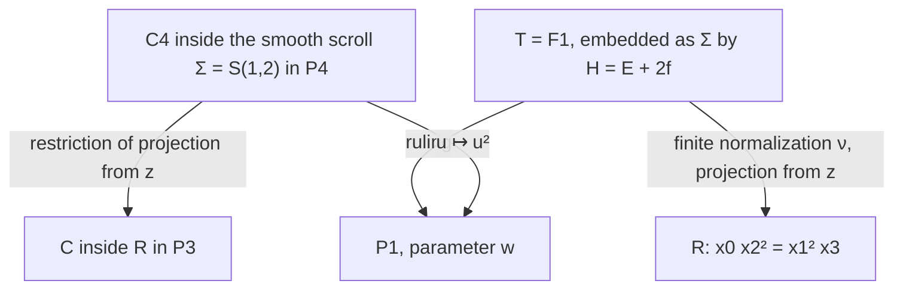

# Paired-secant cubic: normalization, conductor and Gauss dual

The fixed marked system is \(C=[s^4:s^3t:st^3:t^4]\), over an algebraically closed characteristic-zero field unless a characteristic is explicitly changed. The actual point-on-ruling bundle is the finite normalization of the projected cubic. The smooth scroll in four-space, the reduced inverse curve, its full inverse ideal and the two-blowup Gauss resolution are distinct geometric objects. The same marked projection center explains their relation.

The standard scroll bundle convention is the one in Coskun, *Degenerations of surface scrolls and the Gromov–Witten invariants of Grassmannians*, §2, Lemmas 2.2 and 2.4: a scroll of type \((k,l)\) is represented on \(\mathbf F_{l-k}\) with hyperplane class \(E+lf\). Here \((k,l)=(1,2)\), so the smooth scroll has \(H=E+2f\). The nonnormal projected image, its full conductor and the Gauss resolution require the separate exact proofs below. [Primary text](https://homepages.math.uic.edu/~coskun/revpub.pdf).

## The primal cubic and its full inverse scheme

## 1. The quadric and its two rulings

Use Segre coordinates
\[
 (x_0,x_1,x_2,x_3)=(ac,ad,bc,bd)
\]
on \(Q=V(x_0x_3-x_1x_2)\cong\mathbf P^1_{[a:b]}\times\mathbf P^1_{[c:d]}\). Let \(A=(1,0)\) and \(B=(0,1)\) be the two divisor classes, with \(A^2=B^2=0\), \(A B=1\). Then
\[
 C=V(bc^3-ad^3),\quad [C]=A+3B,\quad H_Q=A+B,\quad C^2=6.
\]
The projection to \([c:d]=[s:t]\) is an isomorphism on \(C\); the projection to \([a:b]=[s^3:t^3]\) has degree three. Thus, for the ruling whose base is \(C\), \(f=B\), a chosen minimal section has class \(E=A\), and \(C=E+3f\). For the other ruling the curve is a three-section. The degree-three map has the two totally ramified fibers \(3p_0,3p_\infty\).

The unique quadric assertion follows directly from multiplication of actual sections: the ten monomials in \(\operatorname{Sym}^2\langle s^4,s^3t,st^3,t^4\rangle\) span all nine degree-eight monomials, with the sole relation \(x_0x_3=x_1x_2\). The displayed determinant is smooth. This proof does not rely on a carrier classification.

## 2. The actual ruling bundle of the cubic

At a finite nonzero parameter \(u=t/s\), the line joining \(c(u)\) and \(c(-u)\) consists of
\[
 [A:B:wB:w^2A],\qquad w=u^2.
\tag{2.1}
\]
The limiting lines at \(w=0,\infty\) are tangent trisecants. They are included using length-two subschemes, rather than by substituting coincident points in an ordinary secant formula.

Write the base as \(B_0=\mathbf P^1_{[v_0:v_1]}\), with \(w=v_1/v_0\). The two vector-valued sections spanning a ruling give the injection
\[
 \mathcal O_{B_0}(-2)\oplus\mathcal O_{B_0}(-1)
 \longrightarrow k^4\otimes\mathcal O_{B_0},
\]
whose summands map to \((v_0^2,0,0,v_1^2)\) and \((0,v_0,v_1,0)\). The vectors are everywhere independent. Consequently the line-point incidence variety is the smooth projective bundle
\[
 T=\mathbf P_{\mathrm{lines}}(\mathcal O(-2)\oplus\mathcal O(-1))
   =\mathbf P_{\mathrm{quot}}(\mathcal O(2)\oplus\mathcal O(1))
   \cong\mathbb F_1.
\tag{2.2}
\]
Here \(\mathbf P_{\mathrm{quot}}\) parametrizes one-dimensional quotients; \(\mathbf P_{\mathrm{lines}}\) parametrizes one-dimensional subspaces. The displayed equality uses duality, not an identification of the two conventions without dualizing.

Let \(E\) be the negative section, and \(f\) a ruling fiber. Then
\[
 E^2=-1,\quad E f=1,\quad f^2=0,\quad H=\mathcal O_T(1)=E+2f.
\tag{2.3}
\]
The morphism to \(\mathbf P^3\) is
\[
 \nu:T\longrightarrow R,\qquad
 [v_0:v_1;A:B]\longmapsto
 [A v_0^2:B v_0:B v_1:A v_1^2].
\tag{2.4}
\]
Fiber coordinates are interpreted in the corresponding locally trivialized summands. Equivalently use Cox degrees \(\deg A=E\), \(\deg B=E+f\), \(\deg v_i=f\); every displayed coordinate has class \(E+2f\).

Every point of the image satisfies the cubic equation. Away from \(x_1=x_2=0\), the base is recovered as \([v_0:v_1]=[x_1:x_2]\), giving birationality. The image is closed and has dimension two, hence is the irreducible cubic \(R\). No ruling is contracted, and the only non-singleton fibers are described in Section 4. In particular \(\nu\) is quasi-finite and proper, hence finite. Since \(T\) is smooth and the map is finite birational, it is the normalization. Thus the incidence is already smooth and normal; one does not need to resolve the incidence further.

## 3. The smooth cubic scroll in the same \(\mathbf P^4\)

The complete linear system \(|H|\), with \(h^0(H)=3+2=5\), embeds \(T\) as the smooth cubic rational normal scroll
\[
 \Sigma=S(1,2)\subset\mathbf P^4,
\]
with coordinates in the *same order as the rational normal quartic*
\[
 [X_0:X_1:X_2:X_3:X_4]
 =[A v_0^2:B v_0:A v_0v_1:B v_1:A v_1^2].
\tag{3.1}
\]
The standard degree-one and degree-two summands show that this morphism is an embedding; alternatively on the charts with a nonzero summand the ratios recover both the base and fiber coordinate, including their differentials. Its ideal is the three \(2\times2\) minors
\[
 X_0X_4-X_2^2,\quad X_0X_3-X_1X_2,\quad X_2X_3-X_1X_4.
\tag{3.2}
\]
The map (2.4) is projection deleting \(X_2\), from \(z=[0:0:1:0:0]\). Equation \(X_0X_4-X_2^2=0\) shows \(z\notin\Sigma\). The conic directrix \(D=V(B)\) lies in the plane \(X_1=X_3=0\), and \(z\) lies in that plane off the conic. Its secants through \(z\) explain the double line of the image.

The rational normal quartic \(C_4\) lies on this scroll. Explicitly,
\[
 [v_0:v_1]=[s^2:t^2],\qquad [A:B]=[1:st]
\]
in the corresponding homogeneous trivializations, or on \(s=1\), \(w=u^2, B/A=u\). Substitution in (3.1) gives exactly
\[
 [1:u:u^2:u^3:u^4].
\]
An invariant description is that \(\Sigma\) is swept out by the secant or limiting tangent lines of \(C_4\) associated with the involution \(u\mapsto-u\). Those lines have independent even and odd parts
\[
 (1,0,w,0,w^2),\qquad(0,1,0,w,0).
\]
Thus the two \(\mathbf P^4\) constructions coexist for an actual geometric reason: **the same embedded \(C_4\) and the same center \(z\) project simultaneously to \(C\) and \(R\)**. This is substantially stronger than an abstract dimension count for linear systems.

## 4. Singularities and the full conductor

The negative section \(E=V(A)\) maps isomorphically to the simple directrix \(V(x_0,x_3)\). The section
\[
 D=V(B),\qquad [D]=E+f,\qquad D^2=1
\]
maps to the double directrix \(L=V(x_1,x_2)\) by
\[
 [v_0:v_1]\longmapsto[v_0^2:v_1^2].
\tag{4.1}
\]
It is degree two, branched precisely at \(0,\infty\). These two branch images are \(p_0=[1:0:0:0]\) and \(p_\infty=[0:0:0:1]\).

Here is an exact local normalization and conductor calculation, including the branch points. On \(x_0=1\), put \(r=B/A, w=v_1/v_0\). Then
\[
 A_0=k[r,rw,w^2]\subset B_0=k[r,w],\qquad
 (x_1,x_2,x_3)=(r,rw,w^2).
\tag{4.2}
\]
The element \(w\) is integral, with \(w^2=x_3\), and is in the fraction field as \(x_2/x_1\). The polynomial ring \(B_0\) is normal and finite over \(A_0\), proving the normalization on the chart. The conductor is exactly
\[
 \mathfrak c_{B_0}=rB_0,\qquad
 \mathfrak c_{A_0}=(r,rw)=(x_1,x_2).
\tag{4.3}
\]
Indeed every monomial containing \(r\) belongs to \(A_0\). Modulo \(rB_0\), the extension is \(k[w^2]\subset k[w]\), and no nonzero element of the smaller ring multiplies all of the larger ring into the smaller ring: multiplication by \(w\) detects the odd part. The reverse chart \(x_3=1\) gives the same answer. Together the charts cover \(L\); away from \(L\), normalization is an isomorphism. Thus the full conductor ideal sheaf downstairs is the reduced ideal \(I_L=(x_1,x_2)\), with pullback \(\mathcal O_T(-D)\). The conductor cover is (4.1), not two globally disjoint sections.

The reduced singular locus is \(L\). The Jacobian singular subscheme in characteristic zero has homogeneous ideal, on \(R\),
\[
 (x_2^2,\ x_1x_3,\ x_0x_2,\ x_1^2).
\]
At a general point of \(L\), completion produces two smooth branches meeting transversely. At \(p_0\) the affine equation is the pinch-point equation \(x_2^2=x_1^2x_3\); the other endpoint is symmetric. The normalization is finite and contracts no curve. It should not be called a birational contraction of the conductor section.

## 5. The quartic on the normalization, and a scheme-image warning

Let \(\widehat C\subset T\) be the strict/reduced lift of \(C\). The ruling on it is the double map \(u\mapsto u^2\); hence \(\widehat C f=2\). Its hyperplane degree is four. Writing \(\widehat C=aE+bf\) gives
\[
 a=2,\quad (E+2f)(2E+bf)=2+b=4,
\]
so
\[
 [\widehat C]=2E+2f,\quad \widehat C^2=4,\quad
 \widehat C E=0,\quad \widehat C D=2.
\tag{5.1}
\]
Its homogeneous Cox equation is
\[
 B^2-A^2v_0v_1=0.
\tag{5.2}
\]
It is smooth and maps isomorphically to \(C\). Locally its equation is \(w=r^2\), which shows it meets \(D=(r=0)\) transversely at the two endpoints but is tangent to each endpoint ruling fiber. Its normal bundle in \(T\) is \(\mathcal O_{\mathbf P^1}(4)\), as a consequence of self-intersection four.

The **full scheme-theoretic inverse image** \(C\times_R T\) is larger than this Cartier curve at the endpoints. On \(x_0=1\), \(I_C\) is generated by \(x_2-x_1^3\) and \(x_3-x_1^4\), or by \(x_2-x_1^3\) and \(x_3-x_1x_2\). Pulling back using (4.2) gives
\[
 I_C\mathcal O_T=(w-r^2)(r,w)
\tag{5.3}
\]
near \(p_0\), and the analogous expression at infinity. Consequently its divisorial hull is \(\mathcal O_T(-\widehat C)\), but there is an embedded length-one defect at each endpoint:
\[
 \operatorname{length}\bigl(\mathcal O_T(-\widehat C)/(I_C\mathcal O_T)\bigr)_{p_i}=1.
\tag{5.4}
\]
The support is exactly \(\widehat C\); the finite normalization has no isolated additional inverse-image points. Statements about the “class of the inverse image” must specify the divisor/strict transform (5.1), rather than falsely asserting the full inverse ideal is invertible.

The same distinction describes the intersection of the projection cone \(S\subset\mathbf P^4\) with the smooth scroll \(\Sigma\). The cone is the inverse image of \(C\) under projection away from \(z\); since \(z\notin\Sigma\), (5.3) implies
\[
 (S\cap\Sigma)_{\mathrm{red}}=C_4,
\]
with the two embedded defects just computed in the full scheme intersection.

## 6. The restriction to the quadric

On the Segre quadric,
\[
 R|_Q=ab(bc^3-ad^3).
\]
This is an equality of Cartier divisors on the smooth quadric:
\[
 R|_Q=C+L_0+L_\infty,
\tag{6.1}
\]
where \(L_0,L_\infty\) are the two fibers of the degree-three ruling over \([a:b]=[1:0],[0:1]\). They are precisely the endpoint tangent trisecants. Each has class \(A\), so the right side has class \(3A+3B=3H_Q\), as required. Each intersects \(C\) in a length-three scheme concentrated at the corresponding endpoint. The interpretation is intrinsic: the paired-secant scroll contains the two limiting tangent trisecants, the quartic has the remaining divisor class, and degree exhausts the restriction. The factorization verifies both the multiplicities and that there is no residual curve omitted from this identity.

For comparison, pulling the quadric equation back to \(T\) gives
\[
 q|_T=v_0v_1(A^2v_0v_1-B^2),
\]
so
\[
 \nu^*Q=\widehat C+f_0+f_\infty.
\tag{6.2}
\]
Its class is \(2E+4f=2H\). Unlike the full inverse ideal of \(C\), this principal Cartier pullback has exactly the displayed divisor and no embedded zero-dimensional structure.

## 7. A natural base change, rather than an arbitrary birational comparison

The map \(C\to B_0\), \(u\mapsto u^2\), is intrinsic to the osculating involution. Pulling the ruling bundle back gives
\[
 T_C=T\times_{B_0}C
 =\mathbf P_{\mathrm{quot}}(\mathcal O_C(4)\oplus\mathcal O_C(2))
 \cong\mathbb F_2.
\]
The pullback of \(\widehat C\) factors as \((r-u)(r+u)=0\). Thus in characteristic zero it is the union of two sections, each of class \(E_2+2f\), with self-intersection two and mutual intersection two. They meet transversely once at each endpoint. This construction is natural, but the map \(T_C\to T\) has degree two; it is not an elementary transformation or a birational identification of their rulings. It explains why forcing the \(\mathbb F_1\) and projection-cone \(\mathbb F_4\) rulings to have the same base would discard meaningful data.

## 8. Characteristic-two boundary

The bundle and monomial formulas (2.2), (2.4), (3.1), and the conductor calculation (4.2)–(4.3) make sense over \(\mathbf Z_{(2)}\). Their fibers still give finite normalizations \(\mathbb F_1\to R_k\): the integral polynomial chart calculation proves this directly, without assuming that normalization commutes with base change. In characteristic two the conductor cover \(D\to L\) is purely inseparable, \(w\mapsto w^2\). The Jacobian singular scheme is then defined by \((x_1^2,x_2^2)\), rather than the characteristic-zero Jacobian ideal. The separable two-branch/pinch-point classification must not be transferred unchanged.

The smooth lifted quartic (5.2) still has local equation \(w=r^2\), but its map to the ruling base is inseparable. The base change of Section 7 gives a double section \((r-u)^2=0\), not two distinct sections. This is a concrete common construction witnessing degeneration of the paired-secant incidence: the involution \(u\mapsto-u\) specializes to the identity, while its length-two divisor \(p+(-p)\) specializes to \(2p\). Corresponding “secants” become tangent lines; their flat limiting incidence scroll remains the displayed \(\mathbb F_1\) bundle. It would be incorrect to use the set of distinct characteristic-two pairs to reconstruct this scheme family.

In fact, in characteristic two the same smooth scroll \(\Sigma\) is the tangent developable of \(C_4\): on the finite chart, \(c_4'(u)=(0,1,0,u^2,0)\), and subtracting \(u c_4'(u)\) from \(c_4(u)\) gives \((1,0,u^2,0,u^4)\). These are exactly the ruling vectors in Section 3, with \(w=u^2\). Similarly \(R\) is the tangent developable downstairs. The ruling map is inseparable, so this does not contradict the characteristic-zero nondevelopability of the paired-secant scroll.

## Gauss resolution, dual normalization and limiting tangent planes

## 1. Retained input and conventions

We retain the independently reviewed construction of the smooth finite
normalization from the [merged cubic-scroll note](CUBIC_SCROLL_AND_RULED_SURFACES.md#cubic-scroll-normalization),
Sections 2–5, and its
[independent audit](QUARTIC_CONES_AND_RULED_MODELS.md), Section 3.
We do not rerun that normalization proof. In its notation,

\[
T=\mathbb F_1=\mathbf P_{\mathrm{lines}}(\mathcal O(-2)\oplus\mathcal O(-1)),
\quad H=E+2f,
\]

\[
\nu([v_0:v_1;A:B])=[A v_0^2:Bv_0:Bv_1:A v_1^2].
\tag{1}
\]

Here \(E^2=-1, Ef=1, f^2=0\), and Cox degrees are

\[
\deg A=E,\qquad \deg B=E+f,\qquad \deg v_i=f.
\]

The conductor section is \(D=V(B)\), class \(E+f\), square (1), and

\[
\widehat C=V(B^2-A^2v_0v_1),\qquad [\widehat C]=2E+2f.
\]

The negative section \(E=V(A)\) maps to the simple directrix

\[
M=V(x_0,x_3),
\]

whereas \(D\) maps two to one to the double directrix \(V(x_1,x_2)\).
The two conductor branch points are

\[
q_0=(B=v_1=0),\qquad q_\infty=(B=v_0=0).
\]

Use dual coordinates \([a:b:c:d]\), so that the covector represents the plane

\[
a x_0+b x_1+c x_2+d x_3=0.
\]

The letters \(c\) in a dual coordinate and \(C\) for the curve have different
roles. A Gauss value below is a conormal covector, not an ambient normal vector.

## 2. The Gauss map on the actual normalization

The hypersurface Gauss system consists of the four first partial derivatives of

\[
F=x_0x_2^2-x_1^2x_3.
\]

Pulling that system to \(T\) gives

\[
[B^2v_1^2:-2ABv_0v_1^2:2ABv_0^2v_1:-B^2v_0^2].
\]

Its common divisorial factor is precisely the conductor equation \(B\).
Consequently the rational map extending the Gauss map from \(R_{\rm sm}\) is

\[
\gamma_T:T\dashrightarrow(\mathbf P^3)^\vee,\qquad
[Bv_1^2:-2Av_0v_1^2:2Av_0^2v_1:-Bv_0^2].
\tag{2}
\]

Every entry is a section of

\[
L=2H-D=E+3f.
\tag{3}
\]

This line-bundle description explains the conductor correction to the usual
gradient system; it is more informative than merely cancelling a factor on the
smooth locus.

The base scheme of (2) is exactly the reduced pair \(q_0\sqcup q_\infty\).
For example on \(A=v_0=1\), with \(r=B/A, w=v_1/v_0\),

\[
\nu=[1:r:rw:w^2],\qquad
\gamma_T=[rw^2:-2w^2:2w:-r],
\tag{4}
\]

whose base ideal at \(q_0\) is \((r,w)\). The reversed chart gives the other
reduced base point. Everywhere else either \(B\ne0\), or \(A v_0v_1\ne0\)
on \(D\setminus\{q_0,q_\infty\}\), so there are no further base points or
base divisors.

Let

\[
\pi:S=\operatorname{Bl}_{q_0,q_\infty}T\longrightarrow T
\]

have exceptional curves \(e_0,e_\infty\). The resolved Gauss map is the morphism
given by

\[
\mathcal M=\pi^*(E+3f)-e_0-e_\infty,\qquad \mathcal M^2=3.
\tag{5}
\]

One ordinary blowup at each point suffices: the local generators \((r,w)\)
become invertible, so no infinitely near base point remains.

## 3. The cubic dual and its normalization

The complete dual surface is

\[
\boxed{R^\vee=V(a c^2+b^2d)\subset(\mathbf P^3)^\vee.}
\tag{6}
\]

Indeed (2) satisfies this equation. The equation is irreducible: regarded as a
polynomial in \(a\), it is primitive over \(k[b,c,d]\), and \(c^2\) and \(b^2d\)
have no common factor. On the dense open \(w\ne0,\infty\), the ratio

\[
w=-b/c
\]

recovers the ruling, and (4) then recovers \(r\). Thus the Gauss image has
dimension two and is dense in (6); its closure is that cubic surface. The
surface is not developable in characteristic zero. Its Gauss map is birational
but is neither finite nor everywhere defined on its normalization before the
two blowups.

There is a projective linear isomorphism \(R^\vee\simeq R\), for example

\[
[a:b:c:d]\longmapsto[a:b:c:-d].
\]

This is a statement about these two projective cubic surfaces. It is not a
polarity construction identifying the conormal normalization of the quartic
with its quadric.

For clarity the finite normalization of \(R^\vee\) can be written in the
same ruling convention:

\[
\nu^\vee:T^\vee=\mathbb F_1\longrightarrow R^\vee,
\quad
[v_0:v_1;A':B']\longmapsto
[A'v_1^2:-B'v_1:B'v_0:-A'v_0^2].
\tag{7}
\]

It is obtained from (1) by projective coordinate changes in the source base
and target, so the retained finite-normalization result applies. Its negative
section is \(E^\vee=V(A')\); its conductor is \(D^\vee=V(B')\).

The Gauss map lifts birationally to \(T^\vee\), over the *same* base

\[
[v_0:v_1;A:B]\dashrightarrow
[v_0:v_1;A':B']=[v_0:v_1;B:2A v_0v_1].
\tag{8}
\]

This formula is interpreted in local trivializations; it is not a claim that
the two displayed fiber coordinates have the same Cox degree on \(T\).
The corresponding intrinsic factorization is

\[
T\ \xleftarrow{\ \pi\ }\ S\ \xrightarrow{\ \rho\ }\ T^\vee
\ \xrightarrow{\ \nu^\vee\ }\ R^\vee.
\tag{9}
\]

Here \(\rho\) contracts exactly the strict transforms of the two endpoint
fibers \(f_0,f_\infty\). This follows locally from (8): near \(q_0\) the
fiber transformation is \([A':B']=[r:2w]\), resolved by the blowup of

\[
(r,w),
\]

and the strict transform of \(w=0\) is contracted to \([A':B']=[1:0]\).
The exceptional curve maps isomorphically to the new ruling fiber.
The reversed chart is identical. Away from those two fibers (8) is an
isomorphism. Thus these are precisely two elementary transformations.

Their effect on the marked sections is especially simple:

\[
D\longmapsto E^\vee,\qquad E\longmapsto D^\vee.
\tag{10}
\]

The first section has square \(1-2=-1\) after the blowups; it does not meet
the strict fibers being contracted. The second has square \(-1+2=1\)
after contracting those two fibers. These intersection computations also
identify the resulting ruled surface as \(\mathbb F_1\). The Gauss comparison
therefore exchanges the two directing sections with their marked roles
retained; it is not an isomorphism of the original marked ruled surfaces.

The singular support and Jacobian singular scheme of the dual are

\[
\operatorname{Sing}(R^\vee)_{\rm red}=V(b,c),
\]

\[
I_{\operatorname{Sing}(R^\vee)}=(c^2,bd,ac,b^2).
\tag{11}
\]

In (11) we give generators of the Jacobian ideal **sheaf**. The saturated
homogeneous ideal defining that sheaf is

\[
(b^2,bc,c^2,ac,bd)
=(b,c)\cap(c,d,b^2)\cap(a,b,c^2).
\tag{11a}
\]

Indeed the product of \(bc\) with every homogeneous coordinate lies in
(11); the displayed primary decomposition proves saturation and equality
of the resulting sheaf. Thus this is a reduced double-directrix line
with an embedded length-one addition at each pinch endpoint, rather
than a generically doubled singular line. On \(a=1\), for example, the
local ideal is \((c,b^2,bd)\); the nilpotent class of \(b\) is supported
only at \(d=0\).

The conductor section \(D^\vee\to V(b,c)\) has degree two, ramified at

\[
[1:0:0:0],\qquad[0:0:0:1].
\]

The corresponding two image points are pinch points. At a general point of
the double line the two completed branches meet transversely. These are the
same local types as for \(R\), transported by the displayed projective
isomorphism, with their scheme structures explicitly supplied by (11).

## 4. Ordinary and limiting Gauss values are different

For a general ruling \(w\), the Gauss map varies along the ruling and maps it
birationally to a ruling of \(R^\vee\). The endpoint fibers are exceptional:
all smooth points of \(f_0\setminus D\) have tangent plane \(x_3=0\), and all
smooth points of \(f_\infty\setminus D\) have tangent plane \(x_0=0\).
These are the two contracted fibers in (9).

On the source negative section \(E\), which lies over smooth points of \(R\),
the Gauss map is

\[
[v_0:v_1]\longmapsto[v_1^2:0:0:-v_0^2].
\]

It is degree two onto the dual double line. Thus a general point of the
singular line in \(R^\vee\) has two actual smooth contact points on the
simple directrix of \(R\).

On the source conductor \(D\setminus\{q_0,q_\infty\}\), the extension (2)
has value

\[
[0:-v_1:v_0:0],
\]

the dual simple directrix. These are limiting tangent planes along a branch
over the source double line; the source points themselves are singular in
 \(R\).

Finally the exceptional curve over \(q_0\) fills the dual line

\[
\ell_0=V(a,b),
\]

and that over \(q_\infty\) fills

\[
\ell_\infty=V(c,d).
\tag{12}
\]

Apart from \([0:0:0:1]\in\ell_0\) and \([1:0:0:0]\in\ell_\infty\),
these endpoint-pencil planes are not Gauss values at any smooth point of
 \(R\).

They belong to the dual because the dual is the *closure* of the Gauss image.
For example in (4), a Gauss value with \(a=b=0\) requires \(w=0\) away from
the conductor, and then also \(c=0\). This difference matters in any
interpretation of intersections of dual varieties.

## 5. The osculating curve and the residual flag

There is an intrinsic residual interpretation of the **whole** dual
normalization, not just the osculating curve. Let

\[
L_\iota=\{p+\iota(p):p\in C\}\subset\operatorname{Sym}^2C
\]

be the projective line of even binary quadratics, with its endpoint
divisors \(2p_0,2p_\infty\) included. Let

\[
J=\operatorname{pr}_1^{-1}(L_\iota)\subset\mathcal I.
\tag{12a}
\]

By the universal residual construction of the flag, a fiber of \(J\)
parametrizes the planes containing the secant line of its degree-two
divisor. Those are exactly the ruling lines of \(R\), including its
two endpoint tangent trisecants. For a ruling parameter
\([v_0:v_1]\) and divisor \(D=V(v_0t^2-v_1s^2)\), the plane
covectors form the rank-two kernel of restriction of the marked linear
system \(V\) to \(D\). As a subbundle of
\(V\otimes\mathcal O_{\mathbf P^1}\), it is generated by

\[
(v_1^2,0,0,-v_0^2),\qquad(0,-v_1,v_0,0),
\]

with respective summands \(\mathcal O(-2)\) and \(\mathcal O(-1)\).
Thus \(J\cong\mathbb F_1\), and its plane map is exactly (7). In
particular

\[
\boxed{T^\vee=J=\mathcal I|_{L_\iota}}
\tag{12b}
\]

is a natural identification for the marked embedding and involution.
This proof includes nonreduced endpoint divisors: restriction to \(2p_0\)
means containing the limiting tangent line, so the whole endpoint pencil
is retained, not just its generic osculating limit.

The primal surface \(T\) is the corresponding **point-on-ruling** bundle;
the dual normalization \(J\) is the **plane-through-ruling** bundle. A
tangent plane to a ruled surface contains its ruling, so its Gauss map
is naturally a rational map from the first bundle to the second over
the same base. Equations (8)–(10) describe the two special fibers at
which this fiberwise projectivity degenerates. This is the geometric
source of the two elementary transformations.

On \(\widehat C\), put \(w=u^2, r=u\). Equation (4) becomes

\[
[u^5:-2u^4:2u^2:-u]
=[-u^4:2u^3:-2u:1],
\tag{13}
\]

away from the endpoints. The right side extends regularly to both endpoints
and is the osculating-plane quartic. Hence the Gauss map of the cubic
restricts along the marked quartic to its osculating-plane map, with precisely
the limiting endpoint planes required by the global extension. This explains
the relation through the scroll, rather than equating arbitrary tangent and
osculating planes.

There is a particularly small residual construction behind (13). Let

\[
\jmath:C\longrightarrow\mathcal I,\qquad
p\longmapsto(2p,p+\iota(p)),\quad\iota(u)=-u.
\tag{14}
\]

The total divisor is \(3p+\iota(p)\), so it belongs to the marked hyperplane
system and its image in dual space is (13). The second divisor in (14)
parametrizes precisely the ruling lines of the cubic. Residual swapping gives

\[
\tau\jmath(p)=(p+\iota(p),2p),
\]

which has the *same plane* but a different first secant divisor. Thus the
osculating residual involution on points, the paired-secant ruling, and
residual swap on the flag arise from one residual divisor identity, while
remaining genuinely different maps. At the two endpoints these pairs
coincide on the swap fixed locus; generically they do not.

Under the two elementary transformations the strict osculating bisection

\[
\widehat C\subset T
\]

has image of class \(2E^\vee+2f\) on \(T^\vee\), again a smooth bisection.
For direct verification, (8) sends \(B^2=A^2v_0v_1\) to

\[
(B')^2=4(A')^2v_0v_1.
\tag{15}
\]

Its endpoint behavior is resolved by (9). The divisor-class assertion follows
also by using its ruling degree two and degree four under (7).

## 6. The full scheme intersection with the dual quadric

The dual quadric is

\[
Q^\vee=V(ad-bc).
\]

On its Segre model

\[
[a:b:c:d]=[p r:p s:q r:q s],
\]

the cubic equation (6) restricts exactly to

\[
p q(qr^3+ps^3).
\tag{16}
\]

Therefore the **scheme-theoretic** intersection, viewed as a Cartier divisor
on the smooth quadric, is

\[
\boxed{R^\vee\cap Q^\vee=\ell_0+\ell_\infty+K,}
\tag{17}
\]

where each component occurs once and

\[
K=V(qr^3+ps^3)\subset Q^\vee
\]

is a smooth rational quartic of class \((1,3)\). The equation is linear in

\[
[p:q]
\]

with coefficients \(s^3,r^3\) that do not vanish simultaneously, so it is
the graph of a degree-three morphism and is smooth. A convenient
parametrization is

\[
K:[s:t]\longmapsto[-t^4:s t^3:-s^3t:s^4].
\tag{18}
\]

The two lines are disjoint and belong to the same ruling of the quadric.
Each meets \(K\) in a length-three divisor concentrated at an endpoint.
Consequently (17) is reduced but has nontransverse intersections there.
Factorization (16), not a support count, proves that no embedded
zero-dimensional correction is present in this complete intersection on the
quadric.

The Cartier pullback to the dual normalization has the parallel form

\[
(\nu^\vee)^*Q^\vee=f_0+f_\infty+\widehat K,\qquad
\widehat K=V((B')^2-(A')^2v_0v_1).
\tag{17a}
\]

Indeed substituting (7) into \(ad-bc\) gives
\(v_0v_1((B')^2-(A')^2v_0v_1)\).
The osculating bisection (15) instead has coefficient \(4\).
Thus the dual operation exchanges which of these marked bisections has the
same incidence with its quadric as the primal quartic: the source quartic
has coefficient \(1\) and maps to the osculating bisection with coefficient
\(4\), whereas the source bisection \(B^2=4A^2v_0v_1\) maps to
\(\widehat K\) with coefficient \(1\). This is an equality of explicit
marked constructions; equality of their divisor classes alone would not
identify them.

The curve \(K\) is different from both the osculating quartic and the curve

\[
\sigma_Q(C):u\longmapsto[u^4:-u^3:-u:1]
\]

of quadric-tangent planes along \(C\). These are different marked curves and are not interchangeable traces.

For a general plane on \(K\), there are actual contacts on both surfaces,
at *different* points. Taking \(r=2u, w=u^2\) in (4) gives

\[
x_R=[1:2u:2u^3:u^4]\in R_{\rm sm},
\quad H=[-u^4:u^3:-u:1]\in K.
\]

The pole of that plane under the quadric polarity is

\[
x_Q=[1:u:-u^3:-u^4]\in Q.
\tag{19}
\]

For \(u\ne0,\infty\), these points are different and neither lies on
the common quartic \(C\). In particular (17) is not the locus of common
Gauss planes at the same point of \(R\cap Q\).

In fact there is **no** point at which both \(R\) and \(Q\) are smooth and
have the same tangent plane. To see this, the retained Cartier identity

\[
R|_Q=C+L_0+L_\infty
\]

exhausts their common support. At \(c(u)\), \(u\ne0,\infty\), the planes

\[
[-u^4:2u^3:-2u:1],\qquad[u^4:-u^3:-u:1]
\]

cannot coincide in characteristic zero. At a smooth point

\[
[A:B:0:0]\in L_0,
\]

one has \(B\ne0\); the tangent planes are respectively \([0:0:0:1]\)
and \([0:0:-B:A]\), again different. The reversed argument applies on

\[
L_\infty.
\]

The remaining endpoints are singular on \(R\), so they cannot supply a
common smooth contact point. A general plane of either line in (12) is
therefore a true tangent plane to \(Q\) and only a limiting tangent plane
to \(R\) at a pinch point, exactly as Section 4 describes.

## The saturated dual singular scheme

## 3. Singular scheme, including saturation

The reduced singular line of (2) is \(L^\vee=(b=c=0)\). The homogeneous
Jacobian ideal and its saturation are respectively
\[
J=(c^2,bd,ac,b^2),\qquad
J^{\rm sat}=(b^2,bc,c^2,ac,bd).                             \tag{6}
\]
The extra generator \(bc\) matters when giving a saturated ideal:
multiplication by each homogeneous coordinate puts \(bc\) in \(J\).
The larger monomial ideal is saturated. A monomial outside it either
contains neither \(b,c\), or is \(a^i b\), or is \(c d^j\);
multiplying by a suitable endpoint coordinate keeps it outside.

On \(a=1\), the ideal is \((c,b^2,bd)\). The nilpotent class of \(b\)
is annihilated by \((b,d)\), so the reduced line has one embedded
length-one point at \([1:0:0:0]\). On \(d=1\) there is one at the other
endpoint. Away from them the singular scheme is reduced.
The cubic itself has general double crossings and two pinch points.
Its finite normalization (5) has a degree-two conductor cover branched
at those endpoints. The cubic's singularities and its singular
subscheme are distinct assertions.

## The actual characteristic-two dual

Finally, in characteristic two the actual gradient of \(R\) is
\([x_2^2:0:0:x_1^2]\), whose reduced scheme image is the line \(b=c=0\).
On \(T\) its common factor is now \(B^2\), and after removing it the
map is \([v_1^2:0:0:v_0^2]\), factoring through the inseparable
degree-two map on the ruling base. The specialized equation
\(ac^2+b^2d=0\) still defines a cubic surface, but it is not the actual
dual of the characteristic-two surface. This directly verifies the
author's characteristic warning without transferring characteristic-zero
Gauss geometry across the fiber.

---

## Characteristic reach and mathematical status

The monomial normalization charts, conductor ideals and projective bundles exist over \(\mathbf Z_{(2)}\) and give the finite normalization in characteristic two by direct ring calculation. The conductor cover then becomes purely inseparable; the two-separate-branch and pinch-point classification does not transfer. In that fiber the scroll is the tangent developable and the Gauss image is a line. The characteristic-zero dual cubic and Gauss birationality therefore do not extend just by reducing their equations. The complete inverse-image embedded endpoint defects remain distinct from isolated off-curve inverse points in a proposed STCI construction. Scope is [R-0028](../results/quartic_ruled_projection_geometry.md) and its supporting marked geometry.
