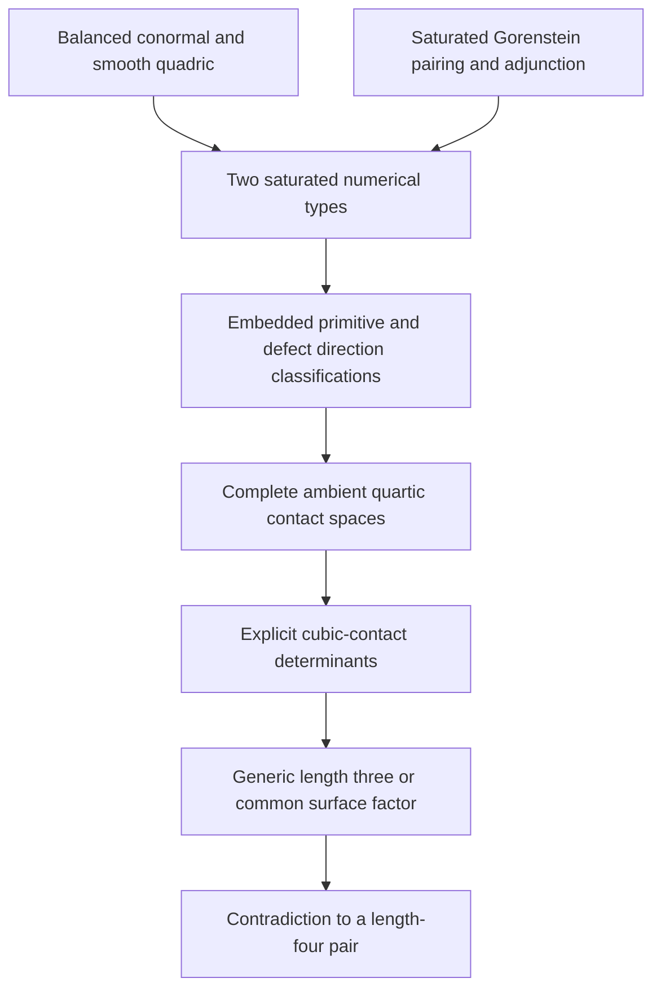
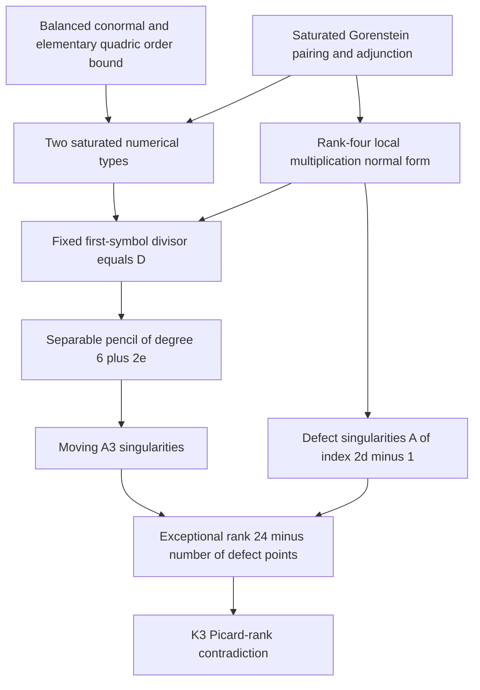

# Quartic (4,4): intrinsic approaches and characteristic conormal

Historical mathematical investigations, including K3 proposals and their critical audits, retained as exploratory material, not as an endorsed reduction or theorem. Full source content follows.


---

## intrinsic-44-research-report

# Intrinsic (4,4) obstruction: research report and successor handoff

Date: 2026-10-23. **Independently reviewed new research evidence; no canonical theorem promotion.**

## Outcome and exact scope

The principal contribution is a new intrinsic proof that the fixed curve

\[
C=[s^4:s^3t:st^3:t^4]\subset\mathbf P^3_k
\]

cannot be the reduced support of a complete intersection of two quartics
over an algebraically closed field of characteristic zero. The proof is in
[the K3 obstruction note](#intrinsic-44-k3-proof-proposal).
It uses no classification of primitive triples, normal directions, quartic
carriers, or quartic contact pencils, and no cubic-contact nonvanishing
calculation. Its new obstruction is a surplus of exceptional curves on the
K3 resolution of a general member of the hypothetical pencil.

The proof retains the promoted balanced-conormal calculation
[STCI-R-0020](../results/quartic_conormal_characteristic_jump.md) and the
general accepted source-level
[saturated Gorenstein pairing theorem](2026-10-05-mf6-pairing-audit.md).
The latter is not a separately promoted result ID; the rank-four pairing
needed here is also reconstructed directly by its Frobenius determinant
in the new proof and audit. The unique smooth
quadric and its divisor classes give an elementary preliminary order
bound. The old exclusion [STCI-R-0001](../results/quartic_carrier_exclusion.md)
and the classified filtered proof
[STCI-R-0022](../results/quartic_44_filtered_exclusion.md) are comparison
records, not premises of the new proof. None of their status fields is
changed.

This is a proof for the degree pair (4,4). For a proper pair of quartics
containing C, it also implies that its generic multiplicity on C is at
most three: multiplicity four would exhaust the degree sixteen by
Bézout, forcing sole reduced support C. It does not exclude residual
components when the multiplicity is smaller, and it makes no claim
about arbitrary higher-degree mates or unrestricted STCI.

## The new geometric argument

Let Z be a hypothetical (4,4) complete intersection with sole support C.
Its generic transverse length is four and its dualizing sheaf is
\(\mathcal O_Z(4)\). A quartic with normal order at least two is a multiple
of \(q^2\), where \(q\) defines the unique smooth quadric. Restricting a
mate to that quadric rules out such an equation in the pair. The generic
transverse algebra is consequently curvilinear.

Let \(L=\mathcal O(e-7)\) be the first saturated layer. The conormal
quotient makes \(e\geq0\). Saturated duality gives

\[
E_2=L^2(D),\qquad E_3=L^3(D)=\mathcal O(-18),\qquad
\deg D=3-3e.
\]

Thus \(e=0\) with \(\deg D=3\), or \(e=1\) with \(D=0\). The new local
multiplication argument gives, at a defect of multiplicity d, the exact
embedded completed ideal

\[
(x^2,\ y^2-t^d x).
\]

This proves that D is exactly the fixed divisor of the first normal
symbols of the actual quartics. Removing D gives a basepoint-free pencil
of degree \(n=6+2e\) on C. Characteristic-zero separability makes a general
fiber consist of n distinct points outside D. Each gives an \(A_3\)
singularity on a general quartic member. At a defect of multiplicity d,
the general member has an \(A_{2d-1}\) singularity. The latter statement
allows arbitrary local coefficient functions in the two original
equations; it is not restricted to constant combinations of model
generators.

Writing \(r=\#\operatorname{Supp}D\), the resulting exceptional rank is

\[
3n+\sum_{p\in\operatorname{Supp}D}(2d_p-1)=24-r.
\]

It is 24 in the primitive case, and 21, 22, or 23 in the three defect
partitions. Bertini gives smoothness outside C, so the quartic has only
the isolated rational double points just described. Finite singular
locus also proves that it is integral and normal. Its minimal resolution
is a K3 surface. The independent exceptional classes contradict the
characteristic-zero bound \(\rho\leq20\); including the hyperplane class
gives the familiar stronger exceptional-rank bound of 19. The surface
facts are recorded in
[Morrison, pp. 5–6](https://web.math.ucsb.edu/~drm/conferences/ITP99/morrison/cortona.pdf)
and [Shimada, introduction](https://home.hiroshima-u.ac.jp/ichiro-shimada/preprints/RDPssK3/rdpssk3.pdf).

## Dependency diagrams and replacement audit

The old classified route, reconstructed from R0022 and its stated
evidence, is:



The new route is:



| Old ingredient | Nature and authority | Treatment in the new proof |
| --- | --- | --- |
| Conormal bundle and smooth quadric | Intrinsic embedded geometry; conormal promoted as R0020 | Retained explicitly |
| Saturated layers, Frobenius pairing, adjunction | Intrinsic local algebra and duality; accepted source-level theorem | Retained explicitly |
| Primitive e=1 direction classification | Classification-dependent accepted source evidence | Replaced by the separable first-symbol pencil and eight A3 points |
| Defect e=0 direction classification | Classification-dependent part of R0022 evidence | Replaced by the rank-four algebra normal form and defect singularities |
| Complete quartic contact matrices | Coordinate computations of actual global lifting spaces | Unneeded for the new contradiction |
| Explicit determinant nonvanishing | Exact computation plus classification exhaustion | Replaced by the K3 exceptional-rank obstruction |
| Associated graded and Rees objects | Intrinsic constructions, but not a universal length certificate by themselves | Explained in the companion contact and valuation notes |

The new proof is symmetric in the two equations: their two-dimensional
source is used as a pencil, with a general member and a complementary
generator. A local coordinate or generator is selected only to prove the
intrinsic local singularity type. No preferred global quartic is classified.

## Contact, coefficient valuations, and actual realizability

The [intrinsic cubic-contact note](INTRINSIC_VALUATIONS_AND_CONTACT_GEOMETRY.md#2026-10-23-intrinsic-cubic-contact-constructionmd)
constructs, for a pure quasiprimitive triple Y with ideal J,

\[
\mathcal M_Y=(J/I_CJ)/\mathrm{torsion},\qquad
0\longrightarrow L\otimes E_2\longrightarrow\mathcal M_Y
\longrightarrow \ker(E\to L)(-D)\longrightarrow0.
\]

The old \(h_0\tau_1-h_1\tau_0\) is the determinant of the actual ambient
source map into this rank-two bundle. Its global target is
\(\det(W)^*\otimes\det(E)\otimes L^2\otimes\mathcal O_C(8)\)
for quartics. This recovers a degree-four or degree-six determinant line,
the coordinate transformation laws, and its interpretation after two
normal-slice blowups. This construction alone does not force its
nonvanishing. The K3 proof bypasses that missing nonvanishing argument.

The [coefficient-valuation note](INTRINSIC_VALUATIONS_AND_CONTACT_GEOMETRY.md#2026-10-23-intrinsic-coefficient-valuationsmd)
distinguishes coefficient places, prolongations to an algebraic closure,
normal Gauss valuations, and ambient blowup-flag valuations. A real
weighted minimum is justified on polynomials or an explicitly restricted
series ring; it fails on arbitrary coefficient-pole series in
\(K[[u,v]]\). The intrinsic rank-two flag on
\(\operatorname{Bl}_C\mathbf P^3\supset E\supset E_p\)
retains normal order followed by coefficient order without a global
coefficient-field splitting. The mu4 calculation detects the order-three
collision of the residual branches and the characteristic-dependent
residue polynomial. Scalar ideal values alone, even over every centered
valuation, do not recover colength; a length-four versus length-three
counterexample is preserved in that note.

For completeness, the accepted quartic lifting constraints remain
available in [the characteristic/conormal source note, section 4](#quartic-characteristic-conormal).
They are not inputs to the K3 proof. In a balanced affine frame
\(U=x_3-z^4-\tfrac32z(x_2-z^3),\ V=x_2-z^3\), the actual first-symbol
image is the 17-dimensional subspace of \(H^0(E(4))\) consisting of
\(P(z)U+R(z)V\) with

\[
P_1=2R_2,\qquad P_4=2R_5,\qquad P_7=2R_8.
\]

In characteristic two the quotient coefficient has zero coefficients
of \(z^2,z^5,z^8\). In both characteristics
\(H^0(\mathcal I_C^2(4))=kq^2\). These are source-level audited explicit
global-image statements, not a claim that every abstract bundle section
lifts. The coordinate algebra is missing \(s^2t^2\) in degree one,
while it equals the full section space in degrees at least two. The new
proof avoids replacing the coordinate algebra by a full section ring:
it uses only the pencil supplied by the hypothetical equations.

## Evidence and successor handoff

The principal proof and supporting local-algebra proof are new,
unpromoted research contributions. Independent mathematical review is
recorded in
[the K3 audit](#intrinsic-44-k3-independent-audit).
The contact and valuation constructions have their own
[secondary audit](INTRINSIC_VALUATIONS_AND_CONTACT_GEOMETRY.md#2026-10-23-intrinsic-contact-valuations-independent-auditmd).
Exact new calculation evidence and commands are collected in
[the validation record](../validation/intrinsic-44-2026-10-23/README.md).
These checks verify displayed identities and examples; the mathematical
proof supplies the universal local normal form, general-member argument,
and K3 contradiction. No inherited exclusion or classification was rerun.

The strongest new result is the complete intrinsic (4,4) proof, using
local multiplication and a global surface-rank bound. The main remaining
issue is broader scope: this argument uses the K3 nature of degree-four
surfaces, and provides no all-degree obstruction. A justified successor
task is to extract the analogous singularity budget for a higher-degree
pencil under explicitly stated curvilinear and duality hypotheses, then
compare it with the appropriate surface invariants. That is an experiment,
not a claim that the (4,4) proof already extends. Separately, the intrinsic
determinant target now makes a classification-free global-source
nonvanishing theorem a precise optional question rather than a dependency
of this exclusion.


---

## intrinsic-44-k3-proof-proposal

# An intrinsic K3 obstruction to a quartic–quartic thickening

Date: 2026-10-23. **Independently audited proof proposal; not canonically promoted.**

## Claim and scope

Let \(k\) be an algebraically closed field of characteristic zero and let

\[
C=[s^4:s^3t:st^3:t^4]\subset\mathbf P^3_k.
\]

There are no homogeneous quartics \(F,G\) with
\(\sqrt{(F,G)}=I_C\). Reducible and nonreduced equations are included.

Throughout this note, \(\mathcal O(n)\) and a twist \(M(n)\) mean degree
n on \(\mathbf P^1\). In particular \(M(16)=M\otimes\mathcal O_C(4)\).

The argument below uses the balanced conormal bundle, the elementary
saturated Gorenstein pairing theorem, and the geometry of rational double
points on quartic surfaces. It does **not** use the prior quartic-carrier
exclusion, the primitive-triple classification, any classification of
quartic contact pencils, or their cubic-contact determinants.

Its geometric obstruction is that a general member of the hypothetical
quartic pencil would have too many independent exceptional curves on its
K3 resolution. The local defect points do not evade that obstruction:
their rational double points replace the apparent loss of moving
singularities.

## Exact dependencies and status

1. The promoted result
   [STCI-R-0020](../results/quartic_conormal_characteristic_jump.md) gives
   \(E=N^*_{C/\mathbf P^3}=\mathcal O_{\mathbf P^1}(-7)^2\).
   Also \(\mathcal O_C(1)=\mathcal O_{\mathbf P^1}(4)\), and the unique
   quadric containing \(C\) is the smooth quadric
   \(q=x_0x_3-x_1x_2\); \(C\) has class \((3,1)\), up to exchanging the
   rulings.
2. The accepted source-level
   [saturated pairing audit](2026-10-05-mf6-pairing-audit.md), sections 1–2,
   proves that a finite-free Gorenstein algebra with generic fiber
   \(K[v]/(v^4)\) has invertible saturated layers and perfect multiplication
   \(E_1\otimes E_2\longrightarrow E_3\).
   This is a general local-algebra theorem, not the inherited primitive
   classification. Its rank-four case also has the short direct
   Frobenius-matrix derivation in section 2 below, reconstructed in the
   independent audit; no earlier STCI proof is an input.
3. Standard characteristic-zero surface facts: an \(A_j\) surface
   singularity has a chain of \(j\) independent exceptional \((-2)\)-curves;
   the minimal resolution of an integral quartic with only rational double
   points is a K3 surface; over characteristic zero its Picard rank is at
   most 20. Primary references are
   [Morrison, *The Geometry of K3 Surfaces*](https://web.math.ucsb.edu/~drm/conferences/ITP99/morrison/cortona.pdf),
   pp. 5–6, and
   [Shimada, *Rational Double Points on Supersingular K3 Surfaces*](https://home.hiroshima-u.ac.jp/ichiro-shimada/preprints/RDPssK3/rdpssk3.pdf),
   introduction. Shimada records the stronger characteristic-zero bound
   19 on the total exceptional rank of a projective K3 model; the weaker
   bound 20 already suffices below.

Everything after these inputs is derived here. This file is a proposal,
not a promotion of a new canonical result.

Supporting artifacts are the independently developed
[local-algebra note](INTRINSIC_VALUATIONS_AND_CONTACT_GEOMETRY.md#2026-10-23-intrinsic-quadruple-local-algebramd), the
[exact local verification script](../computations/verify_intrinsic_quadruple_local_algebra_2026_10_23.py),
and the
[independent proof audit](#intrinsic-44-k3-independent-audit).
The script checks representative polynomial identities and Milnor-algebra
dimensions; the argument for arbitrary formal unit coefficients is the
proof below, together with the local-algebra note. It is not inferred
from a finite collection of examples.

## 1. Generic order and the saturated numerical types

Suppose such \(F,G\) exist and put \(Z=V(F,G)\). They have no common
surface component, hence form a regular sequence. Thus \(Z\) is a
Gorenstein complete-intersection curve, of degree 16, with reduced support
\(C\). Its generic transverse length is \(16/4=4\), and

\[
\omega_Z=\mathcal O_Z(4).
\tag{1}
\]

First, a quartic having normal order at least two on \(C\) must be a
multiple of \(q^2\). Indeed, its restriction to the smooth quadric belongs
to

\[
H^0\bigl(Q,\mathcal O_Q((4,4)-2(3,1))\bigr)=0.
\]

It is therefore \(qH\) for a quadric \(H\); its first normal symbol is
\(H|_C\) times the nonzero symbol of \(q\), so \(H|_C=0\). Uniqueness of the
quadric gives \(H\in kq\). Generic normal order at least two suffices:
the first-symbol sheaf is locally free on \(C\), so generic vanishing is
everywhere vanishing.

Such a quartic cannot occur in the supposed pair. If it is \(q^2\), the
other equation restricts on \(Q\) to a divisor of class \((4,4)\) supported
only on \(C\). That would require \((4,4)=m(3,1)\), which is impossible.
If the other restriction is identically zero, the pair has a common
quadric instead. Consequently both equations have generic normal order
one. Their generic first symbols must be dependent, since independent
symbols would give transverse length one. The generic local algebra is
therefore \(K[v]/(v^4)\).

Let \(N_i\) denote the saturated nilpotent filtration on \(\mathcal O_Z\),
and \(E_i=N_i/N_{i+1}\), for \(0\leq i\leq3\). Locally this is exactly

\[
N_i=B\cap(v^i)B_K.
\]

Write \(L=E_1\). The conormal sheaf surjects onto \(L\), so

\[
L=\mathcal O(e-7),\qquad e\geq0.
\tag{2}
\]

The saturated top layer is the annihilator of the nilradical. Finite
duality for the closed immersion \(C\hookrightarrow Z\), combined with
(1), gives

\[
E_3=\operatorname{Hom}_{\mathcal O_Z}(\mathcal O_C,\mathcal O_Z)
    =\omega_C\otimes(\omega_Z|_C)^{-1}
    =\mathcal O(-18).
\tag{3}
\]

Multiplication \(L^2\longrightarrow E_2\) is generically invertible;
write its effective zero divisor as \(D\), so \(E_2=L^2(D)\).
The perfect pairing \(L\otimes E_2\simeq E_3\) identifies

\[
E_3=L^3(D),\qquad d:=\deg D=3-3e.
\tag{4}
\]

Effectivity leaves exactly \(e=0,d=3\) and \(e=1,d=0\). No classification
of embedded triples has entered this reduction.

## 2. The local defect algebra

Here is the key local construction, valid for any multiplicity-four
Gorenstein structure under these filtration hypotheses in characteristic
different from two.

Fix \(p\in C\), put \(R=k[[t]]\), and complete \(Z\) at \(p\). A lift of
the support parameter \(t\) to the ambient regular local ring provides a
map \(R\longrightarrow B=\widehat{\mathcal O}_{Z,p}\). The algebra \(B\)
is finite over \(R\), and is free of rank four: finiteness follows from
the Artin special fiber, while \(t\) is a nonzerodivisor because \(Z\) is
Cohen–Macaulay with smooth reduced support. The quotient by its
nilradical is \(R\).

The required pairing in rank four can be seen directly. Before imposing
perfection, take a saturated basis \(1,y,x,z\), with \(y\in N_1\),
\(x\in N_2\), \(z\in N_3\), and write \(yx=c z\). All products of
saturated weight at least four vanish. A relative Frobenius functional
\(\lambda:B\to R\) exists because this finite-free algebra is
Gorenstein. The determinant of its product-pairing matrix in this basis
is \(c^2\lambda(z)^4\). It is a unit, hence c is a unit. This proves
that \(E_1\otimes E_2\to E_3\) is perfect at the defect as well as
generically, using only the rank-four multiplication. The saturated
basis exists because its successive quotients are torsion-free rank-one
modules over the DVR; no global retraction is used.

Choose \(y\in N_1\) lifting a basis of \(E_1\), and \(x\in N_2\) lifting a
basis of \(E_2\). Since \(E_1E_2\longrightarrow E_3\) is perfect, we may
choose the basis of \(N_3=E_3\) to be \(z=xy\). Then

\[
B=R\cdot1\oplus R\cdot y\oplus R\cdot x\oplus R\cdot z,
\quad y^2=a(t)x+b(t)z.
\]

All of \(x^2,yz,xz,z^2\) vanish, since \(N_iN_j\subset N_{i+j}\) and
\(N_4=0\). Replacing \(y\) by \(y-bx/2\) leaves \(xy=z\) and changes the
square relation to \(y^2=ax\). The vanishing order of \(a\) is exactly
\(d_p=\operatorname{mult}_pD\), by the definition of \(D\). Consequently

\[
B\simeq R[x,y]/(x^2,\ y^2-a(t)x),\qquad
\operatorname{ord}_t a=d_p.
\tag{5}
\]

This is an algebra isomorphism: the displayed quotient is free on
\(1,y,x,xy\), and the indicated map sends this basis to the adapted
basis of \(B\).

When \(d_p>0\), the elements \(t,x,y\) are independent modulo the square
of the maximal ideal of \(B\), since both displayed relations have order
at least two. Lifting \(x,y\) to ambient functions therefore gives a
regular system of parameters \(t,x,y\) in the completed ambient ring.
In those ambient coordinates the completed ideal of \(Z\) is exactly

\[
J=(x^2,\ y^2-a(t)x)\subset k[[t,x,y]].
\tag{6}
\]

Indeed, the induced surjection from the regular power-series ring has
the quotient (5), so its kernel is the two indicated relations. Thus (6)
is an embedded formal normal form, not merely an abstract algebra model.

When \(d_p=0\), equation (5) eliminates \(x\) and gives
\(B\simeq R[y]/(y^4)\). Equivalently, suitable ambient formal coordinates
\(t,m,l\) identify the ideal with

\[
J=(m,l^4).
\tag{7}
\]

In particular, \(D\) is precisely the nonprimitive locus.

## 3. The actual first-symbol pencil and its fixed divisor

Let \(M=\ker(E\longrightarrow L)\). It is a line bundle and

\[
M=\mathcal O(-7-e).
\tag{8}
\]

The first symbols of the actual global quartics \(F,G\) are sections
\(h_F,h_G\in H^0(C,M(16))\). This assertion uses actual equations, not
arbitrary abstract sections of the conormal bundle.

Their common zero divisor is exactly \(D\). To see this at a defect
point, write \(F,G\) in terms of the generators in (6). Their coefficient
matrix is invertible over the completed ambient local ring: both are
minimal generating sets of the same complete-intersection ideal. In
particular, their coefficients of \(y^2-ax\), restricted to \(C\), generate
the unit ideal. The first symbols are precisely those coefficients
times \(-a\bar x\). Hence their common vanishing order is exactly
\(\operatorname{ord}_t a=d_p\). At a primitive point the same conclusion
with zero common vanishing follows from (7), since the coefficients of
\(m\) generate the unit ideal.

Dividing the two sections by their common fixed divisor therefore gives
a basepoint-free pencil in

\[
M(16)(-D)=\mathcal O(n),\qquad
n=(9-e)-(3-3e)=6+2e.
\tag{9}
\]

Because \(n>0\), these two generating sections cannot be proportional:
that would give a nowhere-vanishing section of a positive-degree line
bundle. The associated map \(C\longrightarrow\mathbf P^1\) is therefore
nonconstant. In characteristic zero it is separable. Thus a general
member of this pencil has exactly \(n\) distinct zeros, avoiding the
finite support of \(D\). Equivalently, a general quartic in the original
pencil has \(n\) simple first-symbol zeros away from the defects.

No surjectivity of the global jet map is asserted or needed: the
basepoint-free pencil just obtained is the pencil furnished by the
hypothetical equations themselves.

## 4. Surface singularities of a general pencil member

Let \(X=V(\lambda F+\mu G)\) for a general \([\lambda:\mu]\).
Off \(C\), smoothness follows from the characteristic-zero Bertini
theorem, applied to the pencil with its base locus removed. Along \(C\)
the complete formal models determine all singularities.

At a primitive point, use (7). At a zero of the moving first-symbol
section, choose another member of the pencil whose \(m\)-coefficient is
a unit, and take its equation as the ambient parameter \(m\). Because
the two equations generate \(J\), the selected equation then has form

\[
X:\quad A(t,m,l)m+U(t,m,l)l^4=0,\qquad U(0)\ne0.
\]

The zero of \(A(t,0,0)\) is simple, so \(\partial A/\partial t(0)\ne0\).
The change \(T=A(t,m,l)/U(t,m,l)\), \(M=m\), \(L=l\) is formally
invertible and identifies the equation, up to a unit, with

\[
TM+L^4=0.
\tag{10}
\]

This is an \(A_3\) rational double point. At every other primitive point
the nonzero first symbol makes \(X\) smooth. Equation (9) consequently
produces exactly \(n=6+2e\) singularities of type \(A_3\) outside \(D\).

At a defect point of multiplicity \(d_p>0\), write the general equation
using (6):

\[
f=\alpha(t,x,y)x^2+\beta(t,x,y)(y^2-a(t)x).
\tag{11}
\]

For a general member, \(\alpha(0)\beta(0)\ne0\), because the generator
matrix is invertible and there are only finitely many defect points.
The coefficients here are arbitrary formal functions; they are not
being assumed constant. Divide (11) by the unit \(\beta\), and put
\(u=\alpha/\beta\). The equation becomes

\[
f'=u(t,x,y)x^2+y^2-a(t)x.
\tag{12}
\]

The Hessian in \(x,y\), at \(t=x=y=0\), is invertible. The formal implicit
function theorem solves \(f'_x=f'_y=0\) as

\[
x_c(t)=\frac{a(t)}{2u(t,0,0)}+O(a(t)^2),\qquad
y_c(t)=O(a(t)^2).
\]

The critical value is

\[
g(t)=f'(t,x_c(t),y_c(t))
     =-\frac{a(t)^2}{4u(t,0,0)}+O(a(t)^3).
\tag{13}
\]

In particular, it has order exactly \(2d_p\), with nonzero leading
coefficient. The formal Morse lemma with parameter \(t\) writes (12) as
a nondegenerate quadratic form in two new variables plus \(g(t)\).
Over the algebraically closed characteristic-zero field, a unit has a
\(2d_p\)-th root, so a further change of \(t\) identifies the completed
surface germ with

\[
XY+T^{2d_p}=0.
\tag{14}
\]

This is an \(A_{2d_p-1}\) rational double point. This calculation includes
\(d_p=1\), where the germ is an ordinary node.

These are all singularities of \(X\), and they are isolated. Therefore
\(X\) is integral and normal: a repeated surface component is singular
along that component, while two distinct projective surface components
meet in a curve along which their union is singular. Both contradict
the established finite singular locus. An integral hypersurface is
Cohen–Macaulay; isolated singularities then imply normality by Serre's
criterion.

## 5. The K3 contradiction

The minimal resolution \(\widetilde X\to X\) is a K3 surface. Let
\(r=\#\operatorname{Supp}D\), so \(r=0\) when \(e=1\), and \(1\leq r\leq3\)
when \(e=0\). The exceptional curves above distinct singularities have
orthogonal negative-definite intersection matrices; the number of
independent exceptional classes is consequently

\[
\begin{aligned}
R
&=3n+\sum_{p\in\operatorname{Supp}D}(2d_p-1)\\
&=3(6+2e)+2(3-3e)-r\\
&=24-r.
\end{aligned}
\tag{15}
\]

If \(e=1\), this is 24. If \(e=0\), it is at least 21. Both exceed the
characteristic-zero bound \(\rho(\widetilde X)\leq20\). This contradicts
the existence of \(F,G\).

For an arbitrary algebraically closed characteristic-zero field, choose
a finitely generated subfield containing the coefficients of the two
equations, and take its algebraic closure inside \(k\). The resulting
algebraically closed subfield \(k_0\) has finite transcendence degree and
embeds into \(\mathbf C\). The assertion that the sole reduced support is
\(C\) descends to \(k_0\) by faithful flatness. Make the construction above
over \(k_0\), then extend that construction to \(\mathbf C\). Smoothness
off the stated points, the ADE types, and the exceptional intersection
matrices are preserved under algebraically closed base extension. The
complex K3 Picard bound therefore gives the same contradiction. No
embedding of the whole original field into \(\mathbf C\) is required.

## Characteristic boundary and proof-ingredient replacement

The proof uses characteristic zero in the separability of the moving
first-symbol pencil and in the K3 Picard bound. The local normal-form
argument also uses that two is invertible. In characteristic two the
conormal bundle itself changes, so the numerical setup (2)–(9) changes
as well. Thus the explicit characteristic-two positive example is
consistent with this argument; the proof does not assert that its
general pencil member has eight distinct \(A_3\) singularities.

The prior primitive \(e=1\) classification is replaced by the eight
moving \(A_3\) points and the K3 bound. The prior \(e=0\) direction
classification is replaced by the defect algebra (5), the resulting
\(A_{2d_p-1}\) points, and the same bound. All explicit cubic-contact
nonvanishing checks and quartic-pencil enumeration are unnecessary for
this proof. The general saturated pairing input remains an explicit
dependency; the conormal splitting remains the only special numerical
input from the fixed embedding beyond the smooth-quadric facts.

The [independent proof audit](#intrinsic-44-k3-independent-audit)
reconstructed and accepted the argument, including its defect points and
arbitrary local coefficient functions. This proves only the stated
quartic–quartic exclusion. It does not establish an
all-degree quartic-carrier theorem or settle the unrestricted STCI
question.


---

## quartic-characteristic-conormal

# The (4,4) characteristic jump: roots of unity, conormal extension, and realization

Date: 2026-10-23. Curve throughout:

\[
C=[s^4:s^3t:st^3:t^4]\subset\mathbf P^3_k.
\]

Here \(\mathcal O(n)\) denotes \(\mathcal O_{\mathbf P^1}(n)\).
An ambient twist \(E(d)\) means \(E\otimes\mathcal O(4d)\).

**Status.** Research proposal and explanatory synthesis, not a promoted result.
The established characteristic-zero exclusion is [STCI-R-0001](../results/quartic_carrier_exclusion.md).
The arithmetic nonlifting statement used below is exactly
[STCI-R-0012](../results/prescribed_z4_arithmetic_nonlifting.md), with its two
specified unramified DVRs. Accepted embedded-geometry calculations are used as
premises, rather than repeated. The new contributions are the explicit
roots-of-unity family interpretation, comparison of the two quartic symbol
images, and the narrower filtered proof proposal linked in section 7.
Independent review and execution evidence are listed at the end.

## 1. What actually coalesces

Consider the integral equations

\[
F=x_1^4-x_0^3x_3,\qquad G=x_2^4-x_0x_3^3.
\]

Their projective intersection is a flat family over \(\mathbf Z\). Indeed its
homogeneous coordinate ring is free over \(\mathbf Z[x_0,x_3]\), with basis
\(x_1^a x_2^b\), \(0\le a,b<4\): the two relations are monic in separate
variables. In particular every graded piece is a free abelian group.

On \(x_0=1\), put

\[
u=x_1,\qquad X=x_3-u^4,\qquad Y=x_2-u^3.
\]

Then \(I_C=(X,Y)\), \(F=-X\), and, modulo \(F\),

\[
G=(u^3+Y)^4-u^{12}
 =Y^4+4u^3Y^3+6u^6Y^2+4u^9Y.                 \tag{1}
\]

On the open where \(u\ne0\), set \(z=x_2/u^3\). The actual intersection is

\[
\operatorname{Spec}k[u,u^{-1},z]/(z^4-1)
 =\mathbf G_m\times\mu_4,                    \tag{2}
\]

and \(C\) is the locus \(z=1\).

In characteristic zero, over an algebraic closure, its four components close
up to the distinct smooth quartics

\[
C_\zeta=[s^4:s^3t:\zeta st^3:t^4],\qquad \zeta^4=1.
\]

There are no further components. At \(x_0=0\) the equations force
\(x_1=x_2=0\); on \(x_0=1,u=0\) they force \(x_2=x_3=0\).
The four components already have total degree sixteen. The complete
intersection is Cohen--Macaulay and generically reduced along each, so has
neither an embedded component nor an extra nilpotent structure supported at
the endpoints. It is the reduced union of the four quartics.

In characteristic two,

\[
z^4-1=(z-1)^4,\qquad (F,G)|_{x_0\ne0}=(X,Y^4).
\]

The analogous chart \(x_3\ne0\) has coordinates
\(c=x_2/x_3\), \(A=x_0/x_3-c^4\), \(B=x_1/x_3-c^3\), and ideal
\((A,B^4)\). These charts cover the intersection, proving its reduced support
is exactly \(C\). The generic transverse algebra is \(k(C)[Y]/(Y^4)\).

Thus the four sheets are **four actual curve components in characteristic
zero**, indexed by the geometric points of \(\mu_4\). In characteristic two
the group scheme has one point with length four. Its nonreduced direction
becomes the transverse thickness of the single support curve. This is a
specific finite-flat scheme explanation of coalescence, not an inference
from a drawing of a normal cone.

There is a numerical check at the endpoints. In the smooth surface
\(F=0\) near \([1:0:0:0]\), the four branches are
\(Y=(\zeta-1)u^3\); every pair has intersection multiplicity three.
The other endpoint has the same description using \(G=0\).
The two delta invariants are eighteen each. Consequently the reduced union
has arithmetic genus \(36-4+1=33\), exactly that of a \((4,4)\) complete
intersection. Relative to \(C_1=C\), the other three quartics meet it in the
cycle \(9p_0+9p_\infty\). These are components downstairs, not exceptional
fibers of a blowup.

## 2. The full initial ideal explains the multiplicity change

Both original equations have generic normal order one in both
characteristics. At the generic point of \(C\), let \(K=k(u)\).
In characteristic zero their first symbols are

\[
\operatorname{in}F=-X,\qquad
\operatorname{in}G=-3u^8X+4u^9Y.
\]

They are independent, so the complete initial ideal is \((X,Y)\) and the
intersection has generic multiplicity one on \(C\). The other twelve units
of degree occur on the three residual quartics.

In characteristic two the two first symbols generate just \((X)\).
Cancellation of the \(X\) terms using the **actual equations** produces
\(Y^4\). Hence

\[
\operatorname{in}_{I_C}(F,G)=(X,Y^4),\qquad
\operatorname{gr}_{I_C}\mathcal O_{V(F,G),\eta_C}
 \simeq K[Y]/(Y^4).                           \tag{3}
\]

The initial ideal of the pair is therefore strictly larger than the ideal
generated by their two first symbols. The missing second generator occurs
at order four. This is the decisive higher-initial-ideal phenomenon.

Generically reduced does not mean that the positive graded pieces vanish
over the entire characteristic-zero curve. On the full \(u\) chart, (1)
instead gives

\[
\operatorname{gr}_{I_C}\mathcal O_{V(F,G)}
 \simeq k[u,Y]/(u^9Y).
\]

The positive pieces are torsion at \(u=0\); the other chart gives the
analogous torsion at infinity. This records where the residual branches meet
\(C\). Equivalently the determinant of the two first-normal sections is
\(-4s^9t^9\), a section of \(\det(E(4))=\mathcal O_{\mathbf P^1}(18)\),
where the notation \(E(4)\) means the ambient twist by
\(\mathcal O_C(4)=\mathcal O_{\mathbf P^1}(16)\).

The same coefficient has three interpretations:

\[
P'_Y(u,0)=4u^9
 =\prod_{\zeta\ne1}\bigl((1-\zeta)u^3\bigr).
\]

It is the derivative of the roots-of-unity equation at its identity, the
coefficient of the conormal determinant, and the product of the separations
from the three residual branches.

There is also an explicit failure of base change for the normal filtration.
For the integral chart \(\mathscr A=\mathbf Z[u,Y]/(P)\) of (1),

\[
\operatorname{gr}_{(Y)}\mathscr A
 =\mathbf Z[u,\eta]/(4u^9\eta).
\]

Indeed the initial ideal of the principal ideal \((P)\) is generated by
\(4u^9Y\), since \(\mathbf Z[u]\) is a domain. Its reduction modulo two
is \(\mathbf F_2[u,\eta]\), whereas

\[
\operatorname{gr}_{(Y)}(\mathscr A\otimes\mathbf F_2)
 =\mathbf F_2[u,\eta]/(\eta^4).
\]

The whole intersection family is flat, but taking its associated graded
algebra along \(C\) does not commute with this specialization. This is an
explicit reason that specializing only first normal symbols loses the
new order-four relation.

## 3. The conormal bundle itself changes

Write \(E=\mathcal I_C/\mathcal I_C^2=N_C^*\). The unique smooth quadric is
\(q=x_0x_3-x_1x_2\), and take \(C\) of class \((3,1)\) on
\(Q\simeq\mathbf P^1\times\mathbf P^1\). Its conormal sequence is

\[
0\longrightarrow\mathcal O(-8)\longrightarrow E
 \longrightarrow\mathcal O(-6)\longrightarrow0.                 \tag{4}
\]

On the first chart put \(a=Y,b=X,e=b-ua,f=a\). In suitable frames at the
other endpoint the accepted transition calculation gives

\[
e'=u^{-8}e,\qquad f'=u^{-6}f-2u^{-7}e.
\]

The extension class is a nonzero scalar multiple of
\(2\in H^1(\mathbf P^1,\mathcal O(-2))\simeq k\). Consequently

\[
E\simeq
\begin{cases}
\mathcal O(-7)\oplus\mathcal O(-7),&\operatorname{char}k\ne2,\\
\mathcal O(-8)\oplus\mathcal O(-6),&\operatorname{char}k=2.
\end{cases}                                                       \tag{5}
\]

This is stronger information than the degree of \(E\). In particular the
balanced-bundle formula proposed in the guide does **not** apply in
characteristic two. With an ambient degree \(d\), the correct formulas are

\[
\operatorname{Sym}^r E(d)=
\begin{cases}
\mathcal O(4d-7r)^{\oplus(r+1)},&\operatorname{char}k\ne2,\\
\displaystyle\bigoplus_{i=0}^r\mathcal O(4d-8r+2i),
   &\operatorname{char}k=2.
\end{cases}                                                       \tag{6}
\]

The regular embedding of the smooth curve gives
\(\operatorname{gr}_{\mathcal I_C}\mathcal O_{\mathbf P^3}
=\operatorname{Sym}^\bullet E\) **over all of \(C\)**, in either
characteristic. This sheaf statement does not identify the ordinary
homogeneous powers of the cone ideal with their saturations. Normal-order
conditions on global equations use sheaf powers, equivalently their
saturated graded ideals; they must not be inferred solely from the ordinary
degree component of an unsaturated power.

## 4. Which symmetric-algebra sections come from quartics?

The incomplete embedding remains visible in this calculation. Its degree-one
linear series is
\(W=\langle s^4,s^3t,st^3,t^4\rangle\), missing \(s^2t^2\).
In degree two, the sums of exponents \(\{0,1,3,4\}+\{0,1,3,4\}\)
already fill \(\{0,\ldots,8\}\). Induction gives every exponent through
\(4n\) for \(n\ge2\). Thus the homogeneous coordinate ring differs from
the full section ring only in degree one; it is incorrect to propagate that
one-dimensional deficiency to all higher degrees. In particular

\[
h^0(\mathcal I_C(4))=35-17=18.
\]

Let \(\sigma_1\) be the quartic first-symbol map. Its image is not the whole
twenty-dimensional space \(H^0(E(4))\). Twisting (4) gives

\[
0\to\mathcal O(8)\to E(4)\to\mathcal O(10)\to0.
\]

The residual restriction on \(Q\) gives

\[
0\to\mathcal O_Q(-2,2)\to\mathcal O_Q(1,3)
 \to\mathcal O(10)\to0.
\]

Its cokernel on sections is \(H^1(Q,\mathcal O_Q(-2,2))\simeq k^3\).
Let

\[
V_{10}=\operatorname{im}H^0(Q,\mathcal O_Q(1,3))
 =\langle1,u,u^3,u^4,u^6,u^7,u^9,u^{10}\rangle.
\]

Quadratics restrict onto \(H^0(\mathcal O(8))\), so \(q\) times
quadratics supplies the full nine-dimensional kernel summand. Therefore,
**in both characteristics**,

\[
\operatorname{im}\sigma_1
 =\{\xi\in H^0(E(4)):\bar\xi\in V_{10}\},\qquad
\dim\operatorname{im}\sigma_1=17.                \tag{7}
\]

In characteristic two, the splitting makes this
\(H^0(\mathcal O(8))e\oplus V_{10}f\). A symbol
\(A(u)e+B(u)f\) is realizable exactly when
\(B_2=B_5=B_8=0\).
In characteristic zero use the balanced frame
\(U=b-\tfrac32ua,V=a\). For \(P(u)U+R(u)V\), realizability is exactly

\[
P_1=2R_2,\qquad P_4=2R_5,\qquad P_7=2R_8.
\]

The second-symbol map has a more severe realization restriction:

\[
H^0(\mathcal I_C^2(4))=kq^2,
\quad \ker\sigma_1=kq^2,
\quad \operatorname{im}\sigma_2=k\,\operatorname{in}(q^2).          \tag{8}
\]

There is a short geometric proof. A double-vanishing quartic restricts on
\(Q\) to a section of \(\mathcal O_Q((4,4)-2(3,1))
=\mathcal O_Q(-2,2)\), hence restricts to zero. Write it as \(qH\).
Double vanishing forces the quadric \(H\) to contain \(C\), and uniqueness
of \(Q\) gives \(H\in kq\). Its second symbol is nonzero.

The full second-symbol targets are nevertheless

\[
\operatorname{Sym}^2E(4)=
\begin{cases}
\mathcal O(2)^3,&\operatorname{char}0,\\
\mathcal O(0)\oplus\mathcal O(2)\oplus\mathcal O(4),&\operatorname{char}2.
\end{cases}
\]

Both have nine sections; only one dimension is realized. There is no jump
in the rank of the quartic first-symbol map or in the dimension of its
kernel. The characteristic dependence lies in the conormal extension and
the higher compatibility of actual equations, not in an extra supply of
quartics of normal order two.

## 5. A uniform reduction of all (4,4) candidates

Equation (8) removes the proposed normal-order cases \((1,2)\) and
\((2,2)\), and every higher order, in **both** characteristics. An equation
of order at least two is a scalar multiple of \(q^2\). A quartic mate cuts
on \(Q\) a divisor of class \((4,4)\), which cannot have support just
\(C\) of class \((3,1)\). If the mate is divisible by \(q\), the common
locus even contains \(Q\). Thus every possible pair has orders \((1,1)\).

Multiplicity four then requires dependent first symbols. Locally over
\(K=k(C)\), replace one generator by its difference with a \(K\)-multiple
of the other and eliminate the linear normal variable. Multiplicity four
means that the first surviving term in the remaining normal variable is of
order exactly four. Local cancellation is necessary; its coefficients must
also arise from global degree-four forms with coefficients in \(k\).

The characteristic-two example passes these conditions and exhausts degree
sixteen on \(C\). For an arbitrary coprime global quartic pair, generic
intersection multiplicity four on the degree-four \(C\) also exhausts the
degree, so complete-intersection purity rules out residual or embedded
components. A construction over \(K[[X,Y]]\) alone supplies neither those
global quartics nor their coprimality.

## 6. What the symmetric algebra does and does not explain

The difference in (1), the vanishing extension class in (4), and the
order-four initial generator in (3) explain why the **known equations** work
in characteristic two and fail in characteristic zero. They do not by
themselves show that every different characteristic-zero pair fails.

An explicit control prevents that overclaim. In every characteristic, (4)
gives a quotient \(E\twoheadrightarrow\mathcal O(-6)\), and therefore the
graded quotient

\[
\operatorname{Sym}^\bullet E\twoheadrightarrow
\mathcal O_C\oplus\mathcal O(-6)\oplus\mathcal O(-12)\oplus\mathcal O(-18).
\]

This algebra has precisely the graded line bundles and Hilbert polynomial
\(16d-32\) of the characteristic-two \((4,4)\) structure. It is even
realized by an embedded primitive quadruple: take the Cartier divisor
\(4C\) on the smooth quadric \(Q\). That quadruple is not a complete
intersection of two quartics. For example its ideal contains \(q\), whereas
a \((4,4)\) complete intersection has no quadratic equation. Thus even an
actual primitive quadruple, together with the correct graded algebra and
genus, is insufficient. **Ambient degree-four realization is essential.**

Nor does a bare symmetric algebra remember the nonlinear coordinate changes
needed for embedded higher neighborhoods. For the prescribed characteristic-
two quadruple the full overlap is

\[
c=u^{-1}+u^{-4}Y,\qquad
B=u^{-6}Y+u^{-9}Y^2+u^{-12}Y^3 \pmod{Y^4}.
\]

The change in the base coordinate and the quadratic and cubic terms carry
information that its graded line bundles alone omit.

STCI-R-0012 supplies a stronger, independently audited statement about this
specific example: no flat embedded lift over \(\mathbf Z_{(2)}\) or
\(\mathbf Z_2\) can retain the fixed curve as its generic reduced support.
Every such lift would force a primitive triple, whose free
\(H^1(\mathcal O(-4))\) obstruction has a Laurent coefficient congruent to
two modulo four. The flat family in section 1 is consistent with this
theorem: its generic support has four components. This is not a theorem
about arbitrary ramified bases or every characteristic-zero quadruple.

## 7. A shorter filtered proof of the (4,4) exclusion

Craighero--Gattazzo's [1986 paper](https://www.numdam.org/item/RSMUP_1986__76__177_0.pdf),
pp. 177--200, works in characteristic different from two and three. Its
introduction and Proposition 4 describe the strategy: successively control
contact, force common singularities at the two special flexes, then use
further contact identities and resultants. The local higher-cancellation
problem above is the infinitesimal version of that contact analysis. The
paper's common-singularity conclusion belongs to its proved hypothesis
\(F\cdot G=4C\); it is not used here as an unproved general STCI principle.

The [companion proof proposal](IDEAL_FILTRATIONS_AND_44_FILTERED_EXCLUSION.md#2026-10-23-quartic-44-filtered-proof-proposalmd)
supplies this additional interface for \((4,4)\), using accepted
quasiprimitive filtration/duality and the existing accepted classification
of primitive triples of type \(\mathcal O(-6)\). It does not invoke the
complete quartic-carrier theorem. The new step uses both quartics
simultaneously in their complete global contact space.

For a hypothetical multiplicity-four complete intersection \(Z\), let its
saturated order quotients be \(E_i=L^i(D_i)\), with
\(L=\mathcal O(e-7)\), \(e\ge0\). The accepted Gorenstein pairing gives
\(D_2=D_3\). Adjunction gives
\(E_3=\omega_C\otimes(\omega_Z|_C)^{-1}=\mathcal O(-18)\), so
\(\deg D_3=3-3e\). Exactly two numerical types remain:

| First quotient | Defects | Higher-contact conclusion |
| --- | --- | --- |
| \(L=\mathcal O(-7)\) | \(\deg D_2=\deg D_3=3\) | Three actual torus orbits: endpoint quartic spaces share a cubic factor; the other is a complete pencil with nonzero cubic-contact determinant. |
| \(L=\mathcal O(-6)\) | \(D_2=D_3=0\) | Four inherited primitive-direction orbits: the quadric case has a common quadric factor; each remaining complete pencil has nonzero cubic-contact determinant. |

The type with degree-three defects is essential: generic order one does not
imply global primitiveness. It includes special transverse fibers with
Hilbert function \((1,2,1)\), where both equations are singular.

The same obstruction treats every remaining pencil. Over \(K=k(C)\),
write its common triple as \(m=f_2\ell^2\pmod{\ell^3}\). If the first
normal coefficients of a basis are \(h_0,h_1\), and their cubic contacts
after this substitution are \(\tau_0,\tau_1\), multiplicity at least four
requires

\[
h_0\tau_1-h_1\tau_0=0\quad\text{in }K.
\]

This determinant changes only by a nonzero constant under a change of
pencil basis. In each full nonfactored quartic pencil it is nonzero, forcing
generic intersection length three. For example the degree-three-defect
open orbit has determinant \(32z(z-2)(z+2)\). Its contact source and defect
annihilator are reconstructed in the new exact certificate from all 35
quartic monomials. For the primitive type, the new determinant argument
uses the complete previously accepted pencils, rather than the older
arbitrary-mate normalization analysis.

This is a shorter proof of the **degree pair \((4,4)\)**, with independent
review recorded separately. It remains an unpromoted proposal. It retains a
small finite classification of normal directions and exact contact maps;
it is not a completely coordinate-free consequence of the symmetric
algebra. The more general exclusion of a quartic carrier with a mate of
arbitrary degree remains the separately scoped theorem R0001.

## Evidence and reproduction

Established inputs, with their exact scopes:

- Normal splitting and characteristic jump: [P-009 in the research record](../RESEARCH_RECORD.md#p-009-characteristic-jump-in-the-normal-bundle-of-c_0)
  and [its exact transition check](../computations/verify_normal_bundle.py).
- Embedded characteristic-two charts and multiplication:
  [the R0012 structure evidence](2026-10-20-z4-local-structure.md).
- Prescribed arithmetic nonlifting: [R0012](../results/prescribed_z4_arithmetic_nonlifting.md),
  [its proof](Z4_LIFTING_AND_DEFORMATION.md#2026-10-20-z4-quartic-obstruction), and
  [independent audit](Z4_LIFTING_AND_DEFORMATION.md#2026-10-20-z4-lift-independent-audit).
- The intrinsic codimension-three restriction sequence is also recorded in
  [the earlier quartic jet supplement](2026-10-06-quartic-jet-geometry-structural-supplement.md#1-the-unique-quadric-and-the-first-normal-codimension-three).
  That file's obsolete frontier labels are not used.

New computations:

```sh
python3 research/computations/verify_44_quartic_symbol_comparison_2026_10_23.py
/opt/homebrew/bin/M2 --script research/computations/verify_44_mu4_family_2026_10_23.m2
/tmp/stci-z4-env/bin/python research/computations/verify_44_filtered_contact_2026_10_23.py
/tmp/stci-z4-env/bin/python research/computations/audit_44_filtered_contact_2026_10_23.py
```

The first script uses Python's standard library; the contact scripts use SymPy.
The temporary runtime is contextual, not a portable prerequisite: any
compatible Python with SymPy can run it. See
[execution evidence](../validation/44-conormal-2026-10-23/README.md),
[the independent geometry/symbol audit](2026-10-23-quartic-geometry-symbol-independent-audit.md),
and [the independent filtered-proof audit](IDEAL_FILTRATIONS_AND_44_FILTERED_EXCLUSION.md#2026-10-23-quartic-44-filtered-proof-independent-auditmd).
The computations verify displayed identities and complete finite linear
maps; the global nonexistence deduction also uses the explicit mathematical
exhaustion and inherited hypotheses in the companion proof.


---

## intrinsic-44-k3-independent-audit

# Independent audit: intrinsic (4,4) exclusion by the K3 exceptional lattice

Date: 2026-10-23. Reviewer: independently delegated adversarial audit agent.

Status: **the reconstructed argument passes this independent mathematical audit**, with the precise hypotheses and local details below. This is an audit of a new proposal, not a canonical promotion. It does not use the previously accepted quartic-carrier exclusion, the previous quartic coefficient classification, or the earlier filtered \(4,4\) proof.

Reviewed documents: [the principal proof proposal](#intrinsic-44-k3-proof-proposal) and [the supporting local-algebra note](INTRINSIC_VALUATIONS_AND_CONTACT_GEOMETRY.md#2026-10-23-intrinsic-quadruple-local-algebramd). The reconstruction below was completed independently and then compared against both actual files. No mathematical discrepancy was found.

## Exact scope and inputs

Let \(k\) be algebraically closed of characteristic zero. Let \(C=C_0\subset\mathbf P^3_k\) be the fixed smooth rational quartic, with \(\mathcal O_C(1)=\mathcal O_{\mathbf P^1}(4)\) and balanced conormal

\[
E=I_C/I_C^2=\mathcal O_{\mathbf P^1}(-7)^{\oplus2}.
\]

Suppose that two quartics \(F,G\) have sole reduced intersection support \(C\). This supposition implies that \(F,G\) have no common surface factor, that \(Z=V(F,G)\) is a Cohen--Macaulay complete-intersection curve, that its degree is 16, and that its generic transverse length along \(C\) is four. Adjunction gives \(\omega_Z=\mathcal O_Z(4)\).

The initial noncurvilinear branch requires the elementary quadric input: \(C\) lies on a smooth quadric \(Q\simeq\mathbf P^1\times\mathbf P^1\) with class \((3,1)\), up to interchange, and \(Q\) is the only quadric through \(C\). This input can be checked directly from the fixed parametrization; it is not an exclusion theorem.

If a quartic has generic normal order at least two along \(C\), its first conormal symbol is zero everywhere, because it is a section of a vector bundle on the integral curve \(C\). Hence it belongs to the sheaf square \(I_C^2(4)\). Its restriction to \(Q\) would lie in \(H^0(\mathcal O_Q(4,4)-2C)=H^0(\mathcal O_Q(-2,2))=0\), so it is \(qH\), where \(q\) defines \(Q\). The order-two condition forces the quadric \(H\) to vanish on \(C\), and consequently this quartic is a scalar multiple of \(q^2\). A proper pair containing \(q^2\) cannot have sole reduced support \(C\): a mate not divisible by \(q\) cuts a divisor of class \((4,4)\) on \(Q\), which cannot have sole support the divisor \(C\) of class \((3,1)\); a mate divisible by \(q\) gives a common surface. This eliminates the transverse Hilbert function \((1,2,1)\) and any order-two member of the hypothetical pencil. The remaining generic algebra is curvilinear of length four.

The review below reconstructs the filtration and local statements directly. It does not import an unproved global retraction or a classification of embedded multiple curves.

## Finite flatness and the saturated pairing

At a closed point \(p\in C\), choose a formal parameter \(t\) on \(C\) and an ambient lift. Put \(R=k[[t]]\). The completed algebra \(B=\widehat{\mathcal O}_{Z,p}\) is finite over \(R\), since its reduction is \(R\) and its nilradical is nilpotent. It is torsion free over \(R\): \(Z\) is Cohen--Macaulay with sole reduced component \(C\), so this parameter is a nonzerodivisor. It is therefore free of rank four. The map \(R\to B\) is only a local coefficient choice, and no global splitting is used.

Let \(J\subset B\) be the nilradical. For \(i=1,2,3\), define \(N_i=B\cap J_K^i\subset B_K\simeq K[u]/(u^4)\), where \(K=k((t))\). These are the saturated nilpotent powers; \(N_1=J\). All the successive quotients \(N_i/N_{i+1}\) are free of rank one over \(R\).

Choose a filtered basis \(1,x,y,z\), with \(x\in N_1\), \(y\in N_2\), and \(z\in N_3\). Generically, and hence in the torsion-free algebra,

\[
x^2=a y+bz,\qquad xy=c z,\qquad xz=y^2=yz=z^2=0,
\]

where \(a,c\ne0\). Since \(B\) is a local complete intersection, its relative dualizing module \(\operatorname{Hom}_R(B,R)\) is free of rank one as a \(B\)-module. Choose a generator \(\tau\). The determinant of the Frobenius matrix \((\tau(e_i e_j))\), in the displayed basis, is

\[
c^2\tau(z)^4.
\]

It is a unit. Therefore \(c\) is a unit, and the product of the first and second saturated pieces identifies them perfectly with the third. This establishes the required pairing even at defect points; generic perfection alone would not have been sufficient.

Globally, write \(L=N_1/N_2\). The product \(L^2\to N_2/N_3\) is nonzero, so

\[
E_1=L,\qquad E_2=L^2(D),\qquad E_3=L^3(D)
\]

for an effective divisor \(D\). Here \(E_i=N_i/N_{i+1}\), and \(N_4=0\). Also \(N_3=\operatorname{Ann}(J)\), by checking generically and using torsion freeness. Finite duality gives

\[
E_3=\omega_C\otimes(\omega_Z|_C)^{-1}=\mathcal O_{\mathbf P^1}(-18).
\]

The first piece \(L\) is a line quotient of \(E\). Write \(L=\mathcal O(e-7)\). Balancedness gives \(e\ge0\), while the degree equality gives

\[
\deg D=3-3e.
\]

Consequently only \((e,\deg D)=(1,0)\) and \((0,3)\) occur.

## The defect normal form, including the ambient embedding

Rescale \(z\) so \(xy=z\). In characteristic zero the substitution \(x'=x-(b/2)y\) removes the \(bz\) term from \(x^2\). Rescaling \(y\) by a unit then gives

\[
B\simeq R[[x,y]]/(x^2-t^d y,\ y^2),\qquad d=\operatorname{mult}_pD.
\]

The source quotient is free over \(R\), with basis \(1,x,y,xy\), so the surjection to \(B\) is an isomorphism. This also checks that no omitted higher nilpotent products remain in the presentation.

When \(d>0\), \(x,y\) are independent in the relative cotangent space of the special fiber. Ambient lifts, together with \(t\), therefore form formal coordinates in the smooth ambient threefold. In those actual ambient coordinates the ideal of \(Z\) is

\[
I_Z=(r_1,r_2)=(x^2-t^d y,\ y^2).
\]

When \(d=0\), these \(x,y\) are not independent ambient coordinates; using them as such would be an error. Instead the structure is primitive and ambient coordinates \(t,x,v\) can be chosen with

\[
I_Z=(v,x^4).
\]

The subsequent analysis treats these cases separately.

## Actual pencil coefficients do not invalidate the ADE calculation

The original pair \(F,G\) and either displayed local regular sequence are minimal generating sets of the same ideal. They differ by an invertible \(2\times2\) matrix over the completed ambient local ring. Thus an actual pencil member has coefficients which are formal functions, rather than assumed constants. At each fixed defect point, the two conditions that either coefficient vanish at that point each exclude at most one pencil parameter. There are finitely many defect points, so a general pencil member has both coefficients units at every defect.

At a defect point its equation can therefore be divided by a unit to give

\[
f=x^2-a(t)y+b(t,x,y)y^2,\qquad a(t)=t^d,\quad b(0,0,0)\ne0.
\]

The formal Morse lemma in the \(x\) variable gives \(f=x'^2+g(t,y)\). More explicitly, the critical solution \(x=\xi(t,y)\) is divisible by \(y^2\), and therefore

\[
g(t,y)=-a(t)y+c(t,y)y^2,\qquad c(0,0)\ne0.
\]

The parametric Morse lemma in \(y\) now gives \(g=y'^2+v(t)\), up to rescaling a unit coefficient. The critical point in \(y\) has order \(a(t)\), and direct substitution shows

\[
v(t)=-a(t)^2\cdot u(t),\qquad u(0)\ne0.
\]

Taking a \(2d\)-th root of the unit and changing the parameter \(t\) proves that \(f\) has type \(A_{2d-1}\). The coefficient-function issue therefore produces no additional hidden singularity types.

Away from \(D\), write a pencil member as \(f=A(t,x,v)v+B(t,x,v)x^4\). At a simple zero of its first symbol, \(A(t,0,0)\) has a simple zero and \(B(0,0,0)\ne0\), the latter by invertibility of the generating matrix. Divide by \(B\) and take \(T=A/B\) as a new ambient coordinate; its derivative in the support direction is nonzero. Then

\[
f/B=Tv+x^4,
\]

which is exactly \(A_3\). At a nonzero first symbol the surface is smooth.

## Global count and a general surface

Let \(M=\ker(E\to L)=\mathcal O(-7-e)\). Locally at a defect point, the first symbols of \(r_1,r_2\) are \(-t^d y,0\), with \(y\) a local generator of \(M\). Away from a defect, the relation \(v\) has a unit first symbol. Consequently the common vanishing divisor of the two first-symbol sections is exactly \(D\), with its multiplicities. Dividing it out yields a basepoint-free pencil in

\[
H^0(M(16)(-D))=H^0(\mathcal O(6+2e)).
\]

This pencil is nonconstant: a proportional pair of sections of a positive-degree line bundle would have a common zero. In characteristic zero the induced finite map \(\mathbf P^1\to\mathbf P^1\) is separable. A general pencil section therefore has \(6+2e\) simple zeros, avoiding \(D\).

Bertini on \(\mathbf P^3\setminus C\), together with the local calculations along \(C\), gives a member \(S\) smooth off finitely many ADE points. This statement does not require a separate irreducibility assertion for the pencil. Indeed a reducible hypersurface in \(\mathbf P^3\) is singular along the curve where two positive-degree components meet; a nonreduced component also gives a positive-dimensional singular locus. Therefore this member is reduced and irreducible. As a hypersurface with isolated singularities it is normal.

Adjunction gives \(\omega_S=\mathcal O_S\), and the hypersurface cohomology sequence gives \(H^1(S,\mathcal O_S)=0\). Rational double points have a crepant rational minimal resolution. Hence the minimal resolution \(\widetilde S\) is a smooth projective K3 surface.

The exceptional configurations at distinct singular points form the direct sum of their negative definite \(A_n\) lattices. For \(e=1\), the eight ordinary first-symbol zeros give rank \(8\cdot3=24\). For \(e=0\), write \(D=\sum_{j=1}^r d_jp_j\), so \(\sum d_j=3\) and \(r\le3\). The six ordinary zeros and the defect points give rank

\[
6\cdot3+\sum_{j=1}^r(2d_j-1)=24-r\ge21.
\]

A characteristic-zero projective K3 surface has Picard rank at most 20. In fact the exceptional rank is at most 19, since the pullback hyperplane class has positive square and is orthogonal to the negative definite exceptional lattice. Both cases contradict this bound.

For arbitrary algebraically closed \(k\) of characteristic zero, the hypothetical pair and the finite constructions descend to a finitely generated characteristic-zero subfield and can be embedded into \(\mathbf C\). The complex K3 bound therefore applies; an unmentioned assumption \(k=\mathbf C\) is unnecessary.

## Primary-source checks and conclusion

The external input is standard surface theory. Directly checked sources are D. R. Morrison, [The geometry of K3 surfaces](https://web.math.ucsb.edu/~drm/conferences/ITP99/morrison/cortona.pdf), printed pp. 5--6, for the \(A_n\) local forms, their \(n\) exceptional curves and crepant K3 resolution; and I. Shimada, [Rational double points on supersingular K3 surfaces](https://home.hiroshima-u.ac.jp/ichiro-shimada/preprints/RDPssK3/rdpssk3.pdf), Introduction, printed p. 1, for the characteristic-zero total exceptional-rank bound 19. The bound is invoked only in characteristic zero, and does not exclude the characteristic-two constructions.

No failure or counterexample was found after independently checking finite flatness, Frobenius perfection at defects, ambient-coordinate validity, varying coefficients in the actual global pencil, reducedness and normality, and the exceptional-curve count. The one necessary separation in the argument is that the normal form with two independent nilpotent ambient coordinates applies only at \(d>0\); the primitive \(d=0\) calculation must use \(I_Z=(v,x^4)\). The generic Hilbert-function \((1,2,1)\) branch must also be explicitly removed by the elementary quadric lemma above. With those points included, this gives an intrinsic exclusion of the sole-support \((4,4)\) case and no assertion about quartic mates of other degrees or unrestricted STCI.

