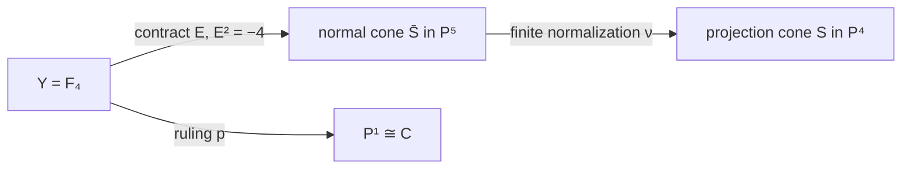
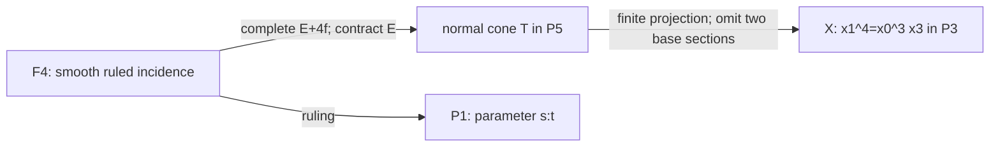
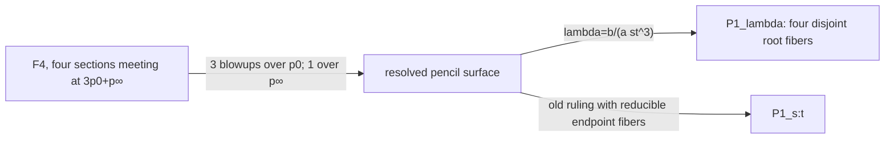
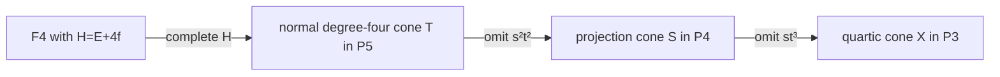

# Quartic cones, graph sections and marked ruled models

The fixed marked system is \(C=[s^4:s^3t:st^3:t^4]\), over an algebraically closed characteristic-zero field unless a characteristic is explicitly changed. A cone over the incomplete quartic, a cone over its plane projection, their common normal cone and their smooth ruled resolution share a birational picture but have different conductor and section data. This chapter owns those distinctions and the explicit endpoint-dependent elementary transformations.

## 3. A comparison table with the actual normalizations

For each smooth ruled surface below, \(E^2=-n\), \(E\cdot f=1\),
and \(f^2=0\). On \(\mathbb F_0\) a minimal section is chosen from
one ruling. The column labelled quartic gives the **strict or reduced
lift**, not an assertion that its full inverse-image ideal is invertible.

| Projective image | Base and smooth ruled model | Hyperplane pullback | Marked quartic class; square | Exceptional/conductor geometry |
| --- | --- | --- | --- | --- |
| \(Q\subset H\) | Degree-one ruling base \(C\); \(\mathbb F_0\), \(E^2=0\) | \(E+f\), square 2 | \(E+3f\); square 6; section | Smooth embedding; opposite ruling has degree 3 on \(C\) |
| Projection cone \(S\subset\mathbf P^4\) | Base \(C\); \(\mathbb F_4\), \(E^2=-4\) | \(E+4f\), square 4 | Both \(C\) and \(C_4\): \(E+4f\); square 4 | Contract \(E\) to normal cone \(T\), then finite \(T\to S\); conductor is reduced vertex downstairs, length 2 upstairs |
| Cubic \(R\subset H\) | Base \(C/\iota\), \(u\mapsto u^2\); \(\mathbb F_1\), \(E^2=-1\) | \(E+2f\), square 3 | \(2E+2f\); square 4; bisection | \(\mathbb F_1\to R\) itself is finite normalization; conductor \(D=E+f\) maps 2:1 to double line, branched at endpoints |
| Quartic \(X=V(F)\subset H\) | Base \(C\); \(\mathbb F_4\), \(E^2=-4\) | \(E+4f\), square 4 | Each \(C_\zeta\): \(E+4f\); square 4 | Contract \(E\) to \(T\), then finite \(T\to X\); full conductor \((x_0,x_1)^2\), extending to \(\mathcal O(-2E-6f_\infty)\) |

Here the common finite normalization of the two cones is
\[
T=\mathbf P(1,1,4)
=\operatorname{Proj}k[s^4,s^3t,s^2t^2,st^3,t^4,r].
\]
It is singular at its vertex. Neither cone has a smooth finite
normalization. For \(X\), the singular locus downstairs is the line
\(x_0=x_1=0\); its transverse local ring on \(x_3=1\) is
\(k[v^3,v^4,b]\subset k[v,b]\), with conductor \(v^6\).
For \(S\), the only singular point is its vertex.

The symmetric quartic \(V(G)\) is obtained by reversing the four
coordinates. It has the corresponding \(\mathbb F_4\) model with the
endpoints interchanged; the smooth-model section intersection becomes
\(p_0+3p_\infty\). The pair \((F,G)\) selects the two ordered variants.

## The cone over the incomplete quartic

## 1. Projectivization and the morphism

Use the **lines** convention: \(\mathbf P_B(\mathcal E)\) parametrizes
one-dimensional subspaces of \(\mathcal E\); its tautological subbundle
is \(\mathcal O(-1)\). Put

\[
B=\mathbf P^1,\quad L=\mathcal O_B(-4),\quad
Y=\mathbf P_B(\mathcal O_B\oplus L),\quad p:Y\longrightarrow B.
\]

Evaluation embeds \(L\) in the constant four-dimensional vector space
whose projectivization is \(H\). Together with the constant line \(kz\),
this gives a fiberwise injective bundle map

\[
\mathcal O_B\oplus L\hookrightarrow k^5\otimes\mathcal O_B.
\]

Its projectivization is a morphism \(\rho:Y\to\mathbf P^4\), with
image \(S\). On \(s\ne0\), set \(u=t/s\), choose the evaluation frame
\(v_0=(1,u,u^3,u^4)\) for \(L\), and write a line in the bundle as
\([a:b]\), meaning the vector \(az+bv_0\). Then

\[
\rho(u,[a:b])=[b:bu:a:bu^3:bu^4]. \tag{1}
\]

The expression is a local formula; \(b\) transforms when the evaluation
frame changes. In particular it is not a formula on an untwisted
product \(B\times\mathbf P^1\).

Let

\[
E=\mathbf P_B(\mathcal O_B),\qquad f=\text{class of a fiber},\qquad
\xi=c_1(\mathcal O_Y(1)).
\]

The section \(E\) maps to \(z\), and

\[
N_{E/Y}=\mathcal H om(\mathcal O_B,L)=\mathcal O_B(-4).
\]

Consequently \(Y\cong\mathbb F_4\), with

\[
E^2=-4,\quad E\cdot f=1,\quad f^2=0,\qquad
\boxed{\xi=E+4f},\qquad \xi^2=4. \tag{2}
\]

Indeed \(\xi\cdot f=1\) and \(\xi|_E=\mathcal O_E\), which determine
the displayed class. The pullback of \(\mathcal O_{\mathbf P^4}(1)\)
is precisely \(\mathcal O_Y(1)\). Off \(E\), a point of \(S\setminus\{z\}\)
determines its ruling line, because its projection to \(H\) lies at a
unique point of the embedded smooth curve \(C\). Formula (1) then gives
an inverse. Thus \(Y\setminus E\cong S\setminus\{z\}\).

There is no additional singular locus away from \(z\). The distinction
between finite normalization and contraction at \(z\), however, is
essential.

## 2. The image cone is not normal

Write \(x_0,x_1,x_2,x_3\) for the four coordinates of \(C\subset H\),
and let \(r=X_2\) be the cone coordinate, all of degree one. The
homogeneous coordinate ring is

\[
A[r],\qquad
A=k[s^4,s^3t,st^3,t^4]\subset k[s,t]^{(4)}=:T,
\]

where a form of degree \(4n\) has degree \(n\). The omitted element
\(h=s^2t^2\) is integral over \(A\), since

\[
h^2=x_0x_3=x_1x_2.
\]

Furthermore

\[
hx_0=x_1^2,\quad hx_1=x_0x_2,\quad
hx_2=x_1x_3,\quad hx_3=x_2^2. \tag{3}
\]

All degree-two monomials in \(s,t\) of total degree eight occur in \(A\):
the sums of two exponents in \(\{0,1,3,4\}\) exhaust \(0,\ldots,8\).
Induction gives every degree \(4n\) monomial for \(n\ge2\). Hence

\[
T=A\oplus kh\quad\text{as graded vector spaces},\qquad
T/A\cong k(-1).
\]

The fourth Veronese ring \(T\) is normal: in characteristic zero it is
the invariant ring of the scalar \(\mu_4\)-action on \(k[s,t]\), or
equivalently its monomial semigroup is saturated in its own lattice.
It follows that \(T[r]\) is the integral closure of \(A[r]\).

The **finite normalization** is therefore

\[
\nu:\overline S=\operatorname{Proj}T[r]\longrightarrow S.
\tag{4}
\]

The normal surface \(\overline S\) is the complete projective cone
over the rational normal quartic, embedded in \(\mathbf P^5\) by the
six coordinates

\[
(s^4,s^3t,s^2t^2,st^3,t^4,r).
\]

Abstractly it is the weighted projective plane
\(\mathbf P(1,1,4)\): its fourth Veronese gives exactly this embedding.
It is singular at its vertex. On the chart \(r\ne0\), its local cone is
\(\operatorname{Spec}T\), the cyclic quotient of type \(\frac14(1,1)\).

The complete system \(|\xi|\), with

\[
h^0(Y,\mathcal O_Y(\xi))=1+h^0(B,\mathcal O_B(4))=6,
\]

contracts exactly \(E\) and maps \(Y\) to \(\overline S\). Thus the
factorization is

The map \(Y\to\overline S\) is the minimal resolution: its exceptional
locus consists of the single \((-4)\)-curve and has no exceptional
\((-1)\)-curve. The composite \(Y\to S\) is a resolution of the
nonnormal surface, **not its finite normalization**. The five-dimensional
subsystem \(kr\oplus V\subset kr\oplus W\), rather than the whole
complete system, is responsible for the nonnormal image.

## 3. Conductor and descent at the vertex

The conductor ideal in \(A\) is the positive-degree ideal
\(\mathfrak m=(x_0,x_1,x_2,x_3)\). A constant cannot be in the conductor,
because multiplying it by \(h\) leaves \(A\); every positive-degree
element is in it by (3) and the degree calculation. After adjoining \(r\),
the conductor is \(\mathfrak m[r]\). Downstairs its projective subscheme
is the **reduced vertex**. Upstairs,

\[
T[r]/\mathfrak mT[r]\cong k[r,h]/(h^2),
\]

so the conductor subscheme on \(\overline S\) has length two at the
vertex. It is not the reduced vertex. Its inverse-image ideal on \(Y\)
is \(\mathcal O_Y(-E)\): in (1) the four \(x_i\) have their common
factor \(b\), and the evaluation sections have no common zero.

These conductor schemes also explain a useful distinction between
linear equivalence upstairs and downstairs. The conductor square has
residue rings \(k\subset k[\epsilon]/(\epsilon^2)\). Its units give
the exact sequence

\[
0\longrightarrow\mathbf G_a(k)\longrightarrow
\operatorname{Pic}(S)\longrightarrow\operatorname{Pic}(\overline S)
\longrightarrow0. \tag{5}
\]

Here both projective integral surfaces have only constant global units,
and the conductor schemes have trivial Picard groups. This is a
statement about Picard groups of this fixed surface over \(k\); no
general representability assertion is needed. The group
\(\operatorname{Pic}(\overline S)\cong\mathbf Z\) is generated by its
hyperplane: on the resolution a descending line bundle has degree zero
on \(E\), hence has class \(a(E+4f)\), and this class does descend.

In particular two sections can be linearly equivalent on the smooth
model and on the normal cone while having distinct line bundles on
\(S\). The pair in the assignment is an explicit instance in Section 4.

## 4. Two quartics as sections of the same complete system

The projected curve \(C\) is the section
\(\mathbf P_B(L)\), namely \(a=0\). It has class
\(\xi=E+4f\). Every homomorphism

\[
q:L\longrightarrow\mathcal O_B,
\qquad q\in H^0(B,\mathcal O_B(4))=W,
\]

gives a graph line subbundle \(L\to\mathcal O_B\oplus L\), and hence
a section \(D_q\) disjoint from \(E\). Conversely every section disjoint
from \(E\) arises this way: its projection to \(L\) is an isomorphism
of line bundles. Thus these sections are the affine space \(W\cong
\mathbf A^5\), the open set of \(|\xi|\cong\mathbf P^5\) whose members
are disjoint from \(E\).

For \(q=s^2t^2\), formula (1) becomes the complete rational normal
quartic \(C_4\). Therefore

\[
\widetilde C=D_0,\qquad
\widetilde C_4=D_{s^2t^2},\qquad
[\widetilde C]=[\widetilde C_4]=E+4f,
\]

and

\[
\widetilde C^2=\widetilde C_4^2=
\widetilde C\cdot\widetilde C_4=4. \tag{6}
\]

These are linearly equivalent, not merely numerically equivalent,
on \(Y\). Their actual intersection subscheme projects isomorphically
onto the divisor

\[
\operatorname{div}(s^2t^2)=2p_0+2p_\infty. \tag{7}
\]

Indeed in a graph chart their equations are \(y=0\) and \(y=q\), so
their intersection is \((y,q)\). This proves (7) scheme-theoretically
and shows why the two sections are tangent at the two endpoints.
Their common normal bundle in \(Y\) is \(\mathcal O_B(4)\).

Since both curves avoid the exceptional section, their intersection
schemes on \(Y\), \(\overline S\), and \(S\) agree. Nevertheless their
linear equivalence does **not** descend from \(\overline S\) to \(S\).
Both image curves are Cartier on \(S\), since they avoid the vertex,
and \(C\) is a hyperplane section. If \(C_4\sim C\) on \(S\), then
\(C_4\) would be a hyperplane section as well. But

\[
H^0(S,\mathcal O_S(1))=kr\oplus V
\]

has dimension five, and no hyperplane in \(\mathbf P^4\) contains the
linearly nondegenerate \(C_4\). This is impossible. One way to justify
the displayed space of sections is that the ring \(A[r]\) has depth at
least two at its irrelevant ideal (the new variable is regular), so
its degree-one piece is already saturated. Equivalently the missing
section \(h\) fails to be regular at the vertex, exactly as (3) shows.
The difference lies in the additive kernel in (5).

The ruling \(p\) restricts to isomorphisms from both sections to \(B\).
After identifying \(B\) with \(C\), the resolved projection
\(\widetilde C_4\to C\) is exactly this restriction. More precisely
the ambient resolved projection on \(Y\) factors as

\[
Y\xrightarrow{p}B\xrightarrow{c}C\hookrightarrow H.
\]

It is not a contraction of the curve \(C_4\); it forgets its graph
coordinate along each joining line.

## 5. All complementary hyperplanes and all section intersections

A hyperplane of \(\mathbf P^4\) avoiding \(z\) has a unique equation

\[
r-\ell(x_0,x_1,x_2,x_3)=0,
\qquad \ell\in V.
\]

Its strict transform meets \(Y\) in the graph section \(D_\ell\).
Consequently the complementary-hyperplane family is the **affine
four-space \(V\)** inside the full affine five-space \(W\) of sections.
The rational normal curve \(C_4=D_{s^2t^2}\) lies outside that
four-space. It is a member of the complete system on the normal cone,
but not of the subsystem defining \(S\subset\mathbf P^4\).

For any \(q_1\ne q_2\in W\),

\[
D_{q_1}\cap D_{q_2}\cong
Z(q_1-q_2)\subset B. \tag{8}
\]

Every such pair has total intersection length four, with multiplicities
given by the zeros of the difference section. In particular

\[
C_4\cap H'\quad\leftrightarrow\quad
Z(s^2t^2-\ell).
\]

As \(H'\) varies, these are exactly the quartic divisors whose defining
section has nonzero middle coefficient, normalized to one. A general
one consists of four distinct points; special ones can have many other
multiplicity patterns. The divisor \(2p_0+2p_\infty\) belongs to the
chosen splitting \(r=0\). The unordered endpoint pair itself is
intrinsic to \(z\), recovered as the two points whose second-osculating
planes on \(C_4\) contain \(z\). Thus section intersections offer a
marked realization of the pair, not a characterization independent of
the hyperplane choice.

## 6. Deformations and the universal incidence

For each graph section,

\[
N_{D_q/Y}\cong\mathcal O_B(4),\quad h^0=5,\quad h^1=0.
\]

The embedded section deformations in the fixed smooth surface are
unobstructed, and the graph family \(W\) realizes all their local
parameters. Complementary ambient hyperplanes realize only four of
these five directions. This difference is visible globally through
the missing degree-one section and the conductor.

Moving the center is a different deformation problem. The admissible
centers outside \(\sigma_2(C_4)\) form an open set of dimension four in
\(\mathbf P^4\). Their ruled incidence surfaces still have abstract
type \(\mathbb F_4\), since the projected evaluation line has degree
\(-4\). The dimension of this center family differs from that of the
section family; there is no identification of the two tangent spaces.
The special center orbit preserving the binary-quartic root type
\((2,2)\) has dimension two, an additional restriction.

There is nevertheless a common universal construction. Over

\[
B\times U,\qquad U=\mathbf P^4\setminus\sigma_2(C_4),
\]

let \(\mathcal Z\) be the tautological center line pulled back from
\(U\), and let \(\mathcal L\) be the evaluation line
\(\mathcal O_B(-4)\) pulled back from \(B\). Since no center belongs
to \(C_4\), their sum injects into the constant ambient vector bundle.
The incidence variety

\[
\mathcal Y=\mathbf P_{B\times U}(\mathcal Z\oplus\mathcal L)
\]

parametrizes a parameter point, a center, and a point on their joining
line. It carries the center section and the \(C_4\) section. A
complementary hyperplane supplies a third section by intersecting each
joining line. Restricting to a fixed center and a fixed splitting gives
the graph construction above. Varying a section in a fixed ruled
surface and varying the incidence surface with its center are therefore
related through a universal incidence, without being the same problem.

## 7. A concrete bridge to the common quartic surface

The [four-section surface note](QUARTIC_CONES_AND_RULED_MODELS.md#four-sheet-ruled-surface)
studies \(F=x_1^4-x_0^3x_3\). The relation to this cone is an actual
linear projection, not just the rationality of the two surfaces. In
the complete normalized cone's coordinates

\[
(s^4,s^3t,s^2t^2,st^3,t^4,r),
\]

the surface \(S\) retains
\((s^4,s^3t,st^3,t^4,r)\), while \(V(F)\subset\mathbf P^3\) retains
\((s^4,s^3t,r,t^4)\). Dropping the \(st^3\) coordinate gives a
morphism \(S\to V(F)\): its projection center is outside \(S\).
It has no positive-dimensional fiber, since such a fiber would be a
line through that center contained in \(S\), forcing the center into
the closed surface. It is generically birational, because on
\(s\ne0\) the coordinate ratio \(s^3t/s^4\) recovers \(u\), and
the remaining fiber coordinate is \(r\). Hence it is finite birational.

Both images thus have the same finite normalization and the same
smooth ruled resolution:

\[
\mathbb F_4\longrightarrow\overline S
\longrightarrow S\longrightarrow V(F).
\]

The distinguished section configurations differ. The present pair has
graphs \(0,s^2t^2\) and divisor \(2p_0+2p_\infty\). The four curves
of the explicit quartic pair have graphs \(\zeta st^3\), with pairwise
intersection divisor \(3p_0+p_\infty\) on this common smooth model.
The further projection can enlarge intersection lengths in its image;
the four-section note distinguishes those image schemes from (8).

## The cuspidal quartic cone and four graph sections

## 1. The ruling and the two different normalization maps

For fixed $[s:t]$, let
\[
\ell_{[s:t]}=\{[a s^4:a s^3t:b:a t^4]\mid[a:b]\text{ in the indicated fiber}\}.
\tag{1}
\]
All these lines contain $v=[0:0:1:0]$. They are the generators of the cone
over the plane quartic
\[
B=[s^4:s^3t:t^4]\subset\mathbf P^2_{x_0,x_1,x_3}.
\]
The map $\mathbf P^1\to B$ is its normalization: $u=t/s=x_1/x_0$
recovers the parameter on a dense chart, and the only singularity is
$s=0$, where $x_3=1$ gives $(x_0,x_1)=(v^4,v^3)$ with $v=s/t$.
This is the $(3,4)$ cusp. Its semigroup has gaps $1,2,5$, hence delta
invariant three, in agreement with the plane quartic arithmetic genus.

Every line (1) lies in $X$. The ruled image is an irreducible surface,
and $x_1^4-x_0^3x_3$ is irreducible; for instance it is primitive and
linear in $x_3$ over $k[x_0,x_1]$. Thus its image is exactly $X$.
The four points of the assignment are the four values $b/a=\zeta st^3$
on this generator, in compatible trivializations.

Use the **lines convention**
\[
Y=\mathbf P_{\mathbf P^1}(\mathcal O\oplus\mathcal O(-4)),
\qquad \mathcal O_Y(-1)\subset p^*(\mathcal O\oplus\mathcal O(-4)).
\]
It is also isomorphic to the quotient-convention surface
$\mathbf P(\mathcal O\oplus\mathcal O(4))$. The subbundle $\mathcal O$
defines the negative section $E$, with
\[
E^2=-4,\quad E\cdot f=1,\quad f^2=0,
\qquad H=c_1(\mathcal O_Y(1))=E+4f.
\tag{2}
\]
Indeed $N_{E/Y}=\operatorname{Hom}(\mathcal O,\mathcal O(-4))$
and $H|_E=\mathcal O$. Formula (1) defines a morphism
$\phi:Y=\mathbb F_4\to X$ by a four-dimensional subspace of $H^0(H)$.
Its negative section contracts to $v$. Therefore **this morphism is a
resolution through the normalization, and is not finite**.

The finite normalization is the normal cone over the complete rational
normal quartic:
\[
T=\operatorname{Proj} k[s^4,s^3t,s^2t^2,st^3,t^4,r]
\cong\mathbf P(1,1,4).
\tag{3}
\]
Here the six displayed generators have standard degree one; in the
weighted presentation $s,t,r$ have weights $1,1,4$. The map
$\rho:Y\to T$ is given by the complete system $|H|$ and contracts only
$E$. It is the minimal resolution of the vertex quotient singularity
$\frac14(1,1)$. In particular the Hirzebruch index is four, not three.
The complete system maps to $\mathbf P^5$, not $\mathbf P^4$.

For a direct proof of finite normalization, set
\[
A=k[s^4,s^3t,t^4,r],\qquad
\overline A=k[s^4,s^3t,s^2t^2,st^3,t^4,r].
\]
The omitted generators belong to $\operatorname{Frac}(A)$, because
$s^2t^2=(s^3t)^2/s^4$ and $st^3=(s^3t)^3/(s^4)^2$.
They are integral: $(s^2t^2)^2=s^4t^4$ and
$(st^3)^4=s^4(t^4)^3$. The fourth Veronese ring of $k[s,t]$ is normal,
and adjoining $r$ preserves normality. Thus $\overline A$ is exactly
the integral closure of $A$. This proves that $\nu:T\to X$ is finite
birational normalization, with
\[
\phi=\nu\circ\rho,\qquad \nu^*\mathcal O_X(1)=\mathcal O_T(1),
\quad\rho^*\mathcal O_T(1)=\mathcal O_Y(H).
\tag{4}
\]

## 2. Singular locus and full conductor

Differentiating $F$ in characteristic zero gives reduced singular locus
\[
\Sigma=V(x_0,x_1),
\tag{5}
\]
the generator above $p_\infty$. It includes the vertex. In the chart
$x_3=1$, away from the vertex, normalization is
\[
k[v^3,v^4,b]\subset k[v,b],\qquad
(x_0,x_1,x_2)=(v^4,v^3,b).
\tag{6}
\]
The map is one-to-one on geometric points along this line; its failure
is a transverse cusp, rather than the double-curve identification of
the cubic scroll. The normalized surface $T$ itself is smooth off its
vertex and singular at its vertex. The original $X$ is nonnormal along
all of $\Sigma$.

The **global conductor ideal** in $\mathcal O_X$ is
\[
\mathfrak c=(x_0,x_1)^2.
\tag{7}
\]
Here is a semigroup proof, which also checks the vertex. A monomial
$s^a t^b$ in the full fourth Veronese belongs to
$k[s^4,s^3t,t^4]$ exactly when, writing $j=b\bmod4$ with
$0\le j\le3$, one has $a\ge3j$. Every monomial with $a\ge6$
therefore belongs, and remains in the smaller semigroup after any
multiplication by a full-Veronese monomial. The only possible smaller
$s$-exponents in the smaller ring are $0,3,4$; each fails the conductor
condition after multiplication by a missing degree-one generator.
The conductor is monomial, since the inclusion is torus graded. Its
monomials are exactly those of $s$-exponent at least six, generated in
the smaller ring by
\[
s^6t^2=x_1^2,\quad s^7t=x_0x_1,\quad s^8=x_0^2.
\]
Polynomial extension by $r=x_2$ preserves this computation. It follows
that (7) gives the full homogeneous conductor, rather than only its
support. In (6) it becomes $v^6k[v,b]$.

On $Y$, its extended ideal is invertible and equals
\[
\mathfrak c\mathcal O_Y=\mathcal O_Y(-2E-6f_\infty).
\tag{8}
\]
Indeed its three generators are locally $a^2s^6$ times
$s^2,st,t^2$, which have no common zero on the base. The multiplicity
two on $E$ must be retained when the resolution and finite
normalization are compared.

## 3. The four sections and their exact intersections

More generally every $h\in H^0(\mathbf P^1,\mathcal O(4))$ gives a
section $D_h$ of $p$ defined by $b=a h$. It avoids $E$, and is the
image of the subbundle $\mathcal O(-4)\to\mathcal O\oplus\mathcal O(-4)$,
$w\mapsto(hw,w)$. Its class is
\[
D_h\sim H=E+4f,\qquad D_h^2=4,\qquad N_{D_h/Y}\cong\mathcal O_{\mathbf P^1}(4).
\tag{9}
\]
The $D_h$ form an affine five-space of sections; the normal-bundle
calculation gives the same unobstructed five-dimensional deformation
space. In particular the four strict transforms, or reduced inverse
images, are
\[
D_\zeta=D_{\zeta st^3}\sim E+4f.
\]
Their restrictions to $C_\zeta$ are isomorphisms, as is evident from
the parameterizations. They are disjoint from the contracted section.
For distinct fourth roots $\zeta,\eta$, their scheme intersection is
the zero divisor of $(\zeta-\eta)st^3$:
\[
(D_\zeta\cap D_\eta)|_{D_\zeta}=3p_0+p_\infty,
\qquad D_\zeta\cdot D_\eta=4.
\tag{10}
\]
This is linear equivalence, not merely numerical equivalence.

The **image curves have different intersection lengths**. On $x_0=1$,
with $u=x_1$, their ideals are
\[
I_{C_\zeta}=(x_3-u^4,\ x_2-\zeta u^3).
\]
Adding the ideals for two distinct roots gives $(x_3,u^3,x_2)$, of
length three at $p_0$. On $x_3=1$, put $b=x_2$. Their ideals are
\[
I_{C_\zeta}=(x_0-b^4,\ x_1-\zeta b^3),
\tag{11}
\]
since $\zeta^4=1$. The sum is $(x_0,x_1,b^3)$, of length three
at $p_\infty$. Hence
\[
(C_\zeta\cap C_\eta)|_{C_\zeta}=3p_0+3p_\infty,
\quad\operatorname{length}(C_\zeta\cap C_\eta)=6.
\tag{12}
\]
The two endpoints exhaust the intersection set. At infinity the
normalization separates distinct tangent directions $b=\zeta v$;
downstairs the cusp parameter $v^3$ makes the image curves tangent.
It is incorrect to transfer (10) unchanged to the images in $\mathbf P^3$.

There is one further scheme distinction. The **full scheme inverse
image** of $C_\zeta$ under normalization is not just $D_\zeta$.
In (6), the ideal pulled back from (11) is
\[
J=(v^4-b^4,\ v^3-\zeta b^3)
 =l\,(v^2+\zeta^{-1}vb+\zeta^{-2}b^2,\ b^3),
\quad l=v-\zeta^{-1}b.
\tag{13}
\]
For the equality, factor the cubics and quartics and reduce the cubic
cofactor modulo the quadratic; it becomes a unit times $b^3$.
The residual ideal in parentheses is a regular sequence of colength
six. The exact sequence
\[
0\longrightarrow (l)/J\longrightarrow k[v,b]/J
\longrightarrow k[v,b]/(l)\longrightarrow0
\]
has its left term of length six. Thus there is an embedded correction
at the cusp point, even though the reduced inverse image is the smooth
section. The same chart describes the full inverse image on $Y$,
since these points avoid $E$.

## 4. A natural pencil and the four separating blowups

Consider the whole pencil
\[
D_\lambda:\quad b=\lambda a st^3,\qquad\lambda\in\mathbf A^1.
\tag{14}
\]
It lies in $|H|$. Its member at infinity is
$E+3f_0+f_\infty$. The pencil has exactly the base scheme of length four
$3p_0+p_\infty$ on $D_0$. Resolve its rational function
\[
\lambda=\frac{b}{a st^3}
\tag{15}
\]
by three successive point blowups above $p_0$ and one blowup above
$p_\infty$. This is a natural resolution of the pencil, not four
arbitrarily chosen blowups.

Near $p_0$ the four sections have equations $b=\zeta u^3$. In the
successive charts they become
$b_1=\zeta u^2$, $b_2=\zeta u$, $b_3=\zeta$.
Thus the third blowup separates them. Near infinity they are
$b=\zeta v$, with distinct tangent directions, so one blowup separates
them. Every pair loses one unit of intersection at each of these four
common centers. The final strict transforms are disjoint curves of
self-intersection $4-4=0$, and are fibers of the resolved morphism
$\widehat Y\to\mathbf P^1_\lambda$. Their class, in the basis of total
exceptional transforms, is
\[
\widehat D=\pi^*H-e_1-e_2-e_3-e_\infty,
\qquad \widehat D^2=0.
\tag{16}
\]
The original ruling over $[s:t]$ now has reducible fibers above the
endpoints. The new map (15) supplies a different rational fibration.
The two rulings should not be conflated.

The action $b\mapsto\xi b$ fixes the base parameter and $E$, preserves
the conductor, and carries $D_\zeta$ to $D_{\xi\zeta}$.
For $\xi\in\mu_4$ it permutes the four curves. It extends through the
pencil resolution and acts on its base by $\lambda\mapsto\xi\lambda$.
Over characteristic zero, this is the usual action of four geometric
points. Over $\mathbf Z_{(2)}$ its group scheme meaning must be kept;
the [arithmetic note](ARITHMETIC_FOUR_SECTION_FAMILY.md#ruled-surfaces-arithmetic) treats it.

## 5. A genuine common cone with the projection construction

The common full cone $T$ from (3) has coordinates
\[
(s^4,s^3t,s^2t^2,st^3,t^4,r).
\]
The projection-cone surface of the assignment uses the subsystem
\[
(s^4,s^3t,r,st^3,t^4)
\]
and is denoted $S\subset\mathbf P^4$. The surface $X$ uses the further
subsystem $(s^4,s^3t,r,t^4)$. Thus there is an actual finite birational
projection $S\to X$, not just an abstract birational equivalence.
Its center, the omitted $st^3$ coordinate point, lies outside $S$:
the base curve $[s^4:s^3t:st^3:t^4]$ never equals that point.
A positive-dimensional projection fiber would be a line through that
center contained in $S$, which is impossible. Properness then makes
the projection finite. On $x_0=1$, its omitted coordinate is recovered as
$(t/s)^3=(x_1/x_0)^3$, so the projection is birational. Both surfaces have the same finite normalization
$T$ and the same minimal smooth ruled model $Y$.

On this common $Y$, the original rational normal quartic in the
projection construction is the graph $r=s^2t^2$; its projected copy
in the complementary hyperplane is $r=0$. The four curves in this
note are the different graphs $r=\zeta st^3$. The image of the first
of those original curves under $S\to X$ is
$[s^4:s^3t:s^2t^2:t^4]$, which is not one of the four $C_\zeta$.
The common surface and nested linear subsystems are canonical for the
fixed coordinates; identifying differently marked graph sections is an
additional operation.

The [projection-cone companion](QUARTIC_CONES_AND_RULED_MODELS.md#projection-cone-ruled-model)
explains the nonnormal vertex of $S$ and the exact distinction between
linear equivalence of graph sections on $Y,T$ and Cartier descent on $S$.

## 6. A marked elementary-transformation bridge from the quadric

This bridge requires the degree-one ruling of $Q$, an ordering of the
two endpoints, and its distinguished auxiliary section described below.
It is compatible with the marked curve; it is more specific than the
existence of a birational map between rational surfaces.

Use Segre coordinates
\[
(x_0,x_1,x_2,x_3)=(A_0B_0,A_0B_1,A_1B_0,A_1B_1)
\]
and let the ruling base be $u=B_1/B_0$. With $A=A_1/A_0$,
$Q$ is $\mathbb F_0$ over this base, its marked curve is $A=u^3$,
and its section $E_0=\{A=\infty\}$ has square zero. These are actual
ruling sections on $Q$, with
\[
H_Q=E_0+f,\qquad C=E_0+3f,\qquad C^2=6.
\]
The generic-fiber identity $b=A$ gives the rational map
\[
[1:u:A:Au]\dashrightarrow[1:u:A:u^4]\in X.
\tag{17}
\]
The transition to the finite fiber coordinate on $Y$ at infinity is
$b'=v^4A$, $v=1/u$. Four elementary transformations over that endpoint
implement it. Starting from $E_0$, blow up $E_0\cap f_\infty$ and
contract the strict transform of $f_\infty$; repeat on the new negative
section. After $j$ steps its self-intersection is $-j$ and the fiber
coordinate is $v^jA$.

For the first three steps the center also lies on the successive
transform of $C$, since $1/A=v^3$ initially. The fourth center lies on
the negative section and is disjoint from $C$. Consequently
\[
C^2:\quad6\longmapsto5\longmapsto4\longmapsto3\longmapsto4,
\]
and its classes are $E_j+3f$ for $j=0,1,2,3$, then $E_4+4f$.
The final image has local equation $b'=v$, exactly the section
$r=st^3$ of the four-component model. In the blowup/contraction formula,
a section through the center loses one in its square; a section avoiding
the center gains one when the fiber is contracted. This checks every
step of the intersection calculation.

This construction privileges one endpoint and one section $A=\infty$.
It is not invariant under the full endpoint-exchanging symmetry, and
it does not identify the original projective hyperplane classes.
The intermediate $\mathbb F_3$ is useful here, but is not the finite
normalization or minimal resolution of $X$.

## Independent normal-bundle proof by syzygies

For the projected curve the quadric normal sequence is
\(0\to\mathcal O(6)\to N_{C/\mathbf P^3}\to\mathcal O(8)\to0\).
Its extension is nonzero in characteristic zero. One independent test,
using the dual Euler and tangent sequences twisted by \(-8\), reduces
\(H^0(N(-8))\) to the kernel of the map from quadratic syzygies of
\((1,u,u^3,u^4)\) to quartics, \((a_i)\mapsto\sum a_i c_i'\).
A basis maps as follows:

\[
\begin{array}{c|c}
(-u,1,0,0)&1\\
(-u^2,u,0,0)&u\\
(0,-u^2,1,0)&2u^2\\
(0,0,-u,1)&u^3\\
(0,0,-u^2,u)&u^4.
\end{array}
\]

The determinant is 2, so \(H^0(N(-8))=0\); equivalently the extension
is the nontrivial one and \(N=\mathcal O(7)^{\oplus2}\). For the
complete quartic, the same argument twisted by \(-7\) uses the four
adjacent linear syzygies of \((1,u,u^2,u^3,u^4)\), which map to
\(1,u,u^2,u^3\). Hence \(H^0(N_{C_4/\mathbf P^4}(-7))=0\).
Its rank is three and degree eighteen, giving
\(N_{C_4/\mathbf P^4}=\mathcal O(6)^{\oplus3}\). Finally the
linear-hyperplane normal sequence splits on \(C\), since
\(H^1(\mathcal O(3))=0\), giving
\(N_{C/\mathbf P^4}=\mathcal O(7)^{\oplus2}\oplus\mathcal O(4)\).
These are statements about different embedded curves in the same space.

## What determines the ruled index

## 7. Why these indices and these occurrences of four appear

The uniform framework is a curve mapping to a Grassmannian and the
projectivization of its rank-two tautological subbundle. In each
construction here the normalized parameter curve is \(\mathbf P^1\),
so its rank-two bundle splits and its projectivization is a Hirzebruch
surface. For the degree-one quadric ruling it is
\(\mathcal O(-1)^2\); for the projection or quartic-cone ruling it is
\(\mathcal O\oplus\mathcal O(-4)\); for the paired-secant ruling it is
\(\mathcal O(-2)\oplus\mathcal O(-1)\). Their index differences are
respectively zero, four, and one. This gives more information than the
abstract classification of rational ruled surfaces: the summands record
the actual directing curves or fixed vertex.

The degree four of the embedded curve determines the \(-4\) section
of its cone resolution and the intersection degree of graph differences.
The four components come from the fourth-power equation and \(\mu_4\),
an additional feature of the prescribed \((F,G)\). The divisors \(2+2\)
and \(3+1\) encode the specific sections \(s^2t^2\) and \(st^3\).
Downstairs lengths \(3+3\) incorporate the cusp conductor. These
numbers have identifiable mechanisms, but are not all the same invariant.
For a cone over a smooth rational curve of degree \(d\), the same bundle
argument gives \(\mathbb F_d\); a root-of-unity configuration requires
a separately specified power equation.

The catalecticant cubic controls secant avoidance of the projection
center, the smooth cubic scroll controls the osculating-pair incidence,
and the projected cubic has a double directrix. These are distinct cubic
objects. The discriminant value \(I^3/J^2=27\) retains its previous
binary-quartic meaning; this work produces no relation to the twenty-seven
lines on a smooth cubic surface. The [literature check](QUARTIC_PROJECTION_MODULI.md)
places the constructions in their classical setting and makes no novelty
claim.

## Characteristic reach and mathematical status

The monomial normalizations and conductor semigroup calculations are characteristic free, with the arithmetic specializations proved separately in [the four-section chapter](ARITHMETIC_FOUR_SECTION_FAMILY.md). The normal-syzygy determinant is 2: the balanced projected normal bundle changes in characteristic two. The cone resolution \(\mathbf F_4\to\mathbf P(1,1,4)\) contracts a curve and is not finite; only the subsequent normalization map is finite. The ordered-endpoint elementary transformation uses actual chosen centers and does not supply a canonical identification of marked polarizations. The fixed quartic admits [every-positive-characteristic STCI pairs](POSITIVE_CHARACTERISTIC_CONSTRUCTIONS.md#every-positive-characteristic-quartic-carrier) on the cuspidal cone, while the characteristic-zero fixed-carrier semigroup has no mate.
