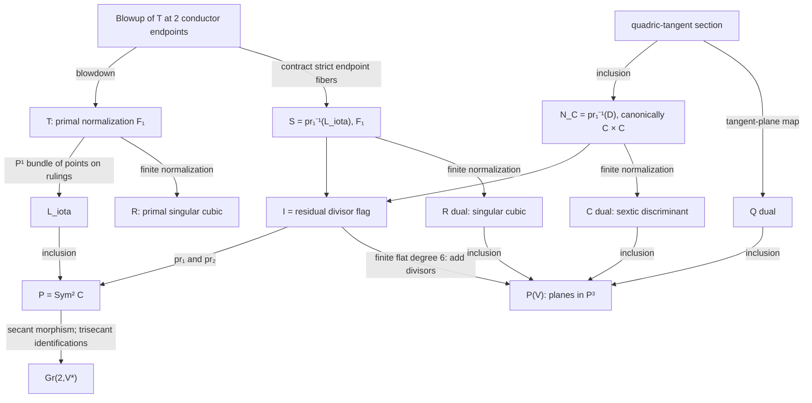
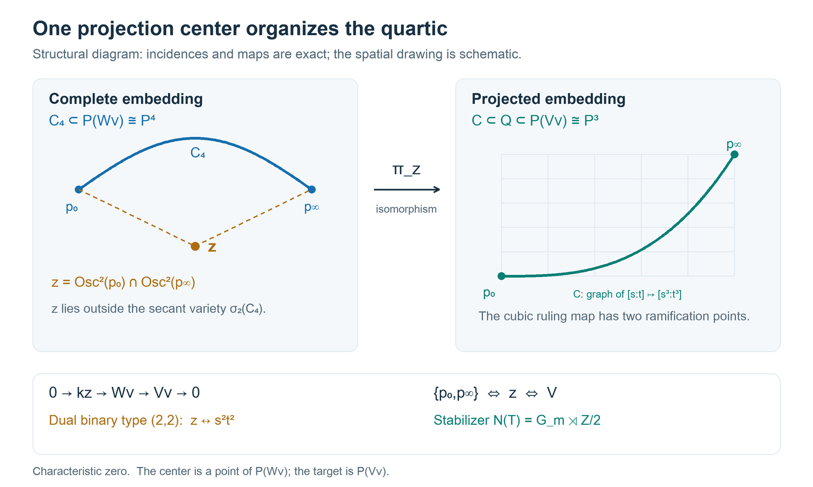
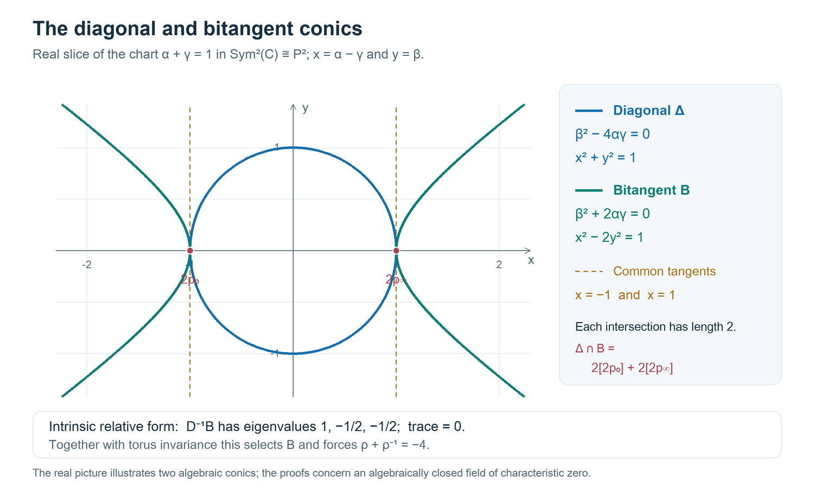

# Quartic duality, flags, symmetric squares and bitangents

Full historical mathematical content organized by topic. Original conditional and audited status is retained; no theorem promotion is implied.


## Subject reading order and mathematical dependencies

1. **Definitions and exact equations:** start with `quartic-dual-intersections` for the binary-quartic invariants, the identities for the discriminant, and the full scheme (V(K,L^3)). The distinction between a Cartier triple and an ambient ideal cube is essential.
2. **Incidence geometry:** read `quartic-flag-incidence` and `quartic-symmetric-square-bitangents` for residual degree-two divisors, the swap involution and its fixed locus. Do not identify the flag threefold with the conormal surface.
3. **Singularities and characteristic:** `quartic-dual-singular-scheme` records the saturated Jacobian calculation, including embedded endpoint corrections. Keep characteristic-zero conclusions separate from characteristic-two degenerations.
4. **Verification and context:** the independent-audit sections qualify the preceding claims; the literature sections contextualize them but do not certify novelty. The canonical scope is controlled by [R-0026](../results/quartic_flag_conormal_geometry.md) and [R-0027](../results/quartic_dual_singular_scheme.md).

**Boundary:** none of these marked dual computations forces a common singularity of arbitrary defining surfaces on (C).


---

## quartic-flag-duality-literature

# Literature context for the flag and duality investigation

Date: 2026-10-24. **Status: source comparison, without a novelty or priority
claim.** This note belongs to the provisional
[flag–duality synthesis](2026-10-24-quartic-flag-duality-synthesis.md).
The specialized propositions are proved in the supporting notes and audited
there; the sources below supply context rather than substitute hypotheses.

## Sources inspected in this investigation

1. Evgueni Tevelev, *Projectively Dual Varieties*,
   [author preprint](https://arxiv.org/pdf/math/0112028), Sections 1.1–1.2
   (printed pages 1–7) and Section 3.1 (printed pages 41–43).
   The conormal construction records a point together with a tangent
   hyperplane, and projective duality uses the second projection.
   Proposition 3.2 explains the first-jet interpretation of tangency.
   These conventions are the setting for our incidence surface and higher
   contact loci. They do not imply that its map is a normalization in
   positive characteristic, nor identify it with the containing quadric.

2. Kathlén Kohn, Bernt Ivar Utstøl Nødland, and Paolo Tripoli,
   *Secants, Bitangents, and Their Congruences*,
   [author paper](https://arxiv.org/pdf/1701.03711), Sections 3 and 7,
   particularly Proposition 7.1 and its proof (printed pages 20–21).
   Their symmetric-square morphism to the secant congruence and the
   disconnected fibers over trisecants give the natural modern context
   for retaining the divisor parameter instead of replacing it by its
   secant line. Their general congruence results are not being specialized
   without checking hypotheses, and do not calculate our endpoint fibers.

3. Izzet Coskun, *Degenerations of surface scrolls and the Gromov–Witten
   invariants of Grassmannians*,
   [author manuscript](https://homepages.math.uic.edu/~coskun/revpub.pdf),
   Section 2, especially Lemmas 2.2 and 2.4 (printed pages 3–4).
   A scroll of type \((k,l)\) is described on \(\mathbb F_{l-k}\) by
   the hyperplane system \(E+lf\); its rulings form a curve in a
   Grassmannian. This supplies the standard bundle language for our two
   \(\mathbb F_1\) models. The marked projection, singular image, and
   resolved Gauss map require the separate arguments in our notes.

4. I. M. Gelfand, M. M. Kapranov, and A. V. Zelevinsky,
   *Discriminants, Resultants, and Multidimensional Determinants* (1994),
   [publisher's contents and bibliographic record](https://link.springer.com/book/10.1007/978-0-8176-4771-1).
   The contents explicitly connect projective dual varieties with general
   discriminants, and include the classical univariate theory. Only this
   publisher record was inspected in the present run; no inaccessible
   internal theorem or product formula is claimed as checked. Our sextic,
   resultant ramification, and restricted invariant identity are verified
   directly. This is classical discriminant theory in a fixed marked
   linear subsystem, rather than evidence for a new general theory.

## Classical projective geometry and access boundary

W. L. Edge's *The Theory of Ruled Surfaces* (1931) is a natural historical
comparison for directing curves, projected cubic scrolls, and their dual
geometry. The [primary scan](https://webhomes.maths.ed.ac.uk/~icheltso/edge2016/pdf/ruled.pdf)
was requested again, but the browsing service rejected its approximately
19 MB size. Its internal classifications were **not inspected**. The
[earlier source ledger](CUBIC_SCROLL_AND_RULED_SURFACES.md) also records
the access boundary for Semple–Roth. Neither book is used as a verified
dependency for our exact cubic or its self-duality.

The general constructions here are standard projective geometry:
addition of effective divisors, incidence flags, conormal varieties,
discriminants, ruled surfaces, and elementary transformations. The useful
output is their explicit compatibility for this particular marked
quartic, including finite fibers and embedded endpoint schemes. A
historical claim that the specialized compatibility is new would require
a more complete comparison with the classical texts; no such claim is
made.


---

## quartic-dual-intersections

# Three dual surfaces and two discriminant identities

Date: 2026-10-24. Author: `dual_intersections` independent investigation.

**Status: new proved propositions in a provisional geometry package; no
canonical promotion and no STCI conclusion.** Work over an algebraically
closed field of characteristic zero throughout. The curve is the fixed
marked embedding
\[
C=[s^4:s^3t:st^3:t^4]\subset\mathbf P^3.
\]

## 1. Scope, retained evidence, and conventions

The [research index](../INDEX.md), [contribution checklist](../CONTRIBUTING_AGENT.md),
[discussion reconciliation](2026-10-24-discussion-reconciliation.md),
[earlier dual-incidence derivation](QUARTIC_PROJECTION_AND_SPECIAL_GEOMETRY.md),
and [merged ruled-surface synthesis](CUBIC_SCROLL_AND_RULED_SURFACES.md)
are the retrieval route. We retain the earlier identification of
\(C^\vee\) with the restricted binary-quartic discriminant, together with
the two endpoint pencil lines and the osculating quartic. These are
previously reviewed provisional geometry, not promoted canonical results.
The dual cubic equation is also reconstructed below to fix its signs.
No normal-bundle splitting or carrier exclusion is needed.

Dual coordinates \([A:B:C:D]\) mean the hyperplane
\(Ax_0+Bx_1+Cx_2+Dx_3=0\). Its section on the parameter line is
\[
f=A s^4+B s^3t+C st^3+D t^4.
\]
Let
\[
\begin{aligned}
M&=AD-BC,& L&=BC-4AD,\\
K&=AC^2+B^2D,& N&=AC^2-B^2D.
\end{aligned}
\]
The dual quadric is \(Q^\vee=V(M)\). The dual of
\(R=V(x_0x_2^2-x_1^2x_3)\) is \(R^\vee=V(K)\).
Indeed the ruling parametrization \([a:b:zb:z^2a]\) gives Gauss image
\([z^2b:-2z^2a:2za:-b]\), and substitution gives \(K=0\).
This image is two-dimensional; its closure is the irreducible cubic
\(V(K)\). Its finite normalization, distinct from its singular projected
image, is the cubic scroll \(\mathbb F_1\); the
[Gauss-map investigation](CUBIC_SCROLL_AND_RULED_SURFACES.md)
studies that normalization and the resolved Gauss map.

Write \(\Delta\) for the ordinary discriminant of
\(A+Bu+Cu^3+Du^4\), interpreted homogeneously as the binary-quartic
discriminant. Thus \(C^\vee=V(\Delta)\).

## 2. The invariant bridge

**Proposition 1.** There are exact polynomial identities
\[
\boxed{\Delta=-4L^3-27K^2}
\tag{1}
\]
and
\[
\boxed{\Delta=4M(8AD+BC)^2-27N^2.}
\tag{2}
\]

**Proof.** For a binary quartic
\(a t^4+b st^3+c s^2t^2+d s^3t+e s^4\), use the coefficient
normalization
\[
I=12ae-3bd+c^2,
\quad
J=72ace+9bcd-27ad^2-27b^2e-2c^3,
\quad
\Delta=(4I^3-J^2)/27.
\]
For the marked linear system, \((a,b,c,d,e)=(D,C,0,B,A)\), hence
\(I=-3L\) and \(J=-27K\), proving (1).
Furthermore
\[
K^2-N^2=4AB^2C^2D,
\qquad
L^3+27AB^2C^2D=-M(8AD+BC)^2,
\]
or direct expansion gives (2). For verification, the full discriminant is
\[
256A^3D^3-192A^2BCD^2-27A^2C^4
-6AB^2C^2D-27B^4D^2-4B^3C^3.
\]
The invariant formulas give the geometric explanation: the projected
dual cubic is the restriction of the classical locus \(J=0\), while
\(L=0\) is the invariant quadric \(I=0\). The containing dual quadric
\(M=0\) is a different quadric. These are classical binary-quartic
invariants; this note makes no novelty claim. The restriction identifies
the objects in this particular marked embedding. \(\square\)

Equation (1) does not assert that \(C^\vee\) is globally a product of a
cusp with a curve. The map given by the invariant expressions can have
critical loci; local singular-scheme analysis must retain that map.

## 3. Full intersection with the dual cubic

**Proposition 2.** The full projective scheme intersection is
\[
C^\vee\cap R^\vee=V(K,L^3).
\tag{3}
\]
Set \(D_R=V(K,L)\). This is a reduced complete-intersection curve, the
union of the osculating quartic \(O\) and the two endpoint pencil lines
\[
\ell_0=V(A,B),\qquad \ell_\infty=V(C,D).
\]
Consequently (3) is the triple effective Cartier divisor \(3D_R\) on
\(R^\vee\). Its fundamental cycle is
\[
3[O]+3[\ell_0]+3[\ell_\infty].
\]
The equation (3), rather than this cycle alone, specifies all scheme
structure at the hyperosculating endpoints.

**Proof.** Identity (1) gives equality of ideals
\((K,\Delta)=(K,L^3)\), since 4 is invertible. The cubic is integral,
and \(L\) is nonzero on it, so its restriction is a nonzerodivisor and
defines a Cartier divisor.

On \(D=1\), eliminating \(A=BC/4\) from \(L=0\) gives
\[
K=B(B+C^3/4).
\tag{4}
\]
One branch is \(\ell_0\). The other is the osculating quartic,
parametrized on this chart by
\[
[-u^4:2u^3:-2u:1].
\]
The reversed chart \(A=1\) gives the osculating curve and
\(\ell_\infty\). The remaining possible points have \(A=D=0\)
and \(BC=0\); they are the points \([0:1:0:0]\) and
\([0:0:1:0]\), already on the corresponding lines. The complete
intersection \((K,L)\) is Cohen--Macaulay, hence has no embedded
associated points. It is generically reduced on its three support
components by (4), its reversal, and the nonsingular line charts.
A generically reduced Cohen--Macaulay curve is reduced. This also proves
that \((K,L^3)\) has no extra embedded points: it too is a complete
intersection. \(\square\)

At \(H_0=[0:0:0:1]\), equation (4) exhibits two smooth reduced branches
meeting to order three. On the smooth ambient quadric \(L=0\), the
intersection ideal is \((B,C^3)\), of length three. The same holds at
\(H_\infty=[1:0:0:0]\). This contact is part of the reduced Cartier
divisor \(D_R\); the full intersection additionally cubes its principal
ideal inside the singular cubic. One must not replace \((K,L^3)\) by
the cube of the ambient ideal \((K,L)\).

There is a useful complete normalization check. On a chart of the dual
scroll with \(D=-1\), write
\[
[A:B:C:D]=[z^2:-za:a:-1].
\]
Then the hyperplane section of the original curve factors as
\[
z^2-za u+a u^3-u^4
=-(u^2-z)(u^2-au+z),
\tag{5}
\]
and
\[
\nu^*L=z(4z-a^2),\qquad
\nu^*\Delta=4z^3(a^2-4z)^3.
\tag{6}
\]
The three factors of the discriminant product formula are respectively
\(4z\), \(a^2-4z\), and the square of
\(z(4z-a^2)\). Thus the same double-root collision simultaneously
affects a quadratic and the resultant of the two quadratics. This
explains the exponent three through residual divisors.

Globally, on \(\mathbb F_1\), let \(E^2=-1\), let \(f\) be a ruling
fiber, and let \(H=E+2f\) be the dual hyperplane class. The strict
osculating quartic has class \(2E+2f\), and (6), with its reversed chart,
gives the exact Cartier pullbacks
\[
\nu^*D_R=\widetilde O+f_0+f_\infty\sim2H,
\quad
\nu^*(C^\vee\cap R^\vee)
=3\widetilde O+3f_0+3f_\infty\sim6H.
\]
These assertions concern the pullback of the **entire principal divisor**
\(D_R\). They do not identify the full inverse ideal of the individual
curve \(O\) with its divisorial hull. Indeed, on this \(D=-1\) chart,
\[
I_O=(A-C^4/16,\ B+C^3/4),\qquad
I_O\mathcal O_{\mathbb F_1}
=(z-a^2/4)(z,a).
\tag{10}
\]
The last factor is the colength-one endpoint correction. Thus the full
inverse ideal and the strict Cartier curve differ even though the
pullback of their union with the endpoint fibers is principal.

## 4. Full intersection with the dual quadric

**Proposition 3.** The full projective scheme intersection is
\[
C^\vee\cap Q^\vee=V(M,N^2).
\tag{7}
\]
Let \(\Gamma_Q\) denote the image of the quadric-tangent section
\(p\mapsto T_pQ\). Then the reduced complete intersection
\(D_Q=V(M,N)\) equals
\(\Gamma_Q\cup\ell_0\cup\ell_\infty\), and (7) is the double
Cartier divisor
\[
2D_Q=2\Gamma_Q+2\ell_0+2\ell_\infty
\quad\hbox{on }Q^\vee.
\]

**Proof.** Identity (2) gives
\((M,\Delta)=(M,N^2)\). In Segre coordinates
\[
[A:B:C:D]=[ac:ad:bc:bd],
\]
the original hyperplane section and the cubic \(N\) factor as
\[
f=(a s^3+b t^3)(c s+d t),
\qquad
N=ab(bc^3-ad^3).
\tag{8}
\]
The third factor in \(N\) is the smooth graph
\(ad^3=bc^3\); it is the quadric-tangent curve, with parametrization
\[
\Gamma_Q(u)=[u^4:-u^3:-u:1].
\]
The first two factors are the two endpoint pencil lines. They are
distinct reduced divisors, so \(D_Q\) is reduced. Alternatively the
discriminant product formula applied to (8) gives the exact identity
\[
\Delta|_{Q^\vee}=-27a^2b^2(ad^3-bc^3)^2,
\tag{9}
\]
including all boundary points. The repeated factors are forced by the
resultant square and the discriminant \(-27a^2b^2\) of the cubic
factor. This proves the scheme statement, not just its support. \(\square\)

The line \(a=0\) meets \(\Gamma_Q\) at \(c=0\), with intersection
length three; the other line has the reversed endpoint behavior.
The total degree is \(2(4+1+1)=12\), as required for a sextic cut on a
quadric. Equation (3) has degree \(3(4+1+1)=18\). These degree checks
corroborate, but do not substitute for, the exact ideal identities.

For comparison, the third full intersection is
\[
R^\vee\cap Q^\vee=V(M,K).
\]
Its pullback to the same Segre quadric is the reduced divisor
\(ab(bc^3+ad^3)=0\): the two endpoint lines and a different smooth
quartic. The [scroll-duality note](CUBIC_SCROLL_AND_RULED_SURFACES.md)
provides its interpretation and the Gauss maps. The minus and plus
signs in (8) and this last equation cannot be interchanged. In
particular \(\Gamma_Q\), \(O\), and this third quartic are distinct.

## 5. Full dual intersections versus common-point traces

The quadric-tangent section of the conormal surface maps to
\(\Gamma_Q\), while the closure of the Gauss trace of \(R\) along
the smooth part of \(C\) maps to \(O\). These are the distinguished
same-point constructions.

For a general point \([0:0:C:D]\in\ell_0\), the plane section of
\(C\) is \(t^3(Cs+Dt)\), so its contact point on \(C\) is \(p_0\).
The tangency point on the smooth quadric, determined by its polarity,
is
\[
[D:-C:0:0].
\]
This usually differs from \(p_0=[1:0:0:0]\). The endpoint pencil line
in \(C^\vee\cap Q^\vee\) therefore records tangencies at different
points of the two varieties. Only its limiting hyperosculating plane
\([0:0:0:1]\) has the quadric tangency point \(p_0\).

For \(R\), the same endpoint line is a family of limiting tangent
planes at its singular pinch point. A general plane of this pencil is
not obtained by following \(T_pR\) along smooth points \(p\in C\)
as \(p\to p_0\); that particular path selects only the osculating
limit \(H_0\). The reversed statements hold at infinity. Thus the
extra lines are actual components of the full dual intersection, while
the closure of the marked smooth-curve trace is the single quartic
\(O\). They must not be discarded or identified with the distinguished
section.

The reduced common intersection of all three dual surfaces is exactly
\(\ell_0\cup\ell_\infty\). Indeed on \(Q^\vee\), requiring both
\(K=0\) and \(\Delta=0\) away from \(ab=0\) would require
\(bc^3+ad^3=bc^3-ad^3=0\), impossible there in characteristic zero.
This is a support statement only; the equations above retain the full
triple-intersection scheme if it is needed.

## 6. Reproduction, limitations, and next questions

Run

```sh
python3 research/computations/verify_quartic_dual_intersections_2026_10_24.py
```

Use SymPy 1.14.0 in the selected Python environment. The
[verifier](../computations/verify_quartic_dual_intersections_2026_10_24.py)
and its [JSON evidence](../computations/quartic_dual_intersections_2026_10_24.json)
check the discriminant, invariant identities, complete-intersection ideal
equalities, residual factorizations, endpoint contact length, and
normalization-chart restrictions over \(\mathbf Q\). The proofs above
supply the global geometric interpretation and reducedness arguments.

The whole package is restricted to the fixed marked embedding in
characteristic zero. In characteristic two or three, constants used in
the invariant/discriminant identities cease to be units; the conclusions
about reduced divisors and multiplicities cannot be specialized from
these equations without a separate analysis. No claim is made here
about the scheme-theoretic singular locus of \(C^\vee\); that is
addressed in the separate singular-scheme investigation.

The useful next extension is to vary the projection hyperplane
\(V\subset H^0(\mathcal O(4))\). The binary-quartic invariant identity
persists before restriction, whereas the accidental identification of
the restricted cubic \(J=0\) with the dual of this paired-secant scroll
requires a new argument for another center. The residual factorization
on \(Q^\vee\) likewise uses this curve's particular cubic ruling.
These distinctions provide a concrete test for which parts of the
unified construction survive variation of the center.


---

## quartic-flag-duality-synthesis

# One divisor flag, two ruled surfaces, and three duals

Date: 2026-10-24. **Status: new proved propositions and exact algebraic
certificates in an independently reviewed provisional geometry package;
no canonical promotion.** Throughout the main argument, the field is
algebraically closed of characteristic zero and
\[
C=[s^4:s^3t:st^3:t^4]\subset\mathbf P^3.
\]
This investigation studies its projective geometry for its own sake.

## 1. What unifies the constructions

The most economical common source is addition of degree-two divisors on
the parameter curve, restricted to its marked hyperplane system. It
produces a smooth flag threefold \(\mathcal I\), containing two naturally
marked ruled surfaces: the conormal normalization of \(C^\vee\), and
the normalization of the dual cubic \(R^\vee\). The same line in the
symmetric square that gives the second surface also parametrizes the
rulings of the primal cubic \(R\).

This supplies actual morphisms and controlled correspondences, rather
than a marked isomorphism between unrelated product surfaces. In
particular the conormal surface has a canonical product description
through residual intersection with a conic. Its two distinguished
sections are the diagonal and the graph of the osculating involution.
Residual swap on the threefold remains a different operation.

The second common source is the classical discriminant identity for the
marked binary-quartic system. It identifies the cubic dual with the
restricted invariant locus \(J=0\), and determines the full intersections
of the three dual surfaces, including their endpoint multiplicities.
These two constructions explain the geometry more effectively than
abstract ruled-surface classifications alone.

## 2. Dependencies, authority, and reading route

The checkout starts at current main \(320dbd8\), containing merged PRs
#71–#74. The [research index](../INDEX.md), [state](../STATE.md),
[frontier](../FRONTIER.md), [authority policy](../AUTHORITY.md),
[interlude](../INTRINSIC_GEOMETRY_INTERLUDE_2026-10-24.md), and
[discussion reconciliation](2026-10-24-discussion-reconciliation.md)
were consulted before the investigation. Navigation and discussion
records are not theorem authority.

The retained geometry is the exact fixed-embedding description in the
[special-lines note](QUARTIC_PROJECTION_AND_SPECIAL_GEOMETRY.md)
and its [geometry audit](2026-10-24-special-lines-planes-geometry-audit.md),
the [automorphism/bitangent synthesis](#2026-10-24-quartic-automorphisms-bitangents-synthesis),
and the [merged ruled-surface synthesis](CUBIC_SCROLL_AND_RULED_SURFACES.md)
with its linked independent audits. These are previously reviewed
**provisional geometry**, not promoted result records. We retain their
unique quadric, group, secant fibers, projection center, and actual cubic
normalization. The only promoted bundle input used for comparison is
[R0020](../results/quartic_conormal_characteristic_jump.md), the stated
characteristic-dependent conormal splitting. Its proof is not rerun.

The supporting investigations are:

| Note | Main contribution and evidence type |
| --- | --- |
| [Flag incidence](2026-10-24-quartic-flag-incidence.md) | Global construction, finite fibers, swap, contact structure, automorphisms; proofs and exact checks |
| [Conormal and residual geometry](2026-10-24-quartic-conormal-residual-geometry.md) | Canonical product, distinguished sections, residual double cover and higher contact; proofs and independent reconstruction |
| [Cubic scroll and Gauss duality](CUBIC_SCROLL_AND_RULED_SURFACES.md) | Dual equation, normalization, Gauss resolution and elementary transformations; proofs and exact checks |
| [Dual intersections](2026-10-24-quartic-dual-intersections.md) | Global intersection ideals and endpoint inverse-ideal corrections; proofs and exact checks |
| [Dual singular scheme](2026-10-24-quartic-dual-singular-scheme.md) | Full Jacobian scheme, generic transverse structures and embedded endpoint points; local algebra and exact certificates |
| [Independent audit](2026-10-24-quartic-flag-duality-independent-audit.md) | Independent reconstruction, boundary checks, and separate algebra replay |
| [Literature context](2026-10-24-quartic-flag-duality-literature.md) | Primary-source comparison and explicit access limits; no novelty claim |

None of these new propositions has been promoted to a canonical result.
The proofs and review establish the scope of this package; passing scripts
are not substitutes for the global arguments.

## 3. The flag is global, with six-sheeted multiplication

Put \(U=H^0(\mathbf P^1,\mathcal O(2))\),
\(W=H^0(\mathbf P^1,\mathcal O(4))\), and
\(V=\langle s^4,s^3t,st^3,t^4\rangle\). The plane
\(P=\operatorname{Sym}^2C=\mathbf P(U)\) parametrizes effective
divisors, including doubled points. Write \(z:W\to W/V\) for the
quotient to the missing coefficient. Multiplication defines
\[
b_z(h,k)=z(hk),\qquad
\mathcal I=\{([h],[k]):b_z(h,k)=0\}.
\]

**Proposition.** This is the secant–plane flag incidence over arbitrary
base schemes. Both projections to \(P\) are projective-line bundles,
and \(\mathcal I\simeq F(1,2;3)\).

**Proof.** For a universal degree-two divisor \(D\), hyperplane
sections containing its secant or tangent are exactly sections vanishing
along \(D\). Dividing by its universal quadratic gives its residual
degree-two divisor. Thus the scheme is the fiber product of divisor
addition \(P\times P\to\operatorname{Sym}^4C\) with
\(\mathbf P(V)\). In coefficients \(h=\alpha s^2+\beta st+\gamma t^2\)
and \(k=A s^2+Bst+Ct^2\), its equation is
\(\alpha C+\beta B+\gamma A=0\). The pairing has determinant
\(-1\); it identifies the second plane with the dual of the first,
giving the ordinary point–line flag incidence. This proves globality
also on nonreduced boundary divisors. \(\square\)

For a varying codimension-one subsystem, the same conclusion holds
precisely when its multiplication pairing is nondegenerate. A radical
pair gives a singular point otherwise. The abstract flag forgets the
marked diagonal conic and hyperplane map; its much larger automorphism
group is not the embedded curve's automorphism group.

The morphism
\[
f:\mathcal I\longrightarrow\mathbf P(V),\qquad(D,E)\longmapsto D+E
\]
is finite flat of degree six: divisor addition is finite between smooth
fourfolds and has six choices of a two-point sub-divisor over four
distinct points, and \(f\) is its base change. Over a quadruple root its
fiber is a length-six scheme, rather than a single reduced point. Its
ramification divisor is the resultant \(\operatorname{Res}(h,k)=0\)
of class \((2,2)\), and its branch support is \(C^\vee\). A general
double-root section has two simple ramification points, so the pushed
ramification cycle is \(2[C^\vee]\).

The residual involution \(\tau(D,E)=(E,D)\) fixes the **scheme**
\[
\mathcal B=\{(D,D):z(h^2)=0\},\qquad
\beta^2+2\alpha\gamma=0.
\]
It is the smooth bitangent conic in characteristic zero; its hyperplane
image is the quartic of bitangent planes. The flag carries its usual
contact distribution, and \(\tau\) preserves it. The fixed conic is
Legendrian. The degree-three quotient by swap parametrizes unordered
partitions into two pairs, rather than a conormal surface.

The secant morphism \(\sigma:P\to\operatorname{Gr}(2,V^*)\) is
not injective. Retaining the audited secant fibers, a general trisecant
has three inverse pairs and an endpoint tangent trisecant has one inverse
point of scheme length three. The map
\((D,E)\mapsto(\sigma(D),f(D,E))\) normalizes the ordinary incidence
of secant lines and containing planes and retains exactly these fibers.
Forgetting \(D\) therefore loses geometric information even when the
plane is also remembered.

## 4. Conormal geometry from the polar geometry of one conic

Let \(\mathcal D\subset P\) be the conic of doubled points,
\(\beta^2-4\alpha\gamma=0\). There is a canonical identification
\[
N_C=\operatorname{pr}_1^{-1}(\mathcal D)\subset\mathcal I,
\quad(p,H)\longmapsto(2p,H|_C-2p).
\]
Its finite map to \(C^\vee\) is birational, since a general tangent
plane has one double contact, and its source is smooth. It is therefore
the normalization, in the stated characteristic-zero scope.

**Proposition.** The marked pairing and doubled-point conic give a
canonical product \(N_C\simeq C\times C\). The residual map
\(r:N_C\to P\) is a double cover whose deck transformation exchanges
the two factors. Its ramification section is \(p\mapsto T_pQ\).

**Proof.** For residual divisor \(E\), its \(b_z\)-polar line meets
\(\mathcal D\) in \(2p\) and one residual point \(2p'\). This
constructs the second factor, including the tangent case \(p=p'\),
by the universal degree-two divisor on the smooth conic. Conversely the
chord or tangent of \(\mathcal D\) through \(2p,2p'\), identified
with its polar point, recovers \(E\). In affine coordinates \(u,u'\)
the residual quadratic is
\[
k(v)=v^2+\frac{u+u'}2v+uu'.
\]
Thus factor exchange is the deck involution. Its diagonal has residual
\(v^2+uv+u^2\), and
\((v-u)^2(v^2+uv+u^2)=(v-u)(v^3-u^3)\), precisely the tangent
quadric section. \(\square\)

Let \(a,b\) be the two ruling classes, with \(a\) a fiber of the
contact-point projection. Then
\[
r^*\mathcal O_P(1)=\mathcal O(1,1),\qquad
\nu_C^*\mathcal O_{\mathbf P(V)}(1)=\mathcal O(3,1).
\]
Both distinguished sections have class \((1,1)\), square two, and
intersect simply at the two endpoints:
\[
\sigma_Q=\Delta_C,\qquad
\sigma_O=\Gamma_\iota,\qquad \iota(u)=-u.
\]
Their images are distinct quartics and meet to order three at each
endpoint in dual space. Images and normalization intersections therefore
have different scheme structures.

This also separates three operations. The osculating involution is an
automorphism of \(C\); the bitangent relation has two generic partners;
\(\tau\) exchanges two degree-two factors on a threefold. The conormal
deck involution exchanges \(p,p'\), and restricts on \(\Gamma_\iota\)
to \(\iota\), giving a genuine relation without identifying these maps.
The intersection \(N_C\cap\tau(N_C)\) records ordered bitangent
contacts \((2p,2q)\), not the swap-fixed factorization \((p+q,p+q)\).

There is no isomorphism over \(C\) carrying \(\sigma_Q\subset N_C\)
to \(C\subset Q\): their squares are two and six. Normal lines in
the blowup exceptional divisor and conormal covectors in this incidence
are different bundle data. Quadric polarity does not overcome this
marked intersection-theoretic obstruction.

## 5. The same flag also normalizes the cubic dual

Let \(L_\iota\subset P\) be the line of pairs \(p+\iota(p)\),
including the two endpoint double points. Its secants sweep the known
cubic \(R=V(x_0x_2^2-x_1^2x_3)\). The surface
\[
\mathscr S=\operatorname{pr}_1^{-1}(L_\iota)\subset\mathcal I
\]
is a projective-line bundle with splitting difference one, hence
\(\mathbb F_1\). It parametrizes all planes through these rulings.

**Proposition.** Restriction \(f|_{\mathscr S}\) is the finite
normalization of the dual cubic
\[
R^\vee=V(AC^2+B^2D)\subset\mathbf P(V).
\]

**Proof.** A factorization with one even quadratic can be written
\((1+zv^2)(A+Bv-Azv^2)\). Its coefficient vector is
\([A:B:Bz:-Az^2]\), on the displayed cubic. The image is a surface;
its hyperplane class on \(\mathbb F_1\) has square three, so the
finite map is birational onto the irreducible cubic. Independently, the
Gauss map of the primal ruling \([a:b:zb:z^2a]\) is
\([z^2b:-2z^2a:2za:-b]\), and fills its plane pencil for general
\(z\). Thus this image is the actual dual of the projected singular
cubic, rather than the dual of the embedded scroll in four-space.
\(\square\)

The dual cubic has a double line and two pinch points; its smooth finite
normalization is \(\mathbb F_1\). The Gauss map pulled back to the
**primal** normalization is rational, with two reduced basepoints at
the conductor endpoints. Blowing them up resolves it. Contracting the
strict endpoint ruling fibers gives \(\mathscr S\), the **dual**
normalization. These are two elementary transformations. The original
conductor becomes the target negative section, and the original negative
section becomes the target conductor. It is a birational correspondence
of marked ruled surfaces, not an everywhere defined isomorphism.

Off the endpoints, the Gauss trace along \(C\) is the osculating plane.
The whole dual cubic contains many other tangent planes. In the flag,
\(N_C\cap\mathscr S\) is precisely the two endpoint pencil fibers,
because \(\mathcal D\cap L_\iota\) consists of the endpoint double
points. The osculating quartic is a common **image** of the two surfaces;
its two flag markings differ away from the endpoints.

More precisely, \(\tau(N_C)\cap\mathscr S\) is the swapped
osculating section \((p+\iota(p),2p)\), scheme-theoretically. This is
the common osculating image with its correct marking inside the second
ruled surface; it is different from \(N_C\cap\mathscr S\).



Every arrow in this diagram is a morphism on its displayed domain.
The two arrows from the blowup resolve the Gauss correspondence. The
line-parameter curve itself does not map onto its swept cubic: its
universal projective-line bundle does. The quadric-tangent section maps
to \(Q^\vee\); there is no map from all of \(N_C\) to \(Q^\vee\)
asserted here.

## 6. Three duals through two invariant identities

Write a hyperplane section as \(A+Bu+Cu^3+Du^4\), and put
\[
M=AD-BC,\quad L=BC-4AD,\quad
K=AC^2+B^2D,\quad T=AC^2-B^2D.
\]
Then \(Q^\vee=V(M)\), \(R^\vee=V(K)\), and the dual sextic is
\[
\boxed{\Delta=-4L^3-27K^2
       =4M(8AD+BC)^2-27T^2.}
\]
Indeed the classical binary-quartic invariants restrict to
\(I=-3L\), \(J=-27K\), and
\(\Delta=(4I^3-J^2)/27\). Thus the dual cubic is the restricted
\(J=0\) locus. Direct expansion proves the second identity as well.

The identities give **equalities of scheme ideals**:

| Full intersection | Scheme and interpretation |
| --- | --- |
| \(C^\vee\cap R^\vee\) | \((K,L^3)\): triple Cartier divisor of osculating quartic plus \(\ell_0+\ell_\infty\) on \(R^\vee\) |
| \(C^\vee\cap Q^\vee\) | \((M,T^2)\): double Cartier divisor of quadric-tangent quartic plus \(\ell_0+\ell_\infty\) on \(Q^\vee\) |
| \(R^\vee\cap Q^\vee\) | \((M,K)\): reduced union of a third smooth quartic and \(\ell_0+\ell_\infty\) |

Here \(\ell_0=V(A,B)\) and \(\ell_\infty=V(C,D)\). Reducedness
of the underlying divisors and absence of extra embedded components in
these complete intersections are proved in the supporting notes.
The ideal notation retains their endpoint structure, beyond the cycle
multiplicities three, two, and one. For an individual distinguished
quartic the full inverse ideal on a scroll can still have an endpoint
correction; it must not be replaced by its Cartier hull.

A plane on a general endpoint pencil line is tangent to \(C\) and
\(Q\) at different points. On \(R\), that line records limiting
tangent planes at its singular pinch point; following smooth points of
\(C\) selects only the unique osculating limit. Thus full dual
intersections exceed common-point conormal traces. The reduced common
intersection of all three duals is the two pencil lines, not a common
distinguished quartic.

The reduced singular locus of \(C^\vee\) is the previously recorded
union of the osculating and bitangent quartics and the two pencil lines.
The new scheme calculation is stricter. The saturated gradient ideal
has Hilbert polynomial \(16n-43\); its unmixed curve has polynomial
\(16n-45\), with one embedded length-one point at each hyperosculating
plane. Generically the osculating curve and pencil lines carry the
length-two Jacobian structure of a transverse cusp, while the bitangent
curve has the reduced Jacobian structure of a transverse node. Explicit
local algebra, a Hilbert–Burch presentation, and an independent exact
replay establish the endpoint correction. The cuspidal expression for
\(\Delta\) alone does not make the entire surface a cusp product;
the critical behavior of the invariant map matters.

## 7. Symmetry, endpoints, and higher contact

The retained embedded automorphism group is
\(G=\mathbf G_m\rtimes\mathbf Z/2\), preserving the unordered
endpoint pair. Its simultaneous action on both divisor factors preserves
\(b_z\) up to scalar, hence the entire flag, its contact distribution,
the factorization map, both marked ruled surfaces, and all the displayed
correspondences. It commutes with residual swap. On the canonical
\(C\times C\) conormal model its action is diagonal. The focused flag
note gives the fixed schemes for every torus element, reflection,
residual swap, and their combinations; choosing one bitangent multiplier
breaks the endpoint-exchange symmetry.

The two endpoints recur for a single geometric reason: the marked center
selects this exceptional unordered pair, and the doubled-point conic is
tangent to the bitangent conic there. They are also the two fixed points
of \(\iota\) and the intersection of \(L_\iota\) with the doubled
conic. Accordingly they appear as degenerate secants, extra triple-contact
fibers, conductor pinch points, Gauss basepoints, and embedded points in
the dual singular scheme. These occurrences are compatible constructions;
their numerical lengths are not interchangeable.

There is a modest higher-contact extension already on \(N_C\). The
third-contact locus is the Cartier divisor
\[
T_{\geq3}=f_0+f_\infty+\sigma_O.
\]
The resultant ramification of \(f\), restricted to \(N_C\), is
\(2T_{\geq3}\): a doubled factor gives
\(\operatorname{Res}(\ell_p^2,k)=k(p)^2\). This relates the
factorization cover to osculation without identifying its ramification
surface with \(N_C\). The fourth-contact jet incidence is exactly
\(T_4=N_C\cap\operatorname{Fix}(\tau)\) as a scheme in the flag.
It has length two at each hyperosculating point, although its support is
two points. This nontransverse intersection of the conormal surface with
the fixed bitangent conic recovers the doubled endpoint Wronskian divisor.
These schemes come from principal-parts evaluation; ordinary derivative ranks
alone would miss the boundary structure. A full theory of nested divisor
flags is a next question, not an assertion of this package.

## 8. Characteristic boundary and a short roadmap

The flag pairing has determinant \(-1\), so the smooth flag and divisor
addition survive in characteristic two. Its swap-fixed scheme becomes
the double line \(\beta^2=0\). The doubled-point map from \(C\) is
then inseparable onto a line, so the conic-polar product construction
fails. The conormal surface is \(\mathbb F_2\), and its map to the
reduced cubic dual of \(C\) is purely inseparable of degree two; it is
not a normalization map. In coordinates \(\Delta\bmod2=K^2\).

There is a second distinction: the actual dual of the cubic \(R\) in
characteristic two is the line \(B=C=0\), since its gradient has only
first and last entries. The cubic special fiber of the characteristic-zero
equation for \(R^\vee\) is therefore not that actual dual. These exact
boundary identities do not extend the characteristic-zero assertions
about normalization, Gauss birationality, or intersection multiplicities.

The most promising continuations are small enough to be precise:

1. **Vary the projection center.** Nondegeneracy of the middle
   multiplication pairing preserves the abstract flag. Study how the
   doubled conic, swap-fixed conic, marked lines, and residual double
   cover vary together. The identification of a restricted invariant
   cubic with this scroll dual is special and requires a fresh argument
   for another center.
2. **Study the three-pair quotient.** Its degree-three map to hyperplane
   space is the natural resolvent construction. Relate its quotient
   singularities and discriminant to the two distinguished ruled
   surfaces, retaining the length-six fiber over a hyperosculating plane.
3. **Extend contact through divisor flags.** Use principal-parts or nested
   Hilbert schemes to organize orders two, three, and four, including the
   nonreduced fourth-contact endpoints. Compare that scheme with the
   embedded correction in the dual Jacobian, without assuming they are
   identical.
4. **Compare the classical sources more completely.** The inspected
   modern sources place the ingredients in standard theory; unavailable
   classical scans leave priority questions open. No novelty claim or
   general classification is made.

No conjecture is needed for the fixed characteristic-zero propositions
above. Variation of the center, quotient geometry beyond the stated local
model, and a systematic higher-contact theory remain research questions.
Canonical STCI records and their scopes are unchanged.

## 9. Reproduction and integration record

The three new Python verifiers use SymPy 1.14.0. With a Python environment
containing that version, run from the repository root:

```sh
python3 research/computations/verify_quartic_flag_incidence_2026_10_24.py
python3 research/computations/verify_cubic_scroll_gauss_dual_2026_10_24.py
python3 research/computations/verify_quartic_dual_intersections_2026_10_24.py
M2 --script research/computations/verify_quartic_dual_singular_scheme_2026_10_24.m2
M2 --script research/computations/audit_quartic_flag_duality_2026_10_24.m2
python3 research/computations/validate_records.py
python3 research/computations/check_markdown_links.py --core
```

The Python scripts save adjacent JSON reports; the two independent
Macaulay2 suites have saved text outputs linked from their notes. The
scoped checks concern new formulas and scheme calculations. Inherited
normal-splitting and carrier-exclusion proofs are not rerun.

Final synthesis integration continued on 2026-10-25. The independent
reviewer identified one diagram error: a family of ruling lines had been
drawn as a morphism from its base curve to the swept surface. The final
diagram displays the universal point-on-ruling bundle and the Gauss
resolution instead. The mathematical statements about the two scrolls
already used those correct domains. The audit also warned that different
length-four endpoint incidences must retain their tangent directions;
only the specifically proved equality \(T_4=N_C\cap\operatorname{Fix}(\tau)\)
is asserted here.

Integration validation on 2026-10-25 passed all 65 exact Python checks
(15 flag, 33 cubic Gauss/dual, 17 intersections), both Macaulay2 suites,
23 canonical metadata records, core navigation links, and every local
destination in the changed Markdown files. The new notes' math delimiters
and `git diff --check` also passed. This confirms the specified symbolic
and record checks; the global propositions rely on their written proofs
and independent audits.


---

## quartic-automorphisms-bitangents-synthesis

# One endpoint pair, two conics, and the geometry of the rational quartic

Date: 2026-10-24. Status: **exploratory research with proofs and independent
audits; no canonical promotion**. Throughout the main discussion, the field
is algebraically closed of characteristic zero and

\[
C=\{[s^4:s^3t:st^3:t^4]\}\subset\mathbf P^3.
\]

This investigation concerns the embedding, its automorphisms, projection,
and contact correspondences. No STCI assertion is proposed. The accepted
normal-bundle splitting and carrier exclusions are neither reproved nor
used in the proofs here.

## 1. Evidence and reading route

The repository route was [INDEX](../INDEX.md),
[STATE](../STATE.md), [FRONTIER](../FRONTIER.md), and
[AUTHORITY](../AUTHORITY.md). These navigation files do not establish new
mathematics. The starting evidence was the
[special-lines research note](QUARTIC_PROJECTION_AND_SPECIAL_GEOMETRY.md)
and its [independent geometry audit](2026-10-24-special-lines-planes-geometry-audit.md)
on `codex/special-lines-planes-2026-10-24`, base commit
`51dc4772e6a2b028a1d9559a4bcfbd69be9bd0d6`.
The contact identities needed for the new arguments were reconstructed;
the endpoint jet drops and the earlier audit's correction of the reduced
dual singular locus remain relevant cautions.

The self-contained proof notes are:

- [Projection, linear system, and full automorphism group](2026-10-24-quartic-projection-automorphisms.md).
- [Symmetric square, bitangent conic, and correspondences](2026-10-24-quartic-symmetric-square-bitangents.md).
- [Literature, projection moduli, and characteristic-two outlook](2026-10-24-quartic-invariant-literature-outlook.md).

Independent reconstruction is recorded in the
[projection/group audit](2026-10-24-quartic-projection-independent-audit.md)
and [symmetric-square audit](2026-10-24-quartic-symmetric-independent-audit.md).
These are reviews of research evidence; none is a numbered canonical result.

## 2. The smallest common datum

Let $W=H^0(\mathbf P^1,\mathcal O(4))$ and
$V=\langle s^4,s^3t,st^3,t^4\rangle$. The center of the linear projection
is the annihilator point $z=\mathbf P(V^\perp)$ in $\mathbf P(W^\vee)$.
The relevant map is the quotient $W^\vee\to V^\vee$; its targets must not
be confused with projective spaces of sections.

The center lies outside the secant variety of the complete rational normal
quartic $C_4$. Its middle catalecticant has determinant $-1$, so projection
separates every length-two subscheme and gives a closed immersion. Under
the characteristic-zero equivariant binary-form duality, $z$ is represented
by a scalar multiple of $s^2t^2$, a form with two double roots. This is a
special orbit of smooth projection centers, not a generic center.

There is a description that avoids choosing a binary-form identification:

\[
z=\operatorname{Osc}^2_{p_0}(C_4)
   \cap\operatorname{Osc}^2_{p_\infty}(C_4).
\tag{2.1}
\]

These are exactly the two osculating planes of $C_4$ containing the center.
Thus the complete embedding together with the unordered pair
$E=\{p_0,p_\infty\}$ reconstructs the center and hence $V$. Conversely the
center recovers this pair. The same points are recovered downstairs as the
two hyperosculating points, or as the two totally ramified points of the
degree-three ruling map. These descriptions are proved to agree in the
projection note.



The figure is schematic: a projective four-space is not being drawn as a
metric three-space. Its arrows record the actual quotient and embedding
maps. [Vector version](../figures/quartic-geometry-2026-10-24/projection-center.svg).

## 3. Why the symmetry and the quadric are inevitable

An ambient projectivity preserving $C$ restricts faithfully to its parameter
line. Its image consists exactly of automorphisms preserving $V$, hence
stabilizing $z$. The two double roots of the dual center imply

\[
\operatorname{Aut}(\mathbf P^3,C)
\cong N(T)=\mathbf G_m\rtimes\mathbf Z/2,
\qquad T=\operatorname{Aut}(\mathbf P^1;p_0,p_\infty).
\tag{3.1}
\]

Here $u\mapsto au$ gives
$\operatorname{diag}(1,a,a^3,a^4)$ and endpoint interchange is the coordinate
reversal. The latter conjugates $a$ to $a^{-1}$. The restriction kernel is
trivial, not merely finite.

The quadric follows from the factorization

\[
V=H^0(\mathcal O(1))\cdot\langle s^3,t^3\rangle.
\tag{3.2}
\]

The four coordinates form a rank-one $2\times2$ matrix. Its determinant is
$x_0x_3-x_1x_2$, and the quadratic multiplication map has a one-dimensional
kernel. Consequently $Q$ is the unique containing quadric and is preserved
by every automorphism of the embedded curve. On $Q$ the curve is the graph
of $[s:t]\mapsto[s^3:t^3]$. The ruling degrees on $C$ are one and three;
an automorphism preserving $C$ cannot exchange the rulings.

There is an explanation of that cubic pencil directly upstairs. A degree-three
divisor with equation $g=a s^3+b s^2t+c st^2+d t^3$ spans a plane containing
$z$ precisely when $z(sg)=z(tg)=0$, or $b=c=0$. Thus the entire pencil
$\langle s^3,t^3\rangle$ consists of exactly the three-point spans containing
the center, including the nonreduced endpoint members. Projection sends
these planes to the trisecant ruling lines. The cubic ruling is already
encoded by the rank-three decompositions of the projection center.

The osculating involution has a particularly short intrinsic description:
it is the unique nonidentity central element of $N(T)$, equivalently the
unique nonidentity involution fixing both points of $E$ individually.
Its coordinate expression is $u\mapsto-u$. Proving that this element is
the osculating residual map still requires contact geometry; the identity
$H_p|_C=3p+\iota(p)$ supplies that proof. It descends through the cubic
quotient $C\to C/\mu_3$, but is not a deck transformation of that quotient.

## 4. Why the bitangent multiplier has trace minus four

Set $U=H^0(\mathbf P^1,\mathcal O(2))$, so that
$\operatorname{Sym}^2(C)=\mathbf P(U)$ by taking the zero divisor of a
quadratic. There are two natural conics in this plane:

\[
\mathcal D:\ \beta^2-4\alpha\gamma=0,
\qquad
\mathcal B:\ z(h^2)=\beta^2+2\alpha\gamma=0,
\quad h=\alpha s^2+\beta st+\gamma t^2.
\tag{4.1}
\]

The first is the diagonal of double points. The second is the locus whose
doubling is a hyperplane section of $C$. Their scheme intersection is
$2[2p_0]+2[2p_\infty]$: the conics are tangent at those two points.
Invariance and tangency alone leave a pencil of conics
$\beta^2+\lambda\alpha\gamma=0$ and do not determine $\lambda$.

The decisive additional **condition** is intrinsic to the already given
diagonal. Write $D$ for its nonsingular polar form and $B$ for a candidate
conic form. Multiplication

\[
m:\operatorname{Sym}^2U\longrightarrow H^0(\mathcal O(4))
\]

has one-dimensional kernel spanned by the inverse discriminant tensor.
Its dual image is therefore exactly the hyperplane
$\operatorname{tr}(D^{-1}B)=0$. For an invariant candidate, the eigenvalues
of $D^{-1}B$ are

\[
1,\ -\lambda/4,\ -\lambda/4.
\]

The trace-free condition forces $\lambda=2$. Equivalently the ratio of
the simple eigenvalue to the repeated eigenvalue is $-2$. This constructs
$\mathcal B$ uniquely from the polar geometry of $\mathcal D$ and the
endpoint-preserving group. It requires no extra independent embedding
datum, although it requires more than an assertion of invariance.



This real affine slice uses $\alpha+\gamma=1$, $x=\alpha-\gamma$,
$y=\beta$. The equations become $x^2+y^2=1$ and $x^2-2y^2=1$.
It illustrates the two tangent intersections; the proofs concern the
whole projective plane over the specified algebraically closed field.
[Vector version](../figures/quartic-geometry-2026-10-24/symmetric-square-conics.svg).

For a nonendpoint bitangent pair $p,q$, choose any parameter with endpoints
$0,\infty$ and put $r=u(q)/u(p)$. Rescaling the parameter does not change
$r$; interchanging either the endpoints or the contacts replaces it by
$r^{-1}$. This unordered cross-ratio is thus intrinsic. Substitution in
the conic gives

\[
r+r^{-1}=-(2+\lambda)=-4,
\qquad \{r,r^{-1}\}=\{-2+\sqrt3,-2-\sqrt3\}.
\tag{4.2}
\]

The representation-theoretic multiplication and the polar trace explain
the value; the ratio equation alone merely expresses it in coordinates.
The intersection numbers of the two conics, which remain the same through
the invariant pencil, cannot explain it. For comparison, the osculating
pair has cross-ratio $-1$, the harmonic involution of the endpoint pair.

## 5. Two cautions about parameter spaces

The secant-line map from $\operatorname{Sym}^2 C$ to the Grassmannian
extends to tangent lines along the diagonal. It retains the unordered pair
on an ordinary secant, but a general trisecant has three different inverse
pairs. At either endpoint tangent trisecant the inverse fiber is one
nonreduced point of length three; locally its ideal can be written
$(\alpha-\beta^2,\beta^3)$. Thus this finite birational map is not an
embedding. This loss of information matters even though $C$ itself is
smoothly embedded.

The ordered bitangent correspondence is the reduced union
$\mathcal R=\Gamma_\rho\cup\Gamma_{\rho^{-1}}\subset C\times C$, not an involution.
Each component maps isomorphically to the unordered conic $\mathcal B$;
the two components meet transversely at the endpoint diagonal points.
By contrast, the osculating graph maps with degree two to the line of
unordered pairs $\{p,\iota(p)\}$. As correspondence cycles,

\[
\mathcal R\circ\mathcal R
=\Gamma_{\rho^2}+2\Delta_C+\Gamma_{\rho^{-2}}.
\tag{5.1}
\]

The multiplicity two counts the two return paths. The scheme-theoretic
image of the fiber-product composition is already reduced and has each
of these three graphs with multiplicity one. The subgroup
$\langle\rho,-1\rangle\subset T(k)$ is
isomorphic to $\mathbf Z\times\mathbf Z/2$ and is Zariski dense in $T$;
it gives an infinite contact orbit on the open torus orbit.
Its common fixed points and all the indicated contact coalescences are
exactly the two distinguished endpoints.

## 6. Moduli and the characteristic-two boundary

The surrounding geometry is classical. The
[literature/outlook note](2026-10-24-quartic-invariant-literature-outlook.md)
records the sources actually inspected and their precise use: Bernardi's
projection criterion and apolarity, and Isaev's binary-quartic invariants
and strictly semistable orbit description. No novelty claim is made.

For normalized binary quartic invariants $I,J$, the embedding locus of
centers is $J\ne0$. Its coarse invariant quotient is the affine line with
coordinate $I^3/J^2$. Our center has value $27$ and is the closed
double-double orbit in the semistable locus. A distinct, nonclosed orbit
with one double root has the same coarse value and also gives a smooth
projected quartic. The quotient stack retains this distinction and the
positive-dimensional stabilizer. Collision of roots of the auxiliary
binary center must therefore be distinguished from singularity of the
projected curve.

In fact this is the unique projective-equivalence class of smooth embedded
rational quartics in $\mathbf P^3$ with a positive-dimensional projective
automorphism group. A center with at least three distinct binary roots has
finite stabilizer; root types $(4)$ and $(3,1)$ lie on the secant cubic;
only the double-double orbit remains. The literature/outlook note gives
the complete short argument, including why all these quartic embeddings
arise as point projections of $C_4$.

In characteristic two the actual subsystem still embeds the curve, the
Segre quadric and separable cubic ruling survive, and the stabilizer of
$V$ remains the smooth torus normalizer. The central subgroup $\mu_2$ is
nonreduced and its nonidentity characteristic-zero point collapses.
The bitangent incidence conic becomes $\beta^2=0$, while the reduced
diagonal is a line. The limiting osculating-plane map is purely
inseparable of degree four onto a line, with section $4p$ at every point.
The characteristic-zero self-duality and trace-free argument cannot be
transported unchanged. These observations are a brief outlook, not a
classification in positive characteristic.

## 7. Reproduction and review boundary

The exact checker and its recorded output are
[the verifier](../computations/verify_quartic_automorphisms_bitangents_2026_10_24.py)
and [the JSON evidence](../computations/quartic_automorphisms_bitangents_2026_10_24.json).
It verifies the explicit algebra supporting the proofs; it does not turn
finite identity checks into a proof of a group or moduli classification.
The figures are regenerated by
[the drawing script](../computations/draw_quartic_geometry_2026_10_24.py).
The audit notes record reviewer reconstruction and any corrections.

All conclusions here are restricted to this fixed characteristic-zero
embedding unless a section explicitly says otherwise. No canonical result
or question record is changed; no existing STCI case is reopened or closed.


---

## quartic-flag-duality-independent-audit

# Independent audit of the quartic flag and duality package

Date: 2026-10-24. Reviewer role: `independent_audit`.

**Outcome: the consequential new propositions listed below are confirmed
in their stated characteristic-zero scope.** The global flag,
marked conormal product, scroll Gauss resolution, three full dual
intersections, and embedded endpoint contributions to the discriminant's
singular scheme have mathematical proofs. The explicit global primary
presentations and Hilbert polynomials also have exact computational
certificates. This is review of provisional intrinsic geometry, **not
canonical promotion**, and it has no STCI consequence.

The curve is exactly
\[
C=[s^4:s^3t:st^3:t^4]\subset\mathbf P^3_k,
\]
where \(k\) is algebraically closed of characteristic zero. Claims about
characteristic two are identified separately below. Nothing here applies
unchanged to an arbitrary rational quartic or another projection center.

## 1. Independence, scope, and retained premises

The reviewer began with [INDEX](../INDEX.md) and the
[contribution checklist](../CONTRIBUTING_AGENT.md), then reconstructed the
bilinear flag, residual conormal equations, Gauss tuple, and discriminant
identities directly from the marked linear system, before reading the
authors' completed notes. The authors' proofs were then inspected for
globality, omitted nonreduced fibers, missing endpoint components, and
confusion between different ramification maps.

The exact premises retained without rerunning inherited proofs are:

- The merged [projection/group and symmetric-square
  synthesis](#2026-10-24-quartic-automorphisms-bitangents-synthesis),
  including the embedded automorphism group, secant normalization, and
  trisecant fibers. These are independently reviewed provisional
  geometry, not numbered canonical results.
- The finite normalization of the primal cubic on \(\mathbb F_1\), with
  hyperplane \(H=E+2f\) and conductor section \(D=E+f\), from the
  [merged ruled-surface synthesis](CUBIC_SCROLL_AND_RULED_SURFACES.md)
  and its cited independent audits. Its old normalization computation
  was not rerun.
- [R0020](../results/quartic_conormal_characteristic_jump.md), only for
  the already accepted normal/conormal splitting when it is mentioned.
  The new marked-product argument does not need to reprove it.
- The dual's reduced singular support of four components from the
  [earlier geometry audit](2026-10-24-special-lines-planes-geometry-audit.md).
  The new work refines its scheme structure.

No carrier-exclusion theorem, primitive-thickening classification, or
other STCI argument is a dependency. The reviewer did not consult older
conversation state as mathematical evidence.

The supporting notes reviewed are the
[flag note](2026-10-24-quartic-flag-incidence.md),
[conormal note](2026-10-24-quartic-conormal-residual-geometry.md),
[scroll note](CUBIC_SCROLL_AND_RULED_SURFACES.md),
[intersection note](2026-10-24-quartic-dual-intersections.md), and
[singular-scheme note](2026-10-24-quartic-dual-singular-scheme.md).

## 2. The global flag and the two different branch constructions

Let \(U=H^0(\mathcal O_{\mathbf P^1}(2))\). Taking the missing middle
coefficient of the product of two quadratics gives
\[
b((a,b,c),(A,B,C))=aC+bB+cA.
\]
Its matrix has determinant \(-1\), including in characteristic two.
Thus the closed scheme \(\mathcal I=V(b)\) is the ordinary smooth
point-line flag variety after identifying its second plane with the
dual of the first by this specific pairing. This proves the isomorphism
on all divisors, not merely on pairs of distinct points. If the analogous
pairing for another system is degenerate, pairs of vectors in its left
and right radicals are singular points of the bilinear hypersurface;
that incidence cannot be the smooth flag variety.

The swap equalizer is the diagonal of the ambient product restricted to
\(\mathcal I\), hence its exact ideal there gives
\[
\operatorname{Fix}(\tau)=V(b^2+2ac).
\]
It is the smooth bitangent conic in characteristic zero. The equalizer
becomes a double line in characteristic two; smoothness of the ambient
flag does not force its involution's fixed scheme to be reduced.

Addition of degree-two divisors is finite flat of degree six over
\(\operatorname{Sym}^4 C\): properness and finite fibers give
finiteness, the smooth target and Cohen--Macaulay source give flatness,
and a reduced four-point divisor has six choices of the first pair.
Base change gives the same result for
\(\mu:\mathcal I\to\mathbf P(V)\). The monic-factor Jacobian is
the quadratic resultant; its vanishing divisor has class \((2,2)\).
At one double root there are two ramified marked factorizations and two
unramified ones, the latter keeping the double root in one factor.
Consequently
\[
\mu_*\operatorname{Ram}(\mu)=2[C^\vee]
\]
as cycles. In particular the surface where the **first quadratic is a
square** is not the ramification divisor. This distinction is essential
and is correctly retained in the final notes.

The boundary fiber lengths in the flag note are also correct. For a
root of multiplicity \(m\), choosing \(n\) of its multiplicity for
the first factor contributes local length \(\binom mn\); clusters
multiply. At a quadruple root the displayed algebra
\(k[a,b]/(a^3-2ab,a^2b-b^2)\) has length six and embedding dimension
two. Thus a one-point support is not a reduced fiber.

The group-action fixed loci were checked directly from the simultaneous
eigenspaces of \(b\): six torus-fixed flags, three disjoint lines for
the central involution or a reflection, no full-group fixed flag, and
the separate swap-fixed conic. The explicit combined equalizer
\(\operatorname{Fix}(\tau g)=\{x:g^2x=x,\ b(x,gx)=0\}\)
handles the exceptional fourth-root torus elements as stated. The
abstract flag automorphism group is not used in place of the embedded
curve's smaller automorphism group.

## 3. Conormal product and marked sections

The conormal incidence has first divisor \(D=2p\). In affine root
coordinates, if \(p=u\) and the residual quadratic is
\(A+Bz+Cz^2\), its equation in the flag is
\[
A-2uB+u^2C=0.
\]
Viewed as a quadratic equation in \(u\), the other root is a companion
\(v\), giving
\[
R(z)=z^2+\frac{u+v}{2}z+uv.
\]
This verifies the construction on a chart. Its global proof is the
universal incidence of a point on a smooth Veronese conic and a line
through that point: removing the recorded point from the degree-two
line section supplies the companion. Conversely a chord, including a
tangent when the two points coincide, supplies the line. Effective
Cartier residual makes the constructions inverse in families, so the
canonical marked isomorphism
\(N\simeq C\times C\) includes the diagonal and endpoints.

This product depends on the embedded system's polarity; it is not
deduced from an arbitrary choice of balanced splitting. Multiplying
\((z-u)^2R(z)\) gives the covector
\[
[u^3v:(u^3-3u^2v)/2:(v-3u)/2:1],
\]
whose homogeneous continuation has bidegree \((3,1)\). It has no base
point. Finiteness follows because a nonzero quartic has finitely many
multiple roots; a general dual plane has a unique double contact.
Thus this is the normalization of the sextic dual.

The residual map \(r:N\to\mathbf P^2\) is the symmetric-square
quotient in the companion coordinates, followed by a projectivity.
It is finite flat of degree two. Its branch conic is
\(B^2-AC=0\), and its ramification is the diagonal \(v=u\).
There the residual is \(z^2+uz+u^2\); multiplication gives precisely
the quadric-tangent covector. Thus \(\sigma_Q\) is this ramification
section. The osculating section is the different graph \(v=-u\),
and its residual is the paired divisor \(p+\iota(p)\).

Both sections have class \((1,1)\) and square two. They meet simply
at the two endpoints. Their dual images meet to order three at each
endpoint, as direct comparison of the covectors confirms. Neither this
marked product nor quadric polarity gives an isomorphism carrying
\(\sigma_Q\) to \(C\subset Q\), whose square is six.

The full third-contact divisor is
\[
T_3=\sigma_O+F_0+F_\infty\sim\mathcal O(3,1).
\]
The two endpoint fibers are indispensable. The fourth-contact ideal near
the first endpoint is
\[
(R(u),R'(u))=(u^2,v+5u),
\]
of length two, with the same result at infinity. This is also the
scheme intersection \(N\cap\operatorname{Fix}(\tau)\).
Finally the resultant of \((z-u)^2\) and \(R\) is \(R(u)^2\),
so the exact Cartier restriction is
\(\operatorname{Ram}(\mu)|_N=2T_3\). These statements correctly
distinguish ordinary curve involution, deck involution, and residual
swap, rather than identifying their different domains.

## 4. Gauss resolution and the second flag surface

On the retained primal normalization chart
\([1:r:rw:w^2]\), the primitive Gauss tuple is
\[
[rw^2:-2w^2:2w:-r].
\]
Globally its line bundle is \(2H-D=E+3f\), after removing the
conductor divisor from the pulled-back gradient system. Its only base
ideals are \((r,w)\) and the reversed endpoint ideal. One ordinary
blowup at each point resolves it. The moving class then has square
\((E+3f)^2-2=3\).

Substitution gives the irreducible cubic
\[
R^\vee=V(AC^2+B^2D).
\]
The general ruling parameter is recovered by \(w=-B/C\), then the
fiber coordinate is recovered, so the Gauss map is birational onto this
surface. Its image is not a curve. The resolved map contracts the
strict transforms of the two endpoint rulings; the exceptional blowup
curves map to the full endpoint pencil lines. These two elementary
transformations produce the dual finite-normalization scroll
\(\mathbb F_1\). Source conductor and negative sections exchange
their marked roles. The raw gradient ideal
\((C^2,BD,AC,B^2)\) and its saturation
\((B^2,BC,C^2,AC,BD)\) define the same projective singular scheme;
the latter makes its two embedded pinch-point additions explicit.

An independently reconstructed small bridge is useful. Let
\(L_\iota\subset\operatorname{Sym}^2C\) be the line of divisors
\(p+\iota(p)\). Restricting the first projection of the flag to this
line gives a ruled surface. With first factor \(1+z u^2\), its
second factor is \(A+Bu-Azu^2\), and multiplication is
\[
A+Bu+Bzu^3-Az^2u^4.
\]
Hence the restricted multiplication map is finite birational onto the
same dual cubic. This flag surface is smooth, therefore its finite
normalization. Its kernel bundle is
\(\mathcal O(-2)\oplus\mathcal O(-1)\), so it is precisely a
cubic scroll. The **same line** \(L_\iota\) parametrizes the primal
secants sweeping \(R\), and the flag surface parametrizes planes
containing these lines. Thus the primal and dual scroll constructions
have an actual common incidence origin. It does not identify the dual
of the singular projected cubic with the full dual of the smooth scroll
in its different ambient \(\mathbf P^4\).

## 5. Full intersection schemes

In dual coordinates put
\[
L=BC-4AD,\quad K=AC^2+B^2D,\quad M=AD-BC,\quad N=AC^2-B^2D.
\]
Independent expansion verifies
\[
\Delta=-4L^3-27K^2
       =4M(8AD+BC)^2-27N^2.
\]
Consequently the exact full homogeneous intersection ideals are
\[
(\Delta,K)=(K,L^3),\qquad
(\Delta,M)=(M,N^2),\qquad
(K,M).
\]
These identities retain every endpoint nilpotent; no inference from a
generic multiplicity is needed. The reduced complete intersection
\((K,L)\) is the osculating quartic and two endpoint lines. Its
generic reducedness follows by eliminating \(A\) on \(D=1\):
\(K=B(B+C^3/4)\) after imposing \(L=0\). The opposite chart
and the two remaining line points complete the support argument.
Being a complete-intersection curve, it has no embedded points and
is reduced. The full discriminant cut on the cubic is its triple
Cartier divisor, not the cube of its ambient ideal.

On the smooth dual quadric, Segre coordinates give
\[
[A:B:C:D]=[ac:ad:bc:bd],
\quad f=(as^3+bt^3)(cs+dt),
\]
and
\[
N=ab(bc^3-ad^3),\quad K=ab(bc^3+ad^3).
\]
Thus the discriminant cut on \(Q^\vee\) is twice the
quadric-tangent quartic plus the same two endpoint lines, each also
with multiplicity two. The cut by the dual cubic is reduced, with
the plus-sign quartic and the two lines, each once. The quartics
are smooth graphs, and each line meets the appropriate quartic in
length three at an endpoint. These complete Cartier factorizations
rule out omitted isolated components.

The notes correctly distinguish such full intersections from
same-point conormal traces. A generic plane on an endpoint line has
triple contact with \(C\) at the endpoint and quadric contact at a
different point. On the cubic it may be merely a limiting Gauss
plane at the singular pinch point. The plus-sign quartic in
\(R^\vee\cap Q^\vee\) likewise parametrizes contacts at different
smooth points. There is no common tangent plane at a point where both
primal surfaces are smooth: their intersection support is
\(C\cup L_0\cup L_\infty\), and direct comparison of the
two gradients excludes equality on each smooth part.

## 6. The singular scheme and its endpoint correction

The projective Jacobian ideal of the sextic is the gradient ideal
\(J=(\Delta_A,\Delta_B,\Delta_C,\Delta_D)\), with \(\Delta\)
redundant by Euler. At every nonquadruple triple-contact plane its
transverse model is a cusp; the Jacobian scheme has transverse length
two. At two distinct double contacts the transverse model is a node;
the Jacobian scheme is reduced. The restriction to the marked linear
system is transverse to the relevant root-multiplicity strata away
from quadruple roots, as the authors' coefficient differentiation
proves, including all endpoint-pencil members except their
quadruple-root plane. This yields degree sixteen, but **does not by
itself determine embedded points**.

The endpoint analysis supplies what the generic calculation misses.
On \(D=1\), the discriminant has weights \((4,3,1)\) in
\((a,b,c)\), weighted degree twelve. With
\(g_A=-\Delta_a/6,g_B=-\Delta_b/12,g_C=-\Delta_c/12\), and
\(h=(bc+8a)(ac^2+b^2)\), the stated \(4\times3\) matrix has
signed maximal minors \(9(g_A,g_B,g_C,h)\). The reviewer separately
checked its determinants and syzygies. Its height-two minor ideal
is perfect by Hilbert--Burch, so adjoining \(h\) removes all
embedded structure on this chart. The syzygies give
\(a h,b h,c h\in(g_A,g_B,g_C)\). Weight ten in that ideal is spanned
by \(c^2g_A,cg_B\), neither of which has an \(ab^2\) term,
whereas \(h\) has coefficient eight on it. Thus \(h\) supplies a
nonzero length-one embedded class at the endpoint. Since its class is
annihilated by the maximal ideal, nonvanishing also persists after
localization. Reversal gives the other endpoint. The nonquadruple
local models exclude additional embedded structure elsewhere.

The reviewer independently entered the sextic into Macaulay2, without
using the author's verifier, and obtained six associated primes:
four curve primes and the two hyperosculating point primes. The
unmixed ideal has Hilbert polynomial \(16n-45\); the full saturated
Jacobian has \(16n-43\). Their quotient has annihilator
\((B,C,AD)\) and constant Hilbert polynomial two. This corroborates
the two length-one pieces. These are exact algebra computations,
separate from the local proof above. The explicit primary presentation
in the singular-scheme note is appropriately labelled computational.

## 7. Evidence, precision corrections, and remaining boundaries

The review's independently authored replay is
[audit_quartic_flag_duality_2026_10_24.m2](../computations/audit_quartic_flag_duality_2026_10_24.m2),
with [saved output](../computations/quartic_flag_duality_independent_audit_2026_10_24_m2.txt).
It checks the two discriminant identities and ideal equalities, six
associated primes, Hilbert polynomials, endpoint annihilator, local
Hilbert--Burch determinants and syzygies, nonmembership, and weighted
Euler. Reproduce with

```sh
M2 --script research/computations/audit_quartic_flag_duality_2026_10_24.m2
```

The replay ran under Macaulay2 1.26.06 over \(\mathbf Q\) and passed.
During author/auditor exchange, the cubic singular ideal was refined
from raw gradients to its saturated homogeneous ideal, making the
embedded pinch-point structure explicit. The raw gradients already
defined the correct projective scheme; this precision correction
does not change its dual equation or Gauss geometry.

The final notes correctly preserve the following failed identifications:
the conormal surface is not the threefold cover's ramification divisor;
the marked quadric-tangent section cannot be matched to \(C\subset Q\);
the secant map is not injective over trisecants; full dual intersections
are not common-point traces; and ordinary, deck, and residual-swap
involutions are different operations. No unresolved proof gap was found
in the fixed characteristic-zero core reviewed here.

The characteristic-zero smooth-conic product construction fails in
characteristic two. There the doubled-divisor map is inseparable onto
a line, the conormal ruled surface is \(\mathbb F_2\), and its map
to the reduced dual is inseparable, so it is not the normalization.
These changes are consistent with the accepted splitting and the
direct first-jet equations in the conormal note. The fixed flag pairing
itself remains nondegenerate. The old Gauss resolution and ordinary
cusp calculations require a separate characteristic analysis and are
not transported by these checks.

Varying the projection center, descending all marked constructions
without the exceptional endpoint pair, and building a broader theory
of higher contact remain research questions. They are extensions of
the proved fixed setup, not unproved dependencies of its propositions.
No novelty claim, canonical theorem promotion, or STCI frontier closure
is supported by this audit.

## 8. Synthesis integration addendum, 2026-10-25

Recorded by the integrating author, following the independent reviewer's
final message. The reviewer read the main synthesis and found one actual
diagram error: an arrow from the ruling parameter curve directly to its
swept cubic surface claimed a morphism that the line family does not
supply. The corrected diagram displays the universal point-on-ruling
\(\mathbb F_1\), its projection to the ruling curve, its finite map to
the primal cubic, and the two-blowup Gauss resolution. Each displayed
arrow then has the stated morphism domain. This correction concerns the
synthesis diagram; the supporting scroll proof already retained those
domains.

The reviewer also confirmed the scheme equality
\(\tau(N_C)\cap\mathscr S=\tau(\sigma_O)\) for the second flag
surface. Its further intersection with \(N_C\) must not be identified
with \(T_4\) merely from equal endpoint lengths: their first-order
directions differ. The synthesis uses only the separately proved
equality \(T_4=N_C\cap\operatorname{Fix}(\tau)\). No new broader
claim is introduced by this integration addendum.


---

## quartic-invariant-literature-outlook

# The projection-center moduli and a characteristic-two outlook

Date: 2026-10-24. Status: **independently audited exploratory observations;
not canonically promoted**. The principal discussion is
over an algebraically closed field of characteristic zero. Section 4 explicitly
changes the characteristic to two. No STCI conclusion, normal-bundle
calculation, or carrier exclusion is asserted or used.

This note supplies the literature and moduli context for the
[projection and automorphism note](2026-10-24-quartic-projection-automorphisms.md)
and the [symmetric-square note](2026-10-24-quartic-symmetric-square-bitangents.md).
The retrieval route was [research/INDEX](../INDEX.md); the earlier
[special-lines investigation](QUARTIC_PROJECTION_AND_SPECIAL_GEOMETRY.md)
and its [geometry audit](2026-10-24-special-lines-planes-geometry-audit.md)
are supporting exploratory evidence. The calculations below are independently
reconstructed from the quartic linear system. None of those evidence files
is treated as a promoted canonical result.

The [independent projection audit](2026-10-24-quartic-projection-independent-audit.md)
also checks the moduli statements and the characteristic-two scope.

## 1. Literature checked and the boundary of the comparison

Two primary research sources were inspected, including their relevant text:

1. Alessandro Bernardi, *Normal bundle of rational curves and Waring
   decomposition*, Journal of Algebra 400 (2014), 123–141,
   [author preprint, Section 2.1 and Remark 2.7](https://arxiv.org/pdf/1203.4955#page=3),
   [Proposition 2.8](https://arxiv.org/pdf/1203.4955#page=5).
   The relevant material is the contraction/apolarity convention, the
   catalecticant rank bound on secant varieties, and the criterion for a
   point projection to preserve a smooth curve isomorphically. The paper's
   normal-bundle results are not imported into this investigation.
2. A. V. Isaev, *Duality for binary quartics and ternary cubics arising from
   their Milnor algebras*, Rev. Roumaine Math. Pures Appl. 60 (2015),
   471–480,
   [Section 3, printed pp. 476–477](https://imar.ro/journals/Revue_Mathematique/pdfs/2015/4/5.pdf#page=6).
   The relevant material is the strictly semistable orbit classification,
   the invariant formulas (3.3)–(3.5), and the quotient description. Its
   associated-form duality is not identified with our osculating involution.

These references establish that the surrounding constructions belong to
classical apolarity and binary-quartic invariant theory. We make no novelty
or literature-priority claim for the specialized observations proved here.
The checked text of Isaev is stated over the complex numbers; the elementary
root-orbit arguments and invariant formulas used below work over every
algebraically closed field of characteristic zero.

## 2. Smooth projection centers and their invariant quotient

Let $W=H^0(\mathbf P^1,\mathcal O(4))$. Use the monomial basis
$s^4,s^3t,s^2t^2,st^3,t^4$ of $W$, and its dual coordinates
$[a_0:a_1:a_2:a_3:a_4]$ on $\mathbf P(W^\vee)$. The complete embedding is

\[
\nu_4([s:t])=[s^4:s^3t:s^2t^2:st^3:t^4].
\]

The closed secant variety $\sigma_2(C_4)$ includes tangent lines. Its equation
is the catalecticant cubic

\[
J=\det\begin{pmatrix}
a_0&a_1&a_2\\a_1&a_2&a_3\\a_2&a_3&a_4
\end{pmatrix}=0.
\tag{2.1}
\]

For completeness, the rank-one matrix of a point of $C_4$ shows that every
secant has rank at most two; the closed secant variety is therefore contained
in this cubic. The secant variety is irreducible of dimension three: at the
two endpoints its two tangent lines span a projective three-space, and the
same rank condition persists on an open set of pairs. The determinant is
irreducible. Indeed, as a polynomial in $a_4$ it has coefficient
$a_0a_2-a_1^2$ and constant term
$-a_0a_3^2+2a_1a_2a_3-a_2^3$; these are relatively prime. To see this,
the first is irreducible, while on $a_0=1,a_2=a_1^2$ the second becomes
$-(a_3-a_1^3)^2$, which is not identically zero. The irreducible cubic
hypersurface consequently equals $\sigma_2(C_4)$.

A center outside this variety identifies no two points and kills no tangent
direction. The induced linear system separates every length-two subscheme
of $\mathbf P^1$, which is precisely the very-ampleness criterion for the
map to its projective target to be a closed immersion. Conversely, a
center on a secant or tangent prevents that separation. Hence

\[
U=\mathbf P(W^\vee)\setminus\sigma_2(C_4)=\{J\ne0\}
\tag{2.2}
\]

is the parameter space of point centers yielding embedded smooth rational
quartics. The same projection criterion is Bernardi's Proposition 2.8.

In characteristic zero the alternating form on a two-dimensional vector
space identifies its fourth symmetric power projectively with the dual
fourth symmetric power, with the appropriate binomial factors. Under this
identification a dual-coordinate point can be written as the binary form

\[
f=a s^4+4b s^3t+6c s^2t^2+4d st^3+e t^4.
\]

Reversal and alternating signs in an equivariant self-duality do not change
the following invariant values. Set

\[
I=ae-4bd+3c^2,\qquad
J=ace-ad^2-b^2e-c^3+2bcd.
\tag{2.3}
\]

Thus $J$ is the catalecticant determinant, and the discriminant has the
normalization

\[
\Delta=I^3-27J^2.
\tag{2.4}
\]

The invariant ring in characteristic zero is $k[I,J]$, of generator degrees
two and three; this standard fact and the normalization are recorded in
Isaev, Section 3. Localizing at $J$, its degree-zero subring is

\[
(k[I,J,J^{-1}])_0=k[z],\qquad z=I^3/J^2.
\tag{2.5}
\]

Consequently the good GIT quotient of $U$ is $\mathbf A^1_z$. The statement
is about the coarse invariant quotient. The quotient stack
$[U/\operatorname{PGL}_2]$ retains stabilizers and distinct nonclosed orbits;
it is a more faithful moduli object for the projected embeddings up to
ambient projectivity. That interpretation follows because a projective
equivalence between two embedded quartics restricts to an automorphism of
their parameter lines and hence identifies their four-dimensional
hyperplane systems, and conversely such an identification induces the
ambient projectivity.

## 3. Our center is a special orbit, not a singular projected curve

The subsystem

\[
V=\langle s^4,s^3t,st^3,t^4\rangle\subset W
\]

has annihilator $[0:0:1:0:0]$. Under the characteristic-zero self-duality
its binary form has two double roots, so it belongs to the orbit of
$s^2t^2$. For $f=s^2t^2$, one has $c=1/6$, $I=1/12$, $J=-1/216$,
and therefore

\[
J\ne0,\qquad \Delta=0,\qquad z=27.
\tag{3.1}
\]

The double-double orbit has dimension two and stabilizer the normalizer of
the torus fixing the two root points. It is closed **inside the semistable
locus**, not inside the full projective space: coalescing its two root
points tends to a quadruple-root, unstable form. There is one other strictly
semistable orbit, represented by $s^2(s^2+t^2)$. It has a unique double
root and two simple roots; its dimension is three and its closure contains
the double-double orbit. These are exactly the two orbits specified in
Isaev, printed p. 476. This is the precise meaning of the unique closed
strictly semistable orbit here.

Both representatives have nonzero catalecticant: in the one-double-root
example, $a=1,c=1/6,e=b=d=0$ still gives $J=-1/216$. Thus both yield
smooth embedded projected quartics and both have $z=27$, although their
centers are inequivalent. The coarse quotient is not an orbit
classification at that value. Four distinct roots are stable and are
classified by their unordered root cross-ratios; in $U$ their quotient
values satisfy $z\ne27$. Squarefree centers with $J=0$ are excluded from
$U$ because they lie on the secant hypersurface.

This distinction is the useful moduli lesson: **a multiple root of the
binary form representing a projection center does not imply a singular
projected quartic**. The discriminant detects collisions in the auxiliary
root divisor of the center; the catalecticant detects failed secant and
tangent separation. Our curve lies on a special orbit for the first
notion while remaining in the open embedding locus for the second.

There is also a concise moduli characterization of this orbit. **Our
quartic is the unique projective-equivalence class of smooth embedded
rational quartics in $\mathbf P^3$ with positive-dimensional projective
automorphism group.** Such a curve is nondegenerate: a smooth plane quartic
has genus three. Every such embedding is therefore a point projection of
$C_4$, because its complete degree-four system has dimension five. A binary
quartic with at least three distinct roots has finite stabilizer: its
stabilizer acts on a finite root set, with kernel fixing three points of
$\mathbf P^1$ and hence trivial. With at most two distinct roots, the
possible multiplicity types are $(4)$, $(3,1)$, and $(2,2)$. The first
two have $J=0$ (substitute $s^4$ or $s^3t$ into the catalecticant), so
cannot give an embedding. The remaining type is exactly our orbit.
Restriction of ambient automorphisms to the curve has trivial kernel
and image the center stabilizer, as proved in the projection note, so
this root argument establishes both directions of the characterization.

## 4. Brief characteristic-two outlook

Now let $k$ be algebraically closed of characteristic two. Keep the actual
subsystem $V\subset W$ and its dual center, rather than reducing the
characteristic-zero binary-form identification. The natural identification
$(\operatorname{Sym}^4 E^\vee)^\vee\cong\operatorname{Sym}^4 E$ uses
binomial/factorial normalizations in characteristic zero; in characteristic
two it must be replaced by divided-power language. In particular, a
fourth power $(as+bt)^4$ has only its two endpoint monomials. The literal
binary form $s^2t^2$ is therefore not a valid substitute for the dual center
without a new representation-theoretic argument.

The map $[s:t]\mapsto[s^4:s^3t:st^3:t^4]$ remains a closed immersion:
on $s\ne0$, the coordinate $u=t/s$ itself occurs among the affine image
coordinates, and the reverse chart gives $s/t$. It remains the graph of
$u\mapsto u^3$ on the same smooth Segre quadric. The latter map is separable
in characteristic two, with its two totally ramified endpoints.

Even its subgroup preserving $V$ does not automatically become larger or
nonreduced. For an invertible matrix
$g=\begin{pmatrix}a&b\\c&d\end{pmatrix}$ acting by substitution on $s,t$,
the middle coefficients of the four basis sections are

\[
0,\quad ab\det(g),\quad cd\det(g),\quad0.
\tag{4.1}
\]

Since $\det(g)$ is invertible, the stabilizer in $\operatorname{GL}_2$ is
cut out by $ab=cd=0$. On the open set $ad\ne0$ this means $b=c=0$;
on $bc\ne0$ it means $a=d=0$. These two opens cover the stabilizer,
because $ad+bc$ is invertible. It is therefore the disjoint union of the
diagonal and antidiagonal tori, scheme-theoretically. Passing to scalars
gives the same smooth torus normalizer in $\operatorname{PGL}_2$.

The order-two subgroup $\mu_2$ inside the torus is, however, nonreduced;
its only geometric point is the identity. The characteristic-zero central
element $u\mapsto-u$ specializes to the identity. This collapse is not an
enlargement of the reduced automorphism group.

For the symmetric square, the divisor represented by
$h=\alpha s^2+\beta st+\gamma t^2$ doubles to $h^2$. Its missing middle
coefficient is $\beta^2$. Hence the incidence condition becomes the
nonreduced double line

\[
\mathcal B=V(\beta^2)\subset\mathbf P^2.
\tag{4.2}
\]

The reduced diagonal is $V(\beta)$: over $k$, every quadratic with zero
mixed coefficient is a square. Its parametrization
$[s:t]\mapsto[t^2:0:s^2]$ is inseparable. Thus the polynomial expression
$\beta^2-4\alpha\gamma$ now cuts out a double line, whereas the actual
reduced image of the diagonal in $\operatorname{Sym}^2\mathbf P^1$ is a
line. One must distinguish that image from the characteristic-zero conic
and its scheme-theoretic flat specialization.

For finite $u\ne0$, Hasse derivatives of
$c(u)=(1,u,u^3,u^4)$ span its ordinary order-two jet plane. The latter is

\[
H_u=V(x_3+u^4x_0),\qquad H_u|_C=4c(u).
\tag{4.3}
\]

Indeed, the section is $(z+u)^4$. At either endpoint, the second Hasse jet
drops rank, but the unique contact-four plane still has this limiting
formula. The osculating-plane map has reduced image the line of planes
$Ax_0+Dx_3=0$ and is purely inseparable of degree four onto it. Every point
has contact four, and there are no two distinct double-contact points in
one hyperplane section. These direct identities explain why reducing
$\rho+\rho^{-1}=-4$ cannot preserve the characteristic-zero two-partner
picture. No classification of the nonreduced correspondence or of
positive-characteristic projection moduli is claimed here.

## 5. Review and computational boundary

The new claims submitted for independent review are: the distinction
between the catalecticant and discriminant conditions, the quotient and
two-orbit warning at $z=27$, and the explicit characteristic-two
stabilizer and incidence degenerations. The characteristic-zero orbit
classification and invariant ring are classical literature inputs with
the checked sources above. Equations (2.1), (2.3), (3.1), (4.1), (4.2),
and (4.3) are suitable for exact symbolic replay. Such replay verifies
identities, not the GIT quotient theorem or the completeness of an orbit
classification. No unresolved inference from these statements to STCI
is proposed.


---

## quartic-dual-singular-scheme

# The singular scheme of the restricted quartic discriminant

Date: 2026-10-24. Author role: `singular_scheme`.

**Status: new proved propositions within a provisional geometry package;
exact ideal presentations have reproducible computational verification.
No canonical promotion or STCI conclusion.** Work over an algebraically
closed field of characteristic zero, with the fixed marked embedding
\(C=[s^4:s^3t:st^3:t^4]\).

## 1. Scope and retained input

The [merged dual-incidence derivation](QUARTIC_PROJECTION_AND_SPECIAL_GEOMETRY.md)
and [independent geometry audit](2026-10-24-special-lines-planes-geometry-audit.md)
already establish that the dual surface is the restricted binary-quartic
discriminant, of degree six. Its reduced singular locus has four
components: the osculating quartic, the bitangent quartic, and the two
endpoint triple-contact pencil lines. Those results are retained, rather
than reproved here. They are reviewed exploratory evidence, not canonical
STCI result records. No normal-bundle splitting or carrier exclusion is
used in this note.

This note determines the additional scheme structure. In particular, the
four reduced components do **not** account for the whole Jacobian scheme:
there is an embedded point of length one at each hyperosculating plane.
The proof below includes a local determinantal argument ruling out further
embedded structure. Generic transverse multiplicities alone would not
justify that conclusion.

## 2. A compact global equation and the exact Jacobian ideal

Write a plane section as
\[
f(s,t)=As^4+Bs^3t+Cst^3+Dt^4.
\]
In the dual projective space \(\mathbf P^3_{[A:B:C:D]}\), put
\[
L=BC-4AD,\qquad K=AC^2+B^2D.
\]
The [dual-intersection calculation](2026-10-24-quartic-dual-intersections.md)
uses the classical invariant presentation
\[
\Delta=-4L^3-27K^2
=256A^3D^3-192A^2BCD^2-27A^2C^4
 -6AB^2C^2D-27B^4D^2-4B^3C^3.
\]
For the statements here it suffices to expand the displayed identity;
it does not require a choice of normalization of classical invariants.

Let \(S=k[A,B,C,D]\) and
\[
J=(\Delta_A,\Delta_B,\Delta_C,\Delta_D).
\]
Then
\[
\operatorname{Sing}(C^\vee)=\operatorname{Proj}(S/J).
\]
This is the scheme-theoretic singular locus defined by the relevant
Fitting ideal of differentials. Euler's identity makes \(\Delta\)
redundant in characteristic zero. The four partials, or equivalently
\(-12L^2dL-54K\,dK\), give an exact global definition, including all
endpoints and nilpotents. The replay below verifies that \(J\) is already
irrelevant-ideal saturated. Thus it also gives the homogeneous ideal of
this projective scheme without a hidden saturation step.

The endpoint pencil lines are
\[
\ell_0=V(A,B),\qquad\ell_\infty=V(C,D),
\]
and the two hyperosculating planes, viewed as points of the dual space, are
\[
e_0=[0:0:0:1],\qquad e_\infty=[1:0:0:0].
\]

## 3. Generic transverse structures

**Proposition.** Away from \(e_0,e_\infty\), the singular scheme is a
curvilinear double structure along the osculating quartic and each pencil
line, and is reduced along the bitangent quartic. The transverse surface
singularities are respectively ordinary cusps and ordinary nodes.

**Proof.** For a section having a triple zero and one distinct simple
zero, étale factorization separates the simple root. The discriminant of
the remaining cubic has the ordinary cusp equation
\(4x^3+27y^2=0\), times a unit. Its Jacobian scheme is
\((x^2,y)\). The missing-middle-coefficient condition is transverse to
the triple-root stratum whenever the residual root differs from the
triple root. One can see this on a chart of the stratum by expanding
\((z-u)^3(z-r)\): its middle coefficient is \(3u(u+r)\).
At a nonendpoint point satisfying \(r=-u\), differentiation in \(r\)
is nonzero. At \(u=0,r\ne0\), differentiation in \(u\) is nonzero.
Homogeneous charts cover a residual root at infinity and the opposite
endpoint. Consequently the restriction retains the cusp model, also on
the two pencil lines away from their quadruple-root members.

For a section having two distinct double zeros, étale factorization into
two quadratic factors gives discriminant \(xy\), times a unit, in the
two independent double-root smoothing parameters. The missing coefficient
is transverse to the double-double stratum: on squares of quadratics its
equation is the smooth bitangent conic, and its differential is nonzero
away from the quadruple-root endpoints. Thus the transverse model is a
node, whose Jacobian scheme \((x,y)\) is reduced. These arguments apply
at **every** nonquadruple section on the four components, not only their
generic points. The four components meet only at the two quadruple-root
sections. \(\square\)

The degree of the singular curve, including its generic nilpotent
multiplicities, is therefore
\[
2\deg(\text{osculating quartic})+
\deg(\text{bitangent quartic})+2\deg\ell_0+2\deg\ell_\infty=16.
\]
Zero-dimensional embedded pieces do not change this degree.

## 4. The two embedded endpoint points

Define a homogeneous quintic
\[
h=(BC+8AD)K=(BC+8AD)(AC^2+B^2D),\qquad U=J+(h).
\]

**Proposition.** The ideal sheaf \(\widetilde U\) defines the unmixed
one-dimensional part of the singular scheme. There is an exact sequence
\[
0\longrightarrow k(e_0)\oplus k(e_\infty)
\longrightarrow\mathcal O_{\operatorname{Sing}(C^\vee)}
\longrightarrow\mathcal O_{\operatorname{Proj}(S/U)}
\longrightarrow0.
\]
In particular there is precisely one embedded point of length one at each
hyperosculating plane, and no other embedded associated points.

**Proof.** Three polynomial identities give
\[
Bh=-\frac{2A}{27}\Delta_B-\frac C{54}\Delta_D,
\qquad
Ch=-\frac B{54}\Delta_A-\frac{2D}{27}\Delta_C,
\]
\[
ADh=-\frac{AC}{216}\Delta_B-\frac{BD}{24}\Delta_C
       +\frac{C^2}{108}\Delta_D.
\]
Hence \(U/J\) is supported at \(e_0,e_\infty\), and is at most one
copy of their residue field at each. To establish nonvanishing and
unmixedness, take the chart \(D=1\), with coordinates \(a,b,c\).
The exact local equation is
\[
F=256a^3-192a^2bc-27a^2c^4-6ab^2c^2-27b^4-4b^3c^3.
\]
It is weighted homogeneous of degree 12 for weights \((4,3,1)\).
Set \(g_A=-F_a/6,g_B=-F_b/12,g_C=-F_c/12\), and continue to write
\(h=(bc+8a)(ac^2+b^2)\). Weighted Euler shows that the localized
Jacobian ideal is \((g_A,g_B,g_C)\); no extra equation \(F\) is needed.

The signed maximal minors of
\[
M=\begin{pmatrix}
-b&-ac&ac^2\\
0&-8a-bc&-ac+bc^2\\
-8&c^2&-9b-c^3\\
9c&9b&18a
\end{pmatrix}
\]
are exactly \(9(g_A,g_B,g_C,h)\), in that order. These identities can
be checked directly by four determinants. This ideal has height two:
its support is the same union of curves as that of the Jacobian, because
\(h\) differs from a Jacobian element only at the endpoint. The
Hilbert–Burch theorem now makes the quotient by \((g_A,g_B,g_C,h)\)
Cohen–Macaulay of dimension one. In particular it has no embedded point.
The use here is the standard converse for maximal minors of a matrix
whose ideal has height two; see, for example, the author-hosted paper
[Eisenbud–Huneke, *Cohen–Macaulay Rees Algebras and Their
Specialization*, proof of Theorem 3.4](https://eisenbud.github.io/papers/pdfs/1983-005.pdf)
for the Hilbert–Burch framework. The specific converse used is the standard
Hilbert–Burch theorem for height-two maximal-minor ideals. No novelty
claim is made for this method.

The weights of \(g_A,g_B,g_C,h\) are \(8,9,11,10\).
If \(h\) belonged to \((g_A,g_B,g_C)\), its weight-10 part would be
a linear combination of \(c^2g_A\) and \(cg_B\). Neither contains the
monomial \(ab^2\), whereas \(h\) has coefficient eight on that
monomial. Thus \(h\) is nonzero modulo the Jacobian ideal, including
after localization at the origin. The three displayed identities imply
that its class is annihilated by \((a,b,c)\), so it spans exactly one
copy of \(k(e_0)\).

Coordinate reversal \((A,B,C,D)\mapsto(D,C,B,A)\) preserves \(\Delta\)
and \(h\), so the same proof applies at \(e_\infty\). Away from these
points \(U=J\), and Section 3 excludes embedded structure there. This
proves the assertion. \(\square\)

The residue-field terms carry no preferred trivializations; globally
the generator \(h\) has degree five. At the graded-module level the
exact algebraic statement is
\[
U/J\cong (S/(B,C,AD))(-5),
\qquad J:h=(B,C,AD).
\]
The elementary local proof proves the corresponding sheaf statement;
the exact graded equality is independently checked in the replay.

## 5. A finite global presentation of the unmixed part

For readers who need explicit ideals, set
\[
P_O=(L,\ C^3+4BD^2,\ K,\ B^3+4A^2C),
\]
\[
P_B=(BC+8AD,\ C^3+8BD^2,\ AC^2-B^2D,\ B^3+8A^2C),
\]
and
\[
T_O=(K,\ C^4+8BCD^2-16AD^3,\ L^2,
                 B^4+8A^2BC-16A^3D).
\]
Here \(P_O,P_B\) define the osculating and bitangent quartics. The
following is an **exact computed ideal presentation**, with independent
geometric interpretation provided by Sections 3–4:
\[
U=(A,B^2)\cap(D,C^2)\cap T_O\cap P_B,
\qquad \sqrt{T_O}=P_O.
\]
The replay verifies equality of ideals, the radical, and associated
primes. Thus the endpoint pencil components are the literal planar
double lines \((A,B^2)\) and \((D,C^2)\); the bitangent primary
component is reduced. The osculating component has generic length two.
Together with the preceding short exact sequence this is a complete
scheme description; printing arbitrary embedded primary components
would add noncanonical choices without refining it.

The saturated Jacobian scheme has Hilbert polynomial
\(16n-43\). Its unmixed part has Hilbert polynomial \(16n-45\), and
their difference is the two residue-field contributions. These polynomial
values are exact computational outputs, not deductions from generic
transverse multiplicities alone.

## 6. Reproduction, scope, and boundaries

Run

```sh
M2 --script research/computations/verify_quartic_dual_singular_scheme_2026_10_24.m2
```

The [saved output](../computations/quartic_dual_singular_scheme_2026_10_24_m2.txt)
records exact equalities over \(\mathbf Q\), the global saturated ideal,
associated primes, Hilbert polynomials, and local minors. The ideals and
determinant/syzygy proofs extend to every algebraically closed
characteristic-zero field. The independent package audit reconstructs
the endpoint correction separately.

Characteristic two or three requires a separate calculation: the cusp
equation, Euler arguments, constants divided by 2 or 3, and the
transversality arguments above do not transfer unchanged. This note makes
no claim about the singular scheme after such specialization. It changes
neither canonical STCI records nor any carrier-exclusion scope.


---

## quartic-flag-incidence

# The residual-pair flag threefold of the fixed rational quartic

Date: 2026-10-24. Author role: `flag_incidence`. **Status: new provisional
research evidence, with explicit proofs; not a canonical result or an STCI
assertion.** Work over an algebraically closed field of characteristic zero
unless a characteristic is stated separately. The curve and marked system
are exactly
\[
C=[s^4:s^3t:st^3:t^4],\qquad
V=\langle s^4,s^3t,st^3,t^4\rangle\subset W=H^0(C,\mathcal O(4)).
\]
Here degrees on the parameter curve refer to its identification with
\(\mathbf P^1\). The projective space \(\mathbf P(V)\) parametrizes
hyperplane **sections**, while the ambient embedding is in
\(\mathbf P(V^\vee)\).

The retrieval route was [INDEX](../INDEX.md), the
[contribution checklist](../CONTRIBUTING_AGENT.md), the
[discussion reconciliation](2026-10-24-discussion-reconciliation.md), and the
[symmetric-square note](2026-10-24-quartic-symmetric-square-bitangents.md)
with its [independent audit](2026-10-24-quartic-symmetric-independent-audit.md).
The group and secant-map facts used below are retained in their exact
characteristic-zero scopes from those independently audited exploratory
notes. They are not canonically promoted. No accepted normal-bundle or
STCI theorem is required. The new arguments concern the global flag,
factorization map, its ramification, and the full group action.

## 1. Construction over arbitrary bases and nonreduced divisors

Put \(U=H^0(\mathbf P^1,\mathcal O(2))\) and
\(P=\operatorname{Sym}^2 C=\mathbf P(U)\), with the convention of lines
of sections. Multiplication of binary forms defines a morphism
\[
m:P\times P\longrightarrow\mathbf P(W),\qquad([h],[k])\longmapsto[hk].
\]
It has no basepoints, because a product of nonzero sections on the integral
curve is nonzero. Define the incidence scheme by the Cartesian square
\[
\mathcal I=(P\times P)\times_{\mathbf P(W)}\mathbf P(V).
\tag{1}
\]
This definition includes all nonreduced divisors and works after arbitrary
base change. Equivalently, its points over a scheme consist of two relative
effective Cartier divisors of degree two whose sum belongs to the marked
relative hyperplane system. No disjointness, reducedness, or secant
injectivity is imposed.

The quotient map \(z:W\to W/V\), a map to a one-dimensional vector
space, produces the symmetric bilinear form
\[
b_z:U\otimes U\longrightarrow W/V,\qquad (h,k)\longmapsto z(hk).
\tag{2}
\]
Thus \(\mathcal I=V(b_z)\) is globally a divisor of bidegree \((1,1)\).
Choose a scalar trivialization of \(W/V\), and write
\[
h=\alpha s^2+\beta st+\gamma t^2,\qquad
k=A s^2+Bst+Ct^2.
\]
The equation, including every boundary configuration, is
\[
\alpha C+\beta B+\gamma A=0,
\qquad
M_z=\begin{pmatrix}0&0&1\\0&1&0\\1&0&0\end{pmatrix},
\qquad\det M_z=-1.
\tag{3}
\]
In particular this pairing is nondegenerate in **every** characteristic.
The displayed calculation verifies the intrinsic construction; it does
not replace it by an affine incidence condition.

For a second bundle construction, let \(\mathcal Z\subset C\times P\)
be the universal degree-two divisor. Evaluation gives a rank-two bundle
\(\mathcal E=p_*\mathcal O_{\mathcal Z}(4)\) and a surjection
\(V\otimes\mathcal O_P\to\mathcal E\). Surjectivity follows from the
fact that the marked system embeds \(C\), hence separates length-two
subschemes. Its rank-two kernel \(\mathcal K\) parametrizes planes
containing the secant or tangent determined by the divisor. Multiplication
by the universal quadratic identifies
\[
\mathcal K\simeq\mathcal O_P(-1)\otimes
\ker\big(U\otimes\mathcal O_P\xrightarrow{b_z(h,-)}\mathcal O_P(1)\big).
\]
Tensoring a bundle by a line bundle does not change its projective bundle.
Consequently \(\mathbf P_P(\mathcal K)\simeq\mathcal I\), and the
residual divisor is defined globally by division by the universal Cartier
divisor. This proves the claimed secant–plane interpretation over arbitrary
bases, including infinitesimal families.

## 2. Exactly when this is a flag variety

The isomorphism \(b_z:U\simeq U^*\otimes(W/V)\) identifies the second
factor with \(\mathbf P(U^*)\). Under that identification,
\[
\mathcal I\simeq\{(x,\ell):x\in\ell\}\subset
\mathbf P(U)\times\mathbf P(U^*)=F(1,2;U).
\tag{4}
\]
This is an isomorphism of the **marked two projections**, with the second
projection identified by \(b_z\); no prior duality between the two copies
of \(P\) is assumed. Both projections are smooth projective-line bundles.

More generally, for any codimension-one system \(V'\subset W\), this
same incidence construction is the usual flag incidence precisely when
its multiplication pairing has rank three. Indeed rank three gives (4).
Multiplication onto \(W\) is surjective, so the pairing is nonzero.
If its rank is one or two, the product of its two projectivized
radicals is a nonempty singular subscheme of the bilinear hypersurface:
at a pair of radical vectors both partial differentials vanish. It
therefore cannot be isomorphic to the smooth flag threefold. This
criterion does not claim that every degenerate system embeds the curve.

The plane \(\operatorname{Sym}^2 C\), its diagonal conic, multiplication
of divisors, and addition of relative effective divisors are intrinsic to
\(C\). The line bundle of degree two is unique up to isomorphism on this
rational curve; changing its scalar identification has no projective
effect. The selected hyperplane system, \(z\), the form \(b_z\), its
polarity, and the resulting marked flag construction belong to the
**embedded** curve. They are independent of coordinates but are not data
of an unmarked abstract rational curve. The abstract flag variety alone
forgets the distinguished diagonal conic and the map to \(\mathbf P(V)\).
Its larger abstract automorphism group must not be substituted for the
automorphism group of the embedded quartic.

Write \(H_1,H_2\) for the two hyperplane classes. Adjunction gives
\(K_{\mathcal I}=-2H_1-2H_2\). The usual cotangent realization
\(\mathcal I\simeq\mathbf P(T^*P)\) supplies the canonical contact
structure of a three-dimensional incidence flag variety. In representatives
it is
\[
\ker b_z(y,dx),\qquad b_z(x,y)=0,
\tag{5}
\]
with contact line bundle \(\mathcal O_{\mathcal I}(1,1)\). Formula (5)
means the usual twisted one-form; no affine trivialization is canonical.

## 3. Residual swap, its fixed scheme, and polarity

The operation
\[
\tau([h],[k])=([k],[h])
\]
is defined over the whole scheme and exchanges the two rulings. It is a
polarity duality of the flag variety, induced by \(b_z\), rather than a
self-map of its first base plane. In the ambient product its equalizer
with the identity is the diagonal, including its full scheme structure.
Consequently
\[
\operatorname{Fix}_{\mathcal I}(\tau)
=\{([h],[h]):z(h^2)=0\}
\simeq V(\beta^2+2\alpha\gamma)=:\mathcal B.
\tag{6}
\]
Over characteristic zero it is exactly the smooth bitangent conic,
including the endpoint quadruple-contact sections. The multiplication map
on this conic is \([h]\mapsto[h^2]\), the embedded rational quartic of
bitangent planes. The equation proves fixed **scheme**, not just fixed
support.

The same equalizer calculation in characteristic two gives the double
line \(V(\beta^2)\), even though \(\mathcal I\) remains a smooth flag
threefold. For characteristic different from two the conic is smooth;
in characteristic three it coincides with the diagonal conic of doubled
points, so its generic member does not represent two distinct tangent
contacts. The ordinary bitangent interpretation used here therefore
requires the stated characteristic-zero assumption (or further separate
analysis away from characteristics two and three).

Differentiation of \(b_z(x,y)=0\) shows that swap sends the contact form
in (5) to its negative. Thus it preserves the contact distribution. On
its fixed conic, differentiation of \(b_z(x,x)=0\) gives
\(b_z(x,dx)=0\) in characteristic different from two. The fixed conic
is therefore a Legendrian curve in the flag contact threefold. This is an
intrinsic interpretation of the bitangent conic after retaining the
embedding polarity, not an identification with the osculating involution.

## 4. The map to hyperplanes: six factorizations and all boundary fibers

Restriction of multiplication defines
\[
f:\mathcal I\longrightarrow\mathbf P(V),\qquad(D,R)\longmapsto D+R,
\quad f^*\mathcal O(1)=\mathcal O_{\mathcal I}(1,1).
\tag{7}
\]
It is **finite flat of degree six**. To see this globally, the addition
map \(\operatorname{Sym}^2 C\times\operatorname{Sym}^2 C\to
\operatorname{Sym}^4 C\) is proper and has finite fibers, hence is
finite. Source and target are smooth of the same dimension, so the
finite map is flat by the regular-target/Cohen–Macaulay-source criterion.
Its degree is six from the choices of two among four distinct points.
Equation (1) is its base change to \(\mathbf P(V)\).

This also describes the nonreduced fibers. If
\(E=\sum m_i p_i\) and \(D=\sum n_i p_i\), with
\(0\leq n_i\leq m_i\) and \(\sum n_i=2\), the corresponding
point of \(f^{-1}(E)\) has length
\(\prod_i\binom{m_i}{n_i}\). Distinct support clusters split étale
locally; each cluster multiplication map is finite flat with the stated
binomial degree and a unique point over its fully concentrated divisor.
Thus the complete list by root partition is:

| Hyperplane divisor partition | Fiber support and local lengths |
| --- | --- |
| \(1+1+1+1\) | Six reduced points |
| \(2+1+1\) | Two reduced points and two points of length two |
| \(2+2\) | Two reduced points and one point of length four |
| \(3+1\) | Two points, each of length three |
| \(4\) | One point of length six |

For example at an endpoint quadruple root, take monic factors
\(h=v^2+av+b\), \(k=v^2+cv+d\). The fiber over \(v^4\)
has \(c=-a\), \(d=a^2-b\), and local algebra
\[
k[a,b]/(a^3-2ab,\ a^2b-b^2).
\tag{8}
\]
It has length six and embedding dimension two in characteristic zero;
replacing it by its single support point would discard most of the fiber.

The ramification divisor is
\[
\operatorname{Ram}(f)=V(\operatorname{Res}(h,k)),\qquad
[\operatorname{Ram}(f)]=2H_1+2H_2.
\tag{9}
\]
Indeed multiplication is étale when the two factors are coprime, by
unique infinitesimal division; its differential loses rank exactly when
they share a root. In a monic chart the Jacobian determinant is the
resultant up to sign; (9) also follows from the canonical classes and
(7). The branch support is the discriminant \(C^\vee\). At a quartic
with precisely one double root, its two factorizations that split the
double root each have simple ramification, whereas the two factorizations
that keep the double root together are unramified. Therefore, as cycles,
\[
f_*\operatorname{Ram}(f)=2[C^\vee].
\]
In particular the conormal surface described below is generally **not**
the ramification divisor of this map.

Swap preserves (7). Its quotient parametrizes the three unordered
partitions of a general four-point divisor into pairs and gives a finite
degree-three map \(\mathcal I/\langle\tau\rangle\to\mathbf P(V)\).
In characteristic zero this quotient has transverse ordinary quadratic
quotient singularities along the image of the fixed conic: locally the
involution acts by \((t,x,y)\mapsto(t,-x,-y)\), so the invariant local
algebra has the relation \((xy)^2=x^2y^2\). This observation does not
identify the quotient with the dual surface; their dimensions differ.

## 5. Secant lines and what the flag remembers over trisecants

Let \(\sigma:P\to\operatorname{Gr}(2,V^*)\) be the global secant
morphism, constructed by the universal rank-two evaluation bundle; the
diagonal gives tangent lines. There are two maps
\[
\ell_1=\sigma\circ\operatorname{pr}_1,\qquad
\ell_2=\sigma\circ\operatorname{pr}_2.
\]
The two lines \(\ell_1(D,R),\ell_2(D,R)\) lie in the hyperplane
\(f(D,R)\). Swap exchanges these line maps and fixes the hyperplane map.

Retain the audited facts from the
[symmetric-square note, Section 2](2026-10-24-quartic-symmetric-square-bitangents.md):
\(\sigma\) is the finite birational normalization of its secant surface
\(S\) in the Grassmannian; a general trisecant ruling of the unique
quadric has three reduced inverse pairs; an endpoint tangent trisecant
has one inverse pair with curvilinear length three. In the finite chart
\(a=u+v,b=uv\), a trisecant ruling of parameter \(\kappa\) has fiber
\[
(b-a^2,\ a^3+\kappa).
\tag{10}
\]
These are retained premises, not new computations of inherited results.

Let
\[
J=\{(L,H):L\in S,\ L\subset H\}.
\]
It is the projective-line bundle over \(S\) of planes containing its
universal line. The diagram
\[
\mathcal I\longrightarrow J,\qquad (D,R)\longmapsto(\sigma(D),f(D,R))
\]
is the base change of \(\sigma:P\to S\), because the bundle
construction in Section 1 parametrizes exactly the same plane pencil.
It is consequently finite birational; \(\mathcal I\) is smooth and
is the normalization of the integral threefold \(J\). For every plane
through a given trisecant, the fiber of \(\mathcal I\to J\) has the
same scheme structure as (10). The residual divisor depends on the plane,
but does not recover which pair was forgotten by \(\sigma\). Thus the
secant–plane flag with its marked divisor is smooth; forgetting that
marking produces precisely the known trisecant identifications.

## 6. Conormal and bitangent correspondences inside one threefold

Let \(\mathcal D\subset P\) be the diagonal conic of doubled points,
\(\beta^2-4\alpha\gamma=0\). Then
\[
N_1=\operatorname{pr}_1^{-1}(\mathcal D),\qquad
N_2=\operatorname{pr}_2^{-1}(\mathcal D)=\tau(N_1)
\tag{11}
\]
are smooth surfaces. The first identifies canonically with the conormal
incidence normalization via
\[
(p,H)\longmapsto(2p,\ H|_C-2p),
\]
since hyperplanes containing \(T_pC\) are exactly sections vanishing
along \(2p\). This uses conormal **covectors**, not ambient normal
vectors. Their classes are \([N_1]=2H_1\), \([N_2]=2H_2\).

Their scheme intersection is the ordered contact curve
\[
(2p,2q),\qquad2p+2q\in\mathbf P(V).
\tag{12}
\]
Writing finite parameters \(u,v\), its equation is
\(u^2+4uv+v^2=0\). Thus it is the union of the two bitangent graph
components with multipliers \(-2\pm\sqrt3\), meeting transversely as
curves at the two endpoint pairs. This is the ordered two-valued
bitangent relation; the fixed conic (6) instead records a single degree-two
divisor \(p+q\) paired with **itself**. The two constructions have the
same bitangent hyperplane image, but different markings and maps.

A further scheme distinction is visible without selecting coordinates on
\(N_1\). Its intersection with the swap-fixed conic is
\[
N_1\cap\operatorname{Fix}(\tau)
=\{(2p,2p):4p\in\mathbf P(V)\}.
\]
This is exactly the fourth-contact jet locus. Pulling back
\(z(h^2)\) by \(h=(t-us)^2\) gives \(6u^2\), with the
symmetric expression at infinity. Its two endpoint components have
length two each. This agrees with the fourth-contact divisor
\(2p_0+2p_\infty\); it is not the reduced intersection of the
quadric-tangent and osculating sections on the conormal surface.

The osculating section of \(N_1\) consists of
\[
(2p,\ p+\iota(p)),\qquad\iota(u)=-u,
\]
because \(H_p|_C=3p+\iota(p)\). Swap carries it to
\((p+\iota(p),2p)\). The ambient central involution \(\iota\)
acts simultaneously on both divisors and fixes a different set of flags;
it does not implement this exchange. The bitangent relation has two
partners, the osculating map has one, and residual swap acts on a
threefold of marked factorizations. They are naturally related through
(7), (11), and (12), without being identified.

## 7. One line in the divisor plane gives both cubic scrolls

The line \(L_\iota=V(\beta)\subset P\) consists of the unordered
osculating pairs \(p+\iota(p)\), including the doubled endpoint limits.
Its secants sweep the given primal cubic \(R\). The same line defines
an intrinsic smooth surface in the flag:
\[
M_\iota=\operatorname{pr}_1^{-1}(L_\iota)\subset\mathcal I.
\]
On this line, equation (3) is \(\alpha C+\gamma A=0\). Its
rank-two kernel over \(\mathbf P^1\) is
\(\mathcal O\oplus\mathcal O(-1)\), so
\(M_\iota\simeq\mathbb F_1\). It parametrizes every plane through
every osculating-pair secant, with that secant retained as a marking.

Its image under \(f\) is the dual of the primal cubic. Indeed on the
ruling chart of \(R\), write a point as
\([a:b:zb:z^2a]\). Off the singular directrix its tangent plane is
\[
[z^2b:-2z^2a:2za:-b].
\]
For a fixed nonzero finite \(z\), as \([a:b]\) varies these planes
fill densely the pencil through that ruling. Taking closures proves
\(f(M_\iota)=R^\vee\). This uses the characteristic-zero nonzero
coefficient 2; it is not valid without modification in characteristic two.
A general quartic in this image has exactly one even quadratic factor,
so the restriction of the finite map \(f\) is birational. Since
\(M_\iota\) is smooth, it is the finite normalization of \(R^\vee\).
The degree is
\[
(H_1+H_2)^2\cdot H_1\big|_{\mathcal I}=3.
\]
For a coordinate verification, write an even quadratic as
\(v^2-z\), with residual factor \(zA+Bv+Av^2\). Its product has
four marked coefficients \([-z^2A:-zB:B:A]\), which satisfy
\[
a_0a_2^2+a_1^2a_3=0.
\]
The dual is thus another cubic ruled surface, with this sign determined
by the conormal pairing convention. The proof via pencils identifies the
image intrinsically; the polynomial identity verifies its equation.

The two constructions from \(L_\iota\) retain different flags:
projectivizing points of its secant lines gives the normalization of the
primal \(R\), whereas projectivizing planes through those lines gives
\(M_\iota\), the normalization of \(R^\vee\). The Gauss map compares
them rationally; an abstract identification of their copies of
\(\mathbb F_1\) does not prove that this rational map extends everywhere.
In the flag, \(N_1\cap M_\iota\) consists scheme-theoretically of the
two full endpoint pencil fibers. Indeed \(\mathcal D\cap L_\iota\)
is the two reduced endpoint double divisors in characteristic zero.
In contrast, \(N_2\cap M_\iota\) is exactly the swapped osculating
curve \((p+\iota(p),2p)\), scheme-theoretically. In the same finite
chart, the condition that the residual factor be \((v-p)^2\) is
\(z=p^2\), and its homogeneous closure is a smooth bisection over
\(L_\iota\). This curve maps to the osculating quartic. Thus the
osculating image shared by the full dual surfaces is lifted by different
factor markings: on \(N_1\) one retains the double contact, while on
\(M_\iota\) one retains the osculating pair. The two descriptions are
exchanged by residual swap.

## 8. The full embedded automorphism group and all fixed loci

Retain from the independently audited
[projection/group note](2026-10-24-quartic-projection-automorphisms.md)
that \(G=\operatorname{Aut}(\mathbf P^3,C)=\mathbf G_m\rtimes\mathbf Z/2\).
On the divisor plane its generators are
\[
t_\lambda[\alpha:\beta:\gamma]=[\lambda^2\alpha:\lambda\beta:\gamma],
\qquad
r_a[\alpha:\beta:\gamma]=[a^2\gamma:a\beta:\alpha],
\quad r_a(u)=a/u.
\]
Their simultaneous actions on the factors obey
\(b_z(t_\lambda x,t_\lambda y)=\lambda^2b_z(x,y)\) and
\(b_z(r_ax,r_ay)=a^2b_z(x,y)\), hence preserve \(\mathcal I\), its
contact distribution, \(f\), and all the natural constructions above
in the equivariant sense. They commute with \(\tau\). Both the bitangent
and osculating correspondences are \(G\)-invariant; choosing one bitangent
multiplier breaks endpoint-exchange symmetry.

Here is a complete scheme-theoretic fixed-locus classification on the
flag threefold. Put \(e_0=[1:0:0]\), \(m=e_1=[0:1:0]\),
\(e_2=[0:0:1]\), and \(L=V(\beta)\).

| Element or subgroup | Fixed scheme on \(\mathcal I\) |
| --- | --- |
| Identity | \(\mathcal I\) |
| \(t_\lambda\), \(\lambda\ne\pm1\) | Six reduced \((e_i,e_j)\), omitting \((e_0,e_2),(m,m),(e_2,e_0)\) |
| Full torus | The same six reduced points |
| Central involution \(t_{-1}=\iota\) | Three disjoint smooth projective lines |
| Any reflection \(r_a\) | Three disjoint smooth projective lines |
| Full group \(G\) | Empty |
| Residual swap \(\tau\) | Smooth diagonal bitangent conic (6) |

For \(t_{-1}\) the three components are the orthogonality graph in
\(L\times L\), and \(L\times\{m\}\), \(\{m\}\times L\).
The graph is \([\alpha:0:\gamma]\mapsto[\alpha:0:-\gamma]\).
For \(r_a\) use the orthogonal eigenspaces
\[
E_+=\{\alpha=a\gamma\},\qquad E_-=k(-a,0,1).
\]
The three components are the orthogonality graph in
\(\mathbf P(E_+)^2\), together with
\(\mathbf P(E_+)\times\mathbf P(E_-)\) and its reverse.
The restrictions of \(b_z\) to both eigenspaces are nondegenerate, so
these components are smooth and disjoint. For a general torus element
all three eigenvalues are distinct, and direct substitution gives the
six indicated pairs. The only point of \(P\) fixed by all of \(G\)
is \(m\), but \((m,m)\notin\mathcal I\). Semisimplicity in
characteristic zero gives reduced eigenspace equalizers; the bilinear
restrictions just described establish the stated scheme structures.
These fixed-locus claims were independently reconstructed by the focused
reviewer `flag_fixed_loci` during this investigation.

The invariant surfaces \(N_1\) and \(M_\iota\) inherit the action,
and their fixed schemes can be read without choosing a product
trivialization. Every nonidentity torus element and every reflection has
four reduced fixed points on \(N_1\): intersect the first-factor fixed
locus with the doubled-divisor conic \(\mathcal D\). There is no
\(G\)-fixed point. On \(M_\iota\), a torus element other than
\(1,-1\) has four reduced fixed points. The central involution fixes
two disjoint projective lines: the orthogonality graph in \(L^2\) and
\(L\times\{m\}\). For \(r_a\), put
\(x_+=[a:0:1]\), \(x_-=[-a:0:1]\). Its fixed scheme on
\(M_\iota\) is the disjoint union
\[
\{x_-\}\times\mathbf P(E_+),\qquad
\{(x_+,m)\},\qquad\{(x_+,x_-)\}.
\]
The restrictions are reduced: \(\mathcal D\) meets the relevant fixed
lines transversely, and \(L\cap\mathbf P(E_+)\) is the reduced point
\(x_+\). The full group again has no fixed point. The two projections,
the factorization map, the secant maps, the normalization maps, and the
Gauss correspondence remain equivariant; an equivariant map can identify
several fixed or nonfixed markings downstairs, so these fixed schemes
are statements on the specified smooth marked models.

For completeness, every combined action has the uniform equalizer
\[
\operatorname{Fix}(\tau g)\simeq
\{x\in\operatorname{Fix}_P(g^2):b_z(x,gx)=0\},
\quad x\longmapsto(x,gx).
\tag{13}
\]
For \(g=t_{-1}\) this is the smooth conic
\(2\alpha\gamma-\beta^2=0\), graphed by \(t_{-1}\);
for \(\lambda^2=-1\) it is the graph over \(L\); for other
\(\lambda\notin\{1,-1\}\) it is two reduced endpoint flags.
For a reflection it is the graph over the smooth conic
\(\alpha^2+a\beta^2+a^2\gamma^2=0\). These different fixed
subvarieties give a concrete scheme-level distinction between residual
swap and the osculating action, even though they commute.

## 9. Verification and remaining review boundary

The companion
[scoped verifier](../computations/verify_quartic_flag_incidence_2026_10_24.py)
checks only the new bilinear, resultant/Jacobian, quadruple-root fiber,
contact, and group formulas, and explicitly labelled characteristic-two
boundary identities for the synthesis. It does not rerun inherited group, conormal,
or secant proofs. Its output is
[recorded separately](../computations/quartic_flag_incidence_2026_10_24.json).
The intrinsic arguments above establish globality and completeness;
finite symbolic checks alone do not do so. No new canonical record or
frontier exclusion is proposed. The smooth flag identification and these
maps answer the fixed-embedding questions in this note; varying the
projection center or classifying analytic singularities of the secant
image are outside its claims.


---

## quartic-symmetric-square-bitangents

# Symmetric square, bitangent conic, and correspondences of the fixed rational quartic

Date: 2026-10-24. Status: **independently audited exploratory arguments;
not canonically promoted**. No STCI consequence is
claimed. Throughout, $k$ is algebraically closed of characteristic zero,
$C\simeq\mathbf P^1$, and

\[
c([s:t])=[s^4:s^3t:st^3:t^4],\qquad
W=H^0(\mathbf P^1,\mathcal O(4)),\quad
V=\langle s^4,s^3t,st^3,t^4\rangle.
\]

This note reconstructs the symmetric-square statements needed from the
[special-lines investigation](QUARTIC_PROJECTION_AND_SPECIAL_GEOMETRY.md)
and its [independent geometry audit](2026-10-24-special-lines-planes-geometry-audit.md).
The arguments depend only on the displayed embedding and its unique
smooth containing quadric, whose elementary derivation is recalled below.
They do not use the accepted normal-bundle splitting, quartic-carrier
exclusions, or any proposed STCI obstruction. For projection and group
conventions see the companion [projection note](2026-10-24-quartic-projection-automorphisms.md).
No literature-priority claim is made.

The [independent audit](2026-10-24-quartic-symmetric-independent-audit.md)
reconstructs the arguments, including endpoint schemes and correspondence
composition, and records the final review boundary.

## 1. Degree-two divisors and the diagonal

Put $U=H^0(\mathbf P^1,\mathcal O(2))$. Sending a nonzero section to its
zero divisor gives

\[
\operatorname{Sym}^2 C=|\mathcal O(2)|=\mathbf P(U)\simeq\mathbf P^2.
\]

Here $\mathbf P(U)$ means lines of sections, so the represented point is

\[
[h]=[\alpha:\beta:\gamma],\qquad
h=\alpha s^2+\beta st+\gamma t^2.
\]

This use of $\mathbf P(U)$ parametrizes divisors; the ambient space of
the quartic embedding is instead $\mathbf P(V^\vee)$. If $u=t/s$ and
$p=c(u),q=c(v)$ are finite, then

\[
[\alpha:\beta:\gamma]=[uv:-(u+v):1].
\tag{1.1}
\]

The diagonal divisor of nonreduced pairs is the smooth conic

\[
\mathcal D:\quad d=\beta^2-4\alpha\gamma=0.
\tag{1.2}
\]

The two endpoint divisors are $2p_0=[0:0:1]$, $2p_\infty=[1:0:0]$,
where $p_0=c(0)$ and $p_\infty=c(\infty)$.
The action of $\operatorname{PGL}_2$ on degree-two divisors is its
symmetric-square action on this plane; $\mathcal D$ is invariant.
The subgroup preserving the embedded quartic is the normalizer of the
torus fixing the unordered pair $\{p_0,p_\infty\}$. Its generators act by

\[
u\mapsto\lambda u:
[\alpha:\beta:\gamma]\mapsto
[\lambda^2\alpha:\lambda\beta:\gamma],
\qquad
u\mapsto 1/u:
[\alpha:\beta:\gamma]\mapsto[\gamma:\beta:\alpha].
\tag{1.3}
\]

The weights depend on the choice of lift to $\operatorname{GL}(U)$,
while the projective action does not.

## 2. Secants give a morphism, but forget a pair on trisecants

The evaluation map $V\otimes\mathcal O\to\mathcal O_Z(4)$ has rank two
for every length-two divisor $Z=p+q$, including $Z=2p$, since the
quartic parametrization is an embedding. Its dual gives a two-dimensional
subspace of $V^\vee$. Hence

\[
\sigma:\operatorname{Sym}^2 C\longrightarrow\operatorname{Gr}(2,V^\vee),
\quad p+q\longmapsto\langle c(p),c(q)\rangle
\tag{2.1}
\]

is a morphism everywhere, with $\sigma(2p)=T_pC$. Equivalently, use the
universal length-two divisor on $C\times\operatorname{Sym}^2 C$ and its
rank-two tautological evaluation bundle.

An explicit independent check is useful. Put $a=u+v,b=uv$. Dividing
$c(u)\wedge c(v)$ by $v-u$, in Plücker order $01,02,03,12,13,23$, gives

\[
\sigma(a,b)=
[1,a^2-b,a^3-2ab,ab,b(a^2-b),b^3].
\tag{2.2}
\]

The divided difference extends to $u=v$ and gives $c(u)\wedge c'(u)$.
Globally the six coordinates are

\[
[\gamma^3,\ \gamma(\beta^2-\alpha\gamma),\
-\beta^3+2\alpha\beta\gamma,\ -\alpha\beta\gamma,\
\alpha(\beta^2-\alpha\gamma),\ \alpha^3].
\tag{2.3}
\]

There is no basepoint: the first and last coordinates force
$\alpha=\gamma=0$, when the third is nonzero. In particular
$\sigma^*\mathcal O_{\operatorname{Gr}}(1)=\mathcal O_{\mathbf P^2}(3)$.

The quadratic monomials in the four coordinates have exactly one linear
relation, $x_0x_3=x_1x_2$; their exponents are
$0,1,2,3,4,4,5,6,7,8$. Thus the containing quadric is uniquely

\[
Q=V(x_0x_3-x_1x_2).
\]

Under its Segre presentation
$x=(ac,ad,bc,bd)$, the curve is the graph
$[c:d]=[s:t]\mapsto[a:b]=[s^3:t^3]$. A line outside $Q$ meets $C$
in length at most two, because its nonzero quadratic restriction vanishes
on that section. A line on $Q$ is a ruling, with section length one or
three. The length-three sections are fibers of $u\mapsto u^3$: three
distinct points away from the endpoints, and $3p_0,3p_\infty$ at them.
There is no section of partition $[2,1]$.

It follows that a general secant retains its unordered contact pair
uniquely. An ordinary trisecant forgets which two of its three points
were selected. In fact the entire trisecant preimage is the smooth conic

\[
\mathcal T:\quad\beta^2-\alpha\gamma=0.
\tag{2.4}
\]

On the finite chart, $b=a^2$; its map to the ruling conic is
$\kappa=-a^3$. More precisely, for

\[
L_\kappa=V(x_2-\kappa x_0,x_3-\kappa x_1),
\]

the scheme fiber in this chart is

\[
\sigma^{-1}(L_\kappa)=V(b-a^2,a^3+\kappa).
\tag{2.5}
\]

For $\kappa\ne0$ this is three reduced points. For $\kappa=0$ it is
one point with curvilinear length three; reversing parameters gives the
other endpoint. Thus the tangent trisecant is associated to a unique
underlying doubled pair, but the secant morphism retains a nonreduced
fiber at it.

Every line meets $C$ in a finite divisor, which has finitely many
length-two subdivisors. The proper morphism $\sigma$ is consequently
quasi-finite, hence finite, and is birational onto its image. Therefore
$\mathbf P^2\simeq\operatorname{Sym}^2 C$ is the normalization of the
secant surface in the Grassmannian. Its Plücker degree is $9=(3H)^2$.
The surface is nonnormal along the trisecant ruling conic, with three
normalization points over a general ruling line.

There is also an infinitesimal loss of information at the endpoints.
The Jacobian of (2.2) has rank two except at $a=b=0$, where it has rank
one. For example two minors are $-(a^2+2b)$ and $2a^2+b$; their
simultaneous vanishing forces $a=b=0$. Reversal handles infinity.
For a distinct pair involving infinity, the two endpoint motions are
independent unless one tangent line is the secant, which would give the
excluded partition $[2,1]$. The killed direction at either endpoint is
the tangent direction to $\mathcal T$. No particular analytic
singularity type of the image is asserted.

These secant formulas and fiber calculations were independently
reconstructed by the subsidiary reviewer `secant_audit`; computational
identities are included in the package verifier.

## 3. Doubling, the projection center, and the bitangent conic

Let $z\in W^\vee\setminus\{0\}$ annihilate $V$, determined up to
scalar. Thus $z(f)$ extracts the coefficient of $s^2t^2$. The map

\[
\delta:\mathbf P(U)\longrightarrow\mathbf P(W),\qquad[h]\mapsto[h^2]
\tag{3.1}
\]

represents doubling $p+q\mapsto2p+2q$. The relevant locus is the
pullback of the hyperplane $\mathbf P(V)\subset\mathbf P(W)$:

\[
\mathcal B=V(q_z),\qquad q_z(h)=z(h^2)=\beta^2+2\alpha\gamma.
\tag{3.2}
\]

This definition uses the same intrinsic datum $z$ as the projection
center in $\mathbf P(W^\vee)$. It is not merely a coordinate test for
contact. Its gradient $(2\gamma,2\beta,2\alpha)$ never vanishes at a
projective point, so $\mathcal B$ is a smooth conic. Every nonendpoint
member gives a unique plane section $2p+2q$, with $p\ne q$, and hence
a bitangent plane. At an endpoint it gives $4p_0$ or $4p_\infty$, the
hyperosculating plane section.

The scheme intersection with the diagonal is

\[
I(\mathcal B\cap\mathcal D)
=(\beta^2+2\alpha\gamma,\beta^2-4\alpha\gamma)
=(\beta^2,\alpha\gamma).
\tag{3.3}
\]

On $\gamma=1$ this is $(\alpha,\beta^2)$, of length two; on
$\alpha=1$ it is $(\gamma,\beta^2)$, also of length two. Thus these
are precisely the two tangent intersections, not four distinct points.
Both conics have tangent $\alpha=0$ at $2p_0$ and $\gamma=0$ at
$2p_\infty$.

Squaring maps $\mathcal B$ to the curve of bitangent planes in
$\mathbf P(V)$, the dual ambient space. This map is a closed immersion:
in characteristic zero, $h^2\propto k^2$ forces $h\propto k$, and the
differential $k\mapsto2hk\bmod h^2$ is injective modulo $h$.
The same square-polynomial argument applies over every field extension,
so the map is universally injective; it is also unramified and proper,
which gives the closed immersion. Its pullback hyperplane bundle is
$\mathcal O_{\mathcal B}(2)=\mathcal O_{\mathbf P^1}(4)$, so the image
is a smooth rational quartic. Using $w=u+v$, it is

\[
[w^4/4:w^3:-2w:1],
\quad (s,t)\text{-section }(t^2-wst-w^2s^2/2)^2.
\tag{3.4}
\]

The endpoint members agree with the limiting osculating planes. The full
pencils of endpoint triple-contact planes are different families; their
existence does not enlarge $\mathcal B$.

## 4. The number $-4$: a cross-ratio and a trace-free conic

The automorphism action and tangency data first leave a pencil. Every
conic

\[
\mathcal B_\lambda:\quad\beta^2+\lambda\alpha\gamma=0
\tag{4.1}
\]

is invariant under (1.3). For $\lambda\ne0,-4$ it is smooth, distinct
from $\mathcal D$, and tangent to $\mathcal D$ at the same two points.
Thus invariance and the intersection scheme alone do not single out
$\lambda=2$. The trisecant conic is the member $\lambda=-1$.

There is, however, a canonical additional *condition*, requiring no
independent geometric datum beyond the diagonal conic: take the
trace-free representative relative to its polar form. The discriminant
form $d$ has matrix

\[
D=\begin{pmatrix}0&0&-2\\0&1&0\\-2&0&0\end{pmatrix},
\qquad
B_\lambda=\begin{pmatrix}0&0&\lambda/2\\0&1&0\\\lambda/2&0&0\end{pmatrix}.
\]

The condition

\[
\operatorname{tr}(D^{-1}B_\lambda)=1-\lambda/2=0
\tag{4.2}
\]

is unaffected by scaling either equation or changing projective
coordinates. It selects exactly $\lambda=2$ among this invariant
pencil. Consequently the group action together with the diagonal does
recover the bitangent conic uniquely **if** this canonical trace-free
construction is included; bare invariance and tangency do not.

The reason for trace-freeness is the quartic linear system, not a
numerical coincidence. Multiplication gives an equivariant surjection

\[
m:\operatorname{Sym}^2 U\longrightarrow W.
\tag{4.3}
\]

Its one-dimensional kernel is generated, using symmetric-tensor notation,
by $(s^2)\mathbin\odot(t^2)-(st)\mathbin\odot(st)$. This is a nonzero
multiple of the inverse discriminant tensor $D^{-1}\in\operatorname{Sym}^2 U$.
Dualizing identifies $W^\vee$ with the five-dimensional hyperplane
of quadratic forms $q$ on $U$ satisfying

\[
\operatorname{tr}(D^{-1}Q)=0,
\tag{4.4}
\]

where $Q$ is the matrix of $q$. For a general functional
$z=(z_0,\ldots,z_4)$, the image is explicitly

\[
q_z=z_0\alpha^2+2z_1\alpha\beta+
 z_2(\beta^2+2\alpha\gamma)+2z_3\beta\gamma+z_4\gamma^2,
\]

which verifies (4.4) directly. Thus the projection center determines the
normalizer-invariant trace-free conic, and conversely $q_z$ determines
$z$. This is the degree-four component of the usual decomposition
$\operatorname{Sym}^2(\operatorname{Sym}^2 k^2)=\operatorname{Sym}^4 k^2\oplus k$,
with determinant twists suppressed projectively.

One can also recover an invariant of the *pair* of conics. The
endomorphism $D^{-1}B_\lambda$ has a simple eigenvalue $1$ and a double
eigenvalue $-\lambda/4$. Their ratio is invariant under simultaneous
projective transformations and independent equation rescaling. For
$\mathcal B$ that ratio is $-2$. Hence its relative position to the
diagonal carries more information than the common tangency scheme.
The pencil spanned by the two conics has singular members $\alpha\gamma=0$
and the double line $\beta^2=0$; the unordered endpoints and the
osculating-pair line appear in that pencil as well.

For a nonendpoint pair $p=c(u),q=c(v)$, substitution of (1.1) in
(4.1) gives

\[
u^2+(2+\lambda)uv+v^2=0.
\]

The cross-ratio of the four naturally marked points
$p_0,p_\infty,p,q$ is $u/v$, using
$[a,b;c,d]=(c-a)(d-b)/((c-b)(d-a))$. Reversing either unordered pair
inverts it. Thus the unordered pair

\[
\{r,r^{-1}\},\qquad r=v/u,
\]

and its sum are intrinsic. For our trace-free conic,

\[
r+r^{-1}=-4,\qquad
\{r,r^{-1}\}=\{-2+\sqrt3,-2-\sqrt3\}.
\tag{4.5}
\]

This supplies a genuine coordinate-free cross-ratio interpretation;
there is no canonical choice between the two roots. Merely naming the
torus weights would not explain the number: the trace-free condition
coming from multiplication is what forces it. Ordinary intersection
numbers of the two conics alone only give total intersection length
four, shared by all members (4.1), and cannot recover $-4$.

## 5. Ordered correspondences, intersections, and composition

Write $\rho=-2+\sqrt3$, with either choice of the square root, and let
$\Gamma_a\subset C\times C$ be the graph of $u\mapsto au$, for
$a\in k^\times$. The osculating residual involution and the ordered
bitangent correspondence are

\[
\mathcal I=\Gamma_{-1},\qquad
\mathcal R=\Gamma_\rho\cup\Gamma_{\rho^{-1}}.
\tag{5.1}
\]

The latter is a reduced divisor of bidegree $(2,2)$, with affine equation

\[
R(u,v)=v^2+4uv+u^2=0.
\tag{5.2}
\]

Its two components are individually graphs of automorphisms, but their
union supplies two partners to a general point and is not an involution.
The first projection is finite flat of degree two; its fiber over either
endpoint is a doubled point, even though the total correspondence is
reduced.

Under simultaneous automorphism action on the two factors, a torus
element preserves each $\Gamma_a$; inversion exchanges
$\Gamma_a\leftrightarrow\Gamma_{a^{-1}}$. Thus $\mathcal R$ and
$\mathcal I$ are invariant under the full embedded automorphism group.
The two bitangent components cannot be canonically ordered. Since
$-1=(-1)^{-1}$, the osculating involution commutes with the full group.

If $a\ne b$, then $\Gamma_a\cap\Gamma_b$ consists of
$(p_0,p_0),(p_\infty,p_\infty)$, with length one at each. Locally the
equations are $v-au,v-bu$, so this is a transverse intersection.
This applies to either bitangent graph versus the diagonal and to the
two bitangent graphs versus one another. Accordingly $\mathcal R$
has ordinary nodes at the two endpoints. For its intersection with the
diagonal, however, both branches contribute:

\[
I(\mathcal R\cap\Delta)=(v-u,6u^2)
\quad\text{near }(0,0).
\tag{5.3}
\]

It has length two there and likewise at infinity. The fixed *set* of the
two-valued relation is exactly the endpoints, with this nonreduced fixed
scheme. Each individual graph has the two reduced fixed points.
Similarly $\mathcal I\cap\mathcal R$ has length two at each endpoint,
whereas $\mathcal I\cap\Delta$ has length one at each.

For cycles of correspondences, graph composition is group multiplication:

\[
\Gamma_a\circ\Gamma_b=\Gamma_{ab},\quad
\mathcal I^2=\Delta,\quad
\mathcal I\circ\mathcal R=\Gamma_{-\rho}+\Gamma_{-\rho^{-1}},
\]

\[
\mathcal R\circ\mathcal R
=\Gamma_{\rho^2}+2\Delta+\Gamma_{\rho^{-2}}.
\tag{5.4}
\]

The multiplicity two records the two paths returning to the starting
point. The scheme-theoretic image of the fiber-product composition has
instead the reduced union of these three graphs. In the finite chart its
ideal is generated by

\[
(w-u)(w^2-14uw+u^2),
\tag{5.5}
\]

whereas the resultant of $R(u,v),R(v,w)$ is
$(w-u)^2(w^2-14uw+u^2)$. Thus the resultant retains the path multiplicity
and is not the ideal of that scheme image.

For completeness, the fiber product itself is reduced. It is finite
flat over $u$ of degree four, and its generic fiber is reduced: the two
choices for $v/u$, followed by the two choices for $w/v$, give four
distinct points in the $(v,w)$-fiber, including two points with the same
$w=u$ but different $v$. A nilpotent would vanish generically and
would be $k[u]$-torsion, impossible in a flat module. Its scheme image
is therefore reduced; its support is exactly the three graphs, proving
(5.5) without confusing elimination with the resultant.

The same argument gives, as cycles,

\[
\mathcal R^{\circ n}
=\sum_{j=0}^{n}\binom nj\Gamma_{\rho^{n-2j}},
\tag{5.6}
\]

and as a scheme image the reduced union of the $n+1$ distinct graphs.
The source chain is finite flat of degree $2^n$ over the first point
and generically reduced, which again proves its reducedness.
For even $n$, the diagonal is one component, so these iterated
relations fix every point along one possible return path. The statement
that only the endpoints are fixed concerns the original nontrivial
graphs and relation, not all iterates.

The number $\rho$ has infinite multiplicative order. Indeed in a real
embedding of $\mathbf Q(\sqrt3)$, one root has absolute value strictly
between zero and one, precluding a root of unity or a power equal to
$-1$. Consequently

\[
\langle\rho,-1\rangle\simeq\mathbf Z\times\mathbf Z/2
\subset\mathbf G_m.
\tag{5.7}
\]

Its useful geometric meaning is the group of possible moves generated
by repeated bitangent choices and the osculating involution. It is
Zariski dense in the torus. Every nonendpoint orbit is infinite and
Zariski dense in $C$, while the two endpoints are individually fixed.
No additional finite symmetry or canonical ordering of $\rho,\rho^{-1}$
is implied.

## 6. Passing to unordered pairs

Let $\pi:C\times C\to\operatorname{Sym}^2 C$ be the quotient by factor
exchange. The inverse image of $\mathcal B$ is exactly $\mathcal R$.
Factor exchange swaps its two components, and the restriction of either
one to $\mathcal B$ is an isomorphism:

\[
u\longmapsto[\rho u^2:-(1+\rho)u:1]
\tag{6.1}
\]

is a degree-two parametrization of the smooth conic. At the endpoints
the two components meet; the full map $\mathcal R\to\mathcal B$ is a
split nodal double cover. In a local parameter on $\mathcal B$, its
equation has the form $d^2=c t^2$, with $c\ne0$. Its fibers at the
two intersections with the diagonal are nonreduced. This is compatible
with the order-two tangency in (3.3); it is not a branched map on either
individual normalization component.

In contrast, the image of $\mathcal I$ is the line

\[
\mathcal L_{\mathrm{osc}}:\quad\beta=0,
\]

parametrizing pairs $p+\iota(p)$. The map
$\Gamma_{-1}\simeq C\to\mathcal L_{\mathrm{osc}}$ is the degree-two
quotient by the involution, branched at $p_0,p_\infty$. Thus the
osculating-pair line and the bitangent conic have different quotient
behavior. The line is also the repeated member of the conic pencil in
Section 4.

For any $a\ne\pm1$, the unordered image of $\Gamma_a$ is a smooth
conic and equals the image of $\Gamma_{a^{-1}}$, with equation

\[
\beta^2-\frac{(1+a)^2}{a}\alpha\gamma=0.
\tag{6.2}
\]

For $a=1$ it is the diagonal conic, traversed isomorphically; for
$a=-1$ it degenerates to the line just described, traversed twice.
The ordered correspondence composition lives on $C\times C$;
forgetting order retains which unordered pairs occur, but loses both
orientation and the path multiplicities in (5.4) and (5.6).

The endpoint pair is recovered in several compatible ways: the reduced
support of $\mathcal B\cap\mathcal D$, the common degenerations of the
two bitangent graphs, the fixed points of $\iota$, and the rank-drop
points of the secant morphism on the diagonal. The constructions are
consequences of one incomplete quartic linear system, with the
multiplication map explaining the numerical invariant.

## 7. Scope and continuation

All statements above concern this fixed embedding in characteristic
zero. The proof mechanisms are evaluation on length-two divisors,
multiplication of binary quadratics, the discriminant polar form, and
graph composition. They are mathematical arguments, supplemented by
exact computations; the computations do not establish novelty or
canonical promotion. The secant image's precise analytic singularity
type at the endpoint tangent trisecants is not determined here and is
not needed for the stated normalization, fiber, or differential claims.


---

## quartic-symmetric-independent-audit

# Independent audit: symmetric square, bitangents, and correspondences

Date: 2026-10-24. Reviewer: independent agent `audit_symmetric`.

Scope: characteristic zero, algebraically closed ground field, and the
fixed embedding

\[
c(u)=[1:u:u^3:u^4].
\]

This audit independently reconstructs the claims of the
[symmetric-square note](2026-10-24-quartic-symmetric-square-bitangents.md).
It is review of provisional research evidence, not canonical promotion.
No normal-bundle splitting or quartic-carrier exclusion is used or rerun.
The research index and the previous
[special-lines geometry audit](2026-10-24-special-lines-planes-geometry-audit.md)
were read first. The derivations below were made before the new author
note was available, followed by a comparison with its final text.

## 1. Independent secant construction, including the exceptional fibers

Write an unordered divisor as the zeros of

\[
h=\alpha s^2+\beta st+\gamma t^2.
\]

For finite roots $u,v$, $h=(t-us)(t-vs)$, so
$(\alpha,\beta,\gamma)=(uv,-u-v,1)$. The Plücker vector of
$\langle c(u),c(v)\rangle$, divided by $v-u$, has the homogeneous
extension

\[
\begin{split}
[P_{01}:P_{02}:P_{03}:P_{12}:P_{13}:P_{23}]
=[&\gamma^3:\gamma(\beta^2-\alpha\gamma):
-\beta(\beta^2-2\alpha\gamma):\\
&-\alpha\beta\gamma:\alpha(\beta^2-\alpha\gamma):\alpha^3].
\end{split}
\tag{1}
\]

There is no base point: if $\alpha$ or $\gamma$ is nonzero, the last
or first coordinate is nonzero; if both vanish, $P_{03}\ne0$.
The Plücker relation is identically satisfied. On the diagonal the
divided difference limits to $c\wedge c'$, including the reverse chart
at infinity. Thus the secant assignment is an everywhere-defined
morphism to $\operatorname{Gr}(2,4)$, including tangent lines.

Its set-theoretic fibers are precisely the degree-two divisors contained
in a fixed line section of $C$. The unique quadric gives line-section
length at most three. A general length-three ruling fiber has three
distinct points, giving three possible unordered pairs and three reduced
preimages. At the two tangent trisecants the only set-theoretic
preimage is $2p$, but this loses infinitesimal information as well:
in the chart $\gamma=1$ at $2p_0$, the fiber ideal is

\[
(\beta^2-\alpha,
-\beta^3+2\alpha\beta,-\alpha\beta,
\alpha\beta^2-\alpha^2,\alpha^3)
=(\alpha-\beta^2,\beta^3).
\tag{2}
\]

It is a curvilinear scheme of length three. The differential of (1) has
rank one there. The other endpoint is symmetric. Every fiber is finite,
and away from the trisecants the line section recovers the pair.
Consequently the projective secant map is finite and birational onto
its image, hence is its normalization; it is neither globally injective
nor an immersion at the two endpoint preimages.

This is a useful scope correction to the tempting claim that a secant
line always remembers its two points. It also separates the existence
of the morphism from any false claim of its being an embedding.

## 2. Bitangent conic and complete intersection with the diagonal

Squaring $h$ produces middle coefficient
$\beta^2+2\alpha\gamma$. Thus the bitangent compactification is

\[
B=V(\beta^2+2\alpha\gamma),
\qquad D=V(\beta^2-4\alpha\gamma)
\tag{3}
\]

for the diagonal $D$. Each has nonsingular polar matrix in characteristic
zero. Their intersection ideal in $\mathbf P^2$ is exactly

\[
(\alpha\gamma,\beta^2).
\tag{4}
\]

There are exactly two support points, $[1:0:0]$ and $[0:0:1]$.
The local ideals are $(\gamma,\beta^2)$ and
$(\alpha,\beta^2)$, giving length two at each. This proves tangency
scheme-theoretically and exhausts Bézout's total intersection number
four. Squaring these divisors gives $4p_\infty$ and $4p_0$.
Therefore the two limiting bitangent planes are exactly the
hyperosculating planes. The convention that an endpoint osculating
plane is the limiting plane, rather than its rank-deficient second jet,
remains essential.

## 3. Canonical trace-free condition and its uniqueness boundary

Let $U=H^0(\mathbf P^1,\mathcal O(2))$, with basis
$e_0=s^2,e_1=st,e_2=t^2$. Multiplication

\[
m:\operatorname{Sym}^2 U\longrightarrow H^0(\mathcal O(4))
\]

is surjective with kernel generated by $e_0e_2-e_1^2$.
The inverse polar tensor of the discriminant $D$ is, up to scalar,
$e_1^2-e_0e_2$. Consequently the image of $m^\vee$ is exactly the
five-dimensional space of quadratic forms that have trace zero relative
to $D$. This proves the claim without a chosen invariant-theory
normalization: rescaling either polar form does not affect trace zero.

For explicit independent verification use

\[
M_D=\begin{pmatrix}0&0&-2\\0&1&0\\-2&0&0\end{pmatrix},
\qquad
M_B=\begin{pmatrix}0&0&1\\0&1&0\\1&0&0\end{pmatrix}.
\]

Then $M_D^{-1}M_B$ has eigenvalues $1,-1/2,-1/2$ and trace zero.
The ratio between its simple and double eigenvalues is $-2$.
It is unaffected by rescaling either equation.

The torus normalizer fixes the whole pencil
$a\beta^2+b\alpha\gamma$, whose nonsingular members through the two
endpoints are tangent to $D$ there. Invariance and those incidence data
alone therefore do not characterize $B$. However their $D$-trace is
$a-b/2$, so precisely one projective member is trace-free:
$b=2a$. The full diagonal polar geometry and group action do suffice to
select $B$. The trace-free requirement is an additional characterization,
not an extra independent geometric datum that must be supplied from
outside $\operatorname{Sym}^2 C$.

For roots $u,v$ of $h$, the trace-free equation becomes

\[
u^2+4uv+v^2=0.
\]

On the complement of the endpoint pair, the ratio $v/u$ is the cross-ratio
of that pair with the ordered contacts, with the convention that the
endpoint coordinate is $0,\infty$. Changing their order or the contact
order inverts the ratio. Therefore
$\rho+\rho^{-1}=-4$ is intrinsic. Merely writing this cross-ratio
restates the relation; the trace-free condition explains why this
particular value occurs. The naked intersection number of the conics
does not explain it, since all the pencil members have the same double
tangencies.

## 4. Ordered correspondences and exact endpoint schemes

Put $\Gamma_a=\{v=au\}\subset C\times C$, with homogeneous
closure, for $a\in k^*$. If $a\ne b$, then
$\Gamma_a\cap\Gamma_b$ consists of $(0,0),(\infty,\infty)$,
each with length one. In a finite endpoint chart this follows from
$(v-au,v-bu)=(u,v)$. In particular the two branches
$\Gamma_\rho,\Gamma_{\rho^{-1}}$ meet transversely at the endpoints.
Their union

\[
R=\Gamma_\rho\cup\Gamma_{\rho^{-1}}
=V(v^2+4uv+u^2)
\tag{5}
\]

has nodes there and no other singularities. Restricting (5) to the
diagonal gives $6u^2$, proving intersection length two at each endpoint.
Restricting to $\Gamma_{-1}$ gives $-2u^2$, again length two at each.
Each individual nonidentity graph has precisely the endpoints as fixed
points; the endpoints are also exactly where the two partners of $R$
coincide. This last property distinguishes them intrinsically from
ordinary points of the two-valued correspondence.

The normalizer conjugates $\Gamma_a$ to itself under the torus and to
$\Gamma_{a^{-1}}$ under endpoint exchange. Thus $R$ and
$\Gamma_{-1}$ are invariant, while an individual bitangent branch is
defined only after choosing one of the inverse multipliers.

For graph correspondences, composition is multiplication:
$\Gamma_a\circ\Gamma_b=\Gamma_{ab}$. Composition of effective
cycles consequently gives

\[
[R]\circ[R]=[\Gamma_{\rho^2}]+2[\Delta]
 +[\Gamma_{\rho^{-2}}].
\tag{6}
\]

The reduced relation has the diagonal only once. This distinction is
also scheme-theoretic: eliminating $y$ from

\[
y^2+4xy+x^2=0,\qquad z^2+4yz+y^2=0
\]

gives the reduced scheme-theoretic image

\[
(z-x)(z^2-14xz+x^2)=0.
\tag{7}
\]

The resultant instead has $(z-x)^2$; it records the two intermediate
paths along the diagonal. The fiber product has four distinct generic
paths, is finite flat over $x$, and is generically reduced, hence reduced.
Its image is the union of the three graph images, so there is no hidden
endpoint-only component in (7). More generally the cycle multiplicities
in $R^{\circ n}$ are binomial coefficients and the reduced image has
$n+1$ distinct graph components.

The osculating graph commutes with $R$ and changes its multipliers to
$-\rho,-\rho^{-1}$. Since $\rho=-2+\sqrt3$ has a real embedding
with $0<|\rho|<1$, it is not a root of unity. Nor is any power
$\rho^n$ equal to $-1$. Thus the subgroup generated by $\rho,-1$
is abstractly $\mathbf Z\times\mathbf Z/2$, and is Zariski dense in
the torus. This is a statement about ordinary characteristic-zero
points, not an identification with a finite-order involution.

## 5. Passing to unordered pairs

Let $q:C\times C\to\operatorname{Sym}^2 C$ be the quotient by exchange.
Each individual $\Gamma_\rho$ maps isomorphically to $B$: its
coordinates are

\[
[\alpha:\beta:\gamma]
=[\rho u^2:-(1+\rho)u:1],
\]

and $1+\rho\ne0$ ensures that this is a smooth conic parametrization.
The quotient of $R$ by exchange is $B$; exchange interchanges its two
normalization components. The map $R\to B$ is finite flat of degree
two, with a double-point fiber over each endpoint divisor. In contrast,

\[
q(\Gamma_{-1})=V(\beta)
\]

is a line, and $\Gamma_{-1}\to V(\beta)$ is the degree-two quotient
$u\mapsto u^2$, branched at the endpoints. Thus the osculating and
bitangent constructions remain visibly different after taking
unordered pairs. A conic parametrizing pairs does not provide a
single-valued self-map of $C$.

## 6. Reproducibility boundary

The exact Plücker identities, endpoint fiber ideal, conic intersection, polar trace, and correspondence composition are independently checkable by symbolic algebra. Their geometric conclusions follow from the derivations above, not from a finite computational sample. The independent reconstruction does not claim a new STCI exclusion.

## 7. Additional geometry and remaining scope

The secant map's trisecant preimage is the conic \(\beta^2-\alpha\gamma=0\); its restriction is cubic onto the ruling conic. The Plücker degree of the secant image is nine, since its finite birational normalization pulls back the Plücker hyperplane bundle to \(\mathcal O_{\mathbf P^2}(3)\). Squaring degree-two sections gives a closed immersion into the plane-section space in characteristic zero: the map is proper, universally injective by uniqueness of polynomial square roots up to scalar, and unramified.

Correspondence composition must be carried out on the **ordered** relation \(\mathcal R\subset C\times C\), not on the unordered bitangent conic. Its scheme-theoretic composition image can be reduced even when the resultant and cycle pushforward record a diagonal component with multiplicity two. Infinite contact orbits may be Zariski dense and should not be described as discrete in the Zariski topology.

The exact analytic singularity type of the secant image at the two endpoint tangent trisecants remains uncomputed. These statements concern the fixed characteristic-zero curve and do not imply a new STCI result.

