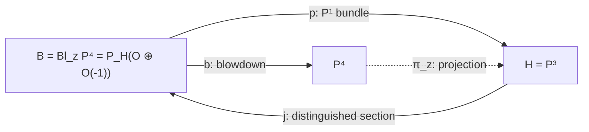
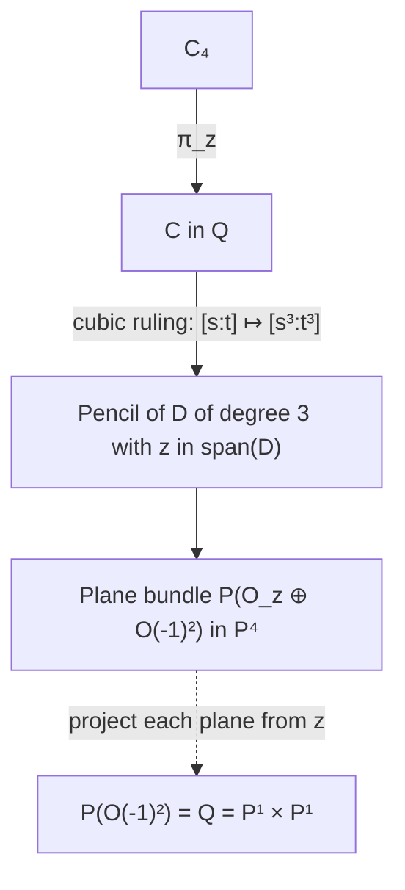
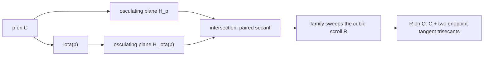

# Projection, conormal and special-line geometry of the quartic

Full historical mathematical investigations retained by subject. Original scopes and epistemic limitations are preserved; no theorem promotion.


---

## discussion-reconciliation

# Discussion reconciliation: intrinsic quartic geometry (2026-10-24)

**Status:** discussion audit and research agenda only. Not a theorem record, STCI obstruction, or promotion. Work over an algebraically closed field of characteristic zero unless specified. Fixed curve $C=[s^4:s^3t:st^3:t^4]\subset\mathbf P^3$.

## Purpose

Preserve questions and constructions raised in the interactive geometry discussions that might otherwise be lost between threads, Codex branches, and merges. Distinguish existing evidence from new proposals and rejected claims. Before starting any lane, consult `research/INDEX.md`, `STATE.md`, `FRONTIER.md`, `AUTHORITY.md` and the relevant audited notes. The intrinsic geometry interlude deliberately does not require an STCI payoff.

## Reconciliation ledger

| Topic | Classification | Existing evidence / precise next step |
| --- | --- | --- |
| Secant–plane **flag variety** | **Add to agenda; verify as a proposition before promotion** | Set $P=\operatorname{Sym}^2C\simeq\mathbf P^2$. The incidence of a length-two divisor $D$ and a plane containing its secant/tangent line can be encoded as pairs $D,R\in P$ with (D+R\in\mathbf P(V)). In affine monic coordinates (D=z^2-Sz+P_0, R=z^2-Tz+U), the condition is (P_0+U+ST=0). Its homogeneous equation is a nondegenerate bilinear pairing, giving an abstract incidence flag threefold (F(1,2;3)). **Check** projective homogenization, the residual-swap involution $D\leftrightarrow R$, and its fixed locus (D=R), the bitangent conic. The two \$\mathbf P^2\$ factors are dual only through the chosen bilinear pairing. This is not the conormal normalization of $C^\vee$. |
| $C^\vee$, conormal normalization, and exceptional divisor | **Partly recorded; conventions to reconcile** | See `research/notes/2026-10-24-special-dual-incidence-derivation.md` and `research/INTRINSIC_GEOMETRY_INTERLUDE_2026-10-24.md`. (N=\{(p,H):T_pC\subset H\}\to C) is the normalization incidence surface; the blow-up exceptional divisor parametrizes normal lines, whereas $N$ parametrizes conormal covectors/tangent planes. Specify projectivization conventions and the rank-two projective duality carefully; do not silently identify vector bundles. Both are abstract products because the accepted normal splitting is balanced. |
| **Canonical** $N\simeq Q$ | **Unresolved; earlier proposed polarity proof rejected** | The unique quadric $Q$ and $N$ are abstractly $\mathbf P^1\times\mathbf P^1$, but this does not by itself produce a preferred identification. Polarity sends the pencil of planes through (T_pC) to the polar line ((T_pC)^\perp), which is generally **not contained in $Q$**. Do not claim it is a ruling or that this constructs $N\to Q$. Study whether the normal exact sequence (0\to\mathcal O(6)\to\mathcal O(7)^2\to\mathcal O(8)\to0), together with distinguished sections, determines additional structure or leaves automorphism ambiguity. |
| Triple dual incidence $C^\vee,X^\vee,Y^\vee$ | **New question to retain** | For hypothetical containing surfaces (X=V$F$,Y=V$G$), compare their Gauss images and conormal traces in $N\to C^\vee$. Distinguish tangencies at the *same* $p\in C$, different points, and extraneous tangencies away from $C$; account for singular carriers and repeated leading normal factors. Pullbacks of full duals need not equal distinguished traces. |
| Leading normal forms as divisors on $N$ | **Provisional; audit required** | The forms (F_r,G_s\in\operatorname{Sym}^rN_C^\vee\otimes\mathcal O_C$d$), etc., give normal-direction data. Check the canonical conversion between roots in the projectivized normal bundle and limiting tangent planes in the conormal incidence surface, especially multiplicities and nonreduced factors. Naive intersection formulas reproduce normal resultants, and full dual-divisor intersections reproduce Bézout; **no new STCI obstruction established**. Seek genuinely additional global compatibility before asserting novelty. |
| Higher contact in incidence spaces | **New question to retain** | Can higher jets, common leading factors, full initial ideals, and Rees/valuation data be realized as incidence, discriminant, or degeneracy loci in a *single global parameter space*? Relate carefully to `research/notes/2026-10-24-delta-embedding-geometry-report.md`; avoid collapsing the full marked ideal to two leading symbols or assuming a local obstruction globalizes. |
| Cubic scroll $R$ and its dual | **Existing result + focused follow-up** | `research/notes/2026-10-24-special-lines-planes-research-note.md` proves (R=V(x_0x_2^2-x_1^2x_3)), $R|_Q=C+L_0+L_\infty$, and (T_pR=O_p) off endpoints. Determine $R^\vee$, the Gauss map on its normalization, and scheme-theoretic intersections with $C^\vee,Q^\vee$. This is a concrete test case for dual traces; note that $R$ is not developable. |
| \$\mathbf P^4\$, missing middle coordinate, ruled surfaces | **Branch-level reconciliation needed** | Compare `codex/quartic-p4-ruled-surfaces-2026-10-24` with main before concluding what is absent. Retain the proposal to realize the normalization of $R$ as an embedded scroll in \$\mathbf P^4\$, study projection and the missing (s^2t^2) coordinate, and connect the complete rational normal quartic with the marked projection center. Do not assert the proposed scroll embedding without checking its line bundle and map. |
| Four characteristic-zero components of explicit \((4,4)\) pair | **Partly on agenda; specific construction to reconcile** | The interlude already asks about (F=x_1^4-x_0^3x_3, G=x_2^4-x_0x_3^3), the four components and their \$\mu_4\$ geometry. Preserve the separate question of a *single surface containing all four curves*, its class, rulings/normalization and behavior under characteristic-two degeneration. Check whether branch work already resolves this. |
| Universal osculating/bitangent plane sections | **Already recorded; do not duplicate** | `research/notes/2026-10-24-special-dual-incidence-derivation.md` has $3\Delta+\Gamma_\iota$, $2\Gamma_{c_+}+2\Gamma_{c_-}$, finite-flat plane-section families, and endpoint gluing. It explicitly distinguishes support cycles from nilpotent scheme structures. |
| Singular locus of $C^\vee$ | **Corrected and recorded** | The reduced singular locus has **four** components: osculating and bitangent quartics plus **two endpoint triple-contact pencil lines**. Do not resurrect the rejected two-component description; scheme-theoretic singular locus is a separate question. |
| Trisecant identification in \(\operatorname{Sym}^2C\to\operatorname{Gr}(1,3)\) | **Recorded; correction retained** | The map is not an embedding: three pairs on a general cubic-ruling trisecant yield the same line. See special-lines note and automorphism/bitangent synthesis. |
| Why the bitangent ratio is \$-2\pm\sqrt3\$ | **Recorded; no new lane** | `research/notes/2026-10-24-quartic-automorphisms-bitangents-synthesis.md` explains it via the discriminant conic, multiplication of binary quadratics, and a trace-free condition; the ratio is not the osculating involution. |

## Second-pass audit: section classes, incidence boundaries, and further questions

### Distinguished sections cannot be matched naively

Under the ruling $Q\to C$ meeting $C$ once, the section $C\subset Q$ has self-intersection $C^2=6$ (its class is $(1,3)$). On the conormal incidence normalization $N\to C$, the section $\sigma_Q:p\mapsto(p,T_pQ)$ comes from the normal exact sequence
$
0\longrightarrow\mathcal O_C(6)\longrightarrow
N_{C/\mathbf P^3}\longrightarrow\mathcal O_C(8)\longrightarrow0.
$
Its self-intersection is $2$ (the normal bundle of the section is $\operatorname{Hom}(\mathcal O(6),\mathcal O(8))\simeq\mathcal O(2)$, with projectivization conventions adjusted appropriately). Thus **there is no isomorphism over $C$ sending $\sigma_Q(C)$ to $C\subset Q$**. This does not rule out other identifications between the abstract ruled surfaces. Audit the osculating section $\sigma_O$, its class, and its two intersections with $\sigma_Q$ at the hyperosculating points. Do not confuse an abstract product isomorphism with an isomorphism preserving a marked section.

### Additional discussion questions worth retaining

- **What exactly is the dual of a curve?** A plane tangent to $C$ at $p$ is any plane containing $T_pC$, not just the osculating plane. The normalization remembers the contact point. At hyperosculating endpoints the second jet drops rank and a full pencil has triple contact; the limiting osculating plane is singled out by order four.
- **Duals of $Q$ and $R$ and their intersections with $C^\vee$:** Distinguish the self-duality $Q^\vee\simeq Q$ via polarity from an identification of $N$ with $Q$. For the explicit cubic $R$, investigate Gauss images, singularities, and whether intersections of duals reflect actual common tangent planes at the *same* point.
- **Polarity of secants and osculating planes:** The pole of an osculating plane is generally outside $Q$; the polar of the paired secant is a *different* line. The explicit formulas are already in the dual-incidence derivation. These are geometric constructions, not a map of $N$ onto $Q$.
- **Dimension and scope of the flag variety:** The secant–plane flag incidence is a threefold, while $N$ is a surface; do not conflate them. The residual-swap involution is on the flag threefold and its fixed locus is a conic. Verify the incidence condition at degenerate divisors and characteristic assumptions.
- **Local-to-global research principle:** A local or affine complete-intersection construction does not by itself obstruct a projective STCI. Seek global compatibility of contact and thickening data, not just a re-expression of local resultant conditions. The earlier K3-carrier argument was viewed as insufficiently intrinsic; record this as research motivation, not a mathematical refutation.
- **Characteristic-two warning:** The osculating involution degenerates, the bitangent conic becomes nonreduced, and polarity/jet constructions require separate characteristic checks. Preserve the contrast with the explicit characteristic-two STCI, without asserting that the characteristic-zero geometry specializes unchanged.

## Priority and closure discipline

1. **Archive now:** the flag-variety incidence formulation, three-dual question, higher-contact incidence question, and the rejected polarity argument.
2. **Reconcile branch evidence before claiming gaps:** \$\mathbf P^4\$ scroll and the common four-curve surface.
3. **Do not reopen or promote:** accepted quartic-carrier exclusions, normal-bundle splitting, or unproved common-singularity assertions. The unrestricted characteristic-zero STCI question remains open.
4. **Useful immediate calculation:** derive the dual of the explicit cubic scroll and compare its conormal trace along $C$ with the osculating section; separately verify the flag-variety construction globally.

This file is a discussion-preservation index, not an assertion that every item is absent from every branch.


---

## p4-resolved-projection

# The rational normal quartic in projective four-space and resolved projection

Date: 2026-10-24. Status: **provisional geometric research with proofs;
independent audit is recorded with the accompanying ruled-surface package;
no canonical promotion and no STCI conclusion**.

Work over an algebraically closed field of characteristic zero unless an
explicit qualification says otherwise. Put

\[
W=H^0(\mathbf P^1,\mathcal O(4)),\quad
V=\langle s^4,s^3t,st^3,t^4\rangle,\quad
m=s^2t^2,
\]
\[
C_4=[s^4:s^3t:s^2t^2:st^3:t^4]\subset\mathbf P(W^\vee),
\quad z=[0:0:1:0:0],\quad H=V(X_2).
\]

The curve in the chosen section is
\(C=[s^4:s^3t:0:st^3:t^4]\subset H\). Thus \(C_4\) and \(C\)
are different embedded curves in the same \(\mathbf P^4\).

The new constructions use only this linear system and elementary bundle
geometry. The sole retained project normal-bundle premise is
[STCI-R-0020](../results/quartic_conormal_characteristic_jump.md), in the
exact scope \(N_{C/H}=\mathcal O(7)^2\) in characteristic zero. Its
accepted proof is not rerun. The earlier
[projection note](2026-10-24-quartic-projection-automorphisms.md),
[symmetric-square note](2026-10-24-quartic-symmetric-square-bitangents.md),
and their independent audits
([projection](2026-10-24-quartic-projection-independent-audit.md),
[symmetric square](2026-10-24-quartic-symmetric-independent-audit.md))
are provisional background. Essential geometric statements needed here
are reconstructed below, rather than promoted by reference. No
normalization or STCI classification is a premise.

## 1. Conventions and the resolved projection

Throughout this note, \(\mathbf P_B(\mathcal E)\) parametrizes **lines** in
the fibers of \(\mathcal E\); its tautological subbundle is
\(\mathcal O_{\mathbf P(\mathcal E)}(-1)\subset p^*\mathcal E\).
Let \(L=k e_2\subset W^\vee\), and write \(U=V^\vee\). The chosen
hyperplane supplies \(W^\vee=L\oplus U\), with \(H=\mathbf P(U)\).
The incidence variety of a direction in \(H\) and a point on the
corresponding line through \(z\) is

\[
B=\mathbf P_H\big((L\otimes\mathcal O_H)\oplus
\mathcal O_H(-1)\big).
\tag{1.1}
\]

The bundle injection into \(W^\vee\otimes\mathcal O_H\) induces
\(b:B\to\mathbf P(W^\vee)\). On a direction \([v]\in H\), its fiber
is \(\mathbf P(L\oplus kv)\), mapped isomorphically to the joining line
\(\overline{z[v]}\). Away from \(z\), \(b\) has inverse given by the
direction of the line to \(z\). Over \(z\) it records all directions.
Equivalently, the equations of this incidence are the usual equations
\(X_i v_j=X_j v_i\) for indices \(i,j\ne2\), the graph closure of the
ideal \((X_0,X_1,X_3,X_4)\). Its affine charts are the blowup charts of
that ideal. Therefore \(b\) is exactly
\(\operatorname{Bl}_z\mathbf P^4\to\mathbf P^4\), not just a birational
map with a similar exceptional set.

The bundle projection \(p:B\to H\) resolves \(\pi_z\). Set

\[
\xi=c_1\mathcal O_B(1)=b^*c_1\mathcal O_{\mathbf P^4}(1),\qquad
h=p^*c_1\mathcal O_H(1).
\]

The exceptional section \(E_z=\mathbf P_H(L\otimes\mathcal O_H)\)
has divisor class \(\xi-h\): it is the zero divisor of the map from
the tautological line to \(p^*\mathcal O_H(-1)\). The strict transform
\(H_\infty=\mathbf P_H(\mathcal O_H(-1))\) has class \(\xi\): it is
the zero divisor of the projection of the tautological line to \(L\).
They are disjoint. Both map isomorphically to \(H\) under \(p\), while
\(b\) contracts \(E_z\) to \(z\) and maps \(H_\infty\)
isomorphically onto the original hyperplane.

Their normal bundles follow directly from the normal bundle of a line
subbundle section:

\[
N_{E_z/B}=\operatorname{Hom}(\mathcal O_H,\mathcal O_H(-1))
=\mathcal O_H(-1),
\]
\[
N_{H_\infty/B}=\operatorname{Hom}(\mathcal O_H(-1),\mathcal O_H)
=\mathcal O_H(1).
\tag{1.2}
\]

The class identities are
\(p^*\mathcal O_H(1)=b^*\mathcal O_{\mathbf P^4}(1)(-E_z)\) and
\(\xi(\xi-h)=0\). On a fiber \(\ell\cong\mathbf P^1\),
\(\mathcal O_B(1)|_\ell=\mathcal O_\ell(1)\) and
\(p^*\mathcal O_H(1)|_\ell=\mathcal O_\ell\). On \(E_z\),
\(\xi\) is trivial and \(h=\mathcal O_H(1)\); on \(H_\infty\),
both restrict to \(\mathcal O_H(1)\). These restrictions fix all signs.
For a further consistency check,
\(K_B=-2\xi-3h=-5\xi+3E_z\), as required for blowing up a point of
a fourfold.

If \(j:H\to B\) is the distinguished section, then \(p\circ j\)
is the identity. The morphism \(j\circ p:B\to H_\infty\subset B\)
is an idempotent retraction. The original rational projection is also
defined on \(\mathbf P^4\setminus\{z\}\), restricts to the identity on
\(H\), and becomes a morphism on all of \(B\). This is the precise
sense of “retraction”; it does not identify the blowdown \(b\) with the
bundle projection \(p\).



## 2. Why the projection embeds the curve and selects two points

For \(Z=[Z_0:\cdots:Z_4]\) form

\[
K(Z)=\begin{pmatrix}Z_0&Z_1&Z_2\\Z_1&Z_2&Z_3\\Z_2&Z_3&Z_4\end{pmatrix}.
\]

At a point of \(C_4\), this matrix has rank one. At every point of a
secant or limiting tangent line it has rank at most two. At \(z\) its
determinant is \(-1\). Consequently \(z\) is outside the closed secant
variety and no length-two divisor loses separation under projection.
The subsystem \(V\) is therefore basepoint free and separates every
length-two subscheme of \(\mathbf P^1\), proving that its map is a
closed immersion.

Write \(v(u)=(1,u,u^2,u^3,u^4)\), where \(u=t/s\). Solving membership
of \(e_2\) in \(\langle v,v',v''\rangle\) forces the coefficient of
\(v\) and \(v'\) to vanish, then forces \(u=0\). The reversed chart
gives the other solution \(u=\infty\). The same calculation with
\(v'''\) gives no new points. Thus the two exceptional points are
intrinsic to \((C_4,z)\):

\[
p_0=[1:0],\qquad p_\infty=[0:1],
\]
\[
z=\operatorname{Osc}^2_{p_0}(C_4)\cap
\operatorname{Osc}^2_{p_\infty}(C_4),
\]
\[
\operatorname{Osc}^2_{p_0}(C_4)=\mathbf P\langle e_0,e_1,e_2\rangle,
\quad
\operatorname{Osc}^2_{p_\infty}(C_4)=\mathbf P\langle e_2,e_3,e_4\rangle.
\tag{2.1}
\]

These second-osculating planes each project to a line. On \(C\), the
vanishing sequence at either endpoint is \((0,1,3,4)\), versus
\((0,1,2,3)\) elsewhere (the affine Wronskian is \(72u^2\)). Hence
the two points are precisely the hyperosculating points of the
projected curve. Their intrinsic characterization does not require a
complementary hyperplane.

One can alternatively use characteristic-zero apolar self-duality:
the functional \(e_2\) corresponds, up to nonzero scalar, to
\(s^2t^2\), and its root support is the endpoint pair. The factor
\(6\) in the usual binomial normalization matters in arithmetic;
neither this identification nor the derivative argument is asserted by
naive reduction in characteristic two.

## 3. The two quartics meet in a doubled endpoint divisor

The ideal of \(C\) restricts on \(C_4\) to the ideal generated by
\(X_2\). Indeed all equations in the remaining four coordinates
already vanish on their common parametrization. Hence, as a scheme,

\[
C_4\cap C=C_4\cap H=\operatorname{div}(s^2t^2)
=2p_0+2p_\infty.
\tag{3.1}
\]

This is length four, not two reduced intersection points. Near zero the
curves have parametrizations
\((u,u^2,u^3,u^4)\) and \((u,0,u^3,u^4)\) in the \(X_0=1\) chart.
Their difference first occurs at order two in the direction \(e_2\).
Their common tangent is \(\mathbf P\langle e_0,e_1\rangle\), and
their local intersection ideal on either curve is \((u^2)\).

The entire ordinary jet flags at zero are especially informative:

| Jet order | \(C_4\) in \(\mathbf P^4\) | \(C\) in \(H\subset\mathbf P^4\) |
|---|---|---|
| 0 | \(\mathbf P\langle e_0\rangle\) | \(\mathbf P\langle e_0\rangle\) |
| 1 | \(\mathbf P\langle e_0,e_1\rangle\) | \(\mathbf P\langle e_0,e_1\rangle\) |
| 2 | \(\mathbf P\langle e_0,e_1,e_2\rangle\) | \(\mathbf P\langle e_0,e_1\rangle\) |
| 3 | \(\mathbf P\langle e_0,e_1,e_2,e_3\rangle\) | \(\mathbf P\langle e_0,e_1,e_3\rangle\) |
| 4 | \(\mathbf P^4\) | \(H\) |

At infinity reverse the indices. The limiting second-osculating plane
of \(C\) at zero is its order-three jet plane
\(\mathbf P\langle e_0,e_1,e_3\rangle\), with contact four; it equals
\(H\cap\operatorname{Osc}^3_{p_0}(C_4)\). Its ordinary second jet is
only a line. This distinction prevents an incorrect assertion that the
two quartics have the same osculating plane at their tangency.

The order-two contact in (3.1) comes from the chosen section
\(m=s^2t^2\); its support happens to be the intrinsic exceptional pair
because this section is chosen in the weight-two complement. For an
arbitrary complementary hyperplane the intersection divisor changes,
as Section 6 makes explicit.

## 4. A common smooth surface and the full section family

Pull back the \(\mathbf P^1\)-bundle along \(C\hookrightarrow H\):

\[
T=p^{-1}(C)=\mathbf P_{\mathbf P^1}(\mathcal O\oplus\mathcal O(-4))
\cong\mathbb F_4.
\tag{4.1}
\]

Both strict transforms lie on this smooth surface. Its negative section
is \(E=E_z\cap T\), with \(E^2=-4\). For the fiber \(f\),
\(f^2=0\), \(E\cdot f=1\), and

\[
\tau=\xi|_T=E+4f,\qquad \tau^2=4,\qquad \tau\cdot E=0.
\]

A section disjoint from \(E\) is the graph of a bundle map
\(\mathcal O(-4)\to\mathcal O\), hence of a quartic
\(q\in H^0(\mathcal O(4))\). Its image is

\[
\Gamma_q:[s:t]\longmapsto[s^4:s^3t:q(s,t):st^3:t^4].
\tag{4.2}
\]

All these sections are linearly equivalent to \(\tau\), not just
numerically equivalent. They form the affine open \(\mathbf A^5\)
of \(|\tau|\cong\mathbf P^5\) consisting of members disjoint from
\(E\). The remaining members are \(E\) plus the four fibers cut out
by a quartic on the base, with the usual multiplicities.
The two distinguished members are \(C=\Gamma_0\) and
\(C_4=\Gamma_m\). For any distinct \(q,r\),

\[
\Gamma_q\cap\Gamma_r=\operatorname{div}(q-r),\qquad
\Gamma_q\cdot\Gamma_r=4.
\tag{4.3}
\]

This gives an intrinsic surface explanation of (3.1). Projection
\(C_4\to C\) is the restriction of \(p\), followed by the zero graph
section identifying the base with \(C\). The joining lines are exactly
the fibers of \(T\to\mathbf P^1\); their images are the lines through
\(z\), and at a zero of \(m\) the two section points coincide while
the joining fiber remains well defined. The double zero is tangency
of the two sections, not degeneration or duplication of that fiber.

The image \(S=b(T)\) is the projection cone. The map \(T\to S\)
contracts \(E\) and is an isomorphism away from \(E\). It is **not**
a finite normalization map. Moreover \(S\) is nonnormal at its vertex,
because the embedding of its base \(C\) is not projectively normal.
The precise factorization through the normal cone and the minimal
resolution is proved in the separate
[projection-cone note](2026-10-24-projection-cone-ruled-model.md).
The smooth common surface here is \(T\subset B\), not a fictitious
smooth normalization of the projective cone.

There is a further exact geometric distinction inside this section
family:

\[
q\in V \Longleftrightarrow \Gamma_q\text{ lies in a complementary
hyperplane of }\mathbf P^4,
\]
\[
q\notin V \Longleftrightarrow \Gamma_q\text{ is a rational normal
quartic spanning }\mathbf P^4.
\tag{4.4}
\]

If \(q=a m+\ell\), with \(\ell\in V\), then for \(a\ne0\) the
projectivity \((v,y)\mapsto(v,ay+\ell(v))\) fixes \(z\), induces the
identity on the quotient, and carries \(C_4\) to \(\Gamma_q\).
If \(a=0\), a shear carries \(C\) to \(\Gamma_q\). In particular
\(\Gamma_{\lambda m}\), \(\lambda\in\mathbf A^1\), is a flat
family of smooth embedded quartics on \(T\), specializing the rational
normal quartic to the quartic in \(H\). All have the same surface
normal bundle \(\mathcal O(4)\), while their ambient normal bundles
jump as follows.

## 5. Normal bundles and the normal jump

The blowdown is an isomorphism on a neighborhood of either curve,
since neither meets \(z\). Thus their normal bundles in \(B\) equal
those in \(\mathbf P^4\). With every \(\mathcal O(d)\) measured on
the parameter \(\mathbf P^1\), the data are

| Embedding | Normal bundle |
|---|---|
| \(C_4\subset\mathbf P^4\), or its strict transform in \(B\) | \(\mathcal O(6)^3\) |
| \(C\subset H\) | \(\mathcal O(7)^2\), retained promoted premise R0020 |
| \(C\subset\mathbf P^4\), or its strict transform in \(B\) | \(\mathcal O(7)^2\oplus\mathcal O(4)\) |
| Either curve in \(T\) | \(\mathcal O(4)\) |
| \(C\subset Q\) | \(\mathcal O(6)\) |

Here is a short independent proof of the first row. For
\(f_i=s^{4-i}t^i\), the restricted Euler sequence and the Euler
identity identify the conormal bundle with the kernel of

\[
\mathcal O(-4)^5\xrightarrow{(\partial_s f_i,\partial_t f_i)}
\mathcal O(-1)^2.
\]

Its three quadratic syzygies are

\[
(t^2,-2st,s^2,0,0),\quad(0,t^2,-2st,s^2,0),\quad
(0,0,t^2,-2st,s^2).
\]

Their band matrix has rank three at every point: its first three rows
are invertible when \(t\ne0\), and its last three when \(s\ne0\).
This proves \(N^*_{C_4/\mathbf P^4}=\mathcal O(-6)^3\).

The chosen splitting gives
\(T_{\mathbf P^4}|_H=T_H\oplus\mathcal O_H(1)\), proving the third
row from R0020. The fourth row follows from \(\tau^2=4\), and the
last from the graph class \((1,3)\) on \(Q\), whose square is six.

Because \(T=p^{-1}(C)\),
\(N_{T/B}=p_T^*N_{C/H}\). The section normal sequences are therefore

\[
0\to\mathcal O(4)\to N_{\Gamma_q/B}\to\mathcal O(7)^2\to0.
\tag{5.1}
\]

For \(C\), this sequence splits. For \(C_4\), its middle term is
\(\mathcal O(6)^3\), and it cannot split since
\(\operatorname{Hom}(\mathcal O(7),\mathcal O(6))=0\). The dual
surjection is, in the displayed syzygy basis,

\[
\mathcal O(-6)^3\xrightarrow{(s^2,-2st,t^2)}\mathcal O(-4),
\]

obtained by pairing with the vertical direction \(e_2\).
The shears in Section 4 consequently prove the entire family statement

\[
N_{\Gamma_q/B}=\begin{cases}
\mathcal O(7)^2\oplus\mathcal O(4),&q\in V,\\
\mathcal O(6)^3,&q\notin V.
\end{cases}
\tag{5.2}
\]

This is a concrete deformation phenomenon: the section class and
surface self-intersection stay fixed while linear normality and the
ambient normal splitting change. Infinitesimal deformations as a
section of the fixed ruled surface have tangent space
\(H^0(\mathcal O(4))\), of dimension five, and obstruction space
\(H^1(\mathcal O(4))=0\). Varying the complementary hyperplane moves
only in its four-dimensional subspace \(V\). Moving the projection
center instead has a four-dimensional ambient parameter space, and
changes the subsystem \(V\); it is a different deformation problem.
In particular these two dimension-four spaces must not be identified
because their dimensions happen to agree.

## 6. All complementary hyperplanes and their stabilizers

Every hyperplane avoiding \(z\) has a unique normalized equation

\[
H_{\ell}:X_2-\ell(X_0,X_1,X_3,X_4)=0,
\qquad\ell\in V.
\tag{6.1}
\]

Thus the set of splittings is an affine four-space, a torsor under
\(\operatorname{Hom}(U,L)\). Its strict transform is a section of
\(p\), and its restriction to \(T\) is \(\Gamma_\ell\). On \(C_4\),

\[
C_4\cap H_\ell=\operatorname{div}(m-\ell).
\tag{6.2}
\]

Equivalently these are precisely degree-four effective divisors cut
out by a quartic whose middle coefficient is nonzero, scaled to one.
A general choice has four distinct points. A nonendpoint divisor
\(4p\) also occurs, since the middle coefficient of
\((t-us)^4\) is \(6u^2\ne0\). The endpoint divisors \(4p_0\) and
\(4p_\infty\) do not occur in this affine chart. Therefore neither
the support nor the multiplicity pattern of the intersection divisor
is intrinsic to the center. The distinguished choice \(\ell=0\)
gives \(2p_0+2p_\infty\).

There are two different automorphism questions. All projectivities of
\(\mathbf P^4\) fixing \(z\) preserve the projection as a quotient
construction, while inducing arbitrary projectivities downstairs;
they form the appropriate parabolic group. If \(C_4\) is also required
to be preserved, restriction to \(C_4\cong\mathbf P^1\) identifies the
group with

\[
\operatorname{Aut}(\mathbf P^4,C_4,z)=
\{u\mapsto au,\ u\mapsto a/u\}
\cong\mathbf G_m\rtimes\mathbf Z/2.
\tag{6.3}
\]

Indeed any projectivity of the complete rational normal curve comes
from its parameter automorphism; preserving \(z\) is equivalent,
under apolarity or (2.1), to preserving the unordered endpoint pair.
Conversely such a parameter automorphism acts on the complete section
space and fixes \(z\). There is no restriction kernel, because a
projectivity fixing every point of a nondegenerate irreducible curve
must be scalar.

The chosen \(H=V(X_2)\) is preserved by all of this group: the lifts
are \(\operatorname{diag}(1,a,a^2,a^3,a^4)\) and reversal of the five
coordinates. Thus, **for this distinguished hyperplane**, the subgroup
preserving the hyperplane equals the entire group in (6.3).
For a general complement it is smaller. Writing
\(\ell=\sum_{i\in\{0,1,3,4\}}\ell_i s^{4-i}t^i\), the action on
coefficients is

\[
\ell_i\mapsto a^{2-i}\ell_i,\qquad
(\ell_0,\ell_1,\ell_3,\ell_4)\mapsto
(\ell_4,\ell_3,\ell_1,\ell_0).
\tag{6.4}
\]

These equations give the stabilizer of every choice. A nonzero
complement has torus stabilizer \(\mu_d\), where
\(d=\gcd\{|2-i|:\ell_i\ne0\}\), hence \(d=1\) or \(2\).
An endpoint-exchanging element occurs exactly when there is an
\(a\in k^*\) satisfying
\(\ell_i=a^{2-i}\ell_{4-i}\) for all four indices. A general
complement has trivial stabilizer. The equality of the two groups for
\(H\) should therefore not be generalized to all retraction sections.

## 7. The quadric as a quotient of a family of planes upstairs

The unique quadric is recovered without guessing its equation:
\(\operatorname{Sym}^2V\to H^0(\mathcal O(8))\) has monomial
weights \(0,1,2,3,4,4,5,6,7,8\). Its one-dimensional kernel is
\(x_0x_3-x_1x_2\). This gives the smooth quadric \(Q\subset H\).

A stronger incidence construction recovers its trisecant ruling.
For a degree-three divisor \(D\) cut out by

\[
g=a s^3+b s^2t+c st^2+d t^3,
\]

the plane \(\langle D\rangle\subset\mathbf P^4\) is annihilated
by \(gH^0(\mathcal O(1))\). The condition
\(z\in\langle D\rangle\) is exactly
\(z(sg)=z(tg)=0\), or \(b=c=0\). Thus all such divisors form the
cubic pencil \(\langle s^3,t^3\rangle\), not a chosen subfamily of a
larger unexamined incidence.

For \([A_0:A_1]\in\mathbf P^1\), its plane is

\[
\mathbf P\langle e_2, A_0e_0+A_1e_3, A_0e_1+A_1e_4\rangle.
\tag{7.1}
\]

The rank-three subbundle parametrizing these planes is
\(\mathcal O_z\oplus\mathcal O(-1)^2\). Quotienting the constant
center line gives \(\mathcal O(-1)^2\), whose projectivization is
\(\mathbf P^1\times\mathbf P^1\). Its map to \(H\) is

\[
([A_0:A_1],[B_0:B_1])\longmapsto
[A_0B_0:A_0B_1:A_1B_0:A_1B_1].
\tag{7.2}
\]

It is exactly the Segre embedding onto \(Q\). This constructs the
quadric as the projected incidence of all center-containing
three-point planes of \(C_4\). The curve is the graph
\([s:t]\mapsto([s^3:t^3],[s:t])\): its two ruling degrees are three
and one. Under the convention \(\mathcal O_Q(a,b)\) pulled back
from the \(A\)- and \(B\)-factors, its class is \((1,3)\), its
square is six, and its hyperplane class is \((1,1)\).
The two special fibers of the cubic map are \(3p_0\) and
\(3p_\infty\). They are another manifestation of the center-selected
pair; they do not depend on \(H\).



## 8. Secant, tangent, osculating, and bitangent incidences

There is one useful uniform construction for the line incidences.
Let \(B_2=\operatorname{Sym}^2\mathbf P^1\cong\mathbf P^2\), and
let \(\mathcal D_2\subset\mathbf P^1\times B_2\) be the universal
length-two divisor. Its tautological evaluation bundle

\[
\mathcal E_2=(\operatorname{pr}_2)_*
\big(\mathcal O_{\mathcal D_2}\otimes\operatorname{pr}_1^*\mathcal O(4)\big)
\]

has rank two and receives the surjection \(W\otimes\mathcal O\to
\mathcal E_2\). Its dual embeds in \(W^\vee\otimes\mathcal O\),
and \(\mathbf P_{B_2}(\mathcal E_2^\vee)\to\mathbf P^4\) is the
universal secant incidence, including tangent lines over the diagonal.
Since \(z\) lies on none of those lines, projection also gives an
everywhere-defined line bundle incidence and a Grassmannian morphism
\(B_2\to\operatorname{Gr}(2,V^\vee)\). Projection can identify
different lines or different parameter divisors downstairs: a
trisecant has three degree-two sub-divisors. Thus this Grassmannian
map is not an embedding. Restriction to the diagonal gives the
tangent incidence upstairs and downstairs.

For a quadratic \(h=\alpha s^2+\beta st+\gamma t^2\), the bitangent
condition is intrinsic upstairs:

\[
z\in\langle 2\operatorname{div}(h)\rangle
\Longleftrightarrow z(h^2)=0
\Longleftrightarrow\beta^2+2\alpha\gamma=0.
\tag{8.1}
\]

Here the span of the degree-four divisor is a hyperplane; this says
that it projects to a bitangent plane of \(C\). The diagonal conic
is \(\beta^2-4\alpha\gamma=0\); its intersection with (8.1) is
\((\alpha\gamma,\beta^2)\), length two at each endpoint divisor.
For finite roots \(u,v\), (8.1) is
\(u^2+4uv+v^2=0\). Hence the two partner ratios satisfy
\(\rho+\rho^{-1}=-4\), and are different from \(-1\).
The construction is a center-conditioned multiplication incidence on
the complete quartic system, rather than a new symmetry of order two.

The osculating residual relation similarly comes from
\(z\in\langle3p+q\rangle\). Away from the endpoints, the missing
coefficient of \((t-us)^3(t-vs)\) is \(3u(u+v)\), forcing
\(v=-u\). At an endpoint the same condition permits every residual
point. The **full incidence** consequently has endpoint vertical
components; the closure of its component dominating the parameter
curve is the graph of the involution \(\iota:u\mapsto-u\).
Its projected hyperplanes have sections \(3p+\iota(p)\), with
endpoint limits \(4p_0,4p_\infty\). Treating the total incidence as
only that graph would silently discard the endpoint pencils.

In \(B_2\), the unordered pairs \(p+\iota(p)\) form the line
\(\beta=0\). Restricting the universal secant incidence to this
line gives the ruled incidence whose image is the singular cubic
\(R\). Thus \(R\) is an actual image of a natural incidence
associated with \((C_4,z)\), and not merely a rational surface later
compared by a birational map. Its smooth model, conductor, and
projection from the cubic normal scroll are analyzed in the
[cubic-scroll note](2026-10-24-cubic-scroll-normalization.md).

For higher osculating incidences one uses the universal divisors
\((r+1)p\), their evaluation bundles of rank \(r+1\), and the
associated spans in \(\mathbf P^4\). Projection is regular on points
of these spans after the blowup, but its vector-space rank drops when
a span contains \(z\). The order-two drop occurs exactly at the
two points in (2.1). This explains why a uniform Grassmannian map of
projected ordinary osculating planes cannot be used at those points
without taking a flat limit or saturating the incidence.

## 9. What is intrinsic, what is chosen, and what remains open

The complete rational normal curve carries all divisor and secant
evaluation constructions. The center \(z\) selects the subsystem,
the exceptional pair, the quadric with its cubic ruling, the
osculating involution, and the bitangent conic. Choosing a
complementary hyperplane realizes the quotient target as an actual
linear subspace of \(\mathbf P^4\), and selects an intersection
divisor \(C_4\cap H'\). Its divisor \(2p_0+2p_\infty\) is special
to the distinguished splitting; the pair itself is intrinsic.

The same \(\mathbb F_4\) supports both quartics in a complete linear
system, and its section deformation exhibits the precise ambient
normal jump. The quadric arises instead by quotienting a family of
center-containing three-point planes. The cubic comes from restricting
the two-point incidence to the osculating-pair line. These are related
constructions from the same complete curve and center, with different
rank-two bundles and different parameter maps. No arbitrary birational
equivalence is needed to explain their appearance.

This note does not classify the full deformation of all these
incidences as \(z\) moves through the embedding locus, or compute a
versal deformation of their singular projective images. Those are
specific further questions. All statements here are geometric
arguments for the fixed characteristic-zero data, retained as
provisional research until the independent audit is recorded. No
novelty claim is made; the package's literature note supplies classical
context and source checks. No canonical STCI result or frontier is
modified.


---

## quartic-projection-independent-audit

# Independent audit: projection, automorphisms, moduli, and characteristic two

Date: 2026-10-24. Reviewer: independent agent `audit_projection`.
Status: **independent reconstruction completed; reviewed exploratory
research, not canonical promotion**.

The principal object is the fixed smooth rational quartic
$[s:t]\mapsto[s^4:s^3t:st^3:t^4]$ over an algebraically closed field of
characteristic zero. Characteristic two is considered only in Section 6.
The reviewer read [INDEX](../INDEX.md), the authority and contribution
instructions, and the earlier [special-lines geometry audit](2026-10-24-special-lines-planes-geometry-audit.md),
then reconstructed the arguments before reading the new full drafts.
No normal-bundle calculation, carrier exclusion, or STCI obstruction was
used or rerun.

Reviewed sources are the [projection note](2026-10-24-quartic-projection-automorphisms.md),
the [literature/outlook note](2026-10-24-quartic-invariant-literature-outlook.md),
and Sections 2, 3, and 6 of the [synthesis](2026-10-24-quartic-automorphisms-bitangents-synthesis.md).
The symmetric-square and correspondence claims have a
[separate independent audit](2026-10-24-quartic-symmetric-independent-audit.md).

**Outcome:** no substantive mathematical discrepancy was found in the
reviewed final arguments. Two distinctions checked especially carefully
are the closed orbit *inside the semistable locus*, and the difference in
characteristic two between the reduced diagonal image and the double-line
discriminant divisor. Both are correctly maintained. The endpoint
reconstruction formula suggested during this audit was added to the
projection note; it strengthens the intrinsic explanation without changing
the claimed group.

## 1. Projection center and exceptional osculating spaces

With $W=H^0(\mathcal O_{\mathbf P^1}(4))$ in its monomial basis, the
annihilator of the four-dimensional subsystem is the functional
$z=e_2\in W^\vee$. Thus the projection comes from the quotient
$W^\vee\to V^\vee$. It is not a projection between the projective spaces
of sections. At the center the middle Hankel matrix is

\[
\begin{pmatrix}0&0&1\\0&1&0\\1&0&0\end{pmatrix},
\qquad \det=-1.
\]

Every secant or limiting tangent point of the rational normal quartic
has Hankel rank at most two. This gives a direct proof that the center
lies outside the closed secant variety; no classification of binary
forms is needed for this step. Separation of every length-two subscheme
of $\mathbf P^1$ then proves that projection is a closed immersion.

Independently, on the finite chart set
$v(u)=(1,u,u^2,u^3,u^4)$. Membership of $e_2$ in the span of
$v,v',v''$ forces the coefficient of $v$ to be zero from its first
coordinate and that of $v'$ to be zero from the second. The coefficient
of $v''$ is $1/2$, and the fourth coordinate is then $3u$. Thus only
$u=0$ works. For the span through $v'''$, the added coefficient is
$-u/2$ and the fifth coordinate becomes $-6u^2$, again forcing $u=0$.
The reversed chart gives precisely the other endpoint. This checks the
claim about both second- and third-osculating spaces, including infinity.
No tangent span contains the center.

The endpoint osculating planes are
$\mathbf P\langle e_0,e_1,e_2\rangle$ and
$\mathbf P\langle e_2,e_3,e_4\rangle$, with intersection exactly $z$.
Their projection drops to a line. The vanishing sequence is
$(0,1,3,4)$ there, while the Wronskian on the finite chart is $72u^2$.
Consequently the distinction between an endpoint second jet and the
limiting contact-four plane is necessary and correctly made.

## 2. Duality conventions and the complete automorphism group

For $m_i=s^{4-i}t^i$, the asserted apolar form pairs $m_i,m_{4-i}$
with $(-1)^i/\binom4i$. Substitution of

\[
F_Z=\sum_i(-1)^i\binom4i Z_i s^i t^{4-i}
\]

gives $\langle m_i,F_Z\rangle=Z_i$ term by term. In particular an
evaluation functional at $[s_0:t_0]$ becomes
$(s_0t-t_0s)^4$, and $e_2$ becomes $6s^2t^2$. The normalization and
alternating reversal are correct. Only the projective identification
is independent of the chosen volume form, as the note states.

The kernel of ambient restriction is trivial: any linear representative
fixing $C$ pointwise has every curve point as an eigenline. An irreducible
nondegenerate curve cannot lie in a finite union of proper eigenspaces.
Thus the representative is scalar. This also covers a nonsemisimple
representative, since its eigenvectors still form the union of its
ordinary eigenspaces.

The image of restriction is exactly the subgroup preserving $V$:
necessity follows by pulling back ambient linear forms, and sufficiency
by the induced projectivity of $V^\vee$. Under apolarity the stabilizer
of $V$ is the stabilizer of the double-double root divisor. It is precisely
the subgroup preserving its unordered support, namely
$u\mapsto au$ or $u\mapsto a/u$. This proves completeness of the
torus-normalizer answer and excludes an unexamined larger finite extension.
The matrices $D_a$ and coordinate reversal $J$ act as stated, and
$JD_aJ=a^4D_{a^{-1}}$ verifies the inversion action projectively.

There is also an independent coefficient check. For substitution
$(s,t)\mapsto(as+bt,cs+dt)$, the middle coefficients of the four
sections are

\[
6a^2b^2,\quad3ab(ad+bc),\quad3cd(ad+bc),\quad6c^2d^2.
\]

Over a field of characteristic zero their vanishing and invertibility
force a diagonal or antidiagonal matrix. This check supports, but is
not a substitute for, the intrinsic stabilizer proof.

## 3. Reconstructing the system, quadric, and trisecant ruling

The endpoint pair recovers the subsystem by the intrinsic direct sum

\[
V=H^0(\mathcal O(4)(-3p_0))\oplus
H^0(\mathcal O(4)(-3p_\infty)).
\]

Each summand has dimension two and their intersection has negative degree.
This confirms that reconstructing the center from the two complete
osculating planes does reconstruct the entire embedded linear system.

The quadratic multiplication map has exactly one monomial repetition,
at weight four. Its kernel is therefore one-dimensional and gives the
smooth quadric $x_0x_3-x_1x_2=0$. The Segre parametrization makes the
curve the graph of $u\mapsto u^3$, so the ruling degrees are one and
three. They cannot be interchanged by an automorphism preserving $C$.
The diagonal and antidiagonal actions on the two factors agree with
the displayed ambient matrices. The cubic map is the quotient by
$\mu_3\subset T$ and its two ramification points agree with the
projection-theoretic endpoint pair.

The additional classification of center-containing planes of degree-three
divisors was also independently checked. If
$g=a s^3+b s^2t+c st^2+d t^3$ cuts out such a divisor $D$, its span
is annihilated by $gH^0(\mathcal O(1))$. Thus $z$ lies in that span
if and only if the two middle coefficients of $sg$ and $tg$, namely
$c$ and $b$, vanish. The full pencil is consequently
$\langle s^3,t^3\rangle$. In characteristic zero it has reduced
three-point fibers except at its two triple endpoints. Projection
contracts these planes to exactly the cubic-ruling trisecants.

For $u_i^3=\kappa\ne0$, the sum in projection-note equation (5.4)
has coordinates $(\sum u_i,\sum u_i^2,\sum u_i^3,\sum u_i^4,
\sum u_i^5)=(0,0,3\kappa,0,0)$. This verifies the explicit rank-three
decomposition and its relation to the entire ruling pencil.

## 4. Central involution, osculation, and dual action

In $N(T)=T\rtimes\mathbf Z/2$, central torus elements satisfy $a=a^{-1}$;
no endpoint-exchanging element commutes with every torus element. Hence
the unique nonidentity central element is $a=-1$. This characterization
is intrinsic to the group acting on $C$, and is stronger than merely
saying that the element fixes the projection center.

The residual osculating map still requires a geometric calculation.
The coefficient of $v^2$ in $(v-u)^3(v-r)$ is $3u(u+r)$, so for
nonendpoint $u$ the allowed residual point is $r=-u$. The endpoint
limits are the unique contact-four members, not all planes through
the endpoint tangent. Thus the group characterization and the contact
characterization do coincide.

The dual action is $h\mapsto M^{-\mathsf T}h$. Applying it to
$[-u^4:2u^3:-2u:1]$ gives the parameters $au$ and $1/u$ for $D_a$
and $J$, respectively. The same pushforward of contact divisors gives
$g(B_{p,q})=B_{g(p),g(q)}$. A generic bitangent pair is not exchanged
by $-1$: that would force $v=-u$ and violate the bitangent equation.
The two contact-family fixed members are precisely the endpoint members.
Finally $(-u)^3=-u^3$ verifies descent of the involution to the cubic
quotient, and also shows it is not a deck transformation.

## 5. Moduli statement and literature boundary

The reviewer independently inspected
[Isaev, Section 3, printed pp. 476–477](https://imar.ro/journals/Revue_Mathematique/pdfs/2015/4/5.pdf#page=6).
It explicitly distinguishes the two strictly semistable root types,
their dimensions and closure relation, and the classical invariants
of degrees two and three. The source is over $\mathbf C$; the root
arguments and invariant formulas here have the stated characteristic-zero
scope. Its associated-form involution is not used as an identification
of our osculating involution.

The geometric argument identifying the secant hypersurface with the
irreducible Hankel determinant is sound: the secant variety is an
irreducible threefold, lies in the determinant cubic, and that cubic is
irreducible by the relatively-prime linear coefficient and constant
coefficient argument in the literature note. Thus the embedding locus
is exactly $J\ne0$.

Using the classical invariant ring $k[I,J]$, localization followed by
degree zero gives $k[I^3/J^2]$, so the asserted coarse invariant
quotient is an affine line. Independently substituting both
$s^2t^2$ and $s^2(s^2+t^2)$ gives
$I=1/12$, $J=-1/216$, and $I^3/J^2=27$ in the chosen normalization.
Both are in the embedding locus, although their root types and orbits
differ. The coarse quotient therefore fails to distinguish them.
The double-double orbit is closed in the semistable locus, not in the
whole projective space. The synthesis correctly retains this qualifier.

These moduli conclusions rely on the stated classical invariant-ring
input. Finite symbolic substitutions alone would not establish that
input or a good-quotient theorem.

The subsequently added characterization by positive-dimensional
automorphisms was independently re-read and is sound. A smooth integral
rational quartic in $\mathbf P^3$ is nondegenerate: containment in a
plane would make it a smooth plane quartic of genus three, and containment
in a line is incompatible with degree four. Its four-dimensional
hyperplane subsystem therefore lies in the five-dimensional complete
system $H^0(\mathbf P^1,\mathcal O(4))$ and defines a point projection
of $C_4$. The restriction-kernel and subsystem-stabilizer proofs above
apply to every such embedding. A binary root divisor with at least
three distinct support points has finite stabilizer, by its faithful
action on that finite set. Of the remaining types, $(4)$ and $(3,1)$
have zero catalecticant and cannot give embeddings, while $(2,2)$ is
the single orbit already studied and has a one-dimensional stabilizer.
This proves the asserted uniqueness among smooth embedded rational
quartics in characteristic zero. The corresponding synthesis paragraph
has the same scope. This is an elementary consequence of the preceding
projection and stabilizer classification, not an extra novelty claim.

## 6. Characteristic-two checks and scheme distinctions

This section explicitly changes the characteristic. The ordinary
characteristic-zero apolar identification cannot simply be reduced;
the literature note correctly returns to the actual section space and
its dual. The two affine charts still exhibit the map as a closed
immersion, and $u^3$ remains separable.

Reducing the independently computed middle coefficients gives
$0,ab\det(g),cd\det(g),0$. On the open invertible-matrix locus,
$ab=cd=0$ is the disjoint union of diagonal and antidiagonal tori:
the opens where $ad$ or $bc$ is invertible cover it and force the
other two entries to vanish. Thus the stabilizer is the smooth
normalizer scheme, not a newly nonreduced enlargement. Its central
$\mu_2$ is nonreduced, while $-1$ is the identity geometric point.

For $h=\alpha s^2+\beta st+\gamma t^2$, the missing coefficient of
$h^2$ is $\beta^2$. The bitangent incidence scheme is a double line.
The actual scheme-theoretic image of $p\mapsto2p$ is the reduced line
$\beta=0$, parametrized by Frobenius; the specialized discriminant
polynomial defines its double. These are distinct schemes, and the
final outlook correctly says so.

Hasse derivatives of $(1,u,u^3,u^4)$ of orders one and two are
$(0,1,u^2,0)$ and $(0,0,u,0)$. At nonzero finite $u$ they give
the plane $x_3+u^4x_0=0$, with restricted section $(v+u)^4$.
The endpoint rank drops have the indicated limiting contact-four
planes. The resulting map is the degree-four purely inseparable map
onto a line in the dual projective space. No inference about a
characteristic-two orbit classification or a full nonreduced
correspondence is warranted or claimed.

## 7. Reproduction, corrections, and remaining scope

The reviewer used an independent SymPy 1.14.0 calculation, separate from
the submitted verifier, for the substitution coefficients, maximal-minor
gcds of $[v,v',\ldots,v^{(r)},e_2]$ for $r=1,2,3$, and the two
invariant evaluations. The nonzero-minor gcds on the finite chart were
$1$, $6u$, and $72u^2$, respectively. The reversed chart was checked
by the endpoint symmetry. These are checks of explicit identities;
the completeness, scheme, and quotient arguments are supplied above.

No incorrect mathematical assertion was retained after this review.
The reviewer requested the explicit endpoint reconstruction formula
and emphasized the reduced-diagonal/double-discriminant distinction;
both are present. The final cubic-plane pencil addition was rechecked.
No unresolved mathematical defect was identified within this audit's
scope. This does not certify the unreviewed parts by association, and
does not constitute canonical promotion, a novelty claim, or any STCI
conclusion.


---

## quartic-projection-automorphisms

# The rational quartic: projection center, automorphisms, and osculation

Date: 2026-10-24. Status: **proved arguments in a provisional research
proposal; independent audit recorded separately; no canonical promotion**.

The field is algebraically closed of characteristic zero. The object is the
fixed embedded curve

\[
\nu([s:t])=[s^4:s^3t:st^3:t^4]\subset\mathbf P^3.
\]

This note concerns its intrinsic projective geometry. It uses no
normal-bundle splitting, quartic-carrier exclusion, or STCI obstruction.
The prior [special-lines note](2026-10-24-special-lines-planes-research-note.md),
Sections 2–4, and its [independent geometry audit](2026-10-24-special-lines-planes-geometry-audit.md)
supply the calculations to be explained. The arguments needed for the new
conclusions are reconstructed below, including the endpoint jet drops.
The [symmetric-square companion](2026-10-24-quartic-symmetric-square-bitangents.md)
and [synthesis](2026-10-24-quartic-automorphisms-bitangents-synthesis.md)
explain how the same center controls the bitangent conic. No novelty claim
is intended.

## 1. Projective spaces and the center

Put

\[
W=H^0(\mathbf P^1,\mathcal O(4)),\qquad
V=\langle s^4,s^3t,st^3,t^4\rangle\subset W.
\]

Here $\mathbf P(U)$ denotes the lines in $U$. Evaluation defines the
rational normal quartic

\[
\nu_4:\mathbf P^1\hookrightarrow\mathbf P(W^\vee),\qquad
[s:t]\longmapsto[s^4:s^3t:s^2t^2:st^3:t^4].
\]

The inclusion $V\subset W$ induces the quotient $W^\vee\twoheadrightarrow
V^\vee$, hence a linear projection

\[
\pi_z:\mathbf P(W^\vee)\dashrightarrow\mathbf P(V^\vee),
\quad z=\mathbf P(V^\perp)=[0:0:1:0:0].
\tag{1.1}
\]

Thus $z$ is the middle-coefficient **functional**, not the omitted section
viewed as a point of $\mathbf P(W)$. The latter interpretation requires a
specified self-duality, given in Section 3. Hyperplanes of the target are
points of $\mathbf P(V)$; the osculating and bitangent plane maps take
values there, rather than in $\mathbf P(V^\vee)$.

## 2. Secants, tangents, and osculating spaces before projection

For $Z=[Z_0:\ldots:Z_4]\in\mathbf P(W^\vee)$ form the middle
catalecticant

\[
K(Z)=\begin{pmatrix}Z_0&Z_1&Z_2\\Z_1&Z_2&Z_3\\Z_2&Z_3&Z_4\end{pmatrix}.
\tag{2.1}
\]

At an evaluation point this has rank one. On a secant line, including a
limiting tangent line, it has rank at most two. At $z$ its determinant is
$-1$. Consequently $z$ lies outside the closed secant variety
$\sigma_2(C_4)$, and in particular outside both $C_4$ and its tangent
developable. This argument only needs the rank bound; it does not assume
a classification of secant-variety points.

Every degree-two subscheme of $C_4\cong\mathbf P^1$ spans a secant or
tangent line. Since none contains $z$, projection retains separation of
all length-two subschemes. It has no base point, and it separates both
points and tangent vectors. The associated linear system therefore gives
a closed immersion. This explains smooth embeddedness of $C$ without
checking affine charts one by one.

Write $\operatorname{Osc}^r_p(C_4)$ for the projective span of jets of
orders at most $r$. After the usual symmetric-tensor identification, the
rational normal curve consists of fourth powers $L^4$, and

\[
\operatorname{Osc}^r_{[L]}(C_4)=\mathbf P(L^{4-r}\operatorname{Sym}^r k^2).
\tag{2.2}
\]

In these polynomial coordinates $z$ is proportional to $X^2Y^2$. Hence:

- $z$ belongs to no tangent line ($r=1$).
- It belongs to exactly two osculating planes ($r=2$), at
  $p_0=[1:0]$ and $p_\infty=[0:1]$.
- It belongs to exactly the osculating hyperplanes ($r=3$) at those same
  two points.

In evaluation coordinates the two planes are

\[
\operatorname{Osc}^2_{p_0}=\mathbf P\langle e_0,e_1,e_2\rangle,
\quad
\operatorname{Osc}^2_{p_\infty}=\mathbf P\langle e_2,e_3,e_4\rangle,
\quad
\operatorname{Osc}^2_{p_0}\cap\operatorname{Osc}^2_{p_\infty}=\{z\}.
\tag{2.3}
\]

Here $e_i$ are the coordinate vectors dual to $s^{4-i}t^i$. The projection
of either exceptional second-osculating plane is only a line. The
vanishing sequence of $V$ at either endpoint is $(0,1,3,4)$, of
ramification weight two. Away from the endpoints it is $(0,1,2,3)$:
on $s\ne0$, the Wronskian of $(1,u,u^3,u^4)$ is $72u^2$.
Thus there is a unique limiting osculating plane at each endpoint, with
contact order four, although its ordinary second jet spans a line.

Equations (2.2)–(2.3) give a coordinate-free reconstruction: an unordered
pair of distinct points of the complete rational normal quartic specifies
$z$ by intersecting their second-osculating planes. Conversely this $z$
recovers the pair as the only osculating planes containing it.

## 3. Apolarity and the distinguished orbit

To compare $W^\vee$ with binary quartics, choose a volume form on the
two-dimensional parameter space. Changing that choice multiplies the
resulting self-duality by a scalar, so the projective identification is
canonical. With $m_i=s^{4-i}t^i$, use the apolar pairing

\[
\langle m_i,m_j\rangle=
\begin{cases}(-1)^i/\binom4i&i+j=4,\\0&i+j\ne4.\end{cases}
\tag{3.1}
\]

The functional $Z=(Z_i)$ corresponds to

\[
F_Z(s,t)=\sum_{i=0}^4(-1)^i\binom4i Z_i s^i t^{4-i},
\qquad \langle f,F_Z\rangle=Z(f).
\tag{3.2}
\]

The binomial coefficients are necessary. Evaluation at $[s_0:t_0]$
corresponds to $(s_0t-t_0s)^4$, whereas

\[
F_z=6s^2t^2,\qquad V=(s^2t^2)^\perp.
\tag{3.3}
\]

Thus the omitted coefficient expresses an apolar hyperplane associated
with the doubled endpoint divisor $2p_0+2p_\infty$.

The projection center belongs to the binary-quartic orbit of root type
$(2,2)$, rather than the orbit of a general quartic with four simple
roots. Its points are the squares of quadratics with two distinct roots,
and its stabilizer preserves the unordered root pair. The orbit has
dimension two. In the usual binary-quartic GIT terminology it is the
closed strictly semistable orbit: quartics with a root of multiplicity
more than two are unstable, and the other semistable double-root types
degenerate to this orbit. This terminology is supplementary; the group
and projection proofs use only the explicit root divisor. The orbit is
not closed in the whole projective space, since coalescing the two roots
gives a fourth power, which lies on $C_4$.

## 4. Full projective automorphism group

Restriction gives

\[
r:\operatorname{Aut}(\mathbf P(V^\vee),C)\longrightarrow
\operatorname{Aut}(C)=\operatorname{PGL}_2.
\]

Its kernel is trivial. Indeed a lift of an ambient automorphism fixing
$C$ pointwise has every vector representing a point of $C$ as an
eigenvector. The irreducible curve lies in the finite union of projective
eigenspaces, hence in one of them. Since $C$ spans $\mathbf P^3$, that
eigenspace is the entire vector space and the lift is scalar.

Every automorphism $a$ of $\mathbf P^1$ preserves $\mathcal O(4)$ and
acts projectively on $W$. If it extends to the given embedding, pulling
back ambient linear forms shows $a^*V=V$. Conversely $a^*V=V$ gives a
projective transformation of $\mathbf P(V^\vee)$ carrying $\nu(p)$ to
$\nu(a(p))$. Therefore

\[
\operatorname{im}(r)=\operatorname{Stab}_{\operatorname{PGL}_2}(V)
=\operatorname{Stab}_{\operatorname{PGL}_2}(z).
\tag{4.1}
\]

By (3.3), this is exactly the stabilizer of the unordered pair
$\{p_0,p_\infty\}$. Its elements are

\[
u\longmapsto au\quad\text{or}\quad u\longmapsto a/u,\qquad a\in k^*.
\tag{4.2}
\]

It is the normalizer $N(T)$ of the maximal torus fixing both endpoints
individually, with inversion as the nontrivial Weyl action. Thus

\[
\boxed{\operatorname{Aut}(\mathbf P^3,C)\cong
\mathbf G_m\rtimes\mathbf Z/2.}
\tag{4.3}
\]

Concretely, put

\[
D_a=\operatorname{diag}(1,a,a^3,a^4),\qquad
J=\begin{pmatrix}0&0&0&1\\0&0&1&0\\0&1&0&0\\1&0&0&0\end{pmatrix}.
\tag{4.4}
\]

Then $D_ac(u)=c(au)$, $Jc(u)=c(1/u)$ projectively,
$J^2=1$, and $JD_aJ=a^4D_{a^{-1}}$ as matrices. These are all ambient
automorphisms. The torus has weights $0,1,3,4$ because it is the inherited
quartic representation with its weight-two line omitted.

The two distinguished points have several equivalent intrinsic
descriptions: the torus fixed points on $C$; the hyperosculating points;
the points whose second-osculating planes upstairs contain $z$; and the
two ramification points of the cubic ruling map described next.

## 5. Why the quadric and both ruling actions are forced

The multiplication map

\[
\operatorname{Sym}^2V\longrightarrow H^0(\mathbf P^1,\mathcal O(8))
\]

has monomial exponents $0,1,2,3,4,4,5,6,7,8$. Its kernel is one-dimensional,
spanned by $x_0x_3-x_1x_2$. Hence every projective automorphism preserving
$C$ preserves its unique containing quadric

\[
Q=V(x_0x_3-x_1x_2),
\]

which is smooth. Its equation is the unique equality of weight-four
products in the multiplication of actual sections. In this sense the
quadric is forced by the linear system, not an extra incidence assumption.

Under the Segre coordinates

\[
(x_0,x_1,x_2,x_3)=(A_0B_0,A_0B_1,A_1B_0,A_1B_1),
\]

our curve is the graph of

\[
[B_0:B_1]=[s:t]\longmapsto[A_0:A_1]=[s^3:t^3].
\tag{5.1}
\]

The two projections have degrees one and three on $C$. No automorphism of
the pair $(Q,C)$ can exchange the rulings, because those degrees differ.
The explicit action is

\[
D_a:([A_0:A_1],[B_0:B_1])\mapsto
([A_0:a^3A_1],[B_0:aB_1]),\qquad
J:([A_0:A_1],[B_0:B_1])\mapsto
([A_1:A_0],[B_1:B_0]).
\tag{5.2}
\]

The degree-three ruling is, up to identifying its target, the quotient by
the unique order-three subgroup $\mu_3\subset T$. Its only ramification
points are $p_0,p_\infty$, each with ramification index three. This gives
a second geometric route to the same pair, independently of apolar
coordinates.

The ruling also has a direct interpretation upstairs. Let $D$ be any
effective divisor of degree three on $C_4$, with cubic equation
$g=a s^3+b s^2t+c st^2+d t^3$. Its span is a plane, annihilated by
$H^0(\mathcal O(4)(-D))=gH^0(\mathcal O(1))$. Therefore

\[
z\in\langle D\rangle
\quad\Longleftrightarrow\quad z(sg)=z(tg)=0
\quad\Longleftrightarrow\quad b=c=0.
\tag{5.3}
\]

Thus **all** degree-three divisors whose planes contain the center form
the cubic pencil $\langle s^3,t^3\rangle$. Its reduced members are exactly
the cubic ruling fibers on $C$, and its two nonreduced members are
$3p_0,3p_\infty$. Projection contracts each such plane to its trisecant
line. For a reduced member with $u_i^3=\kappa\ne0$, a concrete
decomposition of the center is

\[
\sum_{i=1}^3u_i(1,u_i,u_i^2,u_i^3,u_i^4)=3\kappa e_2.
\tag{5.4}
\]

This is the elementary form of the degree-three apolar-decomposition
pencil of the binary quartic $X^2Y^2$. In particular the three-point
fibers and their endpoint degenerations are already encoded by the
projection center; they are not additional choices on the quadric.

There are two useful reconstruction formulas from the endpoint pair.
First, intrinsically on $\mathbf P^1$,

\[
V=H^0(\mathcal O(4)(-3p_0))+
  H^0(\mathcal O(4)(-3p_\infty)).
\tag{5.5}
\]

The summands have dimension two and zero intersection; in endpoint
coordinates they are $\langle st^3,t^4\rangle$ and
$\langle s^4,s^3t\rangle$. Second, any four-dimensional $T$-stable subspace
of $H^0(\mathcal O(4))$ is a sum of four of its five distinct weight
lines. Basepoint freedom at the two endpoints forces weights $0,4$;
immersion there forces weights $1,3$. Therefore the only such subspace
giving an embedding is $V$. An arbitrary invariant subspace is not being
assumed: basepoint freedom and immersion force the omitted middle weight.

## 6. The osculating involution is the central involution

The center of $N(T)=T\rtimes\mathbf Z/2$ is precisely
$\{1,-1\}\subset T$. An element of $T$ is central exactly when it equals
its inverse, and no endpoint-exchanging element commutes with all of
$T$. Thus there is a coordinate-free distinguished automorphism

\[
\iota=\text{the unique nonidentity central element of }
\operatorname{Aut}(\mathbf P^3,C).
\tag{6.1}
\]

Equivalently it is the unique nonidentity involution of $\mathbf P^1$
fixing $p_0,p_\infty$ individually. In endpoint coordinates it is
$u\mapsto-u$, with ambient representative
$D_{-1}=\operatorname{diag}(1,-1,-1,1)$.

This group-theoretic characterization alone would not prove that osculation
selects it. For that, the section of a plane with a triple zero at finite
$u\ne0$ has the form $(v-u)^3(v-r)$. Its middle coefficient is
$3u(u+r)$, and the apolar condition $z(f)=0$ forces $r=-u$. Hence

\[
H_u=[-u^4:2u^3:-2u:1]\in\mathbf P(V),\qquad
H_u|_C=3c(u)+c(\iota(u)).
\tag{6.2}
\]

The limiting members are $H_0=V(x_3)$ and $H_\infty=V(x_0)$, with
sections $4p_0,4p_\infty$. At an endpoint other planes through its
tangent line have contact at least three, so the limiting plane in (6.2)
is distinguished by contact four. The residual correspondence here is
that of the limiting osculating family, not all endpoint triple-contact
planes.

Upstairs $\iota$ acts by
$\operatorname{diag}(1,-1,1,-1,1)$ in evaluation coordinates. It fixes
$z$, and projection gives $D_{-1}$. Merely fixing $z$ does not characterize
$\iota$, since every element of $N(T)$ fixes $z$; the characterization is
its unique nontrivial central element. On the cubic ruling quotient,
$u^3\mapsto-u^3$. Consequently $\iota$ descends to the corresponding
central involution of the target endpoint pair, and it is not a deck
transformation of that degree-three map.

## 7. The dual action and the contact families

For an ambient point transformation $M$, a plane coefficient column
$h\in V$ transforms by $M^{-\mathsf T}h$. Thus

\[
D_a^{-\mathsf T}[h_0:h_1:h_2:h_3]
=[h_0:a^{-1}h_1:a^{-3}h_2:a^{-4}h_3],
\]

and $J$ reverses the four coordinates. Formula (6.2) gives

\[
D_a(H_u)=H_{au},\qquad J(H_u)=H_{1/u},\qquad
\iota(H_u)=H_{-u}.
\tag{7.1}
\]

The same conclusion has an intrinsic proof: an automorphism carries
contact divisors to their images and commutes with limiting osculation.
Because $\iota$ is central, the residual map remains $\iota$ under every
automorphism, including those interchanging endpoints.

For a bitangent plane $B_{p,q}$ with contact divisor $2p+2q$, the dual
action gives $g(B_{p,q})=B_{g(p),g(q)}$. In particular
$\iota(B_{u,v})=B_{-u,-v}$. It preserves the bitangent family but does not
interchange the two contacts of a general bitangent plane. The osculating
and bitangent plane families each have exactly the two endpoint members
fixed by $\iota$. For the bitangent assertion, a nonendpoint invariant
unordered contact pair would have $v=-u$; its middle-coefficient condition
would be $-2u^2=0$, impossible in characteristic zero.

## 8. Evidence and precise boundaries

The [exact verifier](../computations/verify_quartic_automorphisms_bitangents_2026_10_24.py)
checks the catalecticant, apolar normalization, Wronskian, group matrices,
and osculating formulas; its [report](../computations/quartic_automorphisms_bitangents_2026_10_24.json)
records the finite checks. The
[independent audit](2026-10-24-quartic-projection-independent-audit.md)
reconstructs the group and projection proofs separately.
Computational identities do not replace the arguments establishing
completeness of the stabilizer or the projective embedding.

The group identification, reconstruction from an unordered endpoint pair,
and explanation of the central involution are proved here for this fixed
characteristic-zero embedding. The principal invariant datum can be
recorded as either $(C_4,z)$ with $z$ of binary-quartic type $(2,2)$, or as
$C_4$ with an unordered pair of distinct points. Each recovers the other
by (2.3). The full hyperplane system, rather than abstract group action
alone, determines the bitangent conic; the companion note makes that
distinction precise.

No normal-bundle theorem or carrier exclusion was used. No STCI case is
closed or reopened, and no canonical result record is introduced.
Characteristic two requires separate treatment: the apolar self-duality
and binomial normalizations in Section 3 are not valid there, and the
principal results are not asserted by reduction of these formulas.


---

## quartic-conormal-residual-geometry

# The conormal surface as an ordered residual-root construction

Date: 2026-10-24. Author role: `conormal_geometry`.

**Status: new provisional intrinsic geometry, with a separate independent
audit; no canonical promotion.** The main statements concern precisely
the marked embedding

\[
C=[s^4:s^3t:st^3:t^4]\subset\mathbf P^3
\]

over an algebraically closed field of characteristic zero. No carrier
classification, STCI obstruction, or higher-filtration result is used.

The construction gives a useful common source for three objects: the
quadric-tangent section is a ramification divisor, the osculating section
is a graph, and the bitangent locus is the inverse image of the diagonal
conic under one residual-divisor map. These descriptions include the
endpoint schemes.

## 1. Inputs and conventions

Retrieval began with [INDEX](../INDEX.md), the requested navigation
summaries, the [authority policy](../AUTHORITY.md), and the
[contribution checklist](../CONTRIBUTING_AGENT.md). Relevant retained
evidence is the [discussion reconciliation](2026-10-24-discussion-reconciliation.md),
[dual-incidence derivation](2026-10-24-special-dual-incidence-derivation.md),
[geometry audit](2026-10-24-special-lines-planes-geometry-audit.md), and
[symmetric-square note](2026-10-24-quartic-symmetric-square-bitangents.md).
Their status remains provisional. The promoted input
[STCI-R-0020](../results/quartic_conormal_characteristic_jump.md) is used
only for its stated splitting
\(E=N^*_{C/\mathbf P^3}=\mathcal O(-7)^2\) when 2 is invertible,
and \(\mathcal O(-8)\oplus\mathcal O(-6)\) in characteristic two.
Its accepted proof is not rerun.

Projectivization \(\mathbf P_{\rm lines}(A)\) parametrizes sublines
of a vector bundle \(A\). Put

\[
U=H^0(C,\mathcal O(2)),\quad P=\mathbf P_{\rm lines}(U),\quad
W=H^0(C,\mathcal O(4)),\quad
V=\langle s^4,s^3t,st^3,t^4\rangle.
\]

A quadratic divisor is represented by
\(r=\alpha s^2+\beta st+\gamma t^2\); thus in the affine root
coordinate \(z=t/s\) it is \(\alpha+\beta z+\gamma z^2\).
The diagonal of double divisors is the Veronese conic

\[
\Delta=\{\beta^2-4\alpha\gamma=0\}\subset P,
\qquad j(p)=2p.
\]

Multiplication followed by the quotient \(W\to W/V\) is the symmetric
pairing, valued in the one-dimensional space \(W/V\),

\[
\mathsf B(r,r')=\alpha\gamma'+\beta\beta'+\gamma\alpha'.
\tag{1.1}
\]

Its matrix has determinant \(-1\). Rescaling a generator of \(W/V\)
rescales the pairing without changing its projective polarity. It
depends on the marked linear system \(V\); it is not attached to an
unmarked abstract rational curve.

## 2. The conormal incidence is a surface inside the flag threefold

Let

\[
\mathcal I=\{(D,R)\in P\times P:\mathsf B(D,R)=0\},\qquad
\mu(D,R)=D+R\in\mathbf P(V).
\]

The conormal incidence is the base change

\[
N=\mathcal I\times_{P,j}C
=\{(p,R):2p+R\in\mathbf P(V)\}.
\tag{2.1}
\]

The isomorphism with \(\{(p,H):T_pC\subset H\}\) is functorial:
restrict a tangent plane to \(C\), then remove its relative effective
Cartier divisor \(2p\). Conversely multiply the sections representing
\(2p\) and \(R\). On a smooth curve this construction works in
families and includes \(R=2p\) and all other nonreduced cases.
Accordingly \(N=\operatorname{pr}_1^{-1}(\Delta)\) as a closed
surface in \(\mathcal I\); the flag threefold itself is not the
conormal normalization.

In jet-bundle terms let

\[
K=\ker\bigl(V\otimes\mathcal O_C\longrightarrow
J^1\mathcal O_C(4)\bigr).
\]

The map is surjective because the embedding separates length-two
subschemes. The Euler and conormal sequences identify
\(K=E\otimes\mathcal O_C(1)=E(4)\), so

\[
N=\mathbf P_{\rm lines}(K),\qquad K\simeq\mathcal O(-3)^2.
\tag{2.2}
\]

This convention parametrizes **conormal covectors**. The exceptional
divisor of the blowup of \(\mathbf P^3\) along \(C\), in the normal-line
convention, parametrizes lines in \(E^\vee\). There is a canonical
rank-two projective identification sending a normal line to its
annihilator covector line. It is not an identification of the two vector
bundles; the rank-two duality carries a determinant twist.

## 3. A canonical product attached to the marked linear system

There is more structure than an unspecified balanced splitting:

\[
\boxed{\quad N\ \simeq\ C\times C.\quad}
\tag{3.1}
\]

The first factor records the contact point. To define the second, take
\((p,R)\in N\). The polar line
\(\mathsf B(-,R)=0\) in \(P\) meets \(\Delta\) in a relative divisor
of degree two containing \(j(p)\). Its residual degree-one divisor
is \(j(p')\). This defines the **companion point** \(p'\), including
the tangency case \(p'=p\).

For the inverse construction, the pair \(p,p'\) determines the chord
of \(\Delta\), or its tangent if the points coincide. Apply the
inverse polarity of \(\mathsf B\) to that line to obtain \(R\).
These are inverse morphisms: restriction of linear forms to a smooth
plane conic is the complete degree-two system, and the universal
incidence of a root in a degree-two divisor is \(C\times C\), with
the second root obtained by Cartier residual. Thus no division by a
generic coordinate, or extension only at geometric points, is involved.

The product is canonical **relative to the embedded linear system**.
It uses both \(\Delta\) and the marked polarity \(\mathsf B\).
Every automorphism of \((\mathbf P^3,C)\) acts diagonally on the
two copies of \(C\) in (3.1).

Write \(\mathcal O(a,b)\) for the two product classes, with the first
factor the contact point. The residual map

\[
r:N\longrightarrow P,\qquad(p,p')\longmapsto R
\]

is the symmetric-square quotient by
\(\delta(p,p')=(p',p)\), followed by the projective isomorphism
induced by the chord construction and \(\mathsf B^{-1}\).
Consequently it is finite flat of degree two, and

\[
r^*\mathcal O_P(1)=\mathcal O(1,1).
\tag{3.2}
\]

With finite affine points \(p=u,p'=v\), one can choose the residual
quadratic as

\[
R(z)=z^2+\frac{u+v}{2}z+uv.
\tag{3.3}
\]

For fixed \(R=\alpha+\beta z+\gamma z^2\), the two companion
points satisfy
\(\gamma u^2-2\beta u+\alpha=0\). The branch conic is therefore

\[
\mathcal A=\{\beta^2-\alpha\gamma=0\}\subset P.
\tag{3.4}
\]

It differs from both the diagonal conic \(\Delta\) and the bitangent
conic \(\mathcal B=\{\beta^2+2\alpha\gamma=0\}\).

## 4. The dual normalization and its hyperplane bundle

The map \(\nu:N\to\mathbf P(V)\) sends \((p,R)\) to the section
with divisor \(2p+R\). Since \(j^*\mathcal O_P(1)=\mathcal O_C(2)\),
and multiplication on \(P\times P\) has bundle \(\mathcal O(1,1)\),

\[
\nu^*\mathcal O_{\mathbf P(V)}(1)=\mathcal O(3,1).
\tag{4.1}
\]

Every nonzero quartic has finitely many multiple roots, so \(\nu\)
is proper and quasi-finite, hence finite. A general member of its image
has one double root and two other simple roots. For example
\((z-1)^2(z^2+z/2)\) has precisely that root pattern. Thus \(\nu\)
is birational in characteristic zero. Its image is the dual variety
\(C^\vee\), and the smooth surface \(N\) is its normalization.
The degree follows without expanding a discriminant:

\[
\deg C^\vee=c_1(\mathcal O(3,1))^2=6.
\]

For checking signs, if \(p=[s:t]\) and \(p'=[a:b]\), the plane
coefficients are

\[
\nu(p,p')=
[2t^3b:\ t^2(ta-3sb):\ s^2(sb-3ta):\ 2s^3a].
\tag{4.2}
\]

These forms have bidegree \((3,1)\) and no common zero. In the affine
chart they represent
\((z-u)^2(z^2+(u+v)z/2+uv)\). Formula (4.2) is a verification of
the global construction, not its definition.

## 5. The two marked sections and their different meanings

The ramification divisor of \(r\) is the diagonal \(p'=p\).
It is exactly the quadric-tangent section \(\sigma_Q\). Indeed
(3.3) gives \(R=z^2+uz+u^2\) there, and

\[
(z-u)^2R=z^4-uz^3-u^3z+u^4,
\qquad
T_{c(u)}Q=[u^4:-u^3:-u:1].
\tag{5.1}
\]

Equivalently, the quadric-tangent section is characterized intrinsically
as the locus where the companion contact point coalesces with the given
one. Its residual image is the branch conic \(\mathcal A\), mapped
isomorphically onto that conic.

This ramification concerns \(r\), not the normalization map \(\nu\).
Away from the endpoints, the quadric-tangent plane section has exactly
one double root and two simple roots, so its point on \(C^\vee\) is
smooth. A branch point for one incidence projection need not be a
singular point of the dual image under another projection.

Let \(\iota(u)=-u\), the osculating residual involution retained
from the audited special-lines work. The limiting osculating section
is the graph

\[
\sigma_O=\{p'=\iota(p)\}\subset C\times C.
\tag{5.2}
\]

Its residual quadratic is \(z^2-u^2\), giving the divisor
\(3p+\iota(p)\), including \(4p\) at the two endpoints.
The residual image is the line \(\beta=0\), and
\(r|_{\sigma_O}\) is its degree-two cover branched at the endpoints.
In fact \(r^{-1}(\beta=0)=\sigma_O\) as Cartier divisors.
The involution \(\delta\) preserves this graph and restricts to
\(p\mapsto\iota(p)\).

Both sections have class \(\mathcal O(1,1)\), square two, and dual
hyperplane degree four:

| Section | Product description | Square | Image under \(r\) | Image under \(\nu\) |
| --- | --- | --- | --- | --- |
| \(\sigma_Q\) | diagonal | 2 | branch conic \(\mathcal A\), degree 1 | quadric-tangent rational quartic in \(Q^\vee\) |
| \(\sigma_O\) | graph of \(\iota\) | 2 | line \(\beta=0\), degree 2 | osculating rational quartic |

They intersect as reduced points exactly at
\((p_0,p_0),(p_\infty,p_\infty)\). The local graph equations
\(v=u\) and \(v=-u\) show that each intersection is simple in
characteristic zero.

Their images in \(\mathbf P(V)\) have a different intersection
scheme: each endpoint intersection has length three. Near the first
endpoint compare
\([u^4:-u^3:-u:1]\) with
\([-v^4:2v^3:-2v:1]\). Equality gives \(u=2v\) and an ideal
\((v^3)\); reversal gives the same at infinity. Thus intersection
on the normalization cannot be substituted for intersection of the
image curves.

Under the ruling \(Q\to C\) meeting \(C\) once, the curve
\(C\subset Q\) has square six. Since \(\sigma_Q^2=2\), there is
**no isomorphism over \(C\)** carrying \(\sigma_Q\) to that marked
curve on \(Q\). The canonical product (3.1) does not supply such an
isomorphism. Polarity sends tangent-plane covectors to poles in ambient
space; the polar line of a tangent line is generally not a ruling of
\(Q\).

## 6. Bitangency and the distinction among the involutions

The locus with residual divisor another double point is

\[
N\cap\tau(N)=r^{-1}(\Delta)\subset\mathcal I,
\qquad \tau(D,R)=(R,D).
\tag{6.1}
\]

It is the ordered bitangent contact curve. If the residual double
point is \(q\), then the missing coefficient condition is
\(p^2+4pq+q^2=0\), giving partner ratios
\(\rho,\rho^{-1}\), where \(\rho=-2+\sqrt3\). Thus it has two
section components, each of class \((1,1)\). In companion coordinates
these are the graphs of multiplication by \(\rho^2\) and
\(\rho^{-2}\), up to interchanging their labels. They meet simply
at each endpoint; their union is the full Cartier inverse image of
\(\Delta\), including the two crossing points.

The three operations have different domains and fixed loci:

- \(\tau\) is residual swap on the flag threefold. It fixes
  \((D,D)\) with \(D\) on the bitangent conic \(\mathcal B\).
- \(\delta\) is the deck involution of \(r:N\to P\). It fixes
  the entire quadric-tangent section \(\sigma_Q\).
- \(\iota\) is an involution of the original curve. It is the
  restriction of \(\delta\) to the invariant osculating graph.

On the bitangent curve, both \(\delta\) and \(\tau\) exchange the
two components, but they do not do the same thing: \(\delta\) keeps
the residual divisor \(2q\) fixed and replaces the contact \(p\)
by its other compatible companion; \(\tau\) exchanges contact and
residual divisors. The ratios \(\rho^{\pm1}\) encode a two-valued
bitangent correspondence, rather than an involution of \(C\).

## 7. Higher contact as jet incidence, including endpoint schemes

Inside \(N\), the condition of contact at least three at the recorded
point is the vanishing of the residual quadratic evaluated there.
In (4.2) coordinates its global equation is

\[
3st(sb+ta)=0.
\]

Therefore the full third-contact Cartier divisor is

\[
T_3=F_0+F_\infty+\sigma_O\sim\mathcal O(3,1),
\tag{7.1}
\]

where \(F_0,F_\infty\) are the fibers of \(N\to C\) over the
endpoints. Their images are exactly the two endpoint pencil lines.
This explains why closing only the generic osculating section misses
two components of the triple-contact locus. The intersections of
\(\sigma_O\) with those fibers are ordinary crossings on \(N\).

The natural fourth-contact **jet scheme** retains more than its two
geometric points. Near \((u,v)=(0,0)\), write

\[
f(z)=(z-u)^2R(z),\qquad
R(z)=z^2+\frac{u+v}{2}z+uv.
\]

Its ideal is obtained by requiring \(R(u)=R'(u)=0\):

\[
\bigl(3u(u+v),\ 5u+v\bigr)
=\bigl(u^2,\ v+5u\bigr).
\tag{7.2}
\]

It has length two. Reversal gives the same length at infinity, and
there are no other fourth-contact points. Its total length is four,
in agreement with the ramification weight of the degree-four
four-dimensional linear system on \(\mathbf P^1\). One must
distinguish this jet incidence scheme from the reduced two-point
intersection \(\sigma_Q\cap\sigma_O\). Restricting the fourth-jet
ideal to the osculating section gives a reduced endpoint; the full
jet scheme has an additional first-order direction in \(N\).

There is a direct flag interpretation of this entire scheme:

\[
\boxed{\quad T_4=N\cap\operatorname{Fix}(\tau)\quad}
\tag{7.3}
\]

scheme-theoretically inside \(\mathcal I\). Indeed \(N\) has
\(D=2p\), and contact four means exactly \(R=2p\), which is the
swap-fixed equation. Pulling the fixed-conic equation back to \(C\)
gives \(\mathsf B(2p,2p)=6s^2t^2\). Thus projection to the contact
point identifies \(T_4\) with the doubled divisor
\(2p_0+2p_\infty\). The fixed conic on the threefold and the
Wronskian scheme on the curve are related by this nontransverse
intersection, rather than by identifying their dimensions or supports.

The full Jacobian singular subscheme of \(C^\vee\) is a separate
construction on the image. Formula (7.1), or the contact-four scheme,
does not by itself identify its nilpotent structure.

There is nevertheless an exact contact link to the threefold map
\(\mu:\mathcal I\to\mathbf P(V)\). Its ramification divisor is
the quadratic resultant \(\operatorname{Res}(D,R)=0\): the
differential of multiplication has a kernel precisely where the two
quadratics share a root. The determinant and resultant both have
bidegree \((2,2)\), and at a general common simple root the
ramification is simple. On the conormal surface \(D=\ell_p^2\),

\[
\operatorname{Res}(\ell_p^2,R)=R(p)^2,
\qquad
\operatorname{Ram}(\mu)|_N=2T_3.
\tag{7.4}
\]

This is an equality of Cartier divisors, not just an equality of
supports. Its class on \(C\times C\) is \((6,2)\), twice the
class in (7.1). It does not assert that the conormal surface itself is
the ramification divisor of the threefold map.

## 8. Characteristic boundary and limits

The polarity \(\mathsf B\) remains nondegenerate in characteristic
two, and its flag threefold remains smooth. The smooth-Veronese-conic
construction does not specialize: \(p\mapsto2p\) becomes purely
inseparable onto the line \(\beta=0\). By R0020 the conormal
incidence is then \(\mathbb F_2\), not a product over \(C\).
In particular (3.1), its deck involution, and the section intersection
arguments cannot be imported unchanged.

More explicitly, for
\(f(z)=A+Bz+Cz^3+Dz^4\) in characteristic two, conormal incidence
satisfies

\[
B=Cu^2,\qquad A=Du^4.
\]

The reduced dual is the cubic
\(AC^2+B^2D=0\). The conormal map to it is generically purely
inseparable of degree two, so **it is not its normalization**. The
restricted characteristic-zero discriminant specializes to the square
\((AC^2+B^2D)^2\), with multiplicity retained. In characteristic
three the triple-contact equation (7.1) also changes, so the main
normalization and osculating conclusions are asserted here in
characteristic zero only.

The new arguments close the marked-product, section-class,
residual-double-cover, and higher-jet questions for the fixed embedding
in characteristic zero. They do not classify other projection centers,
identify \(N\) with the marked quadric, determine the entire image
singular scheme by themselves, or establish an STCI consequence.
Independent reconstruction is recorded in
[the conormal audit](2026-10-24-quartic-conormal-independent-audit.md).


---

## special-lines-planes-research-note

# Special lines, osculating planes, and intersection geometry of the rational quartic

Date: 2026-10-24. Status: **independently reviewed exploratory research
proposal; no canonical promotion and no new STCI exclusion claimed**.

Throughout, $k$ is algebraically closed of characteristic zero and

\[
\nu:\mathbf P^1\longrightarrow\mathbf P^3,
\qquad [s:t]\longmapsto[s^4:s^3t:st^3:t^4],\qquad C=\nu(\mathbf P^1).
\]

The geometry below is reconstructed from this embedding. The conclusion is
positive geometric structure, together with precise necessary conditions for
containing surfaces. We find no contradiction to a hypothetical STCI in the
remaining degrees. In particular, bitangent pairs are **different** from
osculating residual pairs, and there are trisecant lines but no length-four
line sections.

## 1. Authority, retained inputs, and evidence

The retrieval route was [INDEX](../INDEX.md), the relevant canonical records,
and their scope statements. The following accepted results are retained as
premises, without recomputation or reproof:

| Record | Exact input or boundary used here |
| --- | --- |
| [STCI-R-0020](../results/quartic_conormal_characteristic_jump.md) | For this embedding in characteristic zero, $E=N^*_{C/\mathbf P^3}=\mathcal O_{\mathbf P^1}(-7)^2$. |
| [STCI-R-0001](../results/quartic_carrier_exclusion.md) | An integral quartic carrier has no mate of any positive degree. Its recorded factor reduction and lower-degree exclusions imply $d,e\ge5$ for a hypothetical presentation. This is context, not a premise for the geometric arguments. |
| [STCI-R-0019](../results/quasiprimitive_residual_cycles.md) | Its stronger auxiliary-surface length-cycle/defect formulas require a finite-flat generically curvilinear algebra, a saturated invertible flag, a nonzero generic auxiliary first class, and proper residual intersection. Those additional hypotheses are not imposed below. |

The unrestricted characteristic-zero STCI problem remains open. The reviewed
but unpromoted intrinsic $(4,4)$ K3 proposal is not an input, nor are earlier
proposed bounds on common normal directions. No source branch or acceptance
note is treated as a substitute for a promoted record.

New evidence consists of the [geometry derivation](2026-10-24-special-lines-geometry-derivation.md),
[dual-incidence derivation](2026-10-24-special-dual-incidence-derivation.md),
[section derivation](2026-10-24-special-sections-stci-derivation.md),
and [independent normal-count review](2026-10-24-osculating-normal-count-review.md).
These are research evidence, not numbered canonical results. Proofs of the
new statements are given here. No literature-priority claim is intended.
The final [geometry audit](2026-10-24-special-lines-planes-geometry-audit.md)
and [STCI scope audit](2026-10-24-special-lines-planes-stci-audit.md)
independently reconstruct the corrected statements. The geometry audit
found an omitted pair of endpoint-pencil components in the initial dual
singular-locus description; Section 6 now includes them, and the rejected
two-component assertion is documented in the audit and derivation note.
The general local intersection-length formalism is supported by
[Stacks, Section 43.16](https://stacks.math.columbia.edu/tag/0B01) and the
[multiplicity associativity formula, Lemma 43.15.3](https://stacks.math.columbia.edu/tag/0AZU).

## 2. The quadric explains the special lines

The unique containing quadric is smooth:

\[
Q=V(q),\qquad q=x_0x_3-x_1x_2.
\]

Indeed, the ten quadratic coordinate monomials restrict to nine distinct
degree-eight binary monomials; the only repetition is $x_0x_3=x_1x_2$.
Use the Segre description

\[
(x_0,x_1,x_2,x_3)=(ac,ad,bc,bd),\qquad
Q=\mathbf P^1_A\times\mathbf P^1_B.
\]

Then $C$ is the graph of the cubic map

\[
[c:d]=[s:t]\longmapsto[a:b]=[s^3:t^3],
\qquad c_C=bc^3-ad^3=0.
\]

Thus $C\sim(1,3)$, while a hyperplane has class $(1,1)$. The first
projection has degree three on $C$, and the second is an isomorphism. This
intrinsically distinguishes the two ruling families and the two totally
ramified points $p_0=\nu(1,0)$, $p_\infty=\nu(0,1)$.

The ruling with $A$-coordinate $[1:\kappa]$ is

\[
L_\kappa=V(x_2-\kappa x_0,\ x_3-\kappa x_1),
\quad C\cap L_\kappa=\{t^3-\kappa s^3=0\}.
\]

Its intersection length is three. For $\kappa\ne0,\infty$ there are
three distinct points; the endpoint fibers are $3p_0,3p_\infty$.
The other ruling meets $C$ in length one.

**Proposition 2.1.** Every line with scheme intersection length greater than
two with $C$ is one of the $L_\kappa$. In particular no line has
intersection length four or more.

Proof: if a line is not contained in $Q$, the quadratic $q|_L\ne0$
has a degree-two zero divisor containing $C\cap L$. If it is contained
in $Q$, it belongs to one of its rulings, of intersection lengths three
and one. This also accounts for nonreduced line sections.

Write $c(u)=[1:u:u^3:u^4]$. The ordinary tangent

\[
T_u=\langle c(u),c'(u)\rangle
\]

has length two on $C$ for $u\ne0,\infty$; $T_0=L_0$ and
$T_\infty=L_\infty$ are tangent trisecants of length three.
For distinct finite $u,v$, their secant is a trisecant exactly when
$u^3=v^3$. One check is

\[
q(\lambda c(u)+\mu c(v))
=\lambda\mu(u-v)^2(u^2+uv+v^2).
\]

Otherwise it is an ordinary length-two secant. There are no $[2,1]$
trisecant sections: the cubic ruling map is either unramified in a fiber
or totally ramified at an endpoint.

## 3. Osculation and its residual involution

The embedding is the incomplete linear system

\[
W=\langle s^4,s^3t,st^3,t^4\rangle\subset H^0(\mathcal O_{\mathbf P^1}(4)).
\]

For finite $u\ne0$, a section with a triple zero at $u$ has the form
$(v-u)^3(v-r)$. The missing $v^2$ coefficient is $3u(u+r)$,
so $r=-u$. Therefore

\[
H_u=V(-u^4x_0+2u^3x_1-2ux_2+x_3),\qquad
H_u|_C=3c(u)+c(-u).
\tag{3.1}
\]

The residual map is the involution $\iota(u)=-u$. Intrinsically, it is
the unique nonidentity involution fixing individually the two ramification
points of the degree-three ruling map. Formula (3.1), rather than that
description alone, proves it is the residual map of osculation.

The homogeneous dual map is

\[
[s:t]\longmapsto[-t^4:2st^3:-2s^3t:s^4].
\tag{3.2}
\]

It extends to $H_0=V(x_3)$, $H_\infty=V(x_0)$, with sections
$4p_0,4p_\infty$. These are the only hyperosculating points.
At either endpoint the ordinary second jet spans just the tangent line:
every plane through that line has contact at least three. Here $H_p$
means the limiting osculating plane, equivalently the unique plane with
contact four. Defining it only as the span of the second jet would miss
this endpoint distinction.

More explicitly, the full pencil through $T_0$ has equations
$Cx_2+Dx_3=0$ and sections $3p_0+q$, with residual point $q$ varying
freely on $C$; the analogous pencil through $T_\infty$ has equations
$Ax_0+Bx_1=0$. Their special residual points $q=p_0,p_\infty$ give the
two limiting hyperosculating planes. These pencils will reappear as the
extra singular lines of the dual surface in Section 6.

The involution extends to

\[
\sigma[x_0:x_1:x_2:x_3]=[x_0:-x_1:-x_2:x_3].
\]

It preserves $Q$ and both rulings, acting as
$([a:b],[c:d])\mapsto([a:-b],[c:-d])$. Its fixed lines in projective
space are $E_+=V(x_1,x_2)$ and $E_-=V(x_0,x_3)$. Its four fixed
points on $Q$ are the four Segre coordinate points, of which exactly
$p_0,p_\infty$ belong to $C$.

## 4. Bitangent planes give a different correspondence

For a plane with two distinct double contacts $u,v$, its binary section
is proportional to $(z-u)^2(z-v)^2$. The missing middle coefficient gives

\[
u^2+4uv+v^2=0,\qquad v=\rho u\ \text{or}\ \rho^{-1}u,
\quad \rho=-2+\sqrt3.
\tag{4.1}
\]

Thus a generic point has two bitangent partners. The unordered ratio
satisfies $\rho+\rho^{-1}=-4$, which is invariant under changing the
coordinate preserving the two endpoints. **The contacts are not an
involution pair.** The involution takes $\{u,v\}$ to $\{-u,-v\}$.

For such $u,v$, the plane is

\[
B_{u,v}=V(u^2v^2x_0-2uv(u+v)x_1-2(u+v)x_2+x_3).
\]

An intrinsic compactification is especially simple. Identify
$\operatorname{Sym}^2 C\cong\mathbf P^2$, with a divisor represented by
the quadratic $h=\alpha s^2+\beta st+\gamma t^2$. The double divisor
is a plane section precisely when $h^2\in W$, or

\[
\beta^2+2\alpha\gamma=0.
\tag{4.2}
\]

This is a smooth conic. Squaring maps it to a rational quartic of
bitangent planes in the dual space. The diagonal of $\operatorname{Sym}^2 C$
has equation $\beta^2-4\alpha\gamma=0$; the conics are tangent at
the two endpoint divisors. The two contacts therefore coalesce precisely
at $p_0,p_\infty$, giving the same two hyperosculating planes. There is
no bitangent joining an endpoint to a distinct point.

For explicit calculations one can use their sum $w=u+v$:

\[
B_w=[w^4/4:w^3:-2w:1],\qquad
B_w|_C=(z^2-wz-w^2/2)^2.
\tag{4.3}
\]

Its contact parameters are $(1\pm\sqrt3)w/2$. Homogenization includes
the member at infinity.

## 5. The main incidence identities and the canonical cubic scroll

For $u\ne0,\infty$, the two paired osculating planes meet along the
paired secant itself:

\[
H_u\cap H_{-u}=\langle c(u),c(-u)\rangle=S_{u^2},\qquad
S_z=V(x_2-zx_1,\ x_3-z^2x_0).
\tag{5.1}
\]

Each plane contains both points, and they are distinct, which proves the
identity without a coordinate computation. Adding and subtracting their
equations verifies it. The family is parametrized by $C/\iota\cong\mathbf P^1$,
with $z=u^2$. Its endpoint limits are the tangent trisecants, even though
the scheme intersection of the two planes at the endpoint itself is the
whole plane: one must distinguish the limiting line from $H_0\cap H_0$.

The paired secants sweep the irreducible cubic ruled surface

\[
R=V(x_0x_2^2-x_1^2x_3).
\tag{5.2}
\]

The line $S_z$ joins $[1:0:0:z^2]\in E_+$ and
$[0:1:z:0]\in E_-$. Thus the double directrix $E_+$ reflects the
degree-two map $z\mapsto z^2$; $E_-$ is a simple directrix.
Its two branch values are exactly the pinch points $p_0,p_\infty$.
For example, the local equation at $p_0$ is $x_2^2=x_1^2x_3$.

Two identities connect this scroll to osculation and the quadric:

\[
T_{c(u)}R=H_u\quad(u\ne0,\infty),\qquad
R|_Q=C+L_0+L_\infty.
\tag{5.3}
\]

For the first, its gradient at $c(u)$ is
$-u^2[-u^4:2u^3:-2u:1]$. For the second, its Segre restriction is
$ab(bc^3-ad^3)$. These are actual residual lines downstairs.
The scroll is not developable: its tangent plane varies along a general
ruling. Its osculating tangent-plane property holds along the distinguished
curve $C$.

Further incidence is governed by common divisors: for distinct planes
$H,K$, the scheme $C\cap(H\cap K)$ is the divisor
$\min(H|_C,K|_C)$. This follows in a DVR from
$(t^h,t^k)=(t^{\min(h,k)})$. In particular:

- Two distinct osculating planes have intersection line disjoint from $C$
  unless they are involution-paired, when (5.1) applies.
- A bitangent plane and an osculating plane sharing their contact at a
  nonendpoint $p$ intersect in $T_pC$.
- Two distinct tangent lines meet exactly when their contact points form a
  bitangent pair. Hence $T_u,T_{-u}$ are skew for nonendpoint $u$.
- The tangent plane to $Q$ at $c(u)$ cuts $C$ in
  $2c(u)+c(\zeta u)+c(\zeta^2u)$, where $\zeta^3=1,\zeta\ne1$.
  It cuts $Q$ in its two rulings. In contrast a nonendpoint osculating
  or bitangent plane cuts $Q$ in a smooth conic. At the endpoints all
  three plane families have the same limiting hyperosculating plane,
  whose quadric conic splits into the rulings with contact lengths three
  and one.

The polarity of $Q$ is another symmetry, distinct from $\sigma$. The
pole of $H_u$ is $[1:2u:-2u^3:-u^4]$, and

\[
S_{u^2}^{\perp}
=T_{c(u)}Q\cap T_{c(-u)}Q
=V(x_3+u^4x_0,\ x_2+u^2x_1).
\]

This is generally a different line from $S_{u^2}$.



The diagram describes nonfixed $p$; at a fixed point use the limiting
line as explained above.

## 6. Dual geometry and the universal incidence divisor

The dual surface $C^\vee\subset\mathbf P(W)$ parametrizes tangent
planes: its equation is the binary-quartic discriminant restricted to $W$.
It is reduced irreducible of degree six. Its singular set has **four**
irreducible components: the osculating quartic, the bitangent quartic,
and the two endpoint pencils of triple-contact planes

\[
\ell_0=\{[0:0:C:D]\},\qquad
\ell_\infty=\{[A:B:0:0]\}.
\tag{6.0}
\]

For completeness, a nonendpoint triple root forces its residual point to
be its involution partner, giving the osculating quartic. At an endpoint,
however, a section $z^3(C+Dz)$ has a triple root for every $[C:D]$;
the reversed chart gives the second pencil. These entire pencils are
singular on the dual surface, not just their hyperosculating members.
Sections with two double roots give the bitangent quartic. No other
singular points occur: at a section with just one double root the full
discriminant is smooth, with differential a nonzero multiple of evaluation
at that root; this differential cannot vanish on the basepoint-free
system $W$. These assertions describe the reduced singular locus, without
identifying its possibly nonreduced singular scheme. The tangent-plane
incidence over $C$ is a projective-line bundle, proving irreducibility;
a general simple double root proves reducedness.

The osculating and bitangent quartics meet only at the hyperosculating planes. Their
local scheme intersection has length three at either endpoint: in the
last-coefficient-one chart, equating (3.1) and (4.3) gives $u=w$,
$u^3=0$, and the redundant order-four equation. They agree through
quadratic order and separate at cubic order.

On the product of the osculating parameter line and $C$, the universal
plane equation factors homogeneously as

\[
H_{[a:b]}(\nu(s,t))=(at-bs)^3(at+bs).
\]

It defines the exact Cartier divisor

\[
D_{\rm osc}=3\Delta+\Gamma_\iota\sim(4,4).
\tag{6.1}
\]

The bitangent family similarly gives
$D_{\rm bit}=2\Gamma_{c_+}+2\Gamma_{c_-}\sim(4,4)$, with
$c_\pm(w)=(1\pm\sqrt3)w/2$. The graphs meet at the two endpoints;
their mergers produce the hyperosculating sections. There are no additional
vertical components in either divisor.

## 7. Proper containing pairs first, then the STCI hypothesis

Let $F,G\in I_C$ be nonzero homogeneous forms of degrees $d,e>0$
with no common surface component, and $Z=V_+(F,G)$. Initially impose
only $C\subset Z_{\rm red}$. The complete intersection is a pure
Cohen--Macaulay curve, with

\[
[Z]=m[C]+\mathcal R,\qquad de=4m+\deg\mathcal R,
\tag{7.1}
\]

where $\mathcal R$ is an effective residual cycle. If a plane contains
no component of $Z$, then

\[
[Z\cap H]=m[H|_C]+\mathcal R\cdot H.
\tag{7.2}
\]

Residual terms can occur at points on $C$; if a plane contains a residual
curve, the finite-section formula does not apply. In particular, a local
excess or an exceptional vertical cycle does not itself establish an extra
curve downstairs.

Now assume the actual STCI condition $Z_{\rm red}=C$. Then
$\mathcal R=0$, $de=4m$, and every plane is a proper section. Neither
$F_H$ nor $G_H$ is identically zero, and they have no common plane
curve component: either failure would put a plane curve inside $Z$.
For every $p\in C\cap H$, one has the exact local length

\[
\boxed{\ i_p(F_H,G_H)
=\ell\bigl(\mathcal O_{\mathbf P^3,p}/(F,G,H)\bigr)
=m\,\operatorname{ord}_p(H|_C).\ }
\tag{7.3}
\]

Proof: the local ring $B=\mathcal O_{Z,p}$ is one-dimensional
Cohen--Macaulay and $h$ is a parameter/nonzerodivisor. The associativity
formula for multiplicity gives
$e_h(B)=m e_h(\mathcal O_{C,p})=m\operatorname{ord}_p(h|_C)$.
Cohen--Macaulayness gives $e_h(B)=\ell(B/hB)$. This proves the
length assertion, rather than merely an equality of total degrees.

| Plane | Its divisor on $C$ | Local intersection lengths of $F_H,G_H$ |
| --- | --- | --- |
| Ordinary osculating $H_p$ | $3p+\iota(p)$ | $3m$ and $m$ |
| Hyperosculating $H_0,H_\infty$ | $4p_0$ or $4p_\infty$ | One point of length $4m=de$ |
| Nondegenerate bitangent | $2p+2q$ | $2m$ at each point |
| Generic tangent plane to $Q$ at $p$ | $2p+q+r$ | $2m,m,m$ |
| General plane | Four distinct points | $m$ at each point |

These are identities of fundamental zero-cycles and local lengths. They
do not say that the plane CI is the $m$-th power of a plane-section
ideal, or determine its Hilbert function.

## 8. What the local lengths say about tangency

If the two plane germs at $p$ have multiplicities $a_p,b_p$, then

\[
a_pb_p\le m\operatorname{ord}_p(H|_C).
\]

Equality holds when their tangent cones have no common factor; strict
inequality means a common tangent direction. If both germs are smooth,
their contact order is exactly the length in (7.3). When the plane contains
$T_pC$ and differs from the tangent plane to a smooth containing surface,
that surface's section is smooth with tangent line $T_pC$. If the planes
coincide the section is singular, and the tangent cone needs higher terms.

Neither concentration at a hyperosculating point nor a large value of $m$
forces an ambient singularity at that point of concentration. In formal
coordinates with $C=V(x,y)$,

\[
F=x,\quad G=x+y^m,\quad H_r=V(y+t^r)
\tag{8.1}
\]

give two smooth ambient surfaces and two smooth plane germs with exact
intersection length $rm$. The case $r=4$ realizes the hyperosculating
local length. This is a local model, not a projective STCI construction for
$C$.

Nor does the length determine the scheme: $(x,y^4)$ and $(x^2,y^2)$
have the same generic thickness four, but their sections by $H_r$ have
algebras $k[[t]]/(t^{4r})$ and $k[[t,x]]/(x^2,t^{2r})$, of different
embedding dimensions for $r\ge2$.

For $m>1$, the first conormal symbols of $F,G$ satisfy
$\sigma_F\wedge\sigma_G=0$ along all of $C$: independent generic
linear terms would give transverse colength one. Thus their tangent planes
agree wherever both surfaces are smooth on $C$. A zero symbol instead
means the surface is singular there; if both symbols vanish identically,
this first-order viewpoint supplies no common tangent-plane field.

There is nevertheless a standard **global** singularity constraint: each
defining surface of a hypothetical sole-support pair must be singular at
some point of $C$. If $X=V(F)$ were smooth along all of $C$, then $C$ would
be Cartier on a smooth neighborhood in $X$, and $G|_X$ would have divisor
$mC$ there. Restricting the associated line bundles to $C$ gives

\[
4e=m\deg N_{C/X}=m(14-4d).
\]

Here the normal sequence uses the accepted degree $\deg N_{C/\mathbf P^3}=14$
and $N_{X/\mathbf P^3}|_C=\mathcal O_C(d)$. With $de=4m$, it would imply
$16=d(14-4d)$, whereas that integer expression is at most twelve for positive
integers $d$. This is impossible. The argument is ordinary adjunction on the
smooth carrier neighborhood; it does not identify the singular points,
place them at the hyperosculating points, or force the two surfaces to
share a singular point. The local models above remain compatible with it,
since they do not give a globally smooth carrier for this projective curve.

## 9. Restrictions to lines and to the quadric

For a line $L$, at least one of $F_L,G_L$ is nonzero under sole support.
If both are nonzero, their common-zero divisor on $L\cong\mathbf P^1$
is the divisor of their gcd, supported exactly on $C\cap L$, containing
that intersection scheme, and of degree at most $\min(d,e)$. Individual
forms may have other zeros; only common zeros are constrained. If
$L\subset V(F)$, the entire degree-$e$ divisor of $G_L$ is supported
on $C\cap L$. On an endpoint tangent trisecant that is contained in
$V(F)$, it is $ep_0$ or $ep_\infty$.

There is no formula $\ell(Z\cap L)=m\ell(C\cap L)$ in general.
For example the actual transverse line $t=y=0$ in (8.1) gives length
one for every $m$. The special paired secants have length two on $C$,
the generic tangents length two, and the ruling trisecants length three;
none inherits a plane's $3m+m$ or $4m$ formula.

On $Q$, neither restricted equation vanishes identically under sole
support. If $q\mid F$, a nonzero $G_Q$ would have a divisor supported
only on $C$, forcing $(e,e)=b(1,3)$, impossible for $e>0$.
The case $G_Q=0$ would put $Q$ inside $Z$. Write the genuine divisors

\[
\operatorname{div}(F_Q)=aC+R_F,\quad
R_F\sim(d-a,d-3a),\quad 1\le a\le\lfloor d/3\rfloor,
\tag{9.1}
\]

and similarly with $e,b,R_G$. These are orders **on $Q$**, not
automatically ambient normal orders. The residual divisors have no common
component and their proper intersection is supported on $C$. Hence

\[
\boxed{R_F\cdot R_G=2de-4(db+ea)+6ab\ge0,\qquad
R_F\cdot C=4d-6a.}
\tag{9.2}
\]

Here the first displayed intersection denotes its degree. If $d=3a$,
$R_F\sim(2a,0)$ is a sum of trisecant ruling fibers. On each component
the mate has all its roots at the fiber's three points of $C$; at the
ramified fibers they concentrate at one point. These give actual global
interpolation conditions but no general emptiness conclusion. Identifying
the residual intersection cycle with a normal defect divisor requires the
extra R0019 hypotheses listed in Section 1.

## 10. A global normal-direction count, and a counterexample test

This is a new geometric interpretation of first-normal data, not a new
STCI obstruction. The osculating field defines a saturated line

\[
L_{\rm osc}\cong\mathcal O(-8)\subset E.
\tag{10.1}
\]

Indeed, the degree-four, nowhere zero plane vector (3.2) defines a line
$\mathcal O(-4)\subset E\otimes\mathcal O_C(1)=E(4)$: Euler's
relation makes it a cotangent vector and tangency to $C$ makes it
conormal. Untwisting gives (10.1). Alternatively, the scroll's first
normal symbol has precisely the divisor $2p_0+2p_\infty$; saturating
$\mathcal O(-12)\to E$ again gives $\mathcal O(-8)$.

Let $F\in I_C(d)$ have nonzero first normal symbol and zero divisor
$A_F$, of degree $a_F$. Its saturated direction is
$L_F\cong\mathcal O(a_F-4d)\subset E$. If it does not coincide
identically with $L_{\rm osc}$, their wedge has a coincidence divisor

\[
\boxed{\deg D_F^{\rm osc}=4d-6-a_F.}
\tag{10.2}
\]

This is the degree of $\operatorname{Hom}(L_F\otimes L_{\rm osc},\det E)$,
using $\deg E=-14$. At smooth points its zeros mean $T_pV(F)=H_p$.
At points of $A_F$, it compares saturated limiting directions rather
than assigning a tangent plane to a singular surface. If the first symbol
is identically zero the construction is unavailable; if the directions
are identical the wedge is zero and there is no finite coincidence divisor.

There is a reproducible coordinate check valid for every $F\in I_C(d)$:

\[
P_F(s,t)=\sum_i F_{x_i}(\nu(s,t))\nu_i(s,-t),\qquad
\frac{P_F}{4s^3t^3}\in H^0(\mathcal O(4d-6)).
\tag{10.3}
\]

Euler and the derivative of $F(\nu(1,u))=0$ give
$P_F(1,u)=4u^3(F_{x_2}(c(u))+2uF_{x_3}(c(u)))$; the reversed chart
gives the factor $s^3$. The remaining factor records
$A_F+D_F^{\rm osc}$, when nonzero. For $Q$ it is $st$, giving
the two simple endpoint coincidences; for the scroll it is identically zero.

For two proportional, nonzero generic first symbols one obtains the
compatibility identity

\[
4d-a_F=4e-a_G,
\tag{10.4}
\]

and the same saturated coincidence divisor. In a balanced trivialization
$E(7)\cong\mathcal O^2$, the common normal direction is a map of
degree $\mu=4d-7-a_F$, and (10.2) says $\deg D^{\rm osc}=\mu+1$.
This is not a bound $\mu\le2$; entirely thick equations are outside
this first-symbol case.

Geometrically, the balanced projective conormal bundle is a product of
two projective lines. The osculating section has degree one in the
direction factor, so it can serve as the diagonal after an identification
of that factor with $C$. A saturated normal field of degree $\mu$ meets
this diagonal in $\mu+1$ points counted with multiplicity. This ruled
surface picture explains the count and why it supplies an exact
compatibility divisor rather than a small upper bound.

An explicit test prevents an unjustified small bound. Set

\[
F=x_0^2x_2-x_1^3+x_1x_3^2-x_2^3,\qquad G=x_0F+q^2.
\tag{10.5}
\]

The cubic $F$ is smooth everywhere on $C$: at finite $u$ its gradient is
$(2u^3,-3u^2+u^8,1-3u^6,2u^5)$, and at infinity it is $dx_1$.
It has six distinct osculating coincidences, since

\[
P_F=4s^3t^3(s^6+t^6).
\]

The proper pair has $(F,G)=(F,q^2)$ and common saturated direction
of degree five. Its residual support is fully visible:

\[
F_Q=(a^2-b^2)(bc^3-ad^3),\qquad
[V(F,G)]=2[C]+2[L_{a=b}]+2[L_{a=-b}].
\tag{10.6}
\]

Consequently $de=12=8+4$, with $m=2$. It refutes a bound of two
based on proper containment and common first-normal direction alone. It
does **not** refute any bound retaining additional actual-STCI hypotheses:
this pair has two residual trisecants. It is a diagnostic example, not a
proposed STCI witness.

## 11. Compatibility as the planes vary

For an actual sole-support CI $Z$, either degree-four plane family defines

\[
W_Z=(Z\times\mathbf P^1)\cap\mathcal H
\longrightarrow\mathbf P^1.
\]

It is finite flat of degree $de$. Every fiber is a proper section of the
Cohen--Macaulay curve $Z$, of length $de$; equivalently the universal
plane is fiberwise regular and defines a flat relative effective Cartier
divisor with finite fibers. Its fundamental cycles are

\[
[W_Z^{\rm osc}]=m(3\Delta+\Gamma_\iota),\qquad
[W_Z^{\rm bit}]=2m(\Gamma_{c_+}+\Gamma_{c_-}).
\tag{11.1}
\]

These cycles live on the reduced incidence support in the ambient product.
The thickened incidence scheme is not thereby a divisor on the reduced
surface $C\times\mathbf P^1$. The endpoint mergers, including the full
$4m$ fiber, are already compatible with flatness.

There is also a numerical condition on the algebra bundle
$\mathcal B=f_*\mathcal O_{W_Z}$:

\[
\operatorname{rk}\mathcal B=de,\qquad
\deg\mathcal B=-2de(d+e-2).
\tag{11.2}
\]

For a degree-$k$ plane family the second number is
$-kde(d+e-2)/2$. To prove it, use the exact sequence

\[
0\to\mathcal O_Z(-1)\boxtimes\mathcal O(-k)
\to\mathcal O_{Z\times\mathbf P^1}\to\mathcal O_{W_Z}\to0
\]

and the CI Hilbert polynomial
$\chi(\mathcal O_Z(n))=de\,n+de(4-d-e)/2$. Taking Euler
characteristics and subtracting the rank gives the stated degree. This
holds for every such CI section family; it supplies no inconsistency with
(11.1). Both (11.1) and (11.2) are formal compatibility conditions once the
actual pair exists.

## 12. Assessment and focused questions

The new geometric contributions in this package are the unified incidence
description, the osculating conormal reference line and exact coincidence
count, and explicit residual tests that prevent overinterpreting these
configurations. The line geometry also recovers the earlier recorded
trisecant classification; it is not being claimed as new to the repository.

The plane section identities are the ordinary CI cycle identity applied
locally, with Cohen--Macaulayness supplying exact lengths. The quadric
residual support, actual first-normal divisors, and incidence algebra bundle
carry information beyond a bare total-degree equality, but no new
incompatibility has been proved. The decisive missing input is control of
the actual global homogeneous equations and higher normal/gluing data.

The following questions are useful continuation targets, not conjectured
theorems:

1. Does the **algebra structure and embedded extension data** of the finite
   flat incidence family impose conditions stronger than its rank, degree,
   and fundamental cycle? The local models (8.1) rule out a contradiction
   from endpoint concentration alone.
2. Can one combine the osculating-reference coincidence divisor with the
   genuine residual schemes on $Q$, under fully stated saturation and
   first-symbol hypotheses? Example (10.5) shows that proper containment
   and proportional symbols are insufficient; R0019 supplies only its
   conditional length-cycle bridge.
3. Can the two cubic ruling branch points force a global relation between
   higher normal data at $p$ and $\iota(p)$? Neither the cycle
   $3\Delta+\Gamma_\iota$ nor the bitangent correspondence gives such
   a relation on its own. Any assertion must survive both the local smooth
   models and the explicit residual pair.

There is currently no supported conjectural inequality with enough evidence
to state as a proposed obstruction. The unrestricted STCI frontier and the
accepted degree-four exclusion are unchanged.

## 13. Reproduction and review record

Run the new exact identity check (SymPy required):

```sh
/tmp/stci-z4-env/bin/python research/computations/verify_special_lines_planes_2026_10_24.py
python3 research/computations/validate_records.py
git diff --check
```

The first script checks only the displayed new polynomial identities and
local example lengths. It does not rerun the accepted normal splitting or
quartic exclusion, prove a global nonvanishing statement, or search for an
STCI pair. The mathematical proofs are the arguments above. See the
[validation record](../validation/2026-10-24-special-lines-planes/README.md)
for exact output and the final independent scope review.

The work is on `codex/special-lines-planes-2026-10-24`, based on local commit
`d024e2b3eeaae4e439e622baf8259a10b83a5279` of the pre-existing
`codex/delta-embedding-geometry-2026-10-24` branch. The base selection
preserves the current checkout's research context; it is not an assertion
that every inherited proposal is promoted or that this branch starts at
`main`. No remote publication is part of this investigation.


---

## special-lines-planes-stci-audit

# Independent audit: special sections and their STCI scope

Date: 2026-10-24. Reviewer: independent agent stci_final_audit.
Review target: Sections 1 and 7–13 of
[the special-lines research note](2026-10-24-special-lines-planes-research-note.md).
Status: **PASS for these scoped statements and their limitations;
research evidence only, not canonical promotion or an STCI exclusion**.

The reviewer read [INDEX](../INDEX.md) first and then the exact records
[STCI-R-0020](../results/quartic_conormal_characteristic_jump.md),
[STCI-R-0001](../results/quartic_carrier_exclusion.md), and
[STCI-R-0019](../results/quasiprimitive_residual_cycles.md).
Their accepted normal splitting/degree and carrier conclusions were used as
premises. None of their proof computations was rerun. The arguments below
were reconstructed independently; agreement of agents or a passing script
is not substituted for proof.

## 1. Proper intersection and actual local lengths

Nonzero homogeneous forms with no common surface component are a regular
sequence in the polynomial ring of projective three-space. Their intersection
is a pure one-dimensional Cohen--Macaulay complete intersection, with
\([Z]=m[C]+\mathcal R\) and \(de=4m+\deg\mathcal R\).
The qualification that a plane contain no residual component is necessary
and retained. Residual intersections at points already on \(C\) must also
be retained. The note does not infer a downstairs residual curve from an
exceptional vertical cycle.

Under sole support, at each closed \(p\in C\), the local ring
\(B=\mathcal O_{Z,p}\) is Cohen--Macaulay of dimension one with one minimal
prime. A plane equation \(h\) is a parameter and nonzerodivisor, since no
plane contains this nonplanar curve. Multiplicity associativity and the
Cohen--Macaulay parameter-length formula give

\[
\ell(B/hB)=e_h(B)
=\ell(B_{\eta_C})e_h(\mathcal O_{C,p})
=m\operatorname{ord}_p(h|_C).
\]

This proves the actual local lengths \(3m,m\), \(2m,2m\), and \(4m\).
Neither restricted equation is zero and they have no common plane curve
component, since either failure would put a plane curve inside \(Z\).
The same quotient length is their local plane intersection multiplicity.
This argument requires no generically curvilinear algebra or saturated flag.
The note correctly distinguishes it from conditional R0019 formulas and
does not infer an ideal or Hilbert function from the length.

## 2. Tangency, local examples, and global singularities

The plane intersection length is at least the product of the two germ
multiplicities, with equality exactly when the tangent cones have no common
linear factor. For smooth germs the length is the contact order. The note
correctly distinguishes a smooth plane section from a section by the ambient
surface's tangent plane.

The local model
\[
F=x,\qquad G=x+y^m,\qquad H_r:y+t^r=0
\]
has sole reduced support \(C=V(x,y)\), generic length \(m\), two smooth
ambient surfaces, and smooth plane germs with contact exactly \(rm\).
The thickness-four examples \((x,y^4)\), \((x^2,y^2)\) yield different
plane embedding dimensions despite identical lengths \(4r\). These are
local tests, not projective witnesses for the fixed quartic.

For \(m>1\), independent generic first conormal symbols would generate the
maximal ideal of the transverse regular local ring and force colength one.
Their wedge therefore vanishes generically, hence identically on \(C\).
Where both symbols are nonzero the tangent planes agree. Zero symbols,
including identically zero symbols, are correctly distinguished.

The global singularity paragraph also passes. If \(X=V(F)\) were smooth
along all of \(C\), then \(C\) would be Cartier on a smooth neighborhood in
\(X\), and \(G|_X\) would have divisor exactly \(mC\) there. Restriction
to \(C\) gives
\[
\mathcal O_C(e)\simeq N_{C/X}^{\otimes m},\qquad
4e=m(14-4d),
\]
using the accepted normal degree fourteen and the smooth hypersurface
normal sequence. Combining with \(de=4m\) gives \(16=d(14-4d)\).
For positive integral \(d\) the right side has maximum twelve, so there is
no solution. Each hypothetical surface is singular somewhere on \(C\).
This does not locate the singularities or force a common singular point.
It is the standard global adjunction argument, not an exclusion of the
remaining higher-degree singular carriers.

The reviewer suggested changing the local phrase “does not force ambient
singularities” to “does not force an ambient singularity at the point of
concentration.” The author applied this clarification, so the local
examples and global adjunction conclusion are visibly compatible.

## 3. Lines and residual divisors on the quadric

For two nonzero restrictions to a line, the common zero scheme is the
divisor of their gcd. Since \((F,G)\subset I_C\), it contains \(C\cap L\).
Sole support gives no other support, and its degree is at most
\(\min(d,e)\). Individual restrictions can have noncommon additional roots.
If one restriction is zero, the other is nonzero and its entire degree
divisor is supported on \(C\cap L\).

There is no plane-like multiplication-by-\(m\) formula for line sections.
In the local model, the actual transverse line \(t=y=0\) has quotient
length one for every \(m\). This suffices to disprove the local algebraic
implication and is not presented as a special global projective line.

On \(Q\), if \(q\) divided one defining form, the other restriction would
have a divisor solely supported on \(C\), forcing
\((e,e)=b(1,3)\), impossible in positive degree. Thus both restrictions
are nonzero, and
\[
\operatorname{div}F_Q=aC+R_F,\quad
R_F=(d-a,d-3a),\quad 1\le a\le\lfloor d/3\rfloor.
\]
The residuals contain no \(C\) component by definition; sole support
excludes any other common component, and their proper intersection is
supported on \(C\). The quadric pairing gives
\[
\deg(R_F\cdot R_G)
=(d-a)(e-3b)+(d-3a)(e-b)
=2de-4(db+ea)+6ab,
\qquad R_F\cdot C=4d-6a.
\]
The distinction between orders on \(Q\) and ambient normal orders is
retained. No residual scheme is identified with a first-normal defect
without the extra R0019 hypotheses.

## 4. Saturated normal count and the explicit residual example

The degree-four osculating vector is everywhere nonzero, lies in
\(\Omega_{\mathbf P^3}(1)|_C\) by the Euler relation, and is conormal by
tangency. It gives
\(\mathcal O(-4)\subset E(4)\), hence \(L_{\rm osc}=\mathcal O(-8)\).
For a nonzero first symbol, removing its actual zero divisor \(A_F\)
gives \(L_F=\mathcal O(a_F-4d)\). If the saturated directions do not agree
identically, their wedge has divisor degree
\[
\deg\det E-\deg L_F-\deg L_{\rm osc}
=-14-(a_F-4d)+8=4d-6-a_F.
\]
The identically zero-symbol, singular-point, and identical-direction
qualifications are necessary and retained. Proportional generic symbols
have the same saturated subline, so \(4d-a_F=4e-a_G\). In the accepted
balanced bundle the direction-map degree is \(4d-7-a_F\), without a
degree-at-most-two bound.

Independently, set \(f_i(u)=F_{x_i}(1,u,u^3,u^4)\). Euler and
differentiation along \(C\) give
\[
f_0+uf_1+u^3f_2+u^4f_3=0,\qquad
f_1+3u^2f_2+4u^3f_3=0.
\]
Their paired-point derivative is \(4u^3(f_2+2uf_3)\); the reversed
chart gives the factor \(s^3\). This proves the homogeneous degree
\(4d-6\) quotient independently of symbolic computation.

For the cubic in (10.5), the displayed gradient is correct and never
vanishes on \(C\), including infinity. Its coincidence polynomial is
\(s^6+t^6\), with six distinct zeros in characteristic zero.
The pair \((F,x_0F+q^2)\) has ideal \((F,q^2)\), with common saturated
direction of degree five. Its quadric factorization is
\[
F_Q=(a^2-b^2)(bc^3-ad^3).
\]
The two distinct residual ruling fibers and \(C\) are generically reduced
in \(V(F,q)\); replacing \(q\) by \(q^2\) doubles every generic
multiplicity, proving the full cycle (10.6). This is a proper pair with
visible residual support, not an STCI witness. The note correctly limits
the type of small-bound assertion that this example refutes.

## 5. Universal incidence cycle and algebra bundle

Every member plane is a proper section of sole-support \(Z\).
The universal plane is fiberwise a nonzerodivisor on
\(Z\times\mathbf P^1\), so its relative Cartier divisor is flat over
the parameter line. Fibers are finite of length \(de\); properness and
finite fibers give finiteness. Hence this is finite flat of rank \(de\).

Cartier intersection of
\([Z\times\mathbf P^1]=m[C\times\mathbf P^1]\) with the universal
plane gives \(m\) times its divisor on the reduced product:
\(3\Delta+\Gamma_\iota\) or
\(2\Gamma_{c_+}+2\Gamma_{c_-}\).
This is a fundamental cycle identity in the ambient product and does not
make the thickened incidence scheme a divisor on the reduced product.

For degree-\(k\) plane families, let
\[
A=\chi(\mathcal O_Z)=de(4-d-e)/2,\qquad
B=\chi(\mathcal O_Z(-1))=de(2-d-e)/2.
\]
The displayed universal-plane exact sequence gives
\(\chi(\mathcal O_W)=A-(1-k)B=de+kB\).
A rank-\(de\) bundle on \(\mathbf P^1\) has Euler characteristic
\(de+\deg\mathcal B\), proving
\[
\deg\mathcal B=-kde(d+e-2)/2.
\]
For \(k=4\) this is exactly (11.2). Rank, degree, and cycle are formal
compatibility conditions, without an established incompatibility.

## 6. Evidence and outcome

The new exact identity script was rerun with
/tmp/stci-z4-env/bin/python and returned **PASS**, using SymPy 1.14.0.
The local models, normal count, explicit residual pair, and global
adjunction were also reconstructed algebraically above. Computation
supports the displayed identities and is not proof of a new exclusion.

No substantive mathematical correction was required in the reviewed
Sections 7–11. The local/global singularity wording clarification was
applied. The separate geometry audit governs the dual singular-locus
classification, which is not an input to the STCI statements checked here.

Section 1 accurately retains the scopes of R0020, R0001, and R0019.
Sections 12–13 leave the unrestricted STCI problem open, do not propose an
unsupported inequality, and distinguish the residual example from sole
support. The remaining dependency is global control of actual homogeneous
equations, higher normal data, and embedded gluing. These reviewed
proposals have not been promoted to canonical result records.


---

## quartic-conormal-independent-audit

# Independent audit: residual conormal product and higher contact

Date: 2026-10-24. Reviewer: independent agent `conormal_check`.

**Status: independent reconstruction of new provisional research evidence;
no canonical promotion.** The field is algebraically closed of characteristic
zero, and the curve is exactly
\(C=[s^4:s^3t:st^3:t^4]\subset\mathbf P^3\).
The reviewer read the research index and the discussion reconciliation before
reconstructing the proposed residual construction. No STCI exclusion or
normal-bundle calculation is used or rerun.

## 1. Global construction, including coincident points

Write quadratic divisors as
\(D=\alpha z^2+\beta z+\gamma\) and
\(R=Az^2+Bz+C_0\). The coefficient of \(z^2\) in their product is

\[
\mathsf B(D,R)=\alpha C_0+\beta B+\gamma A.
\]

Its matrix is invertible. The diagonal double-divisor locus
\(\Delta\subset\operatorname{Sym}^2C\) is a smooth Veronese conic in
characteristic zero. For a conormal pair \((p,H)\), write its plane section
as \(2p+R\). The polar line \(\mathsf B(-,R)=0\) cuts \(\Delta\) in
a degree-two effective Cartier divisor containing \(2p\). Taking the
residual degree-one divisor gives another point \(2p'\).

This construction extends through tangent polar lines: the residual point
then equals the first point, rather than becoming undefined. Conversely,
the chord or tangent of \(\Delta\) through \(2p,2p'\), followed by
\(\mathsf B^{-1}\), gives the unique residual quadratic. The two operations
are inverse morphisms, using the universal degree-two divisor on the smooth
conic. Thus they prove a global isomorphism

\[
N\simeq C\times C,
\]

canonical relative to the marked linear system. The first coordinate is
the contact point and the second is its companion. The residual projection
is the symmetric quotient of these factors followed by a projective linear
isomorphism of its target. It is finite flat of degree two.

In affine coordinates \(p=u,p'=v\), the residual quadratic is

\[
R(z)=z^2+\frac{u+v}{2}z+uv,
\qquad
f_{u,v}(z)=(z-u)^2R(z).
\]

The residual projection has branch conic \(B^2-AC_0=0\); its ramification
curve is the product diagonal. This also proves that the product construction
does not depend on selecting distinct points or dividing by \(u-v\).

## 2. Distinguished sections and plane-map degree

On the diagonal \(v=u\),

\[
f_{u,u}(z)=(z-u)^2(z^2+uz+u^2)
=z^4-uz^3-u^3z+u^4.
\]

The plane coefficient vector is
\([u^4:-u^3:-u:1]\), which equals the gradient of
\(x_0x_3-x_1x_2\) at \([1:u:u^3:u^4]\). Consequently the ramification
section is exactly the quadric-tangent section \(\sigma_Q\), rather than
merely a section with the same numerical class.

For \(v=-u\), the plane section is
\((z-u)^3(z+u)\). This is the osculating section \(\sigma_O\), including
its limiting contact-four planes at the endpoints.

In homogeneous product coordinates \(([s:t],[a:b])\), the plane map is

\[
\Phi([s:t],[a:b])=
[2t^3b:t^2(ta-3sb):s^2(sb-3ta):2s^3a].
\]

The four coordinates have bidegree \((3,1)\), and have no common zero.
For example, at \(s=0\) the first two coordinates cannot both vanish;
at \(t=0\) the last two cannot both vanish; elsewhere the same conclusion
follows from the first and last coordinates. Therefore
\(\Phi^*\mathcal O(1)=\mathcal O(3,1)\).

Both distinguished sections have class \((1,1)\), hence square two. Their
equations are \(sb-ta=0\) and \(sb+ta=0\). Their intersection consists
of the two endpoint pairs, each reduced and of local intersection length
one. In particular this product construction does not identify the marked
section with \(C\subset Q\), whose self-intersection is six.

## 3. The complete third-contact divisor

On the affine chart the universal plane section already has its factor
\((z-u)^2\). Contact at least three is consequently the single equation

\[
R(u)=\frac32u(u+v)=0.
\]

Its global equation, up to a nonzero scalar, is
\(st(sb+ta)=0\), of bidegree \((3,1)\). Hence the natural third-contact
Cartier divisor is exactly

\[
T_3=f_0+f_\infty+\sigma_O.
\]

All three components have multiplicity one. The two endpoint fibers are
essential: third contact does not consist solely of the limiting osculating
section. The affine formula and its reversed-coordinate counterpart cover
every component and their intersections.

## 4. The fourth-contact scheme is not reduced

In characteristic zero, contact at least four is obtained by imposing
\(R(u)=R'(u)=0\). Near the first endpoint this gives

\[
\begin{aligned}
I_{T_4}
&=(3u(u+v),5u+v)\\
&=(u^2,v+5u).
\end{aligned}
\]

Thus the endpoint has a length-two scheme, with nonzero first-order
direction \(v=-5u\). Reversing coordinates gives exactly the same local
description at infinity. Away from the endpoints, the only possible
third-contact locus is \(v=-u\), where \(R'(u)=2u\ne0\), so there are no
other fourth-contact points.

Therefore the underlying hyperosculating set is two points, but the natural
fourth-jet incidence scheme has total length four, with one doubled point
at each endpoint. It is not the scheme-theoretic intersection of the reduced
sections \(\sigma_Q\) and \(\sigma_O\).

The independent ramification check agrees. The vanishing sequence of the
four-dimensional series at each endpoint is \((0,1,3,4)\), of weight two.
The Wronskian is a section of
\(\mathcal O(4)^4\otimes K_C^6\simeq\mathcal O(4)\), and its divisor is
\(2p_0+2p_\infty\). The local fourth-contact scheme maps isomorphically
to this doubled divisor under projection to the contact point. This agreement
checks both the endpoint multiplicity and the total length.

## 5. Fourth contact inside the fixed scheme of residual swap

Let \(\tau(D,R)=(R,D)\) on the flag threefold. Its fixed scheme is
\(R=D\), with \(\mathsf B(D,D)=0\). Restricting to the conormal surface
where \(D=2p\) gives precisely contact four: the plane section is \(4p\).
This equality holds as schemes. In the affine companion coordinates,
\(R=(z-u)^2\) gives the equations

\[
v+5u=0,\qquad uv-u^2=0,
\]

which generate \((v+5u,u^2)\). Thus
\(N\cap\operatorname{Fix}(\tau)=T_4\), including the nonreduced structure.
Equivalently, substituting the double divisor into the fixed-conic equation
gives \(6s^2t^2=0\), confirming the two doubled endpoints.

## 6. Resultant ramification and image intersections

The multiplication map from the full product of quadratic spaces to the
space of quartics has ramification divisor the resultant of the two
quadratics. Its differential sends \((\dot D,\dot R)\) to
\(\dot D R+D\dot R\); it is singular precisely at common-root pairs, and
at a generic simple common root the ramification is simple. The determinant
has bidegree \((2,2)\), equal to that of the resultant. Restricting this
finite map to the marked hyperplane gives the flag multiplication map;
the conormal factors of this base change cancel in the relative canonical
bundle formula. Equivalently, adjunction gives
\(K_{\mathcal I}=\mathcal O(-2,-2)\), whereas the pullback of the canonical
bundle of \(\mathbf P(V)\) is \(\mathcal O(-4,-4)\). Therefore

\[
\operatorname{Ram}(\mu)=\operatorname{div}\operatorname{Res}(D,R).
\]

On \(N\), the identity
\(\operatorname{Res}((z-u)^2,R)=R(u)^2\) proves the exact Cartier-divisor
equality

\[
\operatorname{Ram}(\mu)|_N=2T_3.
\]

This is ramification of the threefold map restricted to the surface; it
must not be relabelled as ramification of the dual normalization map.

The images of \(\sigma_Q\) and \(\sigma_O\) have intersection length three
at each endpoint, unlike the simple intersection of the sections in \(N\).
Near the first endpoint their vectors are
\([u^4:-u^3:-u:1]\) and \([-v^4:2v^3:-2v:1]\).
Equality first gives \(u=2v\), and the other equations then give the ideal
\((v^3)\); the reversed-coordinate calculation is identical at infinity.
The normalization remembers the contact point, so these are different
incidence problems and their different scheme lengths are consistent.

## 7. Characteristic boundary and audit outcome

The smooth-conic construction requires characteristic different from two;
the stated higher-contact equations and ordinary derivative interpretation
are here asserted in characteristic zero. In characteristic two, the
double-divisor map becomes purely inseparable onto a line, even though the
ambient pairing remains nondegenerate. The companion product, branch conic,
and these jet formulas must not be specialized unchanged. Characteristics
three and five also require separate treatment of the displayed constants
and contact calculations.

**Outcome:** the reviewer found no discrepancy in the global product,
ramification identification, distinguished sections, plane-map line bundle,
third-contact divisor, length-four fourth-contact scheme, fixed-scheme
intersection, resultant restriction, or image intersection lengths under the stated
characteristic-zero hypotheses. The arguments above reconstruct the claims
independently and include the coincident-point and endpoint cases. They are
review evidence for the [conormal residual note](2026-10-24-quartic-conormal-residual-geometry.md),
not a promoted result record or an STCI conclusion.


---

## special-lines-planes-geometry-audit

# Independent geometry audit: special lines and planes

Date: 2026-10-24. Reviewer: independent agent geometry_final_audit.
Scope: Sections 2–6 and the geometric conormal input of Section 10 of the
[research note](2026-10-24-special-lines-planes-research-note.md).

**Outcome:** one substantive omitted-components error was found in the
initial dual-surface statement. The corrected reduced singular locus has
four components, not two. The correction is proved below. The other
reviewed geometric statements and normal-direction count are verified
with their stated hypotheses. This is independent review of provisional
research evidence, not canonical promotion or an STCI obstruction.

## 1. Method and retained input

The reviewer read the research index first, then reconstructed the
arguments from the embedding and binary quartic system. The only accepted
bundle input used was
[STCI-R-0020](../results/quartic_conormal_characteristic_jump.md), namely
$E=N^*_{C/\mathbf P^3}=\mathcal O(-7)^2$ in characteristic zero.
Its proof and the degree-four carrier exclusion were not rerun.

The reviewer independently expanded the restricted quartic discriminant,
its derivatives, and the local intersection of the two dual quartics with
SymPy 1.14.0. The new identity verifier was also executed successfully.
Those computations support the proofs below; its initial passing version
did not detect the omitted components in the prose and therefore could
not be treated as evidence of completeness.

## 2. Quadric, line lengths, and endpoint tangents

The quadratic coordinate monomials have pullback exponents
$0,1,2,3,4,4,5,6,7,8$. Hence their kernel is exactly
$q=x_0x_3-x_1x_2$. On the smooth Segre quadric,

\[
(x_0,x_1,x_2,x_3)=(ac,ad,bc,bd),\qquad
C=V(bc^3-ad^3)\sim(1,3).
\]

The cubic projection to $[a:b]$ has fibers of length three and exactly
two totally ramified fibers. The other ruling projection is the identity
on the parameter line. If a line is not contained in $Q$, its nonzero
quadratic restriction bounds its intersection length with $C$ by two.
Consequently all lines meeting $C$ in length greater than two are
exactly the cubic ruling fibers, with length three. This proof includes
nonreduced line sections, not just three distinct contact points.

The endpoint tangent lines are those totally ramified ruling fibers.
For $u\ne0,\infty$, substituting the tangent parametrization in $q$
gives $-3u^2\mu^2$, so the tangent is not on $Q$ and has length exactly
two. Two distinct finite points lie on a ruling precisely when their
cubes agree. No line has length four on $C$, and no cubic-ruling fiber
has partition $[2,1]$.

## 3. Osculation, involution, bitangency, and incidences

In the incomplete hyperplane system with missing quadratic coefficient,
a section $(z-u)^3(z-r)$ belongs to the system at nonzero finite $u$
exactly when $r=-u$. This yields

\[
H_u=[-u^4:2u^3:-2u:1],\qquad H_u|_C=3u+(-u).
\]

At each endpoint, every plane through the tangent line has contact at
least three, and the unique contact-four member is the limit of generic
osculating planes. The distinction between this limiting plane and the
rank-deficient ordinary second jet is necessary and is correctly made.
The residual involution and its extension
$\operatorname{diag}(1,-1,-1,1)$ are correct.

For two double roots, expansion gives $u^2+4uv+v^2=0$.
Thus the two partner ratios are $-2\pm\sqrt3$, not $-1$.
The conic $\beta^2+2\alpha\gamma=0$ parametrizes the bitangent
quadratics, and its intersection with the diagonal conic
$\beta^2-4\alpha\gamma=0$ is two tangent intersections of length two.
Both limiting bitangent planes are the hyperosculating planes.

Paired osculating planes contain the same two distinct contact points,
so their intersection is the paired secant. The common-divisor
description of $C\cap(H\cap K)$ follows from the local DVR minimum
formula. A bitangent and osculating plane sharing a nonendpoint contact
meet in its tangent line. A plane containing two distinct tangent lines
has two double zeros in its section, proving the bitangent criterion.
If one contact were an endpoint, its order would be at least three,
excluding a second distinct tangency. This verifies the endpoint cases
of that incidence claim.

## 4. Paired-secant cubic, singularities, and polarity

The family $[A:B:zB:z^2A]$ lies on
$R=x_0x_2^2-x_1^2x_3$. Conversely $z=x_2/x_1$ recovers a general
point of this irreducible cubic. Its singular locus is
$E_+=V(x_1,x_2)$, and the map from ruling parameter to it is
$z\mapsto z^2$. Its two branch values give the pinch points. The
affine equation at the first is $x_2^2=x_1^2x_3$.

At $c(u)$ the gradient is $-u^2H_u$, and on $Q$ the equation is
$ab(bc^3-ad^3)$. Hence the tangent-plane identity and the actual
residual divisor $R|_Q=C+L_0+L_\infty$ are correct. The surface is
not developable, since its gradient varies along a general ruling.
At the singular endpoints its tangent-plane field must be interpreted
after saturation, as done in Section 10.

The polarity of $q$ sends plane coefficients
$[h_0:h_1:h_2:h_3]$ to $[h_3:-h_2:-h_1:h_0]$.
It gives the stated pole $[1:2u:-2u^3:-u^4]$ and polar line
$V(x_3+u^4x_0,x_2+u^2x_1)$. The latter differs from the paired
secant for nonendpoint $u$.

## 5. Substantive correction: two extra dual singular lines

The initial Section 6 asserted that the singular set of the restricted
discriminant was just the osculating quartic and bitangent quartic.
That is false: the closure of generic osculating planes is smaller
than the locus of all triple-root sections at the endpoint jet drops.

Write plane coefficients as $[A:B:C:D]$, with affine binary section
$f(z)=A+Bz+Cz^3+Dz^4$. Every member of

\[
\ell_0=\{[0:0:C:D]\}
\]

has a triple root at zero, since $f=z^3(C+Dz)$. Likewise

\[
\ell_\infty=\{[A:B:0:0]\}
\]

consists of sections with a triple root at infinity. These are the
pencils of planes through the endpoint tangent lines. Except at their
contact-four members, they are not in the osculating quartic.
Both lines nevertheless lie in the singular locus, because the full
discriminant differential vanishes at triple-root sections.

The exact restricted discriminant is

\[
\begin{aligned}
\Delta={}&256A^3D^3-192A^2BCD^2-27A^2C^4\\
&-6AB^2C^2D-27B^4D^2-4B^3C^3.
\end{aligned}
\]

Direct differentiation gives $\Delta=\nabla\Delta=0$ on both lines.
The complete reduced singular locus is

\[
\operatorname{Sing}(C^\vee)_{\mathrm{red}}
=\mathcal O_{\mathrm{dual}}\cup\mathcal B_{\mathrm{dual}}
 \cup\ell_0\cup\ell_\infty.
\]

Here the first two components are the rational quartics in the note.
For completeness, a quartic with exactly one double root and other
roots distinct is a smooth point of the full discriminant; its
differential is a nonzero multiple of evaluation at that root.
Restriction to the basepoint-free system $W$ cannot annihilate it.
All remaining discriminant sections have a triple root or two double
roots. Nonendpoint triple roots give the osculating quartic; endpoint
triple roots give the two lines; two double roots give the bitangent
quartic. This classifies the reduced set, not the nilpotent structure
of the singular subscheme.

The dual surface is still reduced irreducible of degree six. Its
tangent-plane incidence is an irreducible projective-line bundle over
$C$, and a general simple double root is smooth on the restricted
discriminant. The homogeneous degree-six equation has no extra factor
or repeated component.

The intersection statement for the two quartics remains correct:
near $H_0$, their affine parametrizations give the ideal
$(w-u,u^3)$, of length three; infinity is symmetric. The added lines
meet these quartics only at the corresponding hyperosculating plane.
Their omission changes the dual singular-set claim, but not the
incidence divisor $3\Delta+\Gamma_\iota$ of the limiting osculating
family.

## 6. Conormal reference line and coincidence count

The degree-four homogeneous osculating plane vector is nowhere zero.
It annihilates the point vector and tangent direction, and hence gives
$\mathcal O(-4)\subset E(4)$ by the Euler and conormal sequences.
Thus $L_{\mathrm{osc}}=\mathcal O(-8)\subset E$ is a subbundle even
at the endpoints. Independently, the scroll's first normal symbol is
$u^2(2uv-w)$ near zero, and the reverse chart gives order two at
infinity. Saturation removes exactly four zeros and gives the same
line.

For a nonzero first normal symbol of a degree-$d$ equation with base
divisor $A_F$, the saturated line has degree $\deg A_F-4d$.
Its wedge with $L_{\mathrm{osc}}$ therefore has degree
$4d-6-\deg A_F$, unless it is identically zero. At a zero first
symbol this compares saturated limiting directions, not an actual
smooth tangent plane.

Euler's relation and differentiation of $F(c(u))=0$ give
$P_F(1,u)=4u^3(F_{x_2}+2uF_{x_3})$, and reversal gives the factor
$s^3$. This proves the homogeneous quotient formula, with the base
divisor removed before counting coincidences.

The explicit cubic has nonzero gradient at every curve point and
$P_F=4s^3t^3(s^6+t^6)$, giving six distinct coincidences.
The equation $x_0F+q^2$ has the same saturated direction, but the
pair's support contains exactly the two residual trisecant lines in
the Segre factorization. It is therefore a valid test of an unscoped
small normal-direction bound, and not an actual-STCI counterexample.

## 7. Review boundary

All reviewed claims concern this fixed embedding in characteristic zero.
The mandatory correction is the four-component reduced dual singular
locus. The audit records the rejected two-component assertion rather
than silently replacing it with a PASS.

The reviewer reread the amended Section 3 endpoint-pencil description,
Section 6 four-component statement and completeness proof, and Section 10
balanced-projective-bundle interpretation. The endpoint pencils are
correctly described, the dual claim is now explicitly about the reduced
singular locus, and the degree-one osculating section can indeed be
identified with a diagonal in the balanced product, giving intersection
number $\mu+1$. The amended identity verifier also passes, including
vanishing of all discriminant derivatives on the extra lines.
The explicit Segre factorization has the scalar sign
$(a^2-b^2)(bc^3-ad^3)$, as in the main note.

**Final corrected outcome:** no remaining discrepancy is identified in
the reviewed geometry. The unrestricted STCI problem and canonical
status are unchanged.

